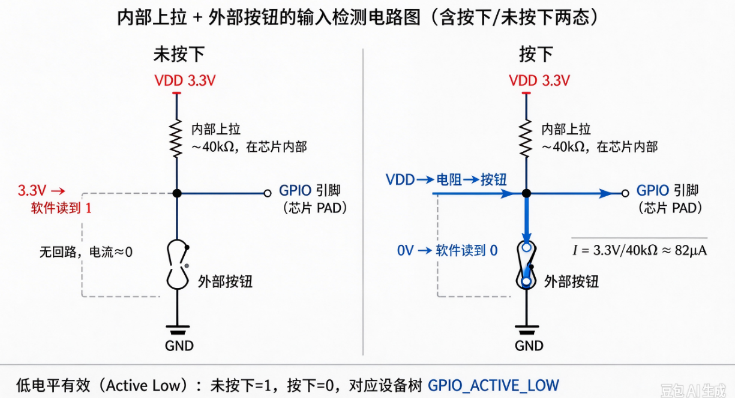
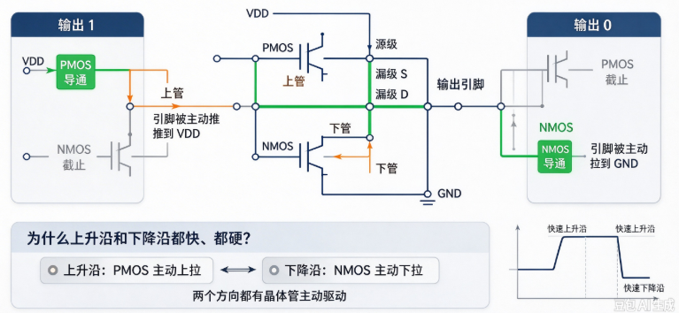
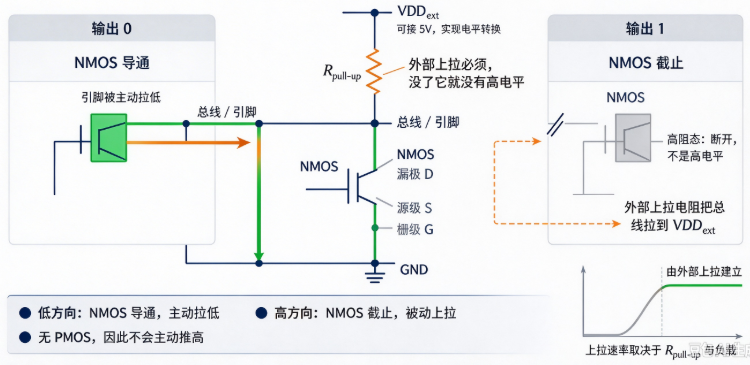
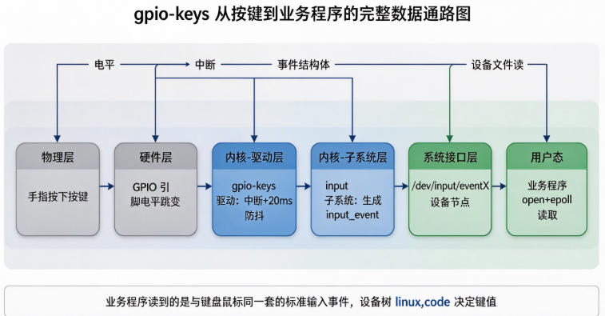

# B-B.2.1 GPIO 通用输入输出

> 所属章节：第五部 B. 总线协议 > B-B.2 基础外设接口
>
> 难度：[B] Beginner | 预计阅读时间：45 分钟

## <span class="blue"> 本节导读

GPIO（General Purpose Input/Output，通用输入输出）是嵌入式系统中使用频率最高的硬件接口：点亮 LED、读取按键、驱动继电器、检测传感器状态，都经它完成。它没有帧格式、没有时序协议——GPIO 的"协议"就是电气层本身：电平阈值、驱动结构、上下拉、中断触发方式。

本节默认读者是纯软件背景，没摸过原理图、没听过"MOSFET"。因此本章先做两件事：把软件工程师读 GPIO 所需的最低限度电气词汇补齐（电压、电阻、二极管、MOSFET 各一段），再在此基础上讲清 GPIO 的硬件结构。

本节覆盖：GPIO 引脚与控制器的基本结构、软件视角的电气学前备、四种工作模式（输入/输出/复用/模拟）的准确定义、浮空/上拉/下拉输入的工程用法、推挽与开漏输出的结构差异、驱动电流与 ESD 等电气边界、GPIO 中断与防抖机制，以及 Linux 侧的两条使用路径——产品正道的设备树现成驱动（gpio-keys/gpio-leds + input/LED 子系统）与原型调试用的 libgpiod 用户态直控。

---

## <span class="blue"> GPIO 是什么：引脚、控制器、寄存器

从软件视角看，GPIO 控制器是挂在片上总线（通常是 APB，见 B-A.1.1）上的一个寄存器块。CPU 像访问内存一样读写这组寄存器，就能控制引脚电平、读回引脚状态。一组寄存器 typically 管理 8~32 个引脚，称为一个 bank；一个 SoC 上有多个 bank，Linux 里每个 bank 对应一个 GPIO 控制器设备。

一个 GPIO 引脚从硅片到板子的路径是：芯片内部的 GPIO 模块 → 引脚焊盘（PAD，芯片封装上那个金属触点）→ 封装键合 → PCB 走线 → 外部器件。软件配置的每一个选项（方向、上下拉、驱动强度），最终都落在 PAD 内侧那小块电路的晶体管开关状态上。


<!-- 【待补图】images/B-B.2.1-GPIO引脚内部结构框图.png（优先级：★必要）
图名：GPIO 引脚内部结构框图（软件视角标注版）
生图提示词：工程框图，白底，横向数据流从左到右。最左侧画一个"APB 总线"粗横条，向下引出到一组标注为"配置/数据寄存器组"的寄存器阵列（画 4 个小方块，分别标注：方向寄存器 DIR、输出数据寄存器 DOUT、输入数据寄存器 DIN、上下拉/速度配置寄存器 CFG）。寄存器阵列右侧画一个大的虚线框标注"单个引脚的内部电路（每个引脚一份）"，框内从上到下四条通路：①输入通路：PAD → 施密特触发器（画六边形符号标注"数字输入缓冲"）→ DIN；②上拉/下拉通路：CFG 控制两个电阻（锯齿符号）分别接 VDD 和 GND，汇到 PAD，标注"可配置弱上拉/弱下拉 40kΩ 级"；③输出通路：DOUT → 输出驱动器（画一对上下堆叠的 MOSFET 符号，标注"推挽/开漏输出级"）→ PAD；④复用通路：一个多路选择器 MUX 符号（梯形）串在 PAD 前，标注"复用选择：GPIO 模式或外设模式（UART/SPI/I2C）"。虚线框最右端画 PAD 焊盘（实心方块），向右引出标注"封装引脚 → PCB"。所有模块用中文标注，关键节点用小字注释"软件写的每一位，最终都是这里某个晶体管的开关状态"。扁平矢量工程图风格，VDD 红色、GND 黑色、信号路径深蓝色。比例 16:9。 -->

---

## <span class="blue"> 电气学前备：软件工程师的最低硬件词汇

后面每一节都会用到这六个词。每个只讲工程上够用的程度。

### 电压、电流、电阻与欧姆定律

- **电压**（单位 V）：两点之间的电位差。数字电路里说的"高电平 3.3 V"，指该点相对 GND（电源地，0 V 参考点）的电位差是 3.3 V。芯片的供电轨（1.8 V、3.3 V、5 V）就是它认定"高电平"的基准。
- **电流**（单位 A/mA/μA）：流过导体的电荷速率。GPIO 的"驱动电流 8 mA"指它对外输出或吸入电流的上限，超过就发热、损坏。
- **电阻**（单位 Ω/kΩ/MΩ）：阻碍电流的能力。三者的关系是**欧姆定律：电压 = 电流 × 电阻（V = I × R）**。知道其中两个量就能算第三个，本章所有电气计算都是这一个公式的变形。

### 分压：两个串联电阻

两个电阻串联接在电压两端，中间节点的电压按阻值比例分配：

```
V_中 = V_总 × R2 / (R1 + R2)
```

例：5 V 经 R1=10 kΩ、R2=12 kΩ 分压，中间点 = 5 × 12/(10+12) ≈ 2.73 V。

后文"上下拉与外部电路冲突"和"电平转换"两次用到这个计算。

### 二极管：单向导通器件

二极管有两个极：阳极和阴极。电流只允许从阳极流向阴极（正向，且电压差超过约 0.3~0.7 V 才导通），反向则阻断。

工程上用它做两件事：整流（与本章无关）和**钳位泄流**——GPIO 的 ESD 保护就是后者：引脚电压一旦高过 VDD+0.3 V，钳位二极管正向导通，把多余电荷泄到电源轨，保护内部电路。


### MOSFET：电压控制的开关


MOSFET 是数字电路的基本开关器件，三个端子：栅极（G，控制端）、漏极（D）、源极（S）。栅极电压决定漏源之间导通还是断开，**几乎不消耗控制电流**。<br>
分两种互补的型号：

| 型号 | 导通条件 | 在 GPIO 输出级里的角色 |
|------|----------|------------------------|
| NMOS | 栅极相对源极为高电平时导通 | 源极接 GND，导通时把引脚拉到低电平 |
| PMOS | 栅极相对源极为低电平时导通 | 源极接 VDD，导通时把引脚推到高电平 |

"推挽输出用一对互补 MOSFET"这句话的含义就是：PMOS 和 NMOS 上下叠放，同一时刻只导通一个，分别负责把引脚拉高和拉低。后文展开。

### 高阻态

高阻态（Hi-Z）不是高电平，而是**断开**：输出级全部截止，引脚对外呈现 MΩ 级阻抗，既不输出也不吸收电流，电平由外部电路决定。

开漏输出的"输出 1"、输入模式的引脚、总线上暂时不说话的设备，都处于高阻态。它是多设备共享一根线的电气前提。

---

## <span class="blue"> 四种工作模式

一个 GPIO 引脚同一时刻只能工作在一种模式。四种模式的本质区别是**引脚的控制权在谁手里、内部哪条通路被接通**：

| 模式 | 引脚控制权 | 数字输入缓冲器 | 典型用途 |
|------|------------|----------------|----------|
| 输入 | GPIO 模块（读路径） | 开 | 按键、开关、传感器数字输出 |
| 输出 | GPIO 模块（写路径） | 无关 | LED、继电器、蜂鸣器 |
| 复用（Alternate Function） | 片上外设控制器 | 开 | UART TX/RX、SPI、I2C、PWM |
| 模拟 | ADC/DAC | **关** | 模拟量采集、模拟输出 |

### 输入与输出

输入模式接通"PAD → 数字输入缓冲 → 输入数据寄存器"通路，软件读寄存器得到 0 或 1；输出模式接通"输出数据寄存器 → 输出驱动器 → PAD"通路，软件写寄存器改变引脚电平。这两种模式软件每天都用，不展开。

### 复用模式：引脚是个可切换的接线端子

芯片引脚数量远比片上外设的信号数量少，所以同一个引脚内部接到一个**多路选择器（MUX）**上：MUX 的一边是 GPIO 模块，另一边是 UART、SPI、I2C 等外设控制器的信号线。配置为复用模式后，引脚与 GPIO 模块断开、改接指定外设，CPU 通过 GPIO 数据寄存器读写这个引脚就**不再有任何效果**——信号由外设控制器直接驱动。

一个引脚通常支持多种复用功能，编号 AF0/AF1/…/AF7，具体哪个引脚能复用成什么，查芯片数据手册的引脚功能表（Pin Function Table）。Linux 里这项工作由 pinctrl 子系统完成，设备树里写作 `pinctrl-0 = <&i2c1_pins>;`——它的全部含义就是"把这些引脚的 MUX 拨到 I2C 位置"。第 12 章展开 pinctrl 机制。

### 模拟模式：接到 ADC，不是"软件模拟协议"

模拟模式把引脚从数字电路域切到模拟电路域：PAD 直接连到 ADC（模数转换器）的采样保持电路上。<BR>
此时**必须关闭数字输入缓冲**——数字缓冲内部是一对互补晶体管，当输入电压处于中间电平（既不是明确的高也不是明确的低）时两个管子会同时微导通，形成从 VDD 到 GND 的持续穿通电流，既增加功耗又干扰采样精度。模拟信号恰恰大部分时间停在中间电平，所以缓冲器必须关掉。

> ⚠️ 名字容易撞车：**"模拟模式"与"GPIO 模拟 I2C"是两件完全无关的事**。<BR>
> 前者是上面说的硬件通路切换；后者（正式名称 bit-banging，位敲打）是用两个**输出模式**的 GPIO，由软件按 I2C 时序手动翻转电平，在没有 I2C 控制器的场合救急用。bit-banging 全程是数字输出，与 ADC 无关，配置时选的仍然是输出模式。


<!-- 【待补图】images/B-B.2.1-四种工作模式信号通路.png（优先级：△有更好）
图名：GPIO 四种工作模式的内部信号通路对比图
生图提示词：工程示意图，白底，2×2 四宫格，每格画同一个简化引脚框图（PAD 方块在右，内部左到右三条通路：上方"输入缓冲→DIN"、中间"MUX 选择器"、下方"输出驱动←DOUT"），用高亮蓝色粗线标出每格激活的通路、灰色细线表示断开的通路。左上"输入模式"：高亮 PAD→输入缓冲→DIN，标注"软件读寄存器"；右上"输出模式"：高亮 DOUT→输出驱动→PAD，标注"软件写寄存器"；左下"复用模式"：MUX 拨到"外设"侧，高亮 PAD→外设控制器（画一个标注 UART/SPI/I2C 的方块），GPIO 模块灰色，标注"GPIO 读写失效"；右下"模拟模式"：PAD 直连一个标注"ADC 采样保持"的方块，数字输入缓冲画红色叉标注"必须关闭（穿通电流）"。每格底部一行小字注明典型用途：按键/LED/UART/电压采集。中文标注，扁平矢量风格。比例 16:9。 -->

---

## <span class="blue"> 输入模式：浮空、上拉、下拉

输入模式要回答的问题只有一个：**外部不驱动这个引脚的时候，它是几？** 三个选项给出三种答案。

### 浮空输入：外部不给，就是未知数

浮空输入（floating，硬件工程师口头也叫"悬空"，与 CPLD/FPGA 同事说的"管脚悬空"是同一个东西）不接任何内部电阻，引脚电平完全由外部驱动决定。此时输入阻抗高达数十 MΩ——阻抗越高越容易拾取环境电磁干扰，外部不接驱动源时，读到的值随机跳变，手指靠近 PCB 都可能改变读数。

> ⚠️ 除非外部电路有明确且稳定的驱动源（对方芯片的输出脚、已装好上拉的连接器），不要使用浮空输入。产品上因浮空引脚误触发中断导致的灵异故障，定位成本远高于一个电阻。

### 上拉输入与按钮检测

上拉输入经内部电阻（典型 30~50 kΩ）将引脚默认拉到高电平：外部不驱动时读到 1，外部把引脚短接到地时读到 0。最经典的应用是按钮检测：



这种"未按下为高、按下为低"的接法称为**低电平有效（Active Low）**，对应设备树里的 `GPIO_ACTIVE_LOW`。下拉输入逻辑相反，用于"触发时输出高电平"的传感器。82 μA 那个计算就是欧姆定律：按下时 3.3 V 全部加在 40 kΩ 上。


<!-- 【待补图】images/B-B.2.1-上拉输入按钮检测电路.png（优先级：★必要）
图名：内部上拉 + 外部按钮的输入检测电路图（含按下/未按下两态）
生图提示词：电路原理示意图，白底，左右两联画同一个电路的两种状态。共同电路：顶部 VDD（3.3V，红色）向下接锯齿电阻符号（标注"内部上拉 ~40kΩ，在芯片内部"），电阻下端节点向右引出标注"GPIO 引脚（芯片 PAD）"，节点向下接按钮开关符号（标注"外部按钮"），按钮下端接 GND（黑色接地符号）。左联"未按下"：开关画成断开状态，节点处标注红色"3.3V → 软件读到 1"，电流路径画灰色虚线标注"无回路，电流≈0"。右联"按下"：开关画成闭合状态，用蓝色箭头画出电流路径 VDD→电阻→按钮→GND，节点处标注"0V → 软件读到 0"，旁边公式小字"I = 3.3V/40kΩ ≈ 82μA"。底部一行注释："低电平有效（Active Low）：未按下=1，按下=0，对应设备树 GPIO_ACTIVE_LOW"。中文标注，标准电路符号，扁平矢量风格。比例 16:9。 -->

### 上下拉与外部电路冲突

内部上下拉阻值大（通常在 30 kΩ ~ 50 kΩ 级），属于"弱"拉。它只负责在"引脚悬空、无人驱动"时提供一个默认电平；一旦外部存在明确驱动或偏置电阻，内部上下拉就无法与之对抗，二者会构成串联分压。

一个典型的配置错误场景：外部电路通过限流电阻接入 5 V，而软件误将该引脚配置为内部下拉。

```
外部 5V --[10kΩ]--+-- GPIO 引脚
                  |
              [40kΩ]  内部下拉（误配置打开了）
                  |
                 GND

引脚实际电压 = 5V × 40k / (10k + 40k) = 4.0 V
```

这里同时触发了两个问题：

1. **电平误判**：内部下拉并没有把引脚拉到 GND，反而和外部 10 kΩ 电阻分压，得到一个 4.0 V 的"中间电平"。对 3.3 V 供电的芯片来说，这通常已超出 CMOS 输入的低电平门限，逻辑上会被判为高电平——下拉没有起到"拉低"的作用。

2. **引脚超压**：4.0 V 已超出 3.3 V 引脚的绝对耐压上限（VDD + 0.3 V ≈ 3.6 V）。引脚内部接 VDD 的 ESD 保护二极管会被正向导通，电流持续灌入芯片电源域，轻则电源轨被顶高导致功能紊乱，重则二极管过热击穿（后文展开）。

> 注意：这个例子中的 5 V 接入本身已违反 3.3 V GPIO 的电平规范。正确的做法应是电平转换或开漏配合外部 3.3 V 上拉。此处用它只是想说明：**内部上下拉绝不是用来"对抗"外部高电压的**——它只会和外部电阻分压，既拉不到预期电平，还可能引入额外风险。


---

## <span class="blue"> 输出模式：推挽与开漏

输出模式只有一个问题：**高电平和低电平，分别是怎么产生的？** 两种结构给出两种答案，这一节是本章电气部分的重心。

### 推挽输出：两个方向都主动

推挽（push-pull）输出级是一对的互补 MOSFET：PMOS 在上（源极接 VDD）、NMOS 在下（源极接 GND），两管漏极相连引出到引脚。<br>
输出 1 时 PMOS 导通、NMOS 截止，引脚被主动推到 VDD；输出 0 时 NMOS 导通、PMOS 截止，引脚被主动拉到 GND。<br>
两个方向都有晶体管主动驱动，所以上升沿和下降沿都快、都硬。



关键参数（以 3.3 V 供电的典型 SoC GPIO 为例，具体数值以本芯片数据手册为准）：

| 参数 | 典型值 | 含义 |
|------|--------|------|
| 驱动电流 I_OL / I_OH | 8 mA | 单引脚吸入/输出电流上限 |
| 导通电阻 R_ON | 20~50 Ω | 满载时产生 0.3~0.4 V 压降 |
| 总电流 | 受 VDD/VSS 引脚限制 | 多引脚同时驱动需合计核算 |

> ⚠️ 两个推挽输出引脚短接，一个输出高、一个输出低，相当于 VDD 经两个导通电阻直连 GND：短路电流 ≈ 3.3V / 50Ω ≈ 66 mA，远超 8 mA 额定值，微秒级即可损坏输出级。<br>
> 软件配置错误（两个驱动抢同一引脚、一个配输出高一个配输出低）同样会制造这个场景。

### 开漏输出：只会拉低，不会推高

开漏（open-drain）输出级只有 NMOS，没有 PMOS：输出 0 时 NMOS 导通把引脚拉低；输出 1 时 NMOS 截止，引脚进入**高阻态**——复习前备词汇：高阻态是断开，不是高电平。要得到高电平，必须靠**外部上拉电阻**把线拉上去。



### 线与（Wired-AND）：用软件语言解释

多个开漏输出并联在同一根线上，外加一个公共上拉电阻，就构成"线与"。用软件语言说：**这根线是一个共享变量，任何设备都能把它写成 0，只有所有设备都放手（写 1，即截止）时它才是 1**。只要有一个设备在拉低，上拉电阻就输——因为它要对抗的是直接短接到 GND 的晶体管。

这个特性的工程价值：

1. **总线仲裁**：多个主设备共享总线时，谁想发言谁拉低，天然避免推挽结构"一个推高一个拉低"的短路事故。I2C 的总线仲裁与 ACK 机制就建立在这个电气特性上（详见 B-B.3.1）
2. **电平转换**：上拉电阻接到 5 V，3.3 V 的 GPIO 就能输出 5 V 逻辑——因为它从不主动输出高电平，高电平是上拉给的，上拉接几伏就是几伏

> ⚠️ 开漏输出忘了接上拉电阻，引脚在输出 1 时是悬浮的高阻态，读数随杂散电容与漏电流漂移，完全不可预期。开漏必配上拉，这是硬性前提。


<!-- 【待补图】images/B-B.2.1-推挽与开漏输出级结构对比.png（优先级：★必要）
图名：GPIO 推挽输出与开漏输出的输出级电路结构对比图
生图提示词：电路原理示意图风格，白底，左右两联对比排版。左联"推挽输出"：画出互补 MOSFET 对——上方 PMOS 源极接 VDD（标注 3.3V），下方 NMOS 源极接 GND，两管漏极相连引出到右侧引脚焊盘（画方块标注 PAD），两管栅极连在一起标注"来自输出寄存器"；旁边用小箭头标注"输出1：PMOS 导通推向 VDD"和"输出0：NMOS 导通拉向 GND"。右联"开漏输出"：只有下方 NMOS（源极接 GND，漏极接引脚 PAD），上方断开处画虚线框标注"无 PMOS，输出1=高阻态（断开，不是高电平）"；引脚外侧画出外部上拉电阻（锯齿电阻符号）接到 VDD_ext（标注"可接 5V→电平转换"），标注"必须外接"。两联下方各一行小字：左"双向主动驱动，禁止两个推挽脚对短"；右"线与 Wired-AND：任一拉低则总线为低（I2C 的电气基础）"。MOSFET 用标准电路符号，VDD 红色、GND 黑色、信号路径深蓝色，中文标注，扁平矢量工程图风格。比例 16:9。 -->

---

## <span class="blue"> 电气边界：驱动电流、速度、ESD、电平兼容

### 速度等级与 EMI

GPIO 控制器通常提供"速度档位"配置（2/10/50 MHz 之类），它控制的是输出驱动器给栅极充放电的电流：档位越高，输出电平的**边沿**（从 0 变 1 的过渡时间）越陡，能驱动的翻转频率越高。

代价有两个。**EMI**（Electromagnetic Interference，电磁干扰）：1 ns 级陡边沿包含的高频分量可达数百 MHz，经 PCB 走线辐射出去，干扰板上模拟电路和无线模块。**过冲**（overshoot）：边沿太陡时电平会冲出目标值再振铃回来，严重时触发对方器件的误动作。

选型原则是够用就好：驱动 LED/继电器用最低档，高速数字接口（SPI Flash、SDIO、RMII 网口）才需要高档位。给低速负载配高速档位，只有 EMI 和功耗的代价，没有任何收益。

### ESD 保护与钳位二极管

ESD（Electrostatic Discharge，静电放电）是人体或设备接触引脚时瞬间释放的静电，电压可达数千伏、持续时间纳秒级。每个 GPIO 引脚内部有两个钳位二极管做防线：引脚电压超过 VDD+0.3 V 时，上方二极管正向导通把电荷泄到 VDD；低于 -0.3 V 时，下方二极管导通泄到 VSS。

关键认知：**它们的设计目的是吸收纳秒级瞬态能量，只能承受几 mA 的持续电流**。把 5 V 信号经 10 kΩ 串联电阻接到 3.3 V 引脚，二极管导通电流约 (5-3.3-0.3)V/10kΩ ≈ 0.14 mA，尚可承受；直连则电流超 10 mA，保护电路烧毁，继而损坏内部 CMOS 电路。静电防得住，持续的过压防不住。


<!-- 【待补图】images/B-B.2.1-ESD钳位二极管保护结构.png（优先级：★必要）
图名：GPIO 引脚 ESD 钳位二极管保护结构与 5V 直连/串阻对比图
生图提示词：电路原理示意图，白底，左右两联。共同部分：中央画 GPIO 引脚焊盘 PAD（方块），PAD 内侧画两个反向钳位二极管——上方二极管阳极接 PAD、阴极接 VDD（3.3V），下方二极管阴极接 PAD、阳极接 VSS（GND），PAD 向右标注"到内部 CMOS 电路（脆弱）"。左联"5V 直连（危险）"：左侧画 5V 信号源直连 PAD，上方二极管画成红色高亮并标注"持续导通 >10mA → 烧毁"，旁边画闪电符号与红色叉。右联"5V 经 10kΩ 串阻（可承受）"：信号源与 PAD 之间画串联电阻（标注 10kΩ），二极管标注"导通电流约 0.14mA，安全"，画绿色勾。底部一行小字："设计目的：吸收静电的纳秒级瞬态，不是持续过压的稳压器"。电路符号标准画法，危险用红色、安全用绿色，中文标注，扁平矢量风格。比例 16:9。 -->

### 5V 容忍引脚（FT）

部分引脚标记为 FT（5V-Tolerant）：内部去掉了接 VDD 的钳位二极管，输入模式可承受最高 5.5 V。注意两点：FT 只限输入（输出高电平仍是 VDD 电平，不会变成 5 V）；是否 FT 必须逐个引脚查数据手册，不能按"这个系列大部分引脚是 FT"推断。

### 电平兼容矩阵

不同供电轨的器件互连时，先查这张表的关系，再决定要不要电平转换芯片：

| 外部设备 | 3.3V GPIO 读它 | 3.3V GPIO 驱动它 | 结论 |
|----------|----------------|-------------------|------|
| 5V TTL | 输出 2.4V 即可被识别 ✓ | 3.3V > TTL 高电平阈值 2.0V ✓ | 直接连 |
| 5V CMOS | 输出 3.5V，3.3V 侧读不了 ✗ | 3.3V < 其阈值 3.5V ✗ | 需电平转换 |
| 1.8V CMOS | 1.8V 低于 3.3V 侧阈值，不可靠 ✗ | 3.3V 对它是过压 ✗ | 需电平转换 |

低速单向场景可用电阻分压做 3.3V→1.8V 的降级（R1=10kΩ/R2=12kΩ 分压出约 1.8 V，就是前备里的分压公式），但 RC 延迟不适用于 MHz 级信号；双向通信（如 1.8V 的 I2C）应使用 TXS0108E/TXB0108 类专用电平转换芯片。

---

## <span class="blue"> GPIO 中断与防抖

### 先讲中断是什么

轮询（polling）是软件循环读引脚电平——CPU 一刻不停地问"变了没有"，绝大多数时候答案是没有，算力全烧在等待上。**中断**把这个关系倒过来：硬件监测引脚，电平发生指定变化时主动给 CPU 发信号，CPU 放下手头工作去执行一段注册好的处理函数（ISR），处理完再回来。

GPIO 中断的全部意义就是"按键按下之前，CPU 不用守着它"。Linux 中断子系统的完整机制是第 10 章的内容，本节只讲 GPIO 这一段的特性。

### 触发方式

"电平发生指定变化"里的"指定"，就是触发方式的配置：

| 触发方式 | 语义 | 适用场景 |
|----------|------|----------|
| 上升沿 | 低→高跳变的瞬间触发一次 | 脉冲检测 |
| 下降沿 | 高→低跳变的瞬间触发一次 | 按键（低电平有效接法） |
| 双边沿 | 两个方向的跳变都触发 | 电平变化监测、旋转编码器 |
| 高/低电平 | 电平持续期间持续触发 | 告警类信号（不消除就一直报） |

机械按键推荐单边沿（下降沿）触发：按下瞬间触点抖动会产生多次来回跳变（下一节展开），双边沿触发会把一次按键计成十几次。


<!-- 【待补图】images/B-B.2.1-中断触发方式波形.png（优先级：△有更好）
图名：GPIO 中断四种触发方式的波形对比图
生图提示词：数字波形示意图，白底，四条上下排列的波形共享同一时间横轴，每条波形都是同一段"高电平→低电平→高电平→低电平"的方波。波形一"上升沿触发"：只在每个上升沿位置画红色竖箭头和圆点；波形二"下降沿触发"：只在下降沿画箭头；波形三"双边沿触发"：上升下降沿都画箭头；波形四"低电平触发"：低电平区间用红色底纹整段填充，标注"持续期间反复触发，直至电平撤销"。每条波形左侧中文标注名称与一句适用场景小字（脉冲检测/按键/编码器/告警）。波形深蓝色，触发标记红色，中文标注，扁平矢量风格。比例 16:9。 -->

### 从 MCU 的 EXTI 到 Linux 的中断链

MCU 裸机开发中，外部中断由 EXTI 模块管理，同编号引脚共享一条 EXTI 线（PA0/PB0/PC0 互斥，同一时刻只能选一个）。

到 Linux 下，这条链路由三层组成：

1. GPIO 控制器本身注册为中断控制器（设备树中带 `interrupt-controller` 属性），把引脚边沿转换为中断
2. 中断经 `interrupt-parent` 上报到 GIC（ARM）或 PLIC（RISC-V）
3. 驱动经 `gpiod_to_irq()` 或设备树 `interrupts` 属性获得 Linux 中断号，注册处理函数——第 10 章的完整中断机制在此衔接

RK3568 的 GPIO 控制器节点（`rk356x.dtsi` 摘录）：

```dts
gpio1: gpio@fe740000 {
    compatible = "rockchip,gpio-bank";
    reg = <0x0 0xfe740000 0x0 0x100>;              // 寄存器块基地址与长度
    interrupts = <GIC_SPI 66 IRQ_TYPE_LEVEL_HIGH>; // 本控制器上报给 GIC 的中断号
    gpio-controller;                               // 身份一：我是 GPIO 提供者
    #gpio-cells = <2>;                             // 引用我时给两个参数：引脚号+标志
    interrupt-controller;                          // 身份二：我是中断控制器
    #interrupt-cells = <2>;                        // 中断引用参数：引脚号+触发方式
};
```

`gpio-controller` 与 `interrupt-controller` 双重身份，正是"GPIO 既能当数据引脚又能当中断源"在设备树里的表达。


### 防抖：机械触点不是理想开关

机械按键的金属触点闭合时不是一次到位，而是像球落地一样弹跳几次才稳定——示波器上看到按下瞬间的电平是一串密集毛刺，持续 5~20 ms。不做处理，一次按下就是十几次中断。两级防线：

- **硬件防抖**：按钮并联 RC 滤波（如 10 kΩ + 100 nF，时间常数 τ=1 ms；劣质开关加大到几十 ms），电容充放电把毛刺物理抹平成圆滑过渡
- **软件防抖**：检测到边沿后不立刻认定，延时 10 ms 再读一次电平确认；Linux 设备树可直接写 `debounce-interval = <20>`（单位 ms），由 gpio-keys 驱动在内核态完成防抖，业务代码无感

> 💡 工业场景采用硬件 RC + 软件延时双保险。单独软件防抖在强电磁干扰环境下不可靠（干扰尖峰可能恰好落在确认时刻）；单独硬件防抖在元件老化后裕量下降。


<!-- 【待补图】images/B-B.2.1-按键抖动与两级防抖.png（优先级：★必要）
图名：机械按键抖动波形与硬件/软件两级防抖原理图
生图提示词：数字波形示意图，白底，三个上下排列的波形共享同一时间横轴（标注 0~40ms）。波形一"原始按键信号"：按下时刻电平从高到低跳变，但跳变沿前后画出密集的高低毛刺（抖动，标注"触点抖动 5~20ms"），毛刺区用红色底纹框出，标注"若直接触发中断：一次按下=十几次中断"。波形二"经 RC 硬件防抖"：同样时刻电平缓慢指数下降（画出 RC 充放电曲线，时间常数 τ=1ms），毛刺被抹平成圆滑过渡，标注"RC 滤波物理抹平"。波形三"软件防抖判定"：在首次边沿处画竖虚线标注"检测到边沿，启动 10ms 计时"，10ms 后再画一条竖虚线标注"延时到，重新读电平确认"，两条线之间用灰色区间填充标注"防抖窗口，期间毛刺被忽略"，窗口后标注"确认按下，上报一次事件"。波形用深蓝色，抖动区红色强调，防抖窗口灰色，中文标注，扁平矢量风格。比例 16:9。 -->

---

## <span class="blue"> Linux 中的 GPIO：产品路径与用户态路径

Linux 下用 GPIO 有两条路径，选哪条由"这是不是产品代码"决定：

| 路径 | 做法 | 用户态代码的角色 | 适用场合 |
|------|------|------------------|----------|
| A. 设备树 + 现成驱动 | 设备树描述，gpio-keys/gpio-leds/gpio-hog 驱动完成中断、防抖、电平 | 纯业务：读 input 事件、写 LED 亮度文件 | 量产产品的按键、状态灯、复位线 |
| B. libgpiod 用户态直控 | 用户态打开 /dev/gpiochipN，自己配方向/边沿/防抖 | 半个驱动 + 业务混在一起 | 原型验证、调试脚本、非标准信号 |

BSP 视角的默认答案是路径 A：**按键和 LED 是驱动的事，epoll 是业务的事，两者不该混在一起写。** 路径 B 绕过 input 子系统，换来不改设备树、即写即跑的便利，代价是分层模糊。本节按"A 为主、B 为辅"组织，先讲两条路径共同的地基 gpiolib。

### gpiolib 框架：gpiochip 与 offset（两条路径共同的地基）

gpiolib 是内核的 GPIO 子系统，它做的事和本书第 11 章的设备模型一脉相承：把各厂商五花八门的 GPIO 控制器抽象成统一接口。分层如下：

```
用户态     libgpiod 库 / gpiodetect 等命令行工具
           ↓ ioctl 系统调用
字符设备   /dev/gpiochip0, /dev/gpiochip1, ...   ← 每个控制器一个节点
           ↓
gpiolib    gpio_chip（控制器抽象）→ gpio_desc（单个引脚描述符）
           ↓ 内核内部 API：gpiod_get / gpiod_set_value / gpiod_to_irq ...
驱动层     gpio-keys / gpio-leds / gpio-hog / 各外设驱动
           ↓
硬件       GPIO 控制器（APB 总线上的寄存器块，见 B-A.1.1）
```

两个必须建立的认知。<br>
**第一，引脚编号是"控制器内偏移号（offset）"**：芯片手册说"GPIO1_B0"，在 Linux 里表达为 gpiochip1 的 offset 8（B 组是第 2 组，每组 8 个，8×1+0=8——具体换算查内核 dtsi 里各 bank 的次序）。不再是 sysfs 时代的全局连续编号。<br>
**第二，引脚是独占资源**：一个引脚被某个驱动或用户态程序请求（request）后，别人再请求会失败——`gpioinfo` 看到的 `used` 列就是当前占用者。

驱动侧的样子（以 GPIO 控制器驱动注册为例，看懂结构即可，写法细节在 D 扩展 GPIO 子系统篇展开）：

```c
static int my_gpio_probe(struct platform_device *pdev)
{
    struct gpio_chip *gc;

    gc = devm_kzalloc(&pdev->dev, sizeof(*gc), GFP_KERNEL); // 分配控制器对象
    gc->label    = "my-gpio";        // gpioinfo 里显示的名字
    gc->base     = -1;               // -1 = 由内核自动分配，现代写法不指定
    gc->ngpio    = 32;               // 本控制器管理 32 个引脚
    gc->parent   = &pdev->dev;       // 挂到设备模型上
    gc->direction_input  = my_dir_in;   // 回调：把引脚配成输入
    gc->direction_output = my_dir_out;  // 回调：配成输出并设初值
    gc->get      = my_get;           // 回调：读引脚电平
    gc->set      = my_set;           // 回调：写引脚电平

    return devm_gpiochip_add_data(&pdev->dev, gc, NULL); // 注册后 /dev/gpiochipN 出现
}
```

用户态程序不直接面对这些回调——它打开 `/dev/gpiochipN`、按 offset 请求引脚，gpiolib 在内部把操作路由到对应控制器的回调上。

> 💡 旧接口 `/sys/class/gpio`（`echo N > export` 那套）已废弃：内核 4.8 标记 deprecated，6.x 内核的发行版大多不再编译 `CONFIG_GPIO_SYSFS`。存量脚本迁移到 `gpioset`/`gpioget` 或设备树方案即可，新代码不要再学它。

### 路径 A：设备树 + 现成驱动（产品正道）

内核自带三个驱动，覆盖 GPIO 最高频的三种用途。在设备树里描述硬件，驱动自动接管，一行驱动代码都不用写：

```dts
/ {
    // 按键：gpio-keys 驱动把它注册成标准输入事件
    gpio_keys: gpio-keys {
        compatible = "gpio-keys";

        button_start: button-start {
            label = "start";                        // 事件来源名
            gpios = <&gpio1 8 GPIO_ACTIVE_LOW>;     // gpiochip1 偏移8，按下=低
            linux,code = <KEY_F1>;                  // 上报成 F1 键事件
            debounce-interval = <20>;               // 内核态 20ms 防抖
        };
    };

    // LED：gpio-leds 驱动把它注册到 LED 子系统
    gpio_leds: gpio-leds {
        compatible = "gpio-leds";

        led_status: led-status {
            label = "status:green";
            gpios = <&gpio1 9 GPIO_ACTIVE_HIGH>;
            default-state = "on";
            linux,default-trigger = "heartbeat";    // 心跳触发器：内核自动闪烁
        };
    };
};
```

`gpio-keys` 的数据通路值得画清楚，因为它是"硬件 → 内核 → 业务程序"完整链条的最小样本：

```
按键按下 → GPIO 引脚电平跳变 → GPIO 控制器产生中断
        → gpio-keys 驱动在中断里做防抖、确认电平
        → 上报 input 事件到输入子系统
        → 出现 /dev/input/eventX 设备节点
        → 业务程序 open + epoll 监听（第 11 章 input 子系统的入口）
```

业务程序读到的是标准输入事件（`struct input_event`），和键盘鼠标同一套接口——这就是"按键变成 F1"的含义。`gpio-leds` 同理把 LED 交给 LED 子系统，`heartbeat` 触发器由内核定时器驱动自动闪烁。第三个驱动 `gpio-hog` 用于"这根线必须固定为高/低"的场合（如上电即保持的复位线），在设备树里直接钉死电平。



#### 路径 A 的业务代码：只读事件，不碰 GPIO

硬件侧全部就绪后，业务程序只是 input 子系统的一个读者。先找到 gpio-keys 注册出的节点：

```bash
cat /proc/bus/input/devices
```

```
N: Name="gpio-keys"
P: Phys=gpio-keys/input0
H: Handlers=kbd event0
```

`Handlers` 里的 `event0` 就是设备节点 `/dev/input/event0`。业务代码（按键按下翻转 LED，LED 走 gpio-leds 的 sysfs 亮度文件）：

```c
/* key_led_biz.c — 路径 A 的业务代码：只读事件、只写亮度，不碰 GPIO */
#include <stdio.h>
#include <fcntl.h>
#include <unistd.h>
#include <linux/input.h>

#define KEY_DEV  "/dev/input/event0"                       /* 上面查到的节点 */
#define LED_DEV  "/sys/class/leds/status:green/brightness" /* gpio-leds 注册的亮度文件 */

int main(void)
{
    int kfd = open(KEY_DEV, O_RDONLY);
    if (kfd < 0) { perror(KEY_DEV); return 1; }

    struct input_event ev;
    char led = '0';

    printf("等待按键...\n");
    /* read 阻塞等事件；要同时监听多路就换 epoll，fd 用法完全一样 */
    while (read(kfd, &ev, sizeof(ev)) == sizeof(ev)) {
        if (ev.type != EV_KEY || ev.code != KEY_F1)
            continue;                 /* 只关心设备树里注册的那个键 */
        if (ev.value != 1)
            continue;                 /* value: 1=按下 0=松开 2=长按重复 */

        led = (led == '0') ? '1' : '0';
        int lfd = open(LED_DEV, O_WRONLY);
        write(lfd, &led, 1);          /* 写 '1' 亮、'0' 灭 */
        close(lfd);
        printf("按键按下，LED -> %s\n", led == '1' ? "亮" : "灭");
    }
    close(kfd);
    return 0;
}
```

编译运行：

```bash
gcc key_led_biz.c -o key_led_biz      /* 无额外依赖，不需要 -lgpiod */
./key_led_biz
```

预期输出（每按一次打印一行，LED 同步翻转）：

```
等待按键...
按键按下，LED -> 亮
按键按下，LED -> 灭
```

整份代码里没有一个 GPIO 字样——中断、防抖、电平、上拉全部在设备树和内核驱动里。这是量产代码该有的样子：**硬件变更改 dts，业务程序不动**。`ev.value` 的 2（长按重复）来自设备树里的 `autorepeat;` 属性，不需要就去掉它。

<!-- 【待补图】images/B-B.2.1-gpio-keys数据通路.png（优先级：△有更好）
图名：gpio-keys 从按键到业务程序的完整数据通路图
生图提示词：分层数据流图，白底，从左到右六个节点用箭头串联，每个节点画圆角矩形并标注所属层。节点1（物理层，灰色）："手指按下按键"；节点2（硬件层，灰色）："GPIO 引脚电平跳变"；节点3（内核-驱动层，蓝色）："gpio-keys 驱动：中断+20ms 防抖"；节点4（内核-子系统层，蓝色）："input 子系统：生成 input_event"；节点5（系统接口层，绿色）："/dev/input/eventX 设备节点"；节点6（用户态，绿色）："业务程序 open+epoll 读取"。每个箭头上方标注传递的内容：电平/中断/事件结构体/设备文件读。底部一行小字："业务程序读到的是与键盘鼠标同一套的标准输入事件，设备树 linux,code 决定键值"。中文标注，扁平矢量风格，层与层之间用浅色背景带区分。比例 16:9。 -->

### 路径 B：libgpiod 用户态直控（原型与调试）

路径 B 绕过 input 子系统：用户态直接打开 `/dev/gpiochipN`，自己配方向、边沿、防抖，自己 poll 等事件。它的定位要认清——**这是"快速原型"的写法，不是"量产产品"的写法**：你要在业务代码里同时干两件事，向内核下发硬件配置（半个驱动）和跑业务逻辑，分层是模糊的。

什么时候用它：原型验证（硬件刚到、驱动还没写）、产线测试脚本（不想为测试改设备树）、非标准信号（脉冲捕获、自定义时序——input 子系统假设你是"按键"，这类信号塞不进它的模型）。什么时候别用：量产产品里的标准按键与状态灯——那会丢掉 input 子系统的标准化收益（统一事件队列、多消费者分发、与键盘鼠标同接口），还让业务代码背上硬件配置。

#### 命令行工具：什么场景用哪条

libgpiod 附带的命令行工具是排障和临时验证的主力。按场景记：

**场景一：板子上有几个 GPIO 控制器？**

```bash
gpiodetect
```

```
gpiochip0 [gpio0] (32 lines)
gpiochip1 [gpio1] (32 lines)
```

**场景二：我这个引脚被谁占了、现在是什么状态？**（GPIO 排障的第一动作）

```bash
gpioinfo gpiochip1
```

```
gpiochip1 - 32 lines:
    line   8:      "GPIO1_B0"       input   active-high [used by "gpio-demo"]
    line   9:      "GPIO1_B1"      output   active-high [used]
```

`used` 列显示占用者名字。占用者不是你——八成是设备树里另一个节点（`gpio-hog`、某个外设驱动）先拿了，回设备树查 `gpios` 属性；方向不对——同样回设备树。

**场景三：临时点个灯/拉个电平试试：**

```bash
gpioset -c gpiochip1 9=1      # -c 守护模式：保持输出直到 Ctrl+C
                              # 不加 -c 则进程退出即释放，引脚回默认态——"灯闪一下就灭"的原因
gpioget gpiochip1 8           # 读一次 gpiochip1 偏移 8 的电平，打印 0 或 1
```

**场景四：监听按键事件，看时间戳：**

```bash
gpiomon --falling gpiochip1 8
```

```
event: FALLING EDGE offset: 8 timestamp: [  1234.567890123]
```

> 💡 没有硬件也能练：内核 `CONFIG_GPIO_SIM`（gpio-sim 模块）可在 PC 上虚拟出 gpiochip，用 configfs 定义引脚与连线后，上面的命令和下文的 libgpiod 程序不改一行即可跑通——学习阶段的全部实验都可以在虚拟环境完成。

#### libgpiod v2 代码示例（路径 B 的写法）

按键中断监听 + LED 控制的最小完整程序。v2 API 的核心模型是"配置对象 + 请求对象"：先描述每个引脚要什么（方向/上下拉/边沿/防抖），打包成一次请求交给内核，之后守着请求的文件描述符等事件。

```c
/* gpio_demo.c — libgpiod v2：按键(中断,20ms防抖) 翻转 LED */
#include <gpiod.h>
#include <stdio.h>
#include <poll.h>

#define CHIP       "/dev/gpiochip1"   /* 目标控制器节点 */
#define BTN_OFFSET  8                 /* 按键：控制器内偏移 8 */
#define LED_OFFSET  9                 /* LED：偏移 9 */

int main(void)
{
    /* ---- 1. 打开控制器 ---- */
    struct gpiod_chip *chip = gpiod_chip_open(CHIP);
    if (!chip) { perror("gpiod_chip_open"); return 1; }

    /* ---- 2. 按键引脚配置：输入 + 上拉 + 双边沿 + 20ms 防抖 ---- */
    struct gpiod_line_settings *btn_set = gpiod_line_settings_new();
    gpiod_line_settings_set_direction(btn_set, GPIOD_LINE_DIRECTION_INPUT);
    gpiod_line_settings_set_bias(btn_set, GPIOD_LINE_BIAS_PULL_UP);
    gpiod_line_settings_set_edge_detection(btn_set, GPIOD_LINE_EDGE_BOTH);
    gpiod_line_settings_set_debounce_period_us(btn_set, 20000); /* 单位是微秒 */

    /* ---- 3. LED 引脚配置：输出，初始灭 ---- */
    struct gpiod_line_settings *led_set = gpiod_line_settings_new();
    gpiod_line_settings_set_direction(led_set, GPIOD_LINE_DIRECTION_OUTPUT);
    gpiod_line_settings_set_output_value(led_set, GPIOD_LINE_VALUE_INACTIVE);

    /* ---- 4. 把两个引脚的配置打包，一次性向内核请求 ---- */
    struct gpiod_line_config *line_cfg = gpiod_line_config_new();
    unsigned int btn_off = BTN_OFFSET, led_off = LED_OFFSET;
    gpiod_line_config_add_line_settings(line_cfg, &btn_off, 1, btn_set);
    gpiod_line_config_add_line_settings(line_cfg, &led_off, 1, led_set);

    struct gpiod_request_config *req_cfg = gpiod_request_config_new();
    gpiod_request_config_set_consumer(req_cfg, "gpio-demo"); /* gpioinfo 的 used 列就显示它 */

    struct gpiod_line_request *req =
        gpiod_chip_request_lines(chip, req_cfg, line_cfg);
    if (!req) { perror("request_lines"); return 1; }  /* 引脚被占用时在这里失败 */

    /* ---- 5. 事件循环：poll 等边沿事件，读到就翻转 LED ---- */
    struct gpiod_edge_event_buffer *evbuf = gpiod_edge_event_buffer_new(16);
    struct pollfd pfd = {
        .fd = gpiod_line_request_get_fd(req),  /* 请求自带一个可 poll 的 fd */
        .events = POLLIN,
    };
    enum gpiod_line_value led = GPIOD_LINE_VALUE_INACTIVE;

    printf("等待按键...\n");
    while (poll(&pfd, 1, -1) > 0) {            /* 阻塞等事件，不烧 CPU */
        int n = gpiod_line_request_read_edge_events(req, evbuf, 16);
        for (int i = 0; i < n; i++) {
            struct gpiod_edge_event *ev =
                gpiod_edge_event_buffer_get_event(evbuf, i);
            if (gpiod_edge_event_get_line_offset(ev) != BTN_OFFSET)
                continue;                      /* 不是按键的事件，丢弃 */
            if (gpiod_edge_event_get_event_type(ev) ==
                GPIOD_EDGE_EVENT_FALLING_EDGE) {   /* 只在下降沿翻转 */
                led = (led == GPIOD_LINE_VALUE_ACTIVE)
                    ? GPIOD_LINE_VALUE_INACTIVE : GPIOD_LINE_VALUE_ACTIVE;
                gpiod_line_request_set_value(req, LED_OFFSET, led);
                printf("按键按下，LED -> %s\n",
                       led == GPIOD_LINE_VALUE_ACTIVE ? "亮" : "灭");
            }
        }
    }

    gpiod_line_request_release(req);   /* 释放引脚，别人才能再请求 */
    gpiod_chip_close(chip);
    return 0;
}
```

编译与运行：

```bash
gcc gpio_demo.c -o gpio_demo -lgpiod     # 链接 libgpiod
./gpio_demo
```

预期输出（每按一次按键打印一行，LED 同步翻转）：

```
等待按键...
按键按下，LED -> 亮
按键按下，LED -> 灭
```

与 1.x 时代的差异要点：不再有"逐引脚 request"，改为一次请求一组引脚；防抖、上下拉、边沿都收进 `gpiod_line_settings`，其中防抖经内核 `GPIO_V2_LINE_ATTR_DEBOUNCE` 落到底层——**控制器支持时由硬件完成，不再依赖用户态延时循环**。维护旧系统时注意：1.x 与 2.x API 互不兼容，`pkg-config --modversion libgpiod` 可查当前版本。

### 两条路径怎么选

| 场景 | 推荐 | 原因 |
|---|---|---|
| 板载按键、矩阵键盘 | A：gpio-keys + input | 分层清晰；多按键内核统一管理；事件进标准输入子系统 |
| 状态灯、电源灯 | A：gpio-leds + trigger | 零代码；heartbeat/mmc 等触发器现成 |
| 上电即固定电平的线（复位、使能） | A：gpio-hog | 设备树钉死，不依赖任何业务进程 |
| 原型验证、临时调试 | B：命令行 / libgpiod | 不改设备树、不编驱动，即写即跑 |
| 非标准信号（脉冲捕获、自定义时序） | B：libgpiod | input 模型塞不下这类信号 |
| 高频翻转（>10kHz）、硬实时 | 都不选：写内核驱动（D 扩展 GPIO 子系统篇） | 用户态路径的延迟与抖动扛不住 |

> 💡 判断口诀：先问"这是不是产品的常态功能"——是，进设备树走路径 A；只是调试、测试、救急，才用路径 B。表里最后一行是边界提醒：两条都是用户态路径，硬实时需求从一开始就该写内核驱动。

---

## <span class="blue"> 本节总结

GPIO 是最简单也最讲电气规矩的外设。结构上就两件事：引脚内部是个可切换的接线端子（四种模式决定它接给谁），输出级就两种结构（推挽双向主动驱动、开漏只拉不推）。开漏的两个不可替代价值——线与和电平转换——全部来自"高电平靠外部上拉"这个结构，I2C 的电气基础就是它。输入侧的铁律是没有浮空：外部不给确定驱动，就配内部上下拉。电气边界三条：驱动电流查手册、ESD 二极管只防瞬态不防持续过压、FT 引脚逐个确认不推断。

中断把"守着读"变成"硬件叫人"，机械触点的 5~20 ms 抖动由硬件 RC 和软件延时两级防线兜住。Linux 侧的地基是 gpiolib：控制器抽象成 gpiochip，引脚按 offset 寻址、独占请求。在此之上两条路径分工明确——**产品功能走路径 A**：按键 gpio-keys、状态灯 gpio-leds、固定电平 gpio-hog，业务程序只读 input 事件，代码里没有一个 GPIO 字样；**调试与原型才走路径 B**：命令行四件套加 libgpiod v2，即写即跑但分层模糊。排障锚点只有一个：`gpioinfo` 先看占用者、方向、电平三要素。

## <span class="blue"> 本节自查（面试问答）

先自答再点开对答案；答不上来的回正文补。问题按面试官的口吻出——他们不问定义，问的是"你踩过这个坑没有"。

### 硬件基础与四种模式

??? details "Q1. 你说说，CPU 写一个寄存器，怎么就变成引脚上的高电平了？"

    GPIO 控制器是 APB 总线上的一组寄存器。CPU 写输出数据寄存器的某一位，这个位驱动对应引脚内部输出级的 MOSFET 栅极：PMOS 导通把引脚推到 VDD（高电平），NMOS 导通拉到 GND（低电平）。软件写的每一位，最终都是某个晶体管的开关状态。

??? details "Q2. GPIO 的四种模式，本质区别是什么？"

    引脚控制权在谁手里。输入/输出归 GPIO 模块；复用模式把引脚内部的多路选择器（MUX）拨到 UART/SPI/I2C 等外设侧，此后 GPIO 数据寄存器对这个引脚的读写完全失效；模拟模式把引脚切到 ADC 的采样电路。设备树里 `pinctrl-0 = <&i2c1_pins>` 的全部含义就是把这组引脚的 MUX 拨到 I2C 位置。

??? details "Q3. "模拟模式"和"GPIO 模拟 I2C"是一回事吗？"

    完全无关的两件事。模拟模式是硬件通路切换，引脚接 ADC，做电压采集。GPIO 模拟 I2C 的正式名称叫 bit-banging（位敲打）：用两个**输出模式**的 GPIO，软件按 I2C 时序手动翻转电平，是没有 I2C 控制器时的救急手段，全程是数字输出。

??? details "Q4. 模拟模式为什么必须关闭数字输入缓冲？"

    数字缓冲内部是互补晶体管对，输入电压停在中间电平时两个管子同时微导通，形成 VDD 到 GND 的持续穿通电流。模拟信号恰恰大部分时间停在中间电平，不关缓冲既费电又干扰采样精度。

### 输入与输出

??? details "Q5. 硬件同事说"这个管脚悬空了"，软件上对应什么？为什么会出事？"

    就是浮空输入（floating）：引脚不接内部上下拉，电平完全由外部驱动。外部没驱动时，数十 MΩ 的高输入阻抗极易拾取电磁干扰，读数随机跳变，手指靠近都可能改变读数——阻抗越高，越小的感应电流就能改变电压。产品上这表现成"灵异"的误中断，所以铁律是：外部不给确定驱动，就配内部上下拉。

??? details "Q6. 内部上拉接按钮，按下读到几？为什么这么设计？"

    读到 0。内部 40 kΩ 上拉把引脚默认拉高（未按下=1），按钮按下把引脚短接到 GND（=0），这叫低电平有效，对应设备树 `GPIO_ACTIVE_LOW`。按下时流过上拉的电流 I = 3.3V/40kΩ ≈ 82 μA，微安级，可忽略。

??? details "Q7. 内部上拉 40 kΩ，外部又有个 10 kΩ 上拉到 5 V，引脚实际几伏？"

    考分压。若误配了内部下拉 40 kΩ：V = 5V × 40k/(10k+40k) = 4.0 V，超过 3.3 V 引脚的耐受上限（VDD+0.3 = 3.6 V），持续加着可能烧 ESD 结构。内部上下拉阻值大、是"弱"拉，只决定没人驱动时的默认值，配置前必须核算外部电路的等效阻抗。

??? details "Q8. 推挽和开漏，结构差在哪？"

    推挽是一对互补 MOSFET：PMOS 在上接 VDD、NMOS 在下接 GND，输出 1 推上去、输出 0 拉下来，两个方向都主动驱动。开漏只有 NMOS：输出 0 拉低，输出 1 截止进入高阻态——高阻是断开，不是高电平，高电平必须靠外部上拉电阻。

??? details "Q9. 两个推挽脚短接，一个输出高一个输出低，会怎样？"

    VDD 经两个导通电阻直连 GND，短路电流 ≈ 3.3V/50Ω ≈ 66 mA，远超 8 mA 额定值，微秒级烧输出级。软件配置错误（两个驱动抢同一引脚）会制造同样的事故。

??? details "Q10. 开漏输出 1 时引脚是什么状态？忘接上拉会怎样？"

    高阻态：既不输出也不吸收电流，电平由外部决定。忘接上拉就没有高电平来源，引脚悬浮，读数随杂散电容和漏电流漂移，完全不可预期——开漏必配上拉是硬性前提。

??? details "Q11. 用软件语言解释一下"线与"（Wired-AND）。"

    多个开漏输出并在一根线上、共用一个上拉：这根线是一个共享变量，任何设备都能写成 0，只有所有设备都放手才是 1。价值有二：总线仲裁（I2C 的 ACK 和仲裁就建立在它上面，天然避免推挽对顶的短路）和电平转换（上拉接 5 V，3.3 V 的 GPIO 就能输出 5 V 逻辑——它从不主动输出高电平，高电平是上拉给的）。

??? details "Q12. I2C 标准模式的上拉电阻为什么常取 4.7 kΩ？"

    两个约束夹出来的。上限由上升时间：R(max) = t_r/(0.8473×C_bus)，300 ns、40 pF 算出 ≈ 8.85 kΩ；下限由灌电流：R(min) = (VDD−V_OL)/I_OL ≈ 363 Ω。4.7 kΩ 居中，上升约 159 ns、灌电流约 0.62 mA，两边都有裕量。

### 电气边界、中断与防抖

??? details "Q13. GPIO 的速度档位是干嘛的？点个 LED 该选哪档？"

    控制输出驱动器给栅极充放电的电流，决定边沿陡度。档位越高边沿越陡，但 EMI 辐射和过冲越严重（1 ns 边沿含数百 MHz 高频分量）。LED、继电器用最低档——给低速负载配高速档，只有代价没有收益。

??? details "Q14. ESD 钳位二极管能挡什么、不能挡什么？5 V 直连和串 10 kΩ 电阻差别多大？"

    它挡静电的纳秒级瞬态，只能承受几 mA 持续电流。5 V 直连：电流超 10 mA，保护电路烧毁；串 10 kΩ：导通电流约 (5−3.3−0.3)/10k ≈ 0.14 mA，可承受。它是瞬态吸收器，不是稳压器。

??? details "Q15. 数据手册上引脚标了 FT，意味着什么？"

    5V 容忍：内部去掉了接 VDD 的钳位二极管，输入模式可耐 5.5 V。两个注意点：FT 只限输入（输出高电平仍是 VDD）；必须逐个引脚查手册，不能按"这个系列大部分是 FT"推断。

??? details "Q16. 按键中断为什么配下降沿，不配双边沿？"

    机械触点按下瞬间抖动 5~20 ms，电平来回跳变。双边沿触发会把一次按下计成十几次中断；下降沿只在第一次跳变触发，后续毛刺由防抖处理。

??? details "Q17. 防抖的两级防线是什么？`debounce-interval = <20>` 是谁在执行？"

    硬件级：按钮并联 RC 滤波（10 kΩ+100 nF，τ=1 ms），物理抹平毛刺。软件级：检测到边沿后延时确认。`debounce-interval` 由 gpio-keys 驱动在内核态执行，业务代码无感。工业场景两级都用：单独软件防抖怕强干扰，单独硬件防抖怕元件老化。

### Linux 路径

??? details "Q18. 芯片手册写 GPIO1_B0，Linux 里怎么找到它？"

    Linux 按"控制器 + 偏移号"寻址：GPIO1_B0 是 gpiochip1 的 offset 8（B 是第 2 组、每组 8 个，8×1+0=8，具体换算以 dtsi 里 bank 次序为准）。不再是 sysfs 时代的全局编号。引脚是独占资源，`gpioinfo` 的 `used` 列显示当前占用者——排障第一动作就是看它。

??? details "Q19. `gpioset gpiochip1 9=1` 点亮的灯，为什么命令一结束就灭？"

    进程退出即释放引脚请求，引脚回默认态。要保持电平：`gpioset -c` 守护模式，或常驻程序持有请求。

??? details "Q20. 量产产品的板载按键，该走 gpio-keys 还是 libgpiod？为什么？"

    gpio-keys + input 子系统。分层决定一切：中断、防抖、电平是驱动的事，epoll 读事件是业务的事。走 libgpiod 会在业务代码里混入硬件配置（方向/边沿/防抖），丢掉 input 子系统的标准化收益（统一事件队列、多消费者分发、与键盘鼠标同接口）。libgpiod 的定位是原型验证、产测脚本、非标准信号。

??? details "Q21. 路径 A 的业务代码为什么"没有一个 GPIO 字样"？这带来什么好处？"

    它 open 的是 `/dev/input/event0`，读的是 `struct input_event`，和键盘鼠标同一套接口；硬件细节全部沉在设备树和内核驱动里。好处：换引脚、改防抖、换板子都只动 dts，业务程序一行不改。

??? details "Q22. `ev.value` 读到 0、1、2 各是什么？2 是哪来的？"

    0=松开，1=按下，2=长按重复。2 来自设备树里的 `autorepeat;` 属性，不需要长按重复就在 dts 里去掉。

??? details "Q23. 什么时候两条路径都不该选？"

    高频翻转（>10 kHz）或硬实时场景：用户态路径的调度延迟和抖动都扛不住，从一开始就该写内核驱动（D 扩展 GPIO 子系统篇）。

## <span class="blue"> 下一步

下一节 **B-B.2.2 PWM 脉宽调制**：GPIO 只能输出 0 和 1，PWM 用占空比在数字引脚上合成"模拟量"——LED 调光、电机调速、舵机控制都建立在它之上。完成基础外设四篇后，**B-B.2.5 实战篇**会把本节的按键中断、PWM 呼吸灯、ADC 采集合并成一个完整的代码级产品案例。

> 💡 螺旋衔接：本节的 `gpio-keys` 走 input 子系统，正是第 11 章设备模型的标准落地形态；中断链细节回接第 10 章；pinctrl 复用配置在第 12 章展开；用户态写驱动的完整写法体系在 D 扩展的 GPIO/中断子系统篇。
