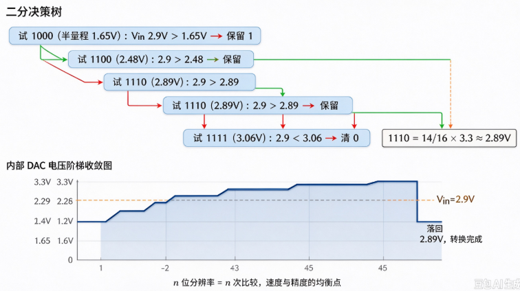

# B-B.2.3 ADC 模数转换

> 所属章节：第五部 B. 总线协议 > B-B.2 基础外设接口
>
> 难度：[B] Beginner | 预计阅读时间：35 分钟

## <span class="blue"> 本节导读

PWM 解决的是数字控制模拟量，ADC（Analog-to-Digital Converter，模数转换器）解决反方向的问题：把连续变化的模拟电压转换成 CPU 能处理的数字。温度、压力、电池电压、光照、音频采集——所有"感知物理世界"的场景都经过 ADC。

本节默认读者没接触过信号链，从零讲起：先讲 ADC 是干什么的、内部怎么工作，**并在一开头就划清硬件与软件的责任线**——哪些过程硬件自动完成、哪些参数归软件配置、哪些换算归软件实现，再讲参数（每个参数先说"它是什么、为什么有意义"，最后才给表）。

本节覆盖：采样/量化/编码三步工作原理、分辨率/采样率/参考电压三个核心参数及 ENOB 的实际含义、SAR 与 Σ-Δ 两种架构为什么存在、Linux IIO 子系统与 ADC 的完整联动（设备树 → 驱动 → sysfs 读数 → 换算），以及两个工业典型信号链：NTC 热敏电阻测温与 4-20 mA 变送器采集（均含 Linux 可运行代码）。

---

## <span class="blue"> ADC 是什么：把物理世界翻译成数字

### 为什么需要 ADC

CPU 的世界里只有数字：寄存器里是 0 和 1，变量是整数。<BR>
但物理世界的量是**连续**的——温度是 24.6 °C 还是 24.7 °C，电池是 3.72 V 还是 3.73 V，中间有无穷多个取值。<BR>
传感器（热敏电阻、霍尔元件、麦克风）把这些物理量变成连续变化的**模拟电压**，可 CPU 还是读不了它——总线上没有"电压"这种东西，只有数据。

ADC 就是这两者之间的翻译：**输入一个模拟电压，输出一个数字**。<BR>
这个数字正比于输入电压，软件拿到它再做换算，就知道温度几度、电池几伏。没有 ADC，SoC 就是个又聋又瞎的计算器。

### ADC 怎么工作：采样、量化、编码

转换过程固定分三步，所有 ADC 架构都只是这三步的不同实现。**先划清责任：这三步全部由 ADC 硬件在几微秒内自动完成，软件不实现其中任何一步**——软件的活在转换前（配参数）和转换后（读数换算）。先看懂硬件在干什么，后面才知道自己的活在哪：

1. **采样（Sample）**：在某一瞬间"抓住"输入电压并保持住。内部是一个开关加一个小电容（采样保持电路）：开关闭合，电容充电到当前电压；开关断开，电容把这一瞬间的电压"定格"，供后续慢慢转换。
2. **量化（Quantize）**：把定格的电压四舍五入到最近的一个**刻度**。ADC 把 0 ~ Vref 的范围切成 2ⁿ 等份（n 是位数），输入电压落在哪一格，就量化为哪一格——格子内部的差异被抹掉了，这是 ADC 误差的来源之一（量化误差）。
3. **编码（Encode）**：把刻度的编号以二进制输出。落在第 2048 格，输出就是二进制数 `100000000000`。

一个具体例子：12-bit ADC、参考电压 3.3 V，范围被切成 2¹² = 4096 格，每格 3.3V/4096 ≈ 0.81 mV。输入 1.65 V 恰好落在第 2048 格，输出数字 2048。软件反算：2048 × 3.3V / 4096 = 1.65 V。**ADC 的全部使用，说到底就是这一个公式的正算与反算。**


<!-- 【待补图】images/B-B.2.3-采样量化编码三步.png（优先级：★必要）
图名：ADC 采样、量化、编码三步工作原理示意图
生图提示词：技术示意图，白底，横向三段流程。左段"采样"：画一条连续正弦波（标注"模拟输入电压"），波上画若干垂直采样线（等间隔），每个采样点画圆点，标注"采样保持：抓住瞬间电压"。中段"量化"：画阶梯图，横轴时间、纵轴 0~Vref 被水平虚线均分为 8 格（标注"2ⁿ 格，这里示意 8 格"），采样点被吸附到最近的格线上形成阶梯，标注"四舍五入到最近的刻度，格内差异被抹掉（量化误差）"。右段"编码"：阶梯图每级右侧对应一个二进制数（000、001、010…111），标注"输出刻度编号 = 数字"。三段之间用粗箭头连接。底部一行小字："例：12-bit、Vref=3.3V → 4096 格、每格 0.81mV；1.65V → 数字 2048"。正弦波橙色，阶梯与数字深蓝色，中文标注，扁平矢量风格。比例 16:9。 -->

### 软件视角：这条链上哪些才是你的事

三步转换、逐位比较、数字滤波——上面这些过程**全部由 ADC 硬件自动完成**，软件从头到尾不实现任何转换逻辑。软件读者最容易产生的误解是"这些是不是得我来写"，先把责任线画清，再往下读：

| 环节 | 谁负责 | 软件要做什么 |
|------|--------|--------------|
| 采样 / 量化 / 编码 | ADC 硬件（自动） | 无。结果自己出现在寄存器里 |
| 分辨率（位数） | 硬件选型，画板时定死 | 读 scale、反算电压；选型时提需求 |
| 采样率 | **软件配置** | 按信号变化快慢设值（寄存器 / 设备树 / trigger） |
| 参考电压 | 硬件设计（基准源、布板） | 软件修不了它，只能怀疑它、实测它（两点校准） |
| 采样时间 | **软件配置**（寄存器位） | 信号源内阻大时按手册加大 |
| SAR / Σ-Δ 内部过程 | 硬件（自动） | 只在选型时关心，运行时完全无感 |
| raw → 电压 → 物理量 | **软件**（本节下半场的全部内容） | IIO 读数、公式换算、查表、边界报警 |

软件的真实工作量集中在三处：**配置少量参数（采样率、采样时间）+ 读数 + 换算**。前面所有"原理"不是让你去实现它，而是让你配得对、读得懂、读数异常时知道该怀疑硬件还是怀疑代码。

---

## <span class="blue"> 三个核心参数：先说意义，再给数字

### 分辨率：能看多细

分辨率（n 位）决定 ADC 把量程切成多少格：2ⁿ 格。**LSB（Least Significant Bit，最低有效位）就是一格对应的电压**：LSB = Vref / 2ⁿ。<br>
它是 ADC 能分辨的最小电压变化——小于一个 LSB 的变化，ADC 根本看不见。

为什么要关心它？因为它决定你的测量"刻度有多粗"。<br>
12-bit、3.3 V 参考时 LSB ≈ 0.81 mV：测电池电压（3.0~4.2 V 区间）够了，一格只是 0.8 mV；但拿去测热电偶（一度只有几十微伏）就是拿米尺量头发丝——所以精密场景要 16-bit、24-bit。

> 💡 位数在选芯片、画板时就定死了，软件改不了。软件对分辨率的全部操作只有一件：按 scale 把 raw 反算成电压——分辨率对软件是"读懂读数"的问题，不是配置问题。

> ⚠️ 标称分辨率 ≠ 实际精度。噪声、温漂、参考电压抖动都会吃掉有效位数，**ENOB（有效位数）通常比标称低 2~4 位**。<br>
> 数据手册的 ENOB 指标比分辨率更值得看——一个 ENOB 只有 9 位的 12-bit ADC，实际表现不如一个 ENOB 10.5 位的 12-bit ADC。

各档分辨率的直观对照（Vref = 3.3 V）：

| 分辨率 | LSB | 典型适用场景 |
|--------|-----|--------------|
| 8-bit | 12.89 mV | 电池电量指示、按键阵列 |
| 10-bit | 3.22 mV | 消费级温度/光强检测（RK3568 内置 SARADC 即此档） |
| 12-bit | 0.81 mV | 工业传感器、电流采样 |
| 16-bit | 50.35 μV | 精密仪器、音频采集 |
| 24-bit | 0.20 μV | 高精度称重、医疗传感（Σ-Δ 架构） |

### 采样率：拍快照的频率

分辨率管"看多细"，采样率管"看多快"。<br>
温度、电池电压这类慢变信号，每秒采几次（几 SPS）就够；电流环控制要跟踪几十 kHz 的电流波形，需要几十 kSPS。

下限由**奈奎斯特准则**给出：要还原一个信号，采样率至少是它最高频率成分的 2 倍。<br>
低于这个值会发生**混叠**——高频信号在采样结果里伪装成一个不存在的低频信号，这种错误软件无法事后修正。工程上取 5~10 倍留裕量。

> 💡 采样率是少数真正由**软件**拍板的参数：寄存器、设备树或 trigger 里配多少，硬件就按多少跑。配低了硬件不报警——它忠实地按你配的烂参数，采出混叠的烂数据。

> 混叠：采样率不足时，高频信号"伪装"成低频信号出现在采样结果里。经典例子是电影里车轮倒转——拍摄帧率不足时，快转的车轮在画面里看起来在慢转甚至倒转。ADC 里同理：1 kHz 信号用 1.1 kSPS 采，结果里会出现一个不存在的 100 Hz 假信号。

### 参考电压：换算的尺子

换算公式 数字值 = (Vin / Vref) × 2ⁿ 里，Vref 是除数——**它是所有测量的共同基准**。<BR>
Vref 漂移 1%，所有通道的读数全部同方向漂移 1%，而传感器是无辜的。

SoC 内部参考源温漂大，精密测量应使用外部基准源（如 REF3333，温漂 3 ppm/°C），Vref 引脚就近放 10 μF + 100 nF 滤波，走线远离高速信号。

> 💡 选基准源、滤波、布板是**硬件工程师**的活；软件对 Vref 只有两件事：记住它是换算公式里的除数，以及读数集体漂移时第一个怀疑它。

> ⚠️ ADC 读数集体漂移、所有通道同方向偏移时，先怀疑 Vref 而非传感器。用万用表实测 Vref 引脚电压，一次测量即可定位。

### 附带一笔：采样时间

内部采样保持电容需要时间充电到输入电压。<BR>
信号源内阻越大（大阻值分压、长走线传感器），充电越慢；采样时间设得太短，电容没充满就开始转换，读数**系统性偏小**——不是噪声，是稳定的、可复现的偏小。<BR>
高阻信号源调试时的经典坑，解法是按手册加大采样周期，或在前端加运放缓冲降低阻抗。

> 💡 采样时间是软件写在寄存器里的配置项——归软件管。懂它的硬件成因（RC 充电曲线），才知道什么时候该调、往哪个方向调：这就是"软件配置项需要硬件直觉"的典型。

---

## <span class="blue"> 两种架构：SAR 与 Σ-Δ 为什么都存在

### 矛盾：速度与精度不可兼得

理想的 ADC 又快又准，物理上做不到：每多要一位分辨率，就要把电压比较做得更精细，比较器的建立时间越长；要 20 位以上的精度，单次转换快到微秒级就不现实。工程上的答案是分两条路线，各自牺牲一头：

> 💡 这两节讲的是**芯片内部**怎么干活——软件运行时对架构完全无感，寄存器接口一模一样。懂架构是为了两件事：选型时知道该买哪种，调试时知道它的怪脾气（SAR 的采样时间、Σ-Δ 的群延迟）从哪来。

### SAR：逐次逼近，像二分查找

SAR（Successive Approximation Register，逐次逼近寄存器）型 ADC 内部有一个 DAC 和一个比较器，工作过程就是**二分查找**：先用量程中点（1/2 Vref）和输入比——输入高，说明答案在上半段；再用 3/4 点和输入比……每比较一次确定一位，n 位分辨率经 n 次比较完成。

以 4-bit、Vin=2.9V、Vref=3.3V 为例：试 1.65V（1000）→ 2.9 更高，保留；试 2.48V（1100）→ 更高，保留；试 2.89V（1110）→ 更高，保留；试 3.06V（1111）→ 超了，退回 1110。<BR>
结果 1110 = 14/16 × 3.3 ≈ 2.89 V。4 次比较出 4 位。

SoC 内置 ADC（RK3568 的 SARADC、i.MX 的 ADC）几乎全是 SAR：速度（~1 MSPS）与精度（8~16 bit）均衡，延迟确定，覆盖嵌入式绝大多数场景。



<!-- 【待补图】images/B-B.2.3-SAR逐次逼近过程.png（优先级：★必要）
图名：SAR ADC 逐次逼近二分搜索过程示意图（以 4-bit、Vin=2.9V、Vref=3.3V 为例）
生图提示词：技术示意图，白底，分上下两部分。上部"二分决策树"：4 层节点，根节点"试 1000（半量程 1.65V）：Vin 2.9V > 1.65V → 保留 1"，第二层"试 1100（2.48V）：2.9 > 2.48 → 保留"，第三层"试 1110（2.89V）：2.9 > 2.89 → 保留"，第四层"试 1111（3.06V）：2.9 < 3.06 → 清 0"，最终结果框标注"1110 = 14/16 × 3.3 ≈ 2.89V"。每层节点用圆角矩形，走向右的分支画绿色箭头（保留）、走向下的分支画红色箭头（清零）。下部"内部 DAC 电压阶梯收敛图"：横轴 4 个比较周期，纵轴电压 0~3.3V，画阶梯折线从 1.65→2.48→2.89→3.06，画一条水平虚线标注"Vin=2.9V"，阶梯逐步逼近并夹住虚线，最后一步回落标注"落回 2.89V，转换完成"。底部一行小字："n 位分辨率 = n 次比较，速度与精度的均衡点"。决策树节点浅蓝底，收敛折线深蓝色，Vin 虚线橙色，中文标注，扁平矢量风格。比例 16:9。 -->

### Σ-Δ：过采样，用平均换精度

Σ-Δ（Sigma-Delta）型走另一条路：用一个很快但很粗（甚至 1-bit）的转换器以远超奈奎斯特的频率反复采样，再用数字滤波器把海量粗结果平均成少数几个精结果——噪声被"整形"推到高频再滤掉。结果是 16~24 bit 的高分辨率，代价是速度只有 kSPS 级，且数字滤波带来明显的群延迟。

需要 20 bit 以上有效分辨率时（称重、精密音频、医疗传感）才选外置 Σ-Δ ADC 芯片（I2C/SPI 接口）。控制环路里用它要特别留意滤波延迟——读到的值是"过去一段时间的平均"，不是当下。

一句话选型：**SoC 内置 = SAR，又快又够用；精密测量 = 外置 Σ-Δ，用延迟和成本换位数。**

---

## <span class="blue"> Linux IIO 子系统

### ADC 为什么归 IIO 管

> 术语：**IIO（Industrial I/O）**：Linux 内核里专门管理"把物理量变成数字"的子系统——ADC、DAC、加速度计、陀螺仪、光传感器都归它。<BR>
> 它不管"控制"（那是 GPIO/PWM 的事），只管"测量"。

GPIO 子系统面向"一位的开和关"，PWM 面向"周期性数字输出"，而 ADC 的数据是多位的、连续的、带单位和刻度的测量值。<BR>
内核为此单独立了一个子系统。

### 分层：一条从寄存器到文件的链

```
用户态        cat /sys/bus/iio/devices/iio:device0/in_voltage0_raw
─────────────  ─────────────────────────────────────────────────
IIO 核心       iio_device（一个 ADC 设备）
               iio_channel（每个采样通道一条）
               buffer / trigger（连续采样用）
─────────────  ─────────────────────────────────────────────────
控制器驱动     rockchip_saradc.c（读硬件寄存器、响应转换完成中断）
─────────────  ─────────────────────────────────────────────────
硬件           SARADC 控制器（挂在 APB 总线上）
```

> 💡 用户态看到的是文件，文件背后是结构体，结构体背后是寄存器。<BR>
> IIO 的价值在于：不管底层是哪家 SoC 的哪个 ADC，用户态接口都是同一组 sysfs 文件。

### 打通链条：设备树 → 驱动 → sysfs

以 RK3568 为例。SoC 级 dtsi 里控制器节点早已存在（`rk356x.dtsi`）：

```dts
saradc: saradc@fe720000 {                          // ADC 控制器，挂 APB
    compatible = "rockchip,rk3568-saradc",         // 匹配 rockchip_saradc 驱动
    reg = <0x0 0xfe720000 0x0 0x100>;              // 寄存器基地址（硬件手册给定）
    interrupts = <GIC_SPI 93 IRQ_TYPE_LEVEL_HIGH>; // 转换完成中断
    clocks = <&cru CLK_SARADC>, <&cru PCLK_SARADC>;// 工作时钟 + 总线时钟
    #io-channel-cells = <1>;                       // 消费方用 1 个数字指定通道
    status = "disabled";                           // SoC 级默认关，板级再开
};
```

板级 dts 只需打开并告知参考电压：

```dts
&saradc {
    vref-supply = <&vcc_3v3>;                      // 参考电压接 3.3V
    status = "okay";                               // 使能控制器
};
```

`status = "okay"` 生效后发生三件事：驱动按 compatible 匹配并 probe、向 IIO 核心注册 iio_device、sysfs 出现 `/sys/bus/iio/devices/iio:device0/`。<BR>
这是第 11 章设备模型在这条总线上的完整一遍。

> 💡 消费方驱动（如 PMIC 的电池电压监控）不碰 sysfs，直接在设备树里引用通道：`io-channels = <&saradc 0>;`，内核里 `iio_read_channel_processed()` 一行拿到毫伏值。

### sysfs 四个文件：raw、scale、offset、name

```
root@linaro-alip:~# cd /sys/bus/iio/devices/iio:device0
root@linaro-alip:/sys/bus/iio/devices/iio:device0# ls
dev  in_voltage0_raw  in_voltage0_scale  name  of_node  power  subsystem  uevent
root@linaro-alip:/sys/bus/iio/devices/iio:device0# cat name
saradc
root@linaro-alip:/sys/bus/iio/devices/iio:device0# cat in_voltage0_raw
2047
root@linaro-alip:/sys/bus/iio/devices/iio:device0# cat in_voltage0_scale
0.805664062
```

四个文件的含义（以一颗 12-bit、Vref = 3.3V 的 ADC 为例）：

- `name`：这个 IIO 设备是谁。多 ADC 系统靠它确认 device0 到底是哪颗。
- `in_voltageN_raw`：**原始数字量**，N 是通道号。12-bit 满量程读数是 4095。
- `in_voltageN_scale`：每 1 LSB 对应多少毫伏。3300/4096 ≈ 0.805664062——正是上面读到的值。
- `offset`：零点偏移，绝大多数 SARADC 为 0。

换算公式一行：

```
电压(mV) = (raw + offset) × scale
```

手算演练：raw = 2047，scale = 0.805664062，则电压 = 2047 × 0.805664062 ≈ 1649 mV。<BR>
换个算法印证：2047/4095 × 3300 ≈ 1649.5 mV，对上了。

> ⚠️ scale 是驱动按 `vref / 2^位数` 现场算出来的，**永远不要在代码里硬编码 0.805664062 这类数值**——换一块 Vref 不同的板子、换一颗位数不同的 ADC，程序不报错、悄悄算错，是最难查的一类 bug。正确姿势：程序里同时读 raw 和 scale，用公式换算。
<!-- -->
> 💡 RK3568 的 SARADC 是 10-bit：raw 范围 0~1023，scale = 3300/1024 ≈ 3.222656。本节示例统一按 12-bit 讲解，换板时以实际 scale 为准——这正是"不硬编码"的理由。

### 没有硬件怎么练：IIO 虚拟设备

内核自带 `CONFIG_IIO_DUMMY_EVGEN`（IIO 虚拟设备与事件发生器）：编入内核后无需任何真实 ADC，就能创建虚拟 iio 设备、用 debugfs 注入 raw 值，把 sysfs 读取、换算、校准整套流程在无硬件环境下走通。宿主机练手或 CI 里跑测试都用它。

### 连续采样：buffer 与 trigger

上面的"读一次给一个值"叫 one-shot 模式。需要按固定频率连续采集（振动分析、波形记录）时，IIO 用 buffer + trigger：触发源（定时器/中断）按节拍触发采样，数据进环形 buffer，用户态从 `/dev/iio:device0` 批量读，`iio_readdev` 工具可直接拉数据。这套机制归 D 扩展 IIO 篇展开，本节只需知道它存在。

### 两点校准：现场先做的验证

> 💡 拿到一块新板子，先别信读数。通道接地：raw 应接近 0（几个 LSB 内的抖动正常）；通道接 Vref（或已知电压源）：raw 应接近满量程。<BR>
> 两点都对，数字侧（驱动、设备树、换算）可信；两点不对，问题在模拟前端（分压、阻抗、参考电压），与代码无关。这一步把"软件问题还是硬件问题"一刀切开，是现场排查的第一刀。

---

## <span class="blue"> 信号链实例一：NTC 热敏电阻测温

### 问题：ADC 只能测电压，怎么测温度？

ADC 不认识温度，只认识电压。所以传感器信号链的第一步永远是：**把被测物理量先变成电压**。NTC（负温度系数热敏电阻）的阻值随温度升高而下降，把它和一个固定电阻串成分压电路，分压点电压就随温度变化——ADC 测这个电压，软件再反推温度。


<!-- 【待补图】images/B-B.2.3-NTC分压电路与信号链.png（优先级：★必要）
图名：NTC 分压电路与完整信号链（温度→电阻→电压→ADC→温度）
生图提示词：工程示意图，白底，从左到右五个环节用箭头串联成一条信号链。左起：①"温度"画一个温度计图标；②"NTC 分压电路"画电路原理图：顶部 VDD 3.3V（红色）→ 锯齿电阻符号（标注"R_fix 10kΩ 精密电阻"）→ 中间节点（实心圆点，标注"分压点 → ADC 引脚"）→ 热敏电阻符号（矩形加斜线，标注"R_ntc 10kΩ@25°C，B=3950"）→ 底部 GND（黑色接地符号）；③"ADC"画一个方块芯片标注"12-bit ADC"，从分压点画蓝色线进入；④"软件换算"画一个代码片段图标，标注"raw→电压→阻值→B 值公式→温度"；⑤"温度值"画输出框标注"25.0°C"。每个环节下方用小字标注该环节的物理量单位：°C、Ω、V、LSB、°C。中文标注，扁平矢量工程图风格，信号路径深蓝色，VDD 红色，GND 黑色。比例 16:9。 -->

25°C 时 R_ntc = 10 kΩ = R_fix，分压点在 1.65 V，raw 约 2048。温度升高，NTC 阻值下降，分压点电压跟着降。

### 公式链：从 raw 一路算回温度

```
raw  ──×scale──→  电压 V_adc
V_adc ──分压公式──→  R_ntc = R_fix × V_adc / (V_ref − V_adc)
R_ntc ──B 值公式──→  温度 T(K) = 1 / ( 1/T25 + ln(R_ntc/R25)/B )
```

- 分压公式：上臂 R_fix 接 Vref、下臂 R_ntc 接地，V_adc = Vref × R_ntc / (R_fix + R_ntc)，移项即得上式。
- B 值公式（Steinhart-Hart 的一阶简化）：`R_ntc = R25 × exp(B × (1/T − 1/T25))`，其中 R25 = 10 kΩ、T25 = 298.15 K（25°C）、B 是材料常数（3950 是常见值，器件手册给定）。

> 💡 不需要背公式——记住链的形状：**每一环把一种物理量翻译成下一种，软件负责走完翻译全程**。<BR>
> ADC 给了中间一站（电压），传感器特性给了首尾两端的关系。

### 为什么查表，而不是现场算浮点：低温段分辨率崩塌

直接在代码里算 exp/ln 当然行，但 NTC 有一个工程上绕不开的问题：**它高度非线性**。

<!-- 【待补图】images/B-B.2.3-NTC温度电阻特性曲线.png（优先级：△有更好）
图名：NTC 温度-阻值特性曲线（含低温段分辨率标注）
生图提示词：二维坐标图，白底。横轴"温度（°C）"从 −50 到 +120，纵轴"阻值（kΩ）"对数坐标从 0.5 到 500。画一条 NTC（R25=10kΩ, B=3950）的特性曲线：左端 −50°C 处约 360kΩ，陡降到 25°C 的 10kΩ，右端 120°C 平缓趋近约 0.6kΩ，整体呈"左陡右平"的指数衰减形态。在 −40°C 附近用红色竖线标注"低温段：阻值变化极快，分压点贴近顶端被压扁，1°C ≈ 7 LSB"；在 25°C 附近用蓝色竖线标注"常温段：1°C ≈ 60 LSB，分辨率充足"。叠加一条灰色水平虚线标注"R25 = 10kΩ @ 25°C"。中文标注，扁平矢量风格，主曲线深蓝色。比例 16:9。 -->

对 12-bit ADC 换算一下：25°C 附近，温度每变化 1°C，raw 变化约 60 个 LSB——分辨率绰绰有余。

到 −40°C 附近，NTC 阻值涨到约 400 kΩ，分压点贴近 Vref 顶端被"压扁"，1°C 只剩约 7 个 LSB——叠加噪声和参考电压漂移，低温段读数开始跳变、不可信。

工程对策是**查表 + 插值**：预先按 B 值公式算出整条"温度 ↔ raw"对照表，运行时二分查表、相邻两项间线性插值。

表由编译期脚本按上式生成、随代码入版本库——生成脚本是一次性工具，运行时固件里只有表和查找函数，**零浮点运算**。

```c
/* 温度-raw 对照表：按 B 值公式生成（上臂 R_fix=10kΩ，NTC R25=10kΩ、B=3950，12-bit ADC）
 * 温度越低 NTC 越大、raw 越大，故表按 raw 降序排列
 * 运行时固件只用这张表，生成脚本不入固件 */
static const struct { int temp_c; unsigned raw; } ntc_table[] = {
    { -40, 3996 }, { -30, 3901 }, { -20, 3741 }, { -10, 3496 },
    {   0, 3156 }, {  10, 2738 }, {  20, 2278 }, {  25, 2048 },
    {  40, 1419 }, {  60,  815 }, {  80,  462 }, { 100,  267 },
};

/* 在降序表里查温度：先二分定位相邻两项，再线性插值 */
static int ntc_lookup(unsigned raw)
{
    int lo = 0, hi = sizeof(ntc_table) / sizeof(ntc_table[0]) - 1;

    if (raw >= ntc_table[lo].raw) return ntc_table[lo].temp_c;  /* 低于量程下限，钳位 */
    if (raw <= ntc_table[hi].raw) return ntc_table[hi].temp_c;  /* 高于量程上限，钳位 */

    while (hi - lo > 1) {                        /* 维持不变式：table[lo].raw > raw > table[hi].raw */
        int mid = (lo + hi) / 2;
        if (raw > ntc_table[mid].raw) hi = mid;  /* raw 偏大 → 温度偏低 → 往前半段（低温段）找 */
        else lo = mid;
    }
    /* 线性插值：raw 在两项之间的比例 = 温度在两项之间的比例 */
    return ntc_table[lo].temp_c +
           (int)((long)(ntc_table[lo].raw - raw) *
                 (ntc_table[hi].temp_c - ntc_table[lo].temp_c) /
                 (ntc_table[lo].raw - ntc_table[hi].raw));
}
```

### 完整可运行示例：从 sysfs 读到打印温度

```c
/* ntc_temp.c —— 读 IIO 通道 raw 值，查表换算成温度
 * 编译（开发板上直接编译，无任何依赖）：
 *     gcc -Wall -o ntc_temp ntc_temp.c
 * 运行（iio:device0 与通道号按实际板子调整）：
 *     ./ntc_temp
 * 预期输出（25°C 环境、分压点在半量程附近时）：
 *     raw=2048, temperature=25°C
 */
#include <stdio.h>                                  /* printf、文件 IO */
#include <stdlib.h>                                 /* exit */

static const struct { int temp_c; unsigned raw; } ntc_table[] = {
    { -40, 3996 }, { -30, 3901 }, { -20, 3741 }, { -10, 3496 },
    {   0, 3156 }, {  10, 2738 }, {  20, 2278 }, {  25, 2048 },
    {  40, 1419 }, {  60,  815 }, {  80,  462 }, { 100,  267 },
};

static int ntc_lookup(unsigned raw)
{
    int lo = 0, hi = sizeof(ntc_table) / sizeof(ntc_table[0]) - 1;

    if (raw >= ntc_table[lo].raw) return ntc_table[lo].temp_c;  /* 超下限，钳位 */
    if (raw <= ntc_table[hi].raw) return ntc_table[hi].temp_c;  /* 超上限，钳位 */

    while (hi - lo > 1) {                        /* 二分定位相邻两项 */
        int mid = (lo + hi) / 2;
        if (raw > ntc_table[mid].raw) hi = mid;
        else lo = mid;
    }
    return ntc_table[lo].temp_c +                /* 相邻两项间线性插值 */
           (int)((long)(ntc_table[lo].raw - raw) *
                 (ntc_table[hi].temp_c - ntc_table[lo].temp_c) /
                 (ntc_table[lo].raw - ntc_table[hi].raw));
}

static int read_raw(const char *path)
{
    FILE *f = fopen(path, "r");                  /* sysfs 属性当普通文件打开 */
    if (!f) { perror(path); exit(1); }           /* 打不开多半是没使能或设备号不对 */
    int raw = -1;
    if (fscanf(f, "%d", &raw) != 1) {            /* sysfs 内容就是一行十进制数字 */
        fprintf(stderr, "read %s failed\n", path);
        fclose(f); exit(1);
    }
    fclose(f);
    return raw;
}

int main(void)
{
    const char *ch = "/sys/bus/iio/devices/iio:device0/in_voltage0_raw";
    int raw = read_raw(ch);                      /* 一次采样：打开→读数字→关闭 */
    printf("raw=%d, temperature=%d°C\n", raw, ntc_lookup(raw));
    return 0;
}
```

> ⚠️ 测温用"读一次"模式足够（温度变化以秒计）。<BR>
> 每秒上千次的连续采集请走 buffer/trigger——sysfs 反复打开关闭的开销会吃掉大部分 CPU。

---

## <span class="blue"> 信号链实例二：4-20 mA 工业变送器

### 为什么工业现场用电流不用电压

工业现场的温度、压力、流量变送器输出 4~20 mA **电流环**，而不是电压信号。<BR>
三个理由全是工程账：

1. **抗干扰**：电流信号对线阻不敏感——同样百米电缆，电压信号沿途压降直接变成读数误差；电流环里回路电流处处相等，线阻不改变电流大小。
2. **传输距离**：电流环轻松上百米，电压信号十米开外就要算压降。
3. **4 mA 零点**：量程起点不是 0 mA 而是 4 mA——读数掉到 0 mA 不是"物理量为零"，而是**断线**。白送一个断线诊断，这是 4-20 mA 最大的隐藏红利。

### 量程匹配：先算，再上板

ADC 只认电压，所以回路里串一个精密采样电阻，把电流变回电压。<BR>
电阻选多大？这笔账必须在画板前算清：

```
150 Ω：4 mA → 0.6 V， 20 mA → 3.0 V      ← 3.3V ADC 完美覆盖，留 0.3V 裕量
250 Ω：4 mA → 1.0 V， 20 mA → 5.0 V      ← 超出 3.3V 满量程！
```

> ⚠️ 用 250 Ω 采样电阻接 3.3V ADC，大信号直接**削顶**——raw 撞在 4095 不再变化。削顶是信息物理丢失，**没有任何软件手段能补救**：你无从知道被削掉的电压是 3.5 V 还是 5 V。量程匹配是画板阶段的硬件决策，软件救不了。


<!-- 【待补图】images/B-B.2.3-420mA电流环信号链.png（优先级：△有更好）
图名：4-20mA 变送器到 ADC 的完整信号链（含量程匹配警示）
生图提示词：工程示意图，白底，从左到右的信号链。最左画一个标注"压力变送器（两线制）"的方形设备，标注量程"0~1.6 MPa ↔ 4~20 mA"；向右一条环路导线（上下两条平行线构成回路，蓝色箭头标出电流方向）标注"电流环：百米电缆，抗干扰"；回路中串入一个锯齿电阻符号标注"R_sense = 150Ω 精密采样电阻"，电阻两端标注"0.6V ~ 3.0V"；电阻右端进入一个方块标注"12-bit ADC（Vref=3.3V）"；最右画输出框标注"软件：raw → 电压 → 电流 → 压力"。图下方画一个红色边框警示气泡："若用 250Ω：20mA×250Ω=5V > 3.3V，削顶，软件无法补救"。中文标注，扁平矢量工程图风格。比例 16:9。 -->

### 代码：换算与断线判断

```c
/* adc_to_pressure.c —— 4-20mA 压力变送器读数换算
 * 变送器：0~1.6 MPa ↔ 4~20 mA；采样电阻 150 Ω；12-bit ADC，Vref=3.3V
 * 编译：gcc -Wall -o adc_to_pressure adc_to_pressure.c
 * 预期输出（变送器输出 12 mA，即量程中点 0.8 MPa 时）：
 *     raw=2234, current=12.0mA, pressure=0.800MPa
 * 断线时输出：
 *     raw=0, current=0.0mA
 *     [ALARM] loop current below 3mA —— 断线或变送器掉电
 */
#include <stdio.h>
#include <stdlib.h>

#define RAW_FULL   4095.0                          /* 12-bit 满量程 */
#define VREF_MV    3300.0                          /* 参考电压，毫伏 */
#define R_SENSE    150.0                           /* 采样电阻，欧姆 */

/* raw → 回路电流（mA）：raw 线性映射回电压，再欧姆定律
 * 单位自洽：V(mV) / R(Ω) = I(mA) */
static double raw_to_current_ma(int raw)
{
    double v_mv = raw / RAW_FULL * VREF_MV;        /* raw → 电压(mV) */
    return v_mv / R_SENSE;                         /* I = U/R */
}

/* 电流（mA）→ 压力（MPa）：4mA→0，20mA→1.6，含断线判断 */
static double current_to_pressure(double ma)
{
    if (ma < 3.0) {                                /* 物理量再小，电流也不可能低于 4mA */
        fprintf(stderr, "[ALARM] loop current below 3mA —— 断线或变送器掉电\n");
        return -1.0;
    }
    return (ma - 4.0) / 16.0 * 1.6;                /* 4~20mA 线性映射到 0~1.6MPa */
}

static int read_raw(const char *path)
{
    FILE *f = fopen(path, "r");                    /* sysfs 属性当普通文件打开 */
    if (!f) { perror(path); exit(1); }
    int raw = -1;
    if (fscanf(f, "%d", &raw) != 1) {              /* 内容就是一行十进制数字 */
        fprintf(stderr, "read %s failed\n", path);
        fclose(f); exit(1);
    }
    fclose(f);
    return raw;
}

int main(void)
{
    const char *ch = "/sys/bus/iio/devices/iio:device0/in_voltage1_raw";
    int raw = read_raw(ch);                        /* 通道号按实际接线调整 */
    double ma  = raw_to_current_ma(raw);           /* raw → 电流 */
    double mpa = current_to_pressure(ma);          /* 电流 → 压力（内含断线判断） */
    printf("raw=%d, current=%.1fmA", raw, ma);
    if (mpa >= 0.0) printf(", pressure=%.3fMPa", mpa);
    printf("\n");
    return 0;
}
```

> 💡 两个例子的形状一模一样：**raw → 电压 → 物理量，外加一个"超出合理区间即报警"的边界检查**。信号链代码的骨架是通用的，变的只是中间那条换算曲线——NTC 是查表插值，电流环是线性映射。

---

## <span class="blue"> 本节总结

ADC 的全部原理一句话：物理世界连续、数字世界离散，采样（时间切片）、量化（幅值取整）、编码（输出二进制）三步完成翻译。三个参数各管一件事——分辨率管看多细（LSB 由位数和 Vref 定，ENOB 才是到货精度），采样率管跟不跟得上变化（奈奎斯特是底线，混叠不可软件补救），参考电压管换算尺子（尺子漂了全盘皆漂）。SAR 与 Σ-Δ 不是新旧替代，而是"速度-精度"权衡的两端：前者逐次逼近、又快又够用，SoC 内置全是它；后者过采样平均，用延迟和成本换 20+ bit。

Linux 侧路径规整：ADC 归 IIO 子系统，设备树 `status="okay"` 加 `vref-supply` 两行打通"控制器 → iio_device → sysfs"链条；用户态按 `电压=(raw+offset)×scale` 换算，scale 由驱动现场算、代码里硬编码是换板即错的坑。两点校准（接地读零、接 Vref 读满）是现场切开"软件问题还是硬件问题"的第一刀。

两个信号链实例同构：NTC 测温（分压→raw→B 值公式→查表插值，低温段 1°C 只剩 7 个 LSB 是查表而非现场算的硬核理由）、4-20 mA（电流环抗干扰、4 mA 零点白送断线诊断；150 Ω vs 250 Ω 的量程账画板前必须算清，削顶无软件补救）。骨架通用：raw → 电压 → 物理量 + 边界报警。

## <span class="blue"> 本节自查（面试问答）

先自答再点开对答案；答不上来的回正文补。

### 原理与参数

??? details "Q1. ADC 为什么要分'采样、量化、编码'三步？一步到位不行吗？"

    模拟信号在时间和幅值两个维度上都连续，数字系统两个维度都存不下。采样把时间切成离散时刻（采样率管这步），量化把每个时刻的电压取整到最近的刻度（分辨率管这步），编码把刻度编号写成二进制（纯形式转换）。三步对应三类独立的误差来源，分开讲是为了分开算账。

??? details "Q2. 12-bit、3.3V 参考的 ADC，1 LSB 是多少毫伏？raw=2047 对应多少伏？"

    LSB = 3300/4096 ≈ 0.806 mV。2047 × 0.806 ≈ 1650 mV——约半量程，合理（2047/4095 × 3300 ≈ 1649.5 mV，两种算法互证）。

??? details "Q3. 标称 16-bit 的 ADC，手册写 ENOB=13.5，意味着什么？"

    有效分辨率只有 13.5 位——低 2.5 位被噪声淹没，读数在那几位上跳来跳去、不含信息。选型按 ENOB 不按标称位数；标称与 ENOB 的差，就是模拟前端设计与噪声水平交的税。

??? details "Q4. 要采 2 kHz 的振动信号，4 kHz 采样率够不够？混叠了能软件滤掉吗？"

    4 kHz 刚踩奈奎斯特底线（fs ≥ 2×f），工程上取 5~10 倍（10~20 kHz）留裕量。混叠是高于 fs/2 的成分"折叠"进低频、冒充真实信号——与真实低频成分无法事后区分，**不可软件补救**，只能靠采样前的模拟抗混叠滤波器。

??? details "Q5. 换了一块板子，同样的温度读数整体偏了 3%，最可疑的两个根因？"

    参考电压变了（Vref 是换算的尺子，尺子偏 3% 则所有读数偏 3%），或分压/采样电阻精度与温漂超标。先万用表实测 Vref，再核电阻精度等级——这是"换算链上每一环都要验"的实例。

??? details "Q6. 采样时间配置太短，读数会表现成什么样？"

    采样保持电容没充到位，读数系统性偏低，且偏低程度随信号源内阻变化——换高内阻传感器偏差更大。按手册给足充电时间：源内阻越大，所需采样时间越长。

### 架构

??? details "Q7. SAR 型 ADC 一次 12-bit 转换要几个比较周期？过程像什么算法？"

    12 个比较周期（加少量建立开销），过程是二分查找：内部 DAC 先给半量程，比较器回答"高了还是低了"，逐位逼近。每一位一个周期——这就是 SAR"位数翻倍、速度减半"的结构性原因。

??? details "Q8. Σ-Δ 型 ADC 拿什么换来 24-bit？控制环路里用它的坑是什么？"

    拿速度换：1-bit 粗转换器超高频过采样，数字滤波把海量粗结果平均成少数精结果，噪声被整形推到高频滤掉。坑是群延迟——读到的是"过去一段时间的平均"而非当下瞬时值，闭环控制里这个延迟直接恶化相位裕度。

### Linux 与信号链

??? details "Q9. sysfs 里的 scale 是谁算的？为什么硬编码它会'换板即错'？"

    驱动按 vref / 2^位数 现场算。硬编码把"这块板子的 Vref 和位数"烙进代码——换 Vref 不同的板、换位数不同的 ADC，程序不报错、悄悄算错，是最难查的一类 bug。正确姿势：raw 和 scale 一起读，用 (raw+offset)×scale 换算。

??? details "Q10. 新板子 ADC 读数不可信，怎么在两分钟内区分软件问题还是硬件问题？"

    两点校准：通道接地，raw 应接近 0；通道接 Vref，raw 应接近满量程。两点都对 → 数字侧（设备树、驱动、换算）可信，去查模拟前端；不对 → 查接线与前端电路，与代码无关。这一刀把排障范围直接砍半。

??? details "Q11. NTC 测温为什么查表插值，而不是现场算 B 值公式？"

    两个理由：①NTC 高度非线性，−40°C 段 1°C 只剩约 7 个 LSB，表格的步进设计必须对照实际 LSB 分辨率核对，现场浮点算救不回这个物理限制；②嵌入式环境浮点开销大，查表+整数插值是定点化标准做法。表由编译期脚本生成入版本库，运行时零浮点。

??? details "Q12. 4-20 mA 的起点为什么不是 0 mA？这个设计白送了什么功能？"

    起点抬高到 4 mA 后，读数掉到接近 0 mA 必然意味着断线或变送器掉电——免费获得断线诊断。代价是牺牲 20% 的电流动态范围，工业现场一致认为值。

??? details "Q13. 150 Ω 和 250 Ω 采样电阻，3.3V ADC 该选哪个？选错了软件能救吗？"

    150 Ω：20 mA → 3.0 V，完美落在量程内还留裕量。250 Ω：20 mA → 5.0 V，超满量程削顶。削顶是信息物理丢失，软件无从恢复被削掉的部分——量程匹配是画板阶段的硬件决策。

??? details "Q14. 两个信号链例子的代码骨架有什么共同点？掌握它有什么用？"

    同一形状：raw → 电压 → 物理量 + 边界报警。变的只是中间那条换算曲线（NTC 查表、电流环线性映射）。掌握骨架后，接入任何新传感器只剩"填换算曲线"一件事。

## <span class="blue"> 下一步

ADC 把模拟世界读进来，反方向的问题是把数字量变回模拟电压——音量控制、参考电压生成、波形发生。

下一节 **B-B.2.4 DAC 与基础外设选型**，讲 DAC 原理，以及 GPIO/PWM/ADC/DAC 四件套的选型决策。

到 **B-B.2.5 实战篇**，GPIO、PWM、ADC 将合并为一个产品级代码案例。

> 💡 螺旋衔接：本节讲的是"用 ADC"（消费侧）；IIO 控制器驱动（iio_device 注册、buffer/trigger 实现）的写法归 D 扩展子系统篇；I2C/SPI 接口的外置 ADC 与数字传感器接 B-B.3、B-B.4。
