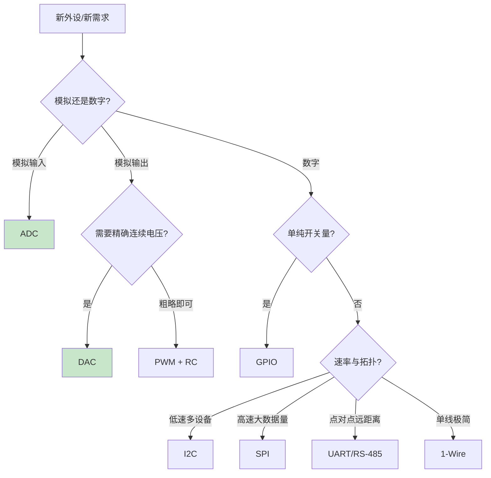

# B-B.2.4 DAC 与基础外设选型

> 所属章节：第五部 B. 总线协议 > B-B.2 基础外设接口
>
> 难度：[B] Beginner | 预计阅读时间：35 分钟

## <span class="blue"> 本节导读

GPIO 输出开关量，PWM 输出"平均值可调"的方波，DAC（Digital-to-Analog Converter，数模转换器）输出的是**真正的连续模拟电压**——变频器频率指令、可编程电源、模拟执行器控制都需要它。同时，基础外设四件套（GPIO/PWM/ADC/DAC）到此集齐，本节给出选型框架：拿到一个新外设，该用哪个接口接。

本节默认读者没接触过 DAC，原理从零讲起，并延续前三节的责任线划法：**电压合成是 DAC 芯片内部电路的活，软件从不参与转换本身**——软件的工作是选型、写码值、做换算。

本节覆盖：为什么需要 DAC（与 PWM 的分工）、R-2R 梯形网络的工作原理（用叠加定理和算例讲透）、分辨率与更新率两个参数的意义、输出缓冲与带载能力、SoC 无内置 DAC 时的三条替代路径（含 RK3568 的实际约束与 IIO 用法）、DAC 控制变频器的完整信号链（含可编译可运行代码）、DDS 波形发生思路，以及基础外设选型决策图。

---

## <span class="blue"> DAC 是什么：数字世界怎么输出"真正的模拟量"

### 为什么需要 DAC

ADC 解决的问题是"把物理世界读进来"（B-B.2.3），DAC 解决反方向的问题：**把数字世界的结果送出去**。

CPU 算出了一个目标值——变频器要跑 25 Hz、可编程电源要输出 5.2 V——但执行机构不认识数字。变频器的频率指令端子要的是 0~10 V 连续电压，阀门驱动器要的是 4~20 mA 电流。总线上没有"电压"这种东西，只有数据；得有一个器件把数据变回连续电压，这就是 DAC。

### 与 PWM 的分工：平均值 vs 真实电压

上一节说 PWM 也能"合成模拟量"——那还要 DAC 干什么？区别在于输出的是什么：

- **PWM 输出的是方波**，负载靠自身惯性感受到平均值。波形本身是满幅抖动的，想拿到干净直流必须外加滤波，且纹波与响应速度不可兼得。
- **DAC 输出的是真实电压**：写 2048，引脚上就是稳定的 1.65 V，无纹波、随写随变。

所以分工很直白：负载自带"平均能力"的（LED、电机、加热片）用 PWM，便宜够用；负载要干净、精确、快变的连续电压的（变频器指令、精密偏置、音频），用 DAC。

### DAC 的核心思想：加权求和

DAC 的全部原理一句话：**让每一位数字位产生一份"权重减半"的电压贡献，再把它们加起来**。

最高位贡献 Vref/2，次高位 Vref/4，再下一位 Vref/8……哪一位是 1 就加上它那份，是 0 就不加。<br>
各位贡献之和就是输出电压：

```text
Vout = Vref × D / 2ⁿ        （D 是写入的数字量，n 是位数）
```

12-bit、Vref=3.3 V 时，写 2048（即 2¹¹，最高位为 1、其余为 0）：Vout = 3.3 × 2048/4096 = 1.65 V——恰好只有最高位那份贡献。<br>
DAC 的全部使用，说到底就是这一个公式的正算与反算，和 ADC 完全镜像。

### R-2R 梯形网络：用两种阻值搭出"加权求和器"

"每位贡献减半"说起来容易，电路怎么实现？最朴素的想法是给每一位配一个精确加权的电阻——但 12-bit 意味着电阻值要横跨 2¹² = 4096 倍（1 kΩ 到 4 MΩ），这种跨度在芯片内部既做不准也做不小，温度一飘比例全乱。

R-2R 梯形网络的巧思是：**只用 R 和 2R 两种阻值**（2R 就是阻值是 R 两倍的那种电阻），靠网络结构自动完成"每过一级权重减半"。网络长这样：每一位数字控制一个开关，开关经一个 2R 电阻选择接 Vref（位=1）或接 GND（位=0）；相邻节点之间用阻值 R 的电阻串联；末端再接一个 2R 电阻到 GND 收尾；输出取在最后一个节点。


<!-- 【待补图】images/B-B.2.4-R2R梯形网络原理.png（优先级：★必要）
图名：R-2R 梯形网络 DAC 工作原理与二进制加权电流图
生图提示词：电路原理示意图，白底，左右两联。左联"R-2R 网络结构"：画 4 位 R-2R 梯形网络——水平主链上相邻节点之间串联电阻（标注 R），每个节点向下经电阻（标注 2R）接一个单刀双掷开关（标注 S3~S0，由数字位 D3~D0 控制），开关两个掷点分别接 Vref（红色汇流排，标注"位=1"）与 GND（黑色汇流排，标注"位=0"），主链最左端经 2R 电阻接 GND 收尾，最右端节点标注 Vout，旁边公式"Vout = Vref × D/2ⁿ"。右联"二进制加权"：画 4 条水平柱状条，从上到下标注"S3 贡献 1/2、S2 贡献 1/4、S1 贡献 1/8、S0 贡献 1/16"，柱长按比例递减，每柱标注开关掷向 Vref 时的电压贡献值（以 Vref=3.3V 为例：1.65V/0.825V/0.41V/0.21V），底部总和示例"S3+S1=1010：1.65+0.41≈2.06V"。电阻用标准锯齿符号，Vref 路径红色、GND 路径黑色，柱状图蓝色渐变，中文标注，扁平矢量风格。比例 16:9。 -->

**它凭什么做到"每位减半"？** 关键性质：从梯形网络的任何一个节点向左看回去，等效电阻恒等于 2R——这是这个结构的数学性质（末端 2R 收尾保证了这一点）。于是每一级都把左边传过来的电压精确地分一半，位越低的开关，贡献被分的次数越多、权重越小。

用叠加定理（多个源共同作用 = 各源单独作用之和）算一遍 4-bit、Vref=3.3 V 的实例：

| 只有哪位接 Vref | 贡献的电压 |
|------------------|-----------|
| S3（最高位） | Vref/2 = 1.65 V |
| S2 | Vref/4 = 0.825 V |
| S1 | Vref/8 = 0.4125 V |
| S0（最低位） | Vref/16 = 0.206 V |

数字量 D=1010（S3、S1 接 Vref，其余接地）：Vout = 1.65 + 0.4125 ≈ 2.06 V。代入通项公式验证：3.3 × 10/16 ≈ 2.06 V，对上了。

只用两种阻值的好处全是制造账：电阻**比例**精度比绝对值精度好做得多，两种阻值容易配对；同批电阻温度系数一致，温度漂移互相抵消；位数想加就加，网络向后延伸即可。实际芯片还有电容分压型（CMOS 工艺）与电流舵型（高速 DAC），但 R-2R 是理解 DAC 的标准起点。

### 软件视角：责任线

与前三节同一个问题：上面这些，哪些是你的活？

| 环节 | 谁负责 | 软件要做什么 |
|------|--------|--------------|
| 加权求和、电压合成 | DAC 芯片内部电路（自动） | 无。写码值，电压自己出现 |
| 分辨率（位数） | 芯片选型，买定离手 | 按负载需求提位数要求；按 scale 换算 |
| 更新率 | **软件配置**（受总线/控制器限制） | 按负载变化快慢选接口与写频 |
| 零点/满度误差 | 硬件事实，普遍存在 | 两点校准，软件线性补偿 |
| 输出带载 | 硬件链路设计（运放+驱动级） | 软件修不了，原理图阶段决定 |
| 频率/电压 → 码值换算 | **软件**（本节下半场） | 读 scale、算 raw、写 sysfs |

软件的真实工作量：**选型算账 + 写码值 + 两点校准补偿**。原理部分的价值照旧——选型时知道买哪种，输出异常时知道该怀疑数字侧还是模拟侧。

---

## <span class="blue"> 两个核心参数与一条带载边界

选型和使用 DAC 前，先回答三个问题：能输出多细（分辨率）、能变多快（更新率）、能带动什么（带载）。前两个是参数，第三个是硬件边界——都不是"芯片自动搞定"的事，逐个过。

### 分辨率：能输出多细的电压

分辨率（n 位）决定 DAC 能把 0~Vref 切成多少格：2ⁿ 格，**你只能写出"格子编号"，格与格之间的电压不存在**。LSB = Vref / 2ⁿ，是输出电压的最小步进——想输出 1.6504 V 和 1.6505 V 的差别？LSB 是 0.8 mV 的话就做不到。

为什么要关心它？因为输出侧同样有"刻度够不够用"的问题，且**天花板在负载端**：变频器对指令电压只能分辨 mV 级差异时，12-bit 的 0.8 mV 步进已经富余；可编程电源要 1 mV 步进调压，12-bit 就不够，得上 16-bit。

> 💡 位数在买芯片时就定死了，软件改不了。软件对分辨率的全部操作是：读 scale、把目标电压换算成码值。选型时的判断标准只有一条——**负载端能分辨多细**，不是位数越高越好。

各档分辨率的直观对照（Vref = 3.3 V）：

| 分辨率 | LSB | 适用场景 |
|--------|-----|----------|
| 8-bit | 12.89 mV | 粗略调压、玩具级 |
| 10-bit | 3.22 mV | 通用工业控制 |
| 12-bit | 0.81 mV | 变频器指令、电源调节（最常用档位） |
| 16-bit | 50.35 μV | 精密仪器、专业音频 |
| 24-bit | 0.20 μV | 计量校准、实验室仪器 |

> ⚠️ 盲目上 16-bit 之前，先解决 PCB 噪声耦合问题——板上数字信号串进来的噪声轻松达到几十 μV，会把高分辨率的收益全部吃掉。精度是整条链的事，不是 DAC 一颗芯片的事。

### 更新率：输出能变多快

更新率决定输出电压能多快改变一次，限制来自三处：DAC 芯片自身的建立时间、**接口速率**（I2C 100 kHz 写一次要几百微秒，SPI 快两个数量级）、负载侧的 RC 惯性。

> 建立时间（settling time）：写入新码值到输出电压真正稳定在新值所需的时间，通常在 μs 级。它是单点更新的物理下限——写得再快，电压也得按它的节奏到位。

按场景分档：温度设定、阀门开度这类慢变量，<10 kSPS 足够；工业模拟输出与音频，10~500 kSPS；波形发生、软件无线电需要 MSPS 级高速 DAC（往往还要配 DMA 自动送数，见后文 DDS）。

> 💡 更新率是**软件配置的参数**，但它的天花板往往是硬件给的——接口速率。选型时"要多快"决定走 I2C 还是 SPI 还是内置 DAC，这笔账在画板前算。

### 输出缓冲与带载能力

R-2R 网络的输出阻抗在 kΩ 级：直接接负载会产生负载效应——负载一抽电流，输出电压就被拉偏，"精确电压"立刻不精确。所以 DAC 输出端按带载能力分四档：

> 💡 这一节是纯硬件边界：负载效应软件修不了、缓冲链软件补不了，只能在选型与原理图阶段尊重它。软件能做的是知道红线在哪——以及出了"接负载后电压漂移"知道该怀疑链路而不是代码。

| 输出形态 | 驱动能力 | 适用负载 |
|----------|----------|----------|
| 无缓冲 | 接近零 | 只能接运放等高阻输入 |
| 内置缓冲 | 几 mA | 轻负载 |
| 外接运放（电压跟随/放大） | 几十 mA | 中等负载、电平转换 |
| 功率驱动级 | 数百 mA 以上 | 电磁阀、执行器 |

> ⚠️ DAC 输出的是精确电压信号，不是功率信号。驱动继电器、电磁阀、电机的正确链路是：DAC → 运放缓冲/隔离 → 功率驱动级（MOSFET/专用驱动芯片）。让 DAC 直接带功率负载，输出漂移是轻的，烧片是重的。
<!-- -->
> ⚠️ 零刻度偏移与满刻度增益误差普遍存在：写 0 输出不恰好是 0 V，写满量程不恰好是 Vref。这是硬件事实，解法是软件两点校准——写 0 与写满量程各实测一次，之后所有码值按实测直线线性补偿。

---

## <span class="blue"> SoC 没有内置 DAC 怎么办

内置 DAC 在 MCU（STM32 等）上常见，但在应用处理器级 SoC 上并不普及——本书锚点硬件 RK3568 就没有内置 DAC。<br>
三条替代路径：

| 路径 | 精度 | 成本 | 适用场景 |
|------|------|------|----------|
| PWM + RC 滤波 | 8~10 bit 有效（受纹波限制） | 接近零 | 背光、粗略偏置电压 |
| 外置 I2C/SPI DAC（MCP4725 等） | 12~16 bit | 几元 | 工业模拟输出主流方案 |
| 专用音频/高速 DAC | 16~24 bit | 高 | 音频、波形发生 |

### 外置 DAC：以内置完全相同的姿势使用

以外置 MCP4725（12-bit，I2C 接口）为例，内核有现成驱动（`drivers/iio/dac/mcp4725.c`），设备树挂在 I2C 控制器下：

```dts
&i2c1 {
    status = "okay";

    dac: mcp4725@60 {
        compatible = "microchip,mcp4725";     // 匹配 mcp4725 驱动
        reg = <0x60>;                         // I2C 从机地址（A0 引脚接地）
        vref-supply = <&vcc_3v3>;             // 参考电压接 3.3V
    };
};
```

注册后用户态经 IIO sysfs 控制，与内置 DAC 用法完全一致：

```bash
cat /sys/bus/iio/devices/iio:device0/out_voltage0_scale   # mV/LSB
echo 2048 > /sys/bus/iio/devices/iio:device0/out_voltage0_raw   # 半量程 → ≈ Vref/2
```

输出侧与 ADC 侧（B-B.2.3）是同一套 IIO 约定的镜像——文件前缀从 `in_voltage` 换成 `out_voltage`，换算公式同形：

```text
Vout(mV) = (raw + offset) × scale
```

写之前先读一次 `scale` 确认换算系数（12-bit 与 16-bit DAC 差 16 倍），**不要硬编码**——与 ADC 侧完全同一条纪律。

IIO 输出侧还有两个低频但关键的属性：`out_voltageY_powerdown`（通道掉电控制，省电场景用）与 buffer 接口（`/dev/iio:deviceX` 连续写入，配 trigger 输出周期波形——波形发生的正规路径，驱动侧写法归 D 扩展 IIO 篇）。

> 💡 没有 DAC 硬件也能练：IIO dummy 框架（`drivers/iio/dummy/`）可虚拟出输出通道，sysfs 写链与换算逻辑先在 PC 上跑通；频率→码值的换算纯软件，用脚本复现验证后再上板。

### PWM+RC：最便宜的那条路

PWM+RC 滤波的原理是把 PWM 方波经低通滤波取平均值（见 B-B.2.2）：截止频率远低于 PWM 频率时，输出近似直流。纹波与响应速度矛盾——滤波越狠纹波越小、响应越慢，只适合慢变设定值场景（背光、偏置电压），精确指令输出别走这条路。


<!-- 【待补图】images/B-B.2.4-PWM_RC滤波纹波权衡.png（优先级：★必要）
图名：PWM+RC 滤波输出纹波与响应速度权衡图
生图提示词：波形示意图，白底，上下三组共享横轴时间。组一"PWM 输入（50% 占空比）"：标准方波。组二"小时间常数（响应快、纹波大）"：方波经过后变成围绕平均值（画水平虚线标注 V_avg=D×3.3V≈1.65V）上下大幅波动的三角纹波，标注"纹波 ±200mV"，并在占空比从 50% 跳到 75% 的时刻画竖虚线，输出快速爬升到新均值，标注"响应快"。组三"大时间常数（响应慢、纹波小）"：纹波幅度明显变小（标注"纹波 ±20mV"），同一跳变时刻输出缓慢指数爬升，用双向箭头标注"稳定时间数十 ms"。右侧配一句结论框："滤波越狠纹波越小、响应越慢——慢变设定值场景专用"。PWM 方波灰色，输出曲线深蓝色，均值虚线橙色，纹波区间红色底纹，中文标注，扁平矢量风格。比例 16:9。 -->

---

## <span class="blue"> 信号链实例：DAC 控制变频器（0-10 V）

工业变频器的标准频率指令接口是 0-10 V 模拟输入：0 V 对应 0 Hz，10 V 对应上限频率（如 50 Hz）。完整信号链：

```text
┌───────────┐     ┌────────────┐     ┌──────────┐
│ SoC/外置  │     │ 运放级      │     │ 变频器    │
│DAC 0~3.3V │────→│ 3.3V→10V   │────→│ AI1 0-10V │──→ 三相电机
└───────────┘     │ 增益≈3.03  │     └──────────┘
                  └────────────┘
        运放供电需 ≥12V 才能输出 10 V；两地共 AGND
```

> 轨到轨（rail-to-rail）运放：输出能摆到接近供电轨的特殊运放。普通运放的输出离供电轨有 1~2 V 的"撞不到"余量——所以给运放供多少电，直接决定 DAC 链路能输出的上限。

> ⚠️ 运放输出撞不到自己的供电轨：要输出 10 V，供电至少 12 V（除非是轨到轨运放）。供电不够的症状是高段削顶——写满量程输出卡在 9 V 上不去，与 ADC 侧削顶同理，软件无法补救。
<!-- -->
> 💡 变频器也有 4-20 mA 指令端子（与 0-10 V 端子电气完全不同，**接线前核对手册**，混接轻则无响应重则烧输入级）。<BR>
> DAC 做 4-20 mA 输出不用电阻硬凑——用 XTR111 类专用电流环发送芯片，DAC 电压进、环路电流出，抗干扰与断线诊断的好处与采集侧（B-B.2.3）对称。

完整可运行示例——把目标频率换算成码值并写入：

```c
/* dac_set_freq.c —— 把目标频率(Hz)换算成 DAC 码值并写入 IIO
 * 信号链：DAC(0~3.3V) → 运放(增益≈3.03) → 变频器 0-10V ↔ 0~50Hz
 * 编译（开发板上直接编译，无任何依赖）：
 *     gcc -Wall -o dac_set_freq dac_set_freq.c
 * 运行（iio:device0 按实际板子调整；需先按设备树使能 DAC 通道）：
 *     ./dac_set_freq 25
 * 预期输出：
 *     scale=0.805664, target 25.0Hz → vfd=5000mV → dac=1650mV → raw=2048
 *     wrote 2048 to /sys/bus/iio/devices/iio:device0/out_voltage0_raw
 */
#include <stdio.h>
#include <stdlib.h>

#define VFD_MAX_HZ  50.0     /* 变频器上限频率(Hz)，查变频器手册 */
#define VFD_MAX_MV  10000.0  /* 变频器模拟指令满量程(mV)：0-10V */
#define GAIN        (VFD_MAX_MV / 3300.0)   /* 运放增益 ≈3.03，把 3.3V 抬到 10V */

static const char *SCALE_PATH = "/sys/bus/iio/devices/iio:device0/out_voltage0_scale";
static const char *RAW_PATH   = "/sys/bus/iio/devices/iio:device0/out_voltage0_raw";

static double read_scale(void)
{
    FILE *f = fopen(SCALE_PATH, "r");
    if (!f) { perror(SCALE_PATH); exit(1); }      /* 打不开多半是 DAC 通道没使能 */
    double scale = 0;
    if (fscanf(f, "%lf", &scale) != 1) { fclose(f); exit(1); }
    fclose(f);
    return scale;                                 /* 单位 mV/LSB，驱动按 vref/2^n 现场算 */
}

static void write_raw(int raw)
{
    FILE *f = fopen(RAW_PATH, "w");
    if (!f) { perror(RAW_PATH); exit(1); }
    fprintf(f, "%d", raw);                        /* sysfs 写入：写十进制字符串即可 */
    fclose(f);
    printf("wrote %d to %s\n", raw, RAW_PATH);
}

int main(int argc, char *argv[])
{
    if (argc != 2) { fprintf(stderr, "usage: %s <freq_hz>\n", argv[0]); return 1; }
    double hz = atof(argv[1]);
    if (hz < 0 || hz > VFD_MAX_HZ) {              /* 先挡非法输入，再换算 */
        fprintf(stderr, "freq out of range (0~%.0fHz)\n", VFD_MAX_HZ);
        return 1;
    }

    double scale  = read_scale();                 /* 换算系数现场读，不硬编码 */
    double vfd_mv = hz / VFD_MAX_HZ * VFD_MAX_MV; /* 频率 → 变频器侧电压 */
    double dac_mv = vfd_mv / GAIN;                /* → DAC 侧电压（运放逆运算） */
    int    raw    = (int)(dac_mv / scale + 0.5);  /* → 码值：电压 ÷ 每LSB毫伏数，四舍五入 */

    printf("scale=%f, target %.1fHz → vfd=%.0fmV → dac=%.0fmV → raw=%d\n",
           scale, hz, vfd_mv, dac_mv, raw);
    write_raw(raw);
    return 0;
}
```

换算链的形状与 ADC 侧（B-B.2.3）完全镜像，只是方向相反：ADC 是 raw → 电压 → 物理量，DAC 是物理量 → 电压 → raw。骨架通用，变的只是中间的映射关系。

DAC 输出异常时，第一排查手段是**阶梯写入 + 万用表三点测量**：写 0、半量程（2048）、满量程（4095），在 DAC 引脚实测电压。

三点呈线性（0 / ≈Vref/2 / ≈Vref）则数字侧与 DAC 正常，问题在运放级或变频器侧；三点异常则回到设备树与 IIO 节点查配置——这与 ADC 侧"两点校准"是同一把刀：先把数字侧和模拟侧切开。

> 💡 DAC 通道对应的引脚必须是模拟模式（数字输入缓冲关闭，见 B-B.2.1 四种工作模式）；若被 pinctrl 配成 GPIO 或复用功能，输出会乱跳或与其他模块争引脚。<BR>
> 输出异常时这是第一批要查的配置项。

---

## <span class="blue"> 进阶形态：用 DAC 发波形（DDS 思路）

设定值输出只是 DAC 的一半能力，另一半是波形发生——正弦、三角、任意波形。思路叫 DDS（Direct Digital Synthesis，直接数字合成）：把波形的一个周期预先存成码值表，按固定时间间隔逐点写入 DAC，输出就是该波形的周期重复。

```c
/* dds_sine.c —— 用 DDS 思路经 IIO 让 DAC 输出正弦波
 * 原理：64 点正弦码值表 + 定时逐点写入，f_out = f_update / 64
 * 编译（开发板上直接编译，无任何依赖）：
 *     gcc -Wall -o dds_sine dds_sine.c
 * 运行（参数为目标输出频率 Hz；iio:device0 按实际板子调整）：
 *     ./dds_sine 1
 * 预期输出：
 *     f_out=1.0Hz, f_update=64Hz, interval=15625us —— 按 Ctrl+C 停止
 * 验证：示波器看引脚应为正弦波；万用表直流档测均值 ≈ Vref/2
 */
#include <stdio.h>
#include <stdlib.h>
#include <unistd.h>

#define RAW_PATH "/sys/bus/iio/devices/iio:device0/out_voltage0_raw"
#define POINTS   64                           /* 每周期的码值点数 */

/* 正弦表：64 点/周期，12-bit DAC，编译期脚本生成入版本库（与 NTC 表同一套路） */
static const unsigned short sine64[POINTS] = {
    2048, 2249, 2447, 2642, 2831, 3013, 3185, 3346,   /* 中点出发，向波峰爬升 */
    3495, 3630, 3750, 3853, 3939, 4007, 4056, 4085,
    4095, 4085, 4056, 4007, 3939, 3853, 3750, 3630,   /* 波峰 4095，开始回落 */
    3495, 3346, 3185, 3013, 2831, 2642, 2447, 2249,
    2048, 1846, 1648, 1453, 1264, 1082,  910,  749,   /* 过中点，向波谷下降 */
     600,  465,  345,  242,  156,   88,   39,   10,
       0,   10,   39,   88,  156,  242,  345,  465,   /* 波谷 0，开始回升 */
     600,  749,  910, 1082, 1264, 1453, 1648, 1846,
};

static void write_raw(int raw)
{
    FILE *f = fopen(RAW_PATH, "w");
    if (!f) { perror(RAW_PATH); exit(1); }    /* 打不开先回设备树查 DAC 通道使能 */
    fprintf(f, "%d", raw);                    /* sysfs 写入：写十进制字符串即可 */
    fclose(f);
}

int main(int argc, char *argv[])
{
    if (argc != 2) { fprintf(stderr, "usage: %s <freq_hz>\n", argv[0]); return 1; }
    double f_out = atof(argv[1]);
    if (f_out <= 0) { fprintf(stderr, "freq must be > 0\n"); return 1; }

    double f_update  = f_out * POINTS;                     /* 每秒要写多少点 */
    int interval_us  = (int)(1000000.0 / f_update + 0.5);  /* 每点间隔(us) */
    printf("f_out=%.1fHz, f_update=%.0fHz, interval=%dus —— 按 Ctrl+C 停止\n",
           f_out, f_update, interval_us);

    unsigned int idx = 0;
    for (;;) {
        write_raw(sine64[idx]);               /* 写当前点的码值 */
        idx = (idx + 1) & (POINTS - 1);       /* & 63 等价于 % 64，POINTS 须为 2 的幂 */
        usleep(interval_us);                  /* 节拍：它决定输出频率 */
    }
    return 0;
}
```

输出频率由更新率决定：`f_out = f_update / 64`。约束同样来自奈奎斯特——每周期点数越多波形越光滑，但更新率有上限：上面这个示例用 sysfs 逐点写，每次写都要打开关闭一次文件，实际只能撑几十 Hz 的波形；I2C DAC 更受总线速率限制（MCP4725 标准模式 100 kHz 下实际只能出几 Hz）；要音频级以上波形须用 SPI 高速 DAC 或内置 DAC + DMA 自动发表，后者正是 IIO buffer + trigger 的用武之地。

> 💡 责任分工：波形表与发表节拍是**软件**的活（就是上面这个程序）；用 DMA 把表自动灌给 DAC 是**控制器与驱动**的活——IIO buffer + trigger 就是这条硬件路径的内核封装。sysfs 逐点写适合验证原理，量产波形走 buffer。

DDS 的工程价值在于"**波形是数据不是电路**"：改表就改波形，正弦换三角换任意调制曲线都不动硬件。测试激励、可编程电源的软启动曲线、压电驱动，都是这个思路的落地。

---

## <span class="blue"> 基础外设选型决策

四件套与低速总线的分工，一张图收敛：



选型速查表：

| 应用场景 | 首选 | 替代 | 不适用 |
|----------|------|------|--------|
| LED 开关/按键/继电器 | GPIO | — | 调光 |
| LED 调光/电机粗略调速 | PWM | DAC | 精密模拟输出 |
| 读电位器/模拟温度 | ADC | 外置 ADC | 远距离模拟传输 |
| 精确 0~x V 输出 | DAC | PWM+RC | 功率驱动 |
| 温湿度/气压等传感器 | I2C | SPI | 高速数据流 |
| Flash/显示屏/高速 ADC | SPI | I2C | 长距离 |
| GPS/蓝牙/调试口 | UART | RS-485（远距离） | 多设备共享 |
| 单线极简（DS18B20） | 1-Wire | I2C | 高速 |

选型顺序的工程惯例：先看传感器数据手册支持什么接口，再看 SoC 还剩什么引脚与控制器，最后看软件栈（内核有没有现成驱动）。引脚紧张时 I2C 优先（两线挂多设备）；带宽紧张时 SPI 优先；两者都不要为了用而用。

---

## <span class="blue"> 本节总结

DAC 的全部原理一句话：每位数字贡献一份权重减半的电压，加起来就是输出——Vout = Vref × D/2ⁿ，与 ADC 完全镜像。R-2R 梯形网络的巧思是只用 R 和 2R 两种阻值，靠"从任一节点左看等效电阻恒为 2R"的结构性质自动完成逐级减半，把"4096 倍电阻跨度"的制造难题消于无形。

两个参数各管一件事：分辨率管输出多细（天花板在负载端能分辨多少，位数不是越高越好），更新率管输出多快（天花板往往是接口速率）。责任线同前三节：电压合成是芯片的活，软件的工作是选型、写码值、两点校准补偿。

工程约束三条铁律：DAC 输出是精确电压不是功率（带载必须经运放加驱动级）、零点和满度误差普遍存在（软件两点校准）、运放供电轨决定输出上限（削顶无软件补救）。

SoC 没有内置 DAC 是常态（RK3568 就没有），三条替代路径按精度排：PWM+RC 白捡 8~10 bit 给慢变设定值，外置 I2C/SPI DAC（MCP4725 类，内核现成驱动、IIO 接口与内置完全一致）是工业主流，高速波形走 SPI DAC 或内置 DAC + DMA。变频器信号链是完整样板：物理量→电压→码值的镜像换算链，输出异常用阶梯写入三点测量先切数字侧与模拟侧。DDS 把另一半能力打开：波形是数据不是电路，改表即改波形，f_out = f_update / 点数。四件套集齐后选型收敛成一张决策图：模拟输入 ADC、精确模拟输出 DAC、粗略用 PWM+RC、开关量 GPIO，总线类需求交给 I2C/SPI/UART。

---

## <span class="blue"> 本节自查（面试问答）

先自答再点开对答案；答不上来的回正文补。

### 原理与参数

??? details "Q1. PWM 也能'合成模拟量'，为什么还要 DAC？"

    输出性质不同：PWM 输出满幅方波，靠负载惯性感受到平均值，想要干净直流必须外加滤波且纹波与响应速度不可兼得；DAC 输出真实连续电压，写 2048 引脚就是稳定 1.65 V，无纹波、随写随变。分工：负载自带平均能力（LED/电机/加热片）用 PWM，要干净精确快变连续电压的（变频器指令/精密偏置/音频）用 DAC。

??? details "Q2. R-2R 网络只用 R 和 2R 两种阻值，解决的是什么制造难题？"

    加权求和最朴素的实现要给每一位配精确加权的电阻——12-bit 需要横跨 4096 倍的电阻值（1 kΩ 到 4 MΩ），芯片内做不准也做不小。R-2R 只用两种阻值靠网络结构完成权重减半：电阻比例精度比绝对值精度好做，同批电阻温度系数一致可互抵，位数想加就往后延伸。

??? details "Q3. R-2R 网络凭什么做到'每位贡献减半'？"

    结构性质：从梯形网络任一节点向左看，等效电阻恒等于 2R（末端 2R 收尾保证了这一点），于是每一级把左边传来的电压精确分半。位越低的开关贡献被分半的次数越多。多位同时接 Vref 时用叠加定理：总输出 = 各位单独贡献之和。

??? details "Q4. Vref=3.3 V 的 4-bit R-2R DAC，写入 D=1010，输出多少伏？"

    S3 贡献 1.65 V + S1 贡献 0.4125 V ≈ 2.06 V。通项验证：3.3 × 10/16 ≈ 2.06 V。

??? details "Q5. 变频器只能分辨 mV 级指令差异，给它配 16-bit DAC 有意义吗？"

    没有。负载端分辨率是天花板：12-bit 的 0.8 mV 步进已富余。而且板上数字噪声轻松达到几十 μV，不先解决噪声耦合，16-bit 的低位全被噪声淹没——精度是整条链的事。分辨率先看负载能分辨多细，不是位数越高越好。

??? details "Q6. MCP4725（I2C DAC）为什么出不了音频波形？"

    更新率被总线卡死：I2C 标准模式 100 kHz，写一次 DAC 要几百微秒，单点更新只能到几 kHz，64 点一周期只剩几十 Hz——离音频 20 kHz 差着数量级。要音频级以上波形须 SPI 高速 DAC 或内置 DAC + DMA 自动发表。

### 硬件边界

??? details "Q7. 为什么不能拿 DAC 直接驱动电磁阀？正确链路是什么？"

    R-2R 网络输出阻抗 kΩ 级，输出的是精确电压信号不是功率信号：负载一抽电流电压就漂移，大电流直接烧片。正确链路：DAC → 运放缓冲/隔离 → 功率驱动级（MOSFET/专用驱动芯片）。

??? details "Q8. 写 0 输出不是 0 V、写满不是 Vref，芯片是不是坏了？"

    大概率没坏——零刻度偏移与满刻度增益误差普遍存在，是硬件事实。解法：两点校准，写 0 与写满各实测一次，之后所有码值按实测直线做软件线性补偿。

??? details "Q9. 运放把 3.3 V 放大到 10 V 给变频器，用 10 V 给运放供电行不行？"

    不行。运放输出撞不到自己的供电轨（除非轨到轨型号），供 10 V 时输出高段削顶卡在 9 V 附近——与 ADC 削顶同理，信息物理丢失，软件无法补救。要输出 10 V 至少供 12 V。

### Linux 与信号链

??? details "Q10. IIO 输出侧与 ADC 输入侧是什么关系？写 raw 之前先读什么？"

    完全镜像：文件前缀 `out_voltage` 对 `in_voltage`，换算公式同形 Vout=(raw+offset)×scale，只是方向相反（DAC 是物理量→电压→码值）。写 raw 前先读 scale 确认换算系数——12-bit 与 16-bit DAC 差 16 倍，硬编码 scale 换芯片即错，与 ADC 侧同一条纪律。

??? details "Q11. DAC 输出异常，怎么快速分清数字侧还是模拟侧的问题？"

    阶梯写入 + 万用表三点测量：写 0、半量程、满量程，在 DAC 引脚实测电压。三点呈线性（0 / ≈Vref/2 / ≈Vref）→ 数字侧与 DAC 正常，去查运放级或负载侧；三点异常 → 回设备树与 IIO 节点查配置（第一批要查：引脚是否配成模拟模式）。与 ADC 两点校准是同一把刀。

??? details "Q12. DDS 想换一种波形，要动硬件吗？输出频率怎么算？"

    不动硬件——"波形是数据不是电路"，改码值表即可，正弦换三角换任意曲线都一样。输出频率 f_out = f_update / 每周期点数；点数越多波形越光滑，但更新率受接口/控制器上限约束，频率与光滑度在此消彼长。

### 选型

??? details "Q13. 拿到一个新外设，按什么顺序决定用什么接口接？"

    三步：先查外设数据手册支持什么接口（它说了算），再看 SoC 还剩什么引脚与控制器，最后看软件栈（内核有没有现成驱动）。引脚紧张 I2C 优先（两线挂多设备），带宽紧张 SPI 优先；两者都不要为了用而用。

---

## <span class="blue"> 下一步

基础外设四件套到此集齐。下一节 **B-B.2.5 实战：GPIO 按键中断 + PWM 呼吸灯 + ADC 电位器采集**，把三件套合成一个端到端代码案例：从数据手册与电路出发，经设备树到可运行的完整程序。之后进入 **B-B.3 I2C** 系列，开始真正的串行总线。

> 💡 螺旋衔接：本节的外置 DAC 走 I2C，正是 B-B.3 系列的第一类负载；DAC 驱动（`write_raw` 实现）的完整写法归 D 扩展 IIO 篇。
