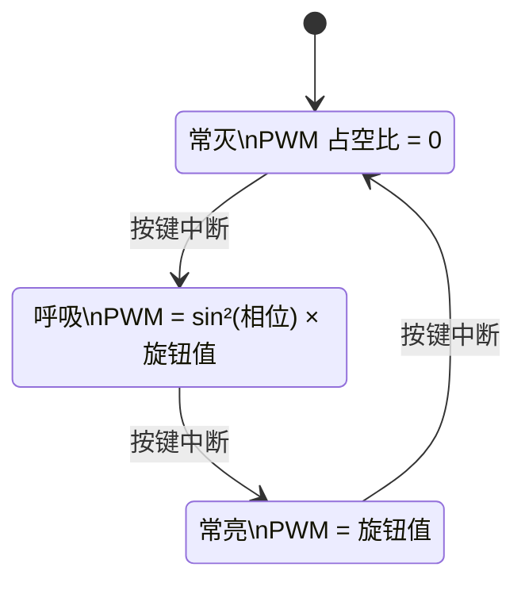
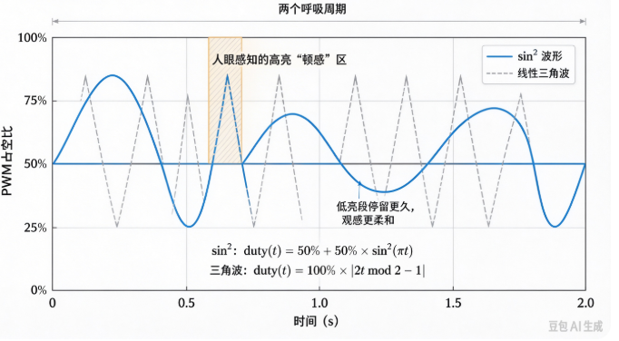

# B-B.2.5 实战：GPIO 按键 + PWM 呼吸灯 + ADC 电位器采集

> 所属章节：第五部 B. 总线协议 > B-B.2 基础外设接口
>
> 难度：[I] Intermediate | 预计阅读时间：50 分钟

## <span class="blue"> 本节导读

B-B.2.1 ~ B-B.2.4 分别讲了 GPIO、PWM、ADC、DAC 四件套。本篇把它们合成一个可运行的最小产品：**电位器旋钮调节 LED 呼吸灯的亮度上限，按键切换工作模式（常灭 / 呼吸 / 常亮）**。

本书面向 BSP 工程师，所以本篇的主示例不是应用层程序，而是**内核模块**：同一个产品逻辑写成 platform 驱动，资源全部来自设备树，按键中断切模式、工作队列算波形、PWM 消费 API 写占空比——这是 BSP 的日常形态。用户态实现保留为对照（原型形态），两者的分工差异本身就是本篇要建立的判断力。

本节覆盖：功能定义与电路接线（RK3568 锚点）、"硬件 / 内核框架 / 你的驱动 / 用户态"四层分工、两种形态的设备树配置与互斥关系、可编译可加载的完整 platform 驱动（含 Makefile 与预期 dmesg）、纯用户态对照实现、联调验证清单与无硬件模拟路径。

---

## <span class="blue"> 功能定义与电路

### 功能规格

| 输入/输出 | 器件 | 作用 |
|-----------|------|------|
| 输入 1 | 电位器（旋钮） | ADC 采集，决定呼吸灯亮度上限 |
| 输入 2 | 轻触按键 | GPIO 中断，循环切换模式：常灭 → 呼吸 → 常亮 |
| 输出 | LED | PWM 驱动，亮度由模式与电位器共同决定 |

模式切换是一个三态循环状态机，电位器不切换状态、只作为每个状态下亮度计算的输入参数：



### 接线（RK3568）

<svg viewBox="0 0 800 345" xmlns="http://www.w3.org/2000/svg" style="max-width:800px;width:100%;height:auto" font-family="sans-serif" font-size="13" stroke="currentColor" fill="none" stroke-width="1.5">
<defs><marker id="arr" markerWidth="8" markerHeight="8" refX="6" refY="3" orient="auto"><path d="M0,0 L6,3 L0,6 Z" fill="currentColor" stroke="none"/></marker></defs>
<rect x="60" y="70" width="170" height="250" stroke-width="2"/>
<text x="145" y="92" text-anchor="middle" fill="currentColor" stroke="none" font-size="15">RK3568</text>
<line x1="230" y1="100" x2="260" y2="100"/>
<text x="222" y="104" text-anchor="end" fill="currentColor" stroke="none">3V3</text>
<line x1="230" y1="150" x2="260" y2="150"/>
<text x="222" y="154" text-anchor="end" fill="currentColor" stroke="none">SARADC_VIN3</text>
<line x1="230" y1="200" x2="260" y2="200"/>
<text x="222" y="204" text-anchor="end" fill="currentColor" stroke="none">GPIO1_A0</text>
<line x1="230" y1="250" x2="260" y2="250"/>
<text x="222" y="254" text-anchor="end" fill="currentColor" stroke="none">PWM0</text>
<line x1="230" y1="300" x2="260" y2="300"/>
<text x="222" y="304" text-anchor="end" fill="currentColor" stroke="none">GND</text>
<line x1="260" y1="100" x2="520" y2="100" stroke-width="2"/>
<text x="375" y="92" text-anchor="middle" fill="currentColor" stroke="none">3.3V</text>
<line x1="520" y1="100" x2="520" y2="130"/>
<path d="M 520 130 L 513 138 L 527 146 L 513 154 L 527 162 L 513 170 L 527 178 L 520 186"/>
<line x1="520" y1="186" x2="520" y2="300"/>
<text x="535" y="122" text-anchor="start" fill="currentColor" stroke="none">电位器 10 kΩ</text>
<path d="M 260 150 L 572 150 L 572 158 L 534 158" stroke-width="2" marker-end="url(#arr)"/>
<text x="330" y="142" text-anchor="middle" fill="currentColor" stroke="none">抽头电压 0~3.3V</text>
<line x1="260" y1="200" x2="478" y2="200" stroke-width="2"/>
<circle cx="480" cy="200" r="3" fill="currentColor" stroke="none"/>
<path d="M 482 203 L 514 189"/>
<circle cx="516" cy="200" r="3" fill="currentColor" stroke="none"/>
<line x1="516" y1="200" x2="540" y2="200" stroke-width="2"/>
<text x="500" y="176" text-anchor="middle" fill="currentColor" stroke="none">轻触按键</text>
<line x1="540" y1="200" x2="540" y2="300"/>
<line x1="260" y1="250" x2="430" y2="250" stroke-width="2"/>
<text x="340" y="242" text-anchor="middle" fill="currentColor" stroke="none">PWM 驱动</text>
<path d="M 430 250 L 437 242 L 445 258 L 453 242 L 461 258 L 469 242 L 477 258 L 485 242 L 493 258 L 500 250"/>
<text x="465" y="230" text-anchor="middle" fill="currentColor" stroke="none">330 Ω</text>
<line x1="500" y1="250" x2="520" y2="250" stroke-width="2"/>
<path d="M 520 238 L 520 262 L 548 250 Z"/>
<line x1="548" y1="238" x2="548" y2="262"/>
<text x="534" y="226" text-anchor="middle" fill="currentColor" stroke="none">LED</text>
<line x1="548" y1="250" x2="580" y2="250" stroke-width="2"/>
<line x1="580" y1="250" x2="580" y2="300"/>
<line x1="260" y1="300" x2="580" y2="300" stroke-width="2"/>
<circle cx="520" cy="300" r="3" fill="currentColor" stroke="none"/>
<circle cx="540" cy="300" r="3" fill="currentColor" stroke="none"/>
<circle cx="580" cy="300" r="3" fill="currentColor" stroke="none"/>
<line x1="560" y1="300" x2="560" y2="310"/>
<line x1="548" y1="310" x2="572" y2="310"/>
<line x1="552" y1="316" x2="568" y2="316"/>
<line x1="556" y1="322" x2="564" y2="322"/>
</svg>

要点：电位器两端接 3.3 V/GND、抽头接 SARADC 通道 3，0~3.3 V 线性对应旋钮角度；按键一端 GPIO1_A0、一端 GND，内部上拉（低电平有效，见 B-B.2.1）；LED 阳极经 330 Ω 限流电阻接 PWM0，电流约 4 mA，在 8 mA 限额内。

> 💡 引脚分配以实际板卡原理图为准：电位器接哪个 ADC 通道、PWM 用哪个通道、按键在哪个 GPIO bank，都查本板 dts 与原理图。<BR>
> 本节示例用 SARADC 通道 3、pwm0、GPIO1_A0，自行替换。

### 四层分工：硬件、内核框架、你的驱动、用户态

前三节的责任线是"硬件 vs 软件"，本篇按 BSP 视角把软件再拆细：

| 层 | 负责什么 | 本章对应物 |
|----|----------|------------|
| 硬件（自动） | ADC 采样量化、PWM 波形生成、按键边沿检测 | 接线图里的三个器件 |
| 内核框架（现成代码） | IIO 消费 API、PWM 消费 API、gpiolib 与中断派发 | `iio_read_channel_raw` / `pwm_apply_might_sleep` / `gpiod_to_irq` |
| **你的驱动**（BSP 主战场） | probe 从设备树拿资源、中断里切模式、节拍里算波形写占空比 | `breath_ctrl_drv.c` |
| 用户态 | 产品形态下为空；原型形态下全包（见对照节） | `breath_ctrl.c` |

> 💡 四层各归各的好处：驱动里没有一个寄存器地址、没有一句外设初始化——前三节讲的硬件细节全部沉淀成了设备树属性和框架 API。<BR>
> 换一个采集源或输出器件，改动收敛在设备树和 probe 的资源获取，模式机与波形算法不动。

---

## <span class="blue"> 设备树配置：两种形态两种写法

**内核驱动形态（本篇主示例）**：三份资源聚合到一个自定义节点，驱动 probe 时一次取走：

```dts
/* ADC、PWM 控制器使能（dtsi 默认 disabled） */
&saradc {
    vref-supply = <&vcc_3v3>;                 /* 参考电压接 3.3V */
    status = "okay";
};

&pwm0 {
    pinctrl-0 = <&pwm0m0_pins>;               /* 引脚复用到 PWM 功能 */
    status = "okay";
};

/* 产品逻辑节点：三份资源聚合，匹配本篇的 platform 驱动 */
/ {
    breath_ctrl: breath-ctrl {
        compatible = "demo,breath-ctrl";               /* 匹配驱动的 of_match_table */
        pwms = <&pwm0 100000 0>;                       /* PWM 通道 + 周期 100000ns(10kHz) + 正常极性 */
        io-channels = <&saradc 3>;                     /* 电位器：SARADC 通道 3 */
        btn-gpios = <&gpio1 0 GPIO_ACTIVE_LOW>;        /* 按键：GPIO1_A0，按下为低 */
    };
};
```

**用户态形态（对照节用）**：按键改由 gpio-keys 现成驱动注册成 input 事件，PWM/ADC 暴露 sysfs 给用户态读写：

```dts
/ {
    gpio_keys: gpio-keys {
        compatible = "gpio-keys";             /* 内核现成按键驱动 */
        button_mode: button-mode {
            label = "mode-btn";
            gpios = <&gpio1 0 GPIO_ACTIVE_LOW>;
            linux,code = <KEY_F1>;            /* 上报的事件码，用户态按它过滤 */
            debounce-interval = <20>;         /* 内核防抖，单位 ms */
        };
    };
};
```

> ⚠️ 两种形态在同一个引脚上**互斥**：`breath-ctrl` 与 `gpio-keys` 都请求 GPIO1_A0，后 probe 的一方会拿到 `-EBUSY`。<BR>
> 同一个产品，功能住内核还是住用户态，设备树长相不同——选哪边，另一边就要从设备树里删掉。

电路上的每根线，在设备树里都有对应落点：

| 电路上的这根线 | 内核驱动形态 | 用户态形态 |
|----------------|--------------|------------|
| 电位器抽头 → SARADC_VIN3 | `io-channels = <&saradc 3>` | `&saradc` 使能，通道号写进程序 |
| 按键 → GPIO1_A0 | `btn-gpios`（驱动自己收中断） | gpio-keys 三属性（内核代管） |
| LED → PWM0 | `pwms = <&pwm0 100000 0>` | `&pwm0` 使能，sysfs 导出 |

上驱动之前先做注册三查，缺哪个回设备树补哪个：

```bash
ls /sys/bus/iio/devices/                 # 出现 iio:deviceX（saradc）
ls /sys/class/pwm/                       # 出现 pwmchipN
gpioinfo gpiochip1 | grep "GPIO1_A0\|line   0"   # 确认按键引脚空闲、未被占用
```

---

## <span class="blue"> 内核驱动完整实现（产品形态）

单文件 platform 驱动 `breath_ctrl_drv.c` + 一个 Makefile，外部模块方式编译，直接可加载验证。

```c
/* breath_ctrl_drv.c —— 呼吸灯产品逻辑的内核态实现（platform 驱动）
 * 资源全部来自设备树 breath-ctrl 节点：pwms / io-channels / btn-gpios
 * 按键中断里切模式；延迟工作队列里读旋钮、算波形、写占空比
 *
 * 编译（外部模块；KDIR 指向目标板的内核构建目录）：
 *     make -C $KDIR M=$PWD ARCH=arm64 CROSS_COMPILE=aarch64-linux-gnu- modules
 * 加载与验证（开发板上）：
 *     insmod breath_ctrl_drv.ko
 *     dmesg | tail
 * 预期 dmesg（probe 后按两下按键）：
 *     breath-ctrl: probed (pwm0 + saradc ch3 + btn irq)
 *     breath-ctrl: mode -> breath
 *     breath-ctrl: mode -> on
 */
#include <linux/module.h>
#include <linux/platform_device.h>
#include <linux/pwm.h>
#include <linux/iio/consumer.h>
#include <linux/gpio/consumer.h>
#include <linux/interrupt.h>
#include <linux/workqueue.h>

#define BREATH_TICK_MS   20                   /* 呼吸节拍：每 20ms 推一步 */
#define ADC_MAX          1023                 /* RK3568 SARADC 为 10-bit */

enum breath_mode { MODE_OFF = 0, MODE_BREATH, MODE_ON, MODE_MAX };

struct breath_ctrl {
    struct pwm_device  *pwm;                  /* 设备树 pwms 属性给的 PWM 通道 */
    struct iio_channel *adc;                  /* io-channels 属性给的 ADC 通道 */
    struct gpio_desc   *btn;                  /* btn-gpios 属性给的按键 */
    int                 irq;                  /* 由按键 GPIO 换算出的中断号 */
    struct delayed_work tick;                 /* 呼吸节拍：延迟工作队列 */
    enum breath_mode    mode;                 /* 当前模式：中断里改、节拍里读 */
    unsigned int        breath_idx;           /* 呼吸步号 0~31（32 步一周期） */
};

/* ---- 读电位器：返回原始值 0~1023 ---- */
static int breath_read_knob(struct breath_ctrl *bc)
{
    int raw;

    if (iio_read_channel_raw(bc->adc, &raw) < 0)  /* IIO 消费侧 API：一行读 raw */
        return 0;                                 /* 读失败按 0 处理，灯不乱闪 */
    if (raw > ADC_MAX) raw = ADC_MAX;             /* 钳位：防异常值穿透到占空比 */
    return raw;
}

/* ---- 写占空比：ratio 为定点比例 0~1024 ---- */
static void breath_set_pwm(struct breath_ctrl *bc, unsigned int ratio)
{
    struct pwm_state state;

    pwm_init_state(bc->pwm, &state);              /* 从设备树读周期/极性默认值 */
    if (ratio > 1024) ratio = 1024;               /* duty ≤ period 是硬约束 */
    state.duty_cycle = (u64)state.period * ratio / 1024;
    state.enabled = ratio ? true : false;         /* 占空比为 0 时顺手关输出 */
    pwm_apply_might_sleep(bc->pwm, &state);       /* 6.8 之前的内核叫 pwm_apply_state */
}

/* ---- 呼吸节拍：读旋钮 → 按模式算占空比 → 写 PWM → 排下一次节拍 ---- */
static void breath_tick(struct work_struct *work)
{
    struct breath_ctrl *bc = container_of(to_delayed_work(work),
                                          struct breath_ctrl, tick);
    unsigned int knob  = breath_read_knob(bc);    /* 旋钮：亮度上限 0~1023 */
    unsigned int ratio = 0;                       /* 占空比比例，定点 0~1024 */

    switch (bc->mode) {
    case MODE_ON:
        ratio = knob;                             /* 常亮：亮度 = 旋钮位置 */
        break;
    case MODE_BREATH: {
        /* 内核态无浮点：sin² 用查表——存四分之一周期 9 项，其余靠对称展开 */
        static const unsigned short sin2_q[9] = {
            0, 39, 150, 316, 512, 708, 874, 985, 1024   /* sin²(0..90°)×1024 */
        };
        unsigned int i = bc->breath_idx;          /* 0~31 */
        unsigned int q = i < 8  ? i      :        /* 折叠到第一象限 0~8 */
                         i < 16 ? 16 - i :
                         i < 24 ? i - 16 : 32 - i;
        ratio = sin2_q[q] * knob / ADC_MAX;       /* sin²(相位) × 旋钮上限 */
        bc->breath_idx = (bc->breath_idx + 1) & 31;   /* 32 步 × 20ms ≈ 0.64s 一周期 */
        break;
    }
    case MODE_OFF:
    default:
        ratio = 0;                                /* 常灭 */
        break;
    }

    breath_set_pwm(bc, ratio);
    schedule_delayed_work(&bc->tick, msecs_to_jiffies(BREATH_TICK_MS));
}

/* ---- 按键中断（线程化）：只切模式，不碰 PWM/IIO ---- */
static irqreturn_t breath_btn_irq(int irq, void *data)
{
    struct breath_ctrl *bc = data;
    static const char * const names[] = { "off", "breath", "on" };

    bc->mode = (bc->mode + 1) % MODE_MAX;         /* 三态循环 */
    pr_info("breath-ctrl: mode -> %s\n", names[bc->mode]);
    return IRQ_HANDLED;
}

static int breath_probe(struct platform_device *pdev)
{
    struct breath_ctrl *bc;
    int ret;

    /* devm_kzalloc：驱动卸载时内存自动释放，不用手写 kfree */
    bc = devm_kzalloc(&pdev->dev, sizeof(*bc), GFP_KERNEL);
    if (!bc)
        return -ENOMEM;

    /* 从设备树拿三份资源；dev_err_probe 在依赖未就绪时返回 -EPROBE_DEFER，
     * 内核会稍后自动重试 probe——PWM/IIO 控制器比本驱动晚注册时靠它兜底 */
    bc->pwm = devm_pwm_get(&pdev->dev, NULL);           /* 读 pwms 属性 */
    if (IS_ERR(bc->pwm))
        return dev_err_probe(&pdev->dev, PTR_ERR(bc->pwm), "get pwm\n");

    bc->adc = devm_iio_channel_get(&pdev->dev, NULL);   /* 读 io-channels 属性 */
    if (IS_ERR(bc->adc))
        return dev_err_probe(&pdev->dev, PTR_ERR(bc->adc), "get adc\n");

    bc->btn = devm_gpiod_get(&pdev->dev, "btn", GPIOD_IN);  /* btn-gpios，配成输入 */
    if (IS_ERR(bc->btn))
        return dev_err_probe(&pdev->dev, PTR_ERR(bc->btn), "get btn gpio\n");

    gpiod_set_debounce(bc->btn, 20000);   /* 消抖 20ms，单位 μs；
                                           * gpiochip 不支持时返回 -ENOTSUPP，教学场景从略 */

    bc->irq = gpiod_to_irq(bc->btn);                  /* GPIO 号换算成中断号 */
    if (bc->irq < 0)
        return dev_err_probe(&pdev->dev, bc->irq, "gpiod_to_irq\n");

    bc->mode       = MODE_OFF;                        /* 上电常灭 */
    bc->breath_idx = 0;
    INIT_DELAYED_WORK(&bc->tick, breath_tick);        /* 呼吸节拍挂工作队列 */
    schedule_delayed_work(&bc->tick, msecs_to_jiffies(BREATH_TICK_MS));

    platform_set_drvdata(pdev, bc);

    /* 顶半部传 NULL：处理全部线程化（IRQF_ONESHOT 配套），
     * 线程上下文里可以放心打印、改模式——详见第 10 章 threaded IRQ */
    ret = devm_request_threaded_irq(&pdev->dev, bc->irq,
                                    NULL, breath_btn_irq,
                                    IRQF_TRIGGER_FALLING | IRQF_ONESHOT,
                                    "breath-btn", bc);
    if (ret)
        return dev_err_probe(&pdev->dev, ret, "request irq\n");

    pr_info("breath-ctrl: probed (pwm0 + saradc ch3 + btn irq %d)\n", bc->irq);
    return 0;
}

/* 6.11 起 .remove 返回 void；6.1/6.6 LTS 需改回 int 并 return 0 */
static void breath_remove(struct platform_device *pdev)
{
    struct breath_ctrl *bc = platform_get_drvdata(pdev);
    struct pwm_state state;

    cancel_delayed_work_sync(&bc->tick);          /* 先停节拍，防卸载后还在写 PWM */
    pwm_init_state(bc->pwm, &state);
    state.enabled = false;
    pwm_apply_might_sleep(bc->pwm, &state);       /* 关灯退出 */
    /* 其余资源全是 devm_* 申请，卸载时自动释放，不用手写 */
}

static const struct of_device_id breath_of_match[] = {
    { .compatible = "demo,breath-ctrl" },         /* 与设备树节点 compatible 对应 */
    { }
};
MODULE_DEVICE_TABLE(of, breath_of_match);

static struct platform_driver breath_driver = {
    .probe  = breath_probe,
    .remove = breath_remove,
    .driver = {
        .name           = "breath-ctrl",
        .of_match_table = breath_of_match,        /* 设备树匹配表：驱动靠它找到节点 */
    },
};
module_platform_driver(breath_driver);            /* 展开为 module_init/exit + 注册注销 */

MODULE_LICENSE("GPL");
MODULE_DESCRIPTION("breath-ctrl demo: button mode + knob brightness + PWM breath");
```

配套 Makefile：

```makefile
obj-m += breath_ctrl_drv.o                      # 编译为可加载模块

# 使用：make -C <内核构建目录> M=$PWD ARCH=arm64 CROSS_COMPILE=aarch64-linux-gnu- modules
```

### 驱动要点解读

1. **资源全部来自设备树**：`pwms` / `io-channels` / `btn-gpios` 三个属性在 probe 里一次取走——对比用户态版"打开三个文件路径"，内核版连路径都没有，只有属性名
2. **devm_\* 系列**：内存、PWM、IIO 通道、GPIO、IRQ 全部托管，remove 里只剩"停节拍、关灯"两件事——资源泄漏类 bug 从结构上消失
3. **中断全线程化**：顶半部传 NULL + `IRQF_ONESHOT`，处理函数运行在线程上下文（第 10 章 threaded IRQ 的落地），打印、睡眠都安全
4. **节拍用工作队列而不用 hrtimer**：`pwm_apply_might_sleep()` 名字里就写着"可能睡眠"，必须在进程上下文——这是 10.3 底半部选型的直接应用
5. **内核态无浮点**：用户态版的 `sinf()` 在内核里不能用，sin² 改查表（四分之一周期 9 项 + 对称折叠）——用户态代码搬进内核的第一道坎几乎都是它
6. **dev_err_probe 与 -EPROBE_DEFER**：PWM/IIO 控制器比本驱动晚完成注册时，probe 返回延迟重试而不是直接失败——dmesg 里看到这个码不是错误，是"稍后重试"

---

## <span class="blue"> 对照：纯用户态实现（原型形态）

同一个产品逻辑不住内核、全住用户态，长这样：按键走 gpio-keys + input 事件（路径 A，见 B-B.2.1），ADC/PWM 走 sysfs。适合原型验证、快速迭代、不想动内核的场景；量产产品里凡是"开机即工作、不依赖根文件系统、要实时性"的功能，都应收进内核侧。

```c
/* breath_ctrl.c —— 电位器调亮度上限，按键切模式：常灭→呼吸→常亮
 * 目标平台：RK3568（saradc + pwm0 + gpio-keys），用户态形态
 * 依赖：无第三方库，仅 libm（sinf 在其中）
 * 编译（开发板上直接编译）：
 *     gcc -Wall -o breath_ctrl breath_ctrl.c -lm
 * 运行：
 *     ./breath_ctrl
 * 预期输出（启动后按两下按键）：
 *     启动：按键切模式（常灭→呼吸→常亮），旋钮调亮度上限
 *     模式 → 呼吸
 *     模式 → 常亮
 */
#include <stdio.h>
#include <stdlib.h>
#include <string.h>
#include <unistd.h>
#include <fcntl.h>
#include <poll.h>
#include <math.h>
#include <linux/input.h>                      /* input_event 结构、EV_KEY 等定义 */

/* ---- 平台参数（按实际板卡修改） ---- */
#define INPUT_DEV      "/dev/input/event0"    /* gpio-keys 注册出的按键事件节点 */
#define BTN_CODE       KEY_F1                 /* 必须与设备树 linux,code 一致 */
#define IIO_DEV        "/sys/bus/iio/devices/iio:device0"
#define ADC_CHANNEL    3                      /* 电位器所在 SARADC 通道 */
#define ADC_MAX        1023                   /* RK3568 SARADC 为 10-bit，满量程 1023 */
#define PWM_CHIP       "/sys/class/pwm/pwmchip0"
#define PWM_PATH       "/sys/class/pwm/pwmchip0/pwm0"
#define PWM_PERIOD_NS  100000                 /* 10 kHz：高于人眼可察频闪 */

enum mode { MODE_OFF = 0, MODE_BREATH, MODE_ON, MODE_MAX };  /* 三态模式机 */

/* ---- sysfs 小工具：属性当普通文件读写 ---- */
static int sysfs_write(const char *path, const char *val)
{
    int fd = open(path, O_WRONLY);
    if (fd < 0) return -1;
    int ret = write(fd, val, strlen(val));    /* sysfs 写入就是写字符串 */
    close(fd);
    return ret < 0 ? -1 : 0;
}

static int sysfs_read_int(const char *path)
{
    char buf[32] = {0};
    int fd = open(path, O_RDONLY);
    if (fd < 0) return -1;
    if (read(fd, buf, sizeof(buf) - 1) <= 0) { close(fd); return -1; }
    close(fd);
    return atoi(buf);                         /* sysfs 内容是一行十进制数字 */
}

/* ---- ADC：读电位器，返回 0.0~1.0 的比例 ---- */
static float adc_read_ratio(void)
{
    char path[128];
    snprintf(path, sizeof(path), "%s/in_voltage%d_raw", IIO_DEV, ADC_CHANNEL);
    int raw = sysfs_read_int(path);
    if (raw < 0) return 0.0f;                 /* 读失败按 0 处理，不让灯乱闪 */
    if (raw > ADC_MAX) raw = ADC_MAX;         /* 钳位：防异常值穿透到占空比 */
    return (float)raw / ADC_MAX;              /* 归一化成比例，与位数解耦 */
}

/* ---- PWM：导出 → 配周期 → 占空比清零 → 使能 ---- */
static int pwm_init(void)
{
    char buf[32];
    sysfs_write(PWM_CHIP "/export", "0");     /* 已导出时会失败，忽略其返回值 */
    usleep(100000);                           /* 等 udev 建好 pwm0 目录 */
    snprintf(buf, sizeof(buf), "%d", PWM_PERIOD_NS);
    sysfs_write(PWM_PATH "/period", buf);     /* 先配周期（单位纳秒） */
    sysfs_write(PWM_PATH "/duty_cycle", "0"); /* 占空比清零，避免上电即亮 */
    return sysfs_write(PWM_PATH "/enable", "1");
}

static void pwm_set_ratio(float ratio)        /* ratio: 0.0~1.0 */
{
    char buf[32];
    if (ratio < 0.0f) ratio = 0.0f;
    if (ratio > 1.0f) ratio = 1.0f;           /* 钳位是 sysfs 约束：duty ≤ period */
    snprintf(buf, sizeof(buf), "%d", (int)(PWM_PERIOD_NS * ratio));
    sysfs_write(PWM_PATH "/duty_cycle", buf);
}

int main(void)
{
    /* ---- 按键：gpio-keys 已注册成 input 设备，直接读事件 ---- */
    int btn_fd = open(INPUT_DEV, O_RDONLY | O_NONBLOCK);
    if (btn_fd < 0) { perror(INPUT_DEV); return 1; }  /* 打不开先回设备树三查 */

    if (pwm_init() < 0) { perror("pwm_init"); return 1; }

    enum mode mode = MODE_OFF;
    float phase = 0.0f;                       /* 呼吸相位，0~2π */
    const float step = 0.15f;                 /* 每个 20ms 节拍推进的相位 */
    struct pollfd pfd = { .fd = btn_fd, .events = POLLIN };

    printf("启动：按键切模式（常灭→呼吸→常亮），旋钮调亮度上限\n");

    for (;;) {
        /* poll 超时 20ms：既等按键事件，又当呼吸节拍源，省掉独立定时器线程 */
        if (poll(&pfd, 1, 20) > 0 && (pfd.revents & POLLIN)) {
            struct input_event ev;
            /* 非阻塞读掏空事件队列；队列空了 read 返回 -1，循环自然退出 */
            while (read(btn_fd, &ev, sizeof(ev)) == sizeof(ev)) {
                /* value: 0=松开 1=按下 2=长按重复——只在"按下"切模式，
                 * 不过滤的话一次按键会切两次（按下+松开各一次） */
                if (ev.type == EV_KEY && ev.code == BTN_CODE && ev.value == 1) {
                    mode = (mode + 1) % MODE_MAX;
                    printf("模式 → %s\n",
                           mode == MODE_OFF   ? "常灭" :
                           mode == MODE_BREATH ? "呼吸" : "常亮");
                }
            }
        }

        float knob = adc_read_ratio();        /* 电位器：亮度上限 0.0~1.0 */

        switch (mode) {
        case MODE_OFF:
            pwm_set_ratio(0.0f);              /* 常灭：占空比 0 */
            break;
        case MODE_ON:
            pwm_set_ratio(knob);              /* 常亮：亮度=旋钮位置 */
            break;
        case MODE_BREATH:
            phase += step;
            if (phase > 6.2832f) phase -= 6.2832f;   /* 相位绕回 0~2π */
            float s = sinf(phase);
            pwm_set_ratio(s * s * knob);      /* sin² 波形 × 旋钮上限 */
            break;
        default:
            break;
        }
    }

    /* 到达不了；正常退出应 close(btn_fd) 并写 enable=0 关 PWM */
    return 0;
}
```

### 用户态版要点（与内核版逐项对照）

1. **事件模型**：poll 超时兼作节拍源（省线程）——内核版对应 delayed_work；两种形态各有一个"节拍源"，选型理由相同
2. **防抖位置**：用户态版靠设备树 gpio-keys 的 `debounce-interval`（单位 **ms**）；内核版用 `gpiod_set_debounce()`（单位 **μs**）——同一件事，两处单位不同，写错差 1000 倍
3. **事件过滤 `value == 1`**：input 事件区分按下/松开/重复，不过滤一次按键切两次模式
4. **浮点可用**：用户态有 `sinf()`，内核版被迫查表——两版波形代码的差异全因这一条


<!-- 【待补图】images/b-b-2-5-breath-curve.png（优先级：△有更好）
图名：sin² 与线性三角波呼吸曲线对比
生图提示词：数据曲线对比图，横轴为时间（0~2 秒，标注两个呼吸周期），纵轴为 PWM 占空比（0~100%）。两条曲线：sin² 波形（蓝色实线，波峰圆润、波谷平缓）与线性三角波（灰色虚线，尖峰尖谷）。在三角波高亮段（>80% 占空比）用浅色底纹标出"人眼感知的高亮'顿感'区"，在 sin² 曲线波谷处标注"低亮段停留更久，观感更柔和"。曲线下方配一行小字给出两条曲线的占空比公式。坐标轴刻度清晰，图例在右上角。扁平技术插画风，白底，蓝色为主色灰色为对比色，中文标注，比例 16:9。 -->

---

## <span class="blue"> 联调验证清单

以内核驱动形态为准（用户态形态把"insmod/dmesg"换成"运行程序/看终端"即可）：

| 步骤 | 操作 | 预期 |
|------|------|------|
| 1 | 注册三查（iio / pwm / gpioinfo 确认按键空闲） | 三件套就绪，引脚未被占用 |
| 2 | `insmod breath_ctrl_drv.ko`，看 dmesg | 打印 `probed (pwm0 + saradc ch3 + btn irq N)`，LED 灭 |
| 3 | 按键一次 | dmesg 打印 `mode -> breath`，LED 平滑明暗循环 |
| 4 | 旋转电位器 | 呼吸峰值亮度跟随变化 |
| 5 | 再按两次键 | 常亮（亮度=旋钮位置）→ 常灭 |
| 6 | 快速连按 10 次 | 无丢模式、无多跳（防抖生效） |
| 7 | `rmmod breath_ctrl_drv` | LED 熄灭，dmesg 无报错、无资源泄漏告警 |

> ⚠️ insmod 后 dmesg 出现 `-EPROBE_DEFER` 不是失败：PWM/IIO 控制器还没注册完，`dev_err_probe` 会让内核稍后自动重试 probe。持续停在 DEFER 才是问题——回设备树查控制器是否使能。
<!-- -->
> ⚠️ 一次按键连跳 2~3 个模式：防抖没生效。内核版查 `gpiod_set_debounce` 是否被 gpiochip 支持（不支持返回 -ENOTSUPP，需退回软件防抖）；用户态版查设备树 `debounce-interval` 是否写了 20（单位 ms）。
<!-- -->
> 💡 亮度上限明显偏低（最高只有约 1/4）：把 10-bit ADC 当 12-bit 换算了，`ADC_MAX` 误写 4095——换平台先确认 ADC 位数。旋钮无响应或方向反：通道号与原理图张冠李戴，万用表量抽头电压、对照各通道 raw 值，一次确认映射。

---

## <span class="blue"> 无硬件路径

无开发板时在 PC 上完整演练（两种形态都支持）：

1. **内核驱动形态**：QEMU 或本机内核上，gpio-sim（configfs 虚拟按键）+ pwm-sim + IIO dummy 三件套造出虚拟资源，配上对应设备树/ACPI 描述后 `insmod` 原样跑通 probe、中断与节拍
2. **按键事件**：`uinput` 创建虚拟 input 设备注入 KEY_F1 按下/松开，用户态程序原样运行
3. **纯逻辑验证**：把 `breath_read_knob` / `breath_set_pwm`（或用户态版的两个读写函数）换成读写普通文件的桩，模式机与呼吸表在 PC 上单元测试

---

## <span class="blue"> 本节总结

本篇把 B-B.2.1 ~ B-B.2.4 的四件套焊成了一个最小但完整的产品闭环：电位器经 ADC 采集成为决策输入，按键经 GPIO 中断驱动三态模式机，PWM 把决策结果输出为 LED 亮度。这套"采集 → 决策 → 输出"骨架是嵌入式产品的通用最小形态——把输入源换成 I2C 传感器、输出换成 SPI 屏幕，骨架纹丝不动，这也是后续总线实战篇的展开方式。

本篇按 BSP 视角给了两种形态：产品形态是 platform 驱动——资源来自设备树（pwms/io-channels/btn-gpios）、devm_* 托管生命周期、中断线程化、节拍进工作队列、无浮点查表；原型形态是纯用户态——gpio-keys 报 input 事件、sysfs 读写 ADC/PWM、poll 兼作节拍。<BR>
判断"功能该住哪层"的依据：开机即工作、不依赖根文件系统、要实时性、要被多个应用共享——住进内核；快速验证、频繁迭代、与硬件时序无关——留在用户态。两种形态在同一个引脚上互斥，设备树只能写一边。

工程细节带走五个：dev_err_probe 把"依赖未就绪"变成自动重试；pwm_apply_might_sleep 的名字就是上下文警告；内核态无浮点是代码搬迁的第一道坎；消抖参数内核驱动用 μs、gpio-keys 用 ms；注册三查与 EPROBE_DEFER 是驱动联调的第一课。

---

## <span class="blue"> 本节自查（面试问答）

先自答再点开对答案；答不上来的回正文补。

### 骨架与分工

??? details "Q1. 同一个产品逻辑，内核态版和用户态版的分工差异在哪？"

    内核态版：设备树聚合三资源，platform 驱动在 probe 里经 devm_* 拿到 PWM/IIO/GPIO/IRQ，中断切模式、工作队列算波形写占空比，用户态为空。用户态版：gpio-keys 报 input 事件、sysfs 暴露 ADC/PWM，应用进程包办模式机与波形。骨架（采集→决策→输出）两版相同，差别在"决策住哪层"。

??? details "Q2. 哪些信号告诉你'这个功能该住进内核'？"

    四条：开机即工作（等不到根文件系统与用户态起来）、要硬实时（调度抖动不可接受）、要被多个应用共享（内核做单点仲裁）、涉及裸中断/时序敏感的硬件交互。都不沾的快速验证功能留用户态，迭代快得多。

??? details "Q3. 把输入源换成 I2C 温度传感器，内核版的哪几层动、哪几层不动？"

    动：设备树节点（io-channels 换成 i2c 挂接）、probe 里的资源获取（iio_channel 换 i2c_client）、`breath_read_knob` 的实现。不动：模式机、中断处理、呼吸查表、`breath_set_pwm`、节拍框架——骨架纹丝不动。

### 设备树

??? details "Q4. breath-ctrl 节点聚合三资源用的是哪三个属性？驱动侧各用什么 API 取？"

    `pwms`（devm_pwm_get）、`io-channels`（devm_iio_channel_get）、`btn-gpios`（devm_gpiod_get）。三个属性名都是对应框架的标准约定，框架解析设备树后把资源句柄交给驱动。

??? details "Q5. breath-ctrl 节点和 gpio-keys 节点为什么不能同时用 GPIO1_A0？"

    同一个引脚只能被一个驱动请求：先 probe 的一方拿走 GPIO1_A0，后到的在 devm_gpiod_get 拿到 -EBUSY。功能住内核还是住用户态，设备树只能写一边。

### 驱动实现

??? details "Q6. devm_* 系列帮你省掉了什么？remove 里为什么只剩两行？"

    devm 把资源生命周期托管给设备模型：驱动卸载时内存、PWM、IIO 通道、GPIO、IRQ 自动按序释放，不用手写释放链。remove 只剩 devm 不管的两件事：停 delayed_work（防卸载后还在跑）、关灯（硬件状态复位）。

??? details "Q7. 按键中断为什么顶半部传 NULL、全走线程？"

    IRQF_ONESHOT + 顶半部 NULL = 完全线程化中断：处理函数运行在进程上下文，可以打印、可以睡眠、不用担心关中断窗口拉长（第 10 章 threaded IRQ）。这个 handler 只切一个枚举值，本来也能放硬中断——线程化是为了演示标准姿势，也为以后 handler 里做更重的事留余地。

??? details "Q8. 呼吸节拍为什么用 delayed_work 而不用 hrtimer？"

    节拍回调里要调 pwm_apply_might_sleep()——名字里写着"可能睡眠"。hrtimer 回调在软中断上下文，禁止睡眠；workqueue 在进程上下文，可以睡。这是 10.3 底半部选型的直接应用：按"是否可睡眠"选机制。

??? details "Q9. 用户态版一行 sinf() 搞定的事，内核版为什么要查表？"

    内核态禁用浮点（ARM 上内核上下文不保存 FPU 状态，用浮点会破坏用户态现场）。sin² 定点化：存四分之一周期 9 项（×1024 缩放），其余靠对称折叠——用户态代码搬进内核的第一道坎几乎都是浮点。

??? details "Q10. insmod 后 dmesg 里出现 -EPROBE_DEFER，是加载失败吗？"

    不是。它表示依赖的资源（PWM/IIO 控制器驱动）还没注册完，dev_err_probe 返回该码后内核会把本驱动挂到延迟队列、稍后自动重试 probe。持续停在 DEFER 才要查：回设备树确认控制器使能。

### 联调

??? details "Q11. 一次按键连跳 2~3 个模式，内核版和用户态版分别怎么查？"

    都是防抖没生效，但查的位置不同：内核版查 gpiod_set_debounce 是否被 gpiochip 支持（-ENOTSUPP 则需软件防抖）；用户态版查设备树 debounce-interval 是否写了 20（单位 ms），并用 evtest 数一次按下报了几个事件。注意两处单位差 1000 倍：驱动 API 是 μs，gpio-keys 属性是 ms。

??? details "Q12. 卸载驱动后 LED 还亮着，说明 remove 漏了什么？"

    漏了"关灯"这一步：cancel_delayed_work_sync 只停了节拍，PWM 通道还按最后的占空比输出。remove 里必须显式 pwm_apply 一个 enabled=false 的状态——硬件状态不会随模块卸载自动复位。

---

## <span class="blue"> 下一步

基础外设板块（B-B.2）到此完整闭环。

下一篇进入 I2C 系列——**B-B.3.1 I2C 物理层与电气特性**：两线制、开漏与上拉、线与仲裁，理解 B-B.2.1 埋下的"开漏必配上拉"在真实总线上如何变成完整的通信协议。

> 💡 螺旋衔接：本篇的"采集→决策→输出"闭环是嵌入式产品的最小骨架——B-B.3/B-B.4 的 I2C/SPI 实战篇（AT24C02、W25Qxx）会把输入源换成总线器件，骨架不变；threaded IRQ、工作队列、底半部选型的机制原理回第 10 章，本篇是它们的第一次实战落地。
