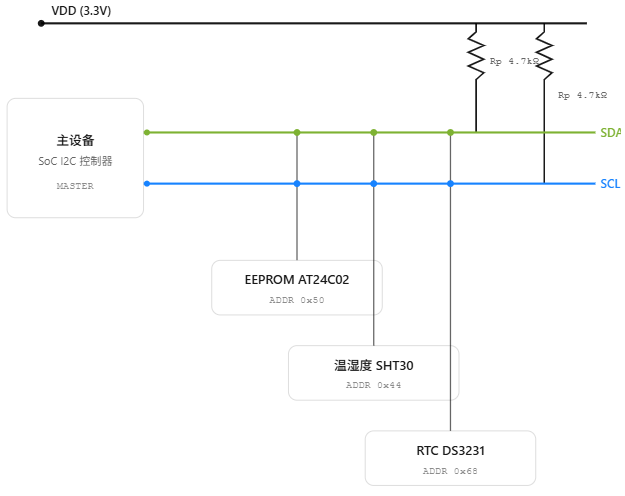

# B-B.3.1 I2C 物理层与电气特性

> 所属章节：第五部 B. 总线协议 > B-B.3 I2C 总线
>
> 难度：[B→I] Beginner → Intermediate | 预计阅读时间：40 分钟

## <span class="blue">本节导读：一条总线怎样才算可靠

I2C（Inter-Integrated Circuit）用 SDA、SCL 两根信号线连接多个设备，常用于 EEPROM、传感器和实时时钟等低速外设。少接线并不等于少约束：引脚为什么不能主动输出高电平，上拉电阻为什么不能凭经验固定，增加设备后为什么可能先遇到电气问题而不是地址耗尽，都要从物理层回答。

本节只解决一个主问题：**一条 3.3 V I2C 总线为什么能够可靠通信，速率、电阻、电容和地址发生变化时，怎样重新核算？**

全文围绕同一条总线展开：片上系统（SoC）作为主设备，挂接 AT24C02 EEPROM、SHT30 温湿度传感器和 DS3231 实时时钟。EEPROM 用来保存少量非易失数据，实时时钟（RTC）在主系统断电后继续保持时间。初始设计为 100 kHz、SDA 和 SCL 各用一只 4.7 kΩ 上拉电阻；后文会让它升速、增加电容，再检查原设计是否仍然成立。

硬件与软件的责任也要分开：原理图决定上拉、电平和走线，器件手册决定速率与耐压边界，软件配置控制器并处理访问冲突。软件人员不一定要独立完成原理图，但必须能读懂这些约束并定位异常。

> 💡 **本系列六篇的分工**
>
> - **本篇 B-B.3.1**：电气结构、速率边界、上拉计算、电平兼容、仲裁和地址冲突。
> - **B-B.3.2**：START、STOP、地址帧、读写位和完整事务的帧格式。
> - **B-B.3.3**：Linux I2C 驱动框架与设备接入。
> - **B-B.3.4**：扫描、读写、示波器与逻辑分析仪等调试方法。
> - **B-B.3.5**：AT24C02 从设备树到读写验证的完整实战。
> - **B-B.3.6**：SMBus、PMBus 与 I2C 的关系及额外约束。

---

## <span class="blue">两根线与两种动作

### SDA 传数据，SCL 给节拍

- **SDA**（Serial Data Line）承载地址、数据和应答，是双向信号线。
- **SCL**（Serial Clock Line）提供采样节拍。常见的单主系统中由主设备控制器驱动；从设备在特定条件下也能拉住它，时钟延展留到 B-B.3.2 讨论。

I2C 是同步串行总线。“串行”表示数据逐位传输，“同步”表示收发双方利用 SCL 对齐每一位，不需要像 UART 那样各自依靠事先约定的波特率计时。这不表示速率可以任意设置，主设备仍须把 SCL 限制在整条总线上所有器件都能工作的范围内。

SDA 只有一根，发送与接收必须分时进行，所以 I2C 属于半双工。B-B.4.1 介绍的 SPI 使用独立的 MOSI、MISO，可以同时收发，属于全双工。I2C 用分时复用减少连线，SPI 用更多信号线换取同时双向传输。

### 开漏只能拉低或放手

B-B.2.1 已介绍推挽输出：内部上管把引脚接向电源以输出高电平，下管把引脚接向地以输出低电平。I2C 的开漏（open-drain）输出不主动接上电源，只保留下拉通路，因此每个引脚只有两种动作：

| 引脚动作 | 内部状态 | 对总线的影响 |
|---|---|---|
| 拉低 | 下拉管导通 | 把信号线主动拉向地（GND） |
| 放手 | 下拉管截止，引脚呈高阻态 | 不主动驱动信号线，只读取实际电平 |

高阻态不是输出高电平。若所有器件都放手且没有上拉，信号线会浮空，电平不能确定。因此 SDA、SCL 各需要一只上拉电阻 Rp 接到电源电压 VDD：至少一个器件拉低时，总线为低；全部器件放手时，电阻把总线拉回高电平。

这也解释了为什么不能用普通推挽 GPIO 直接代替 I2C 输出。一个器件主动推高、另一个主动拉低时，会形成电源到地的低阻通路，不再只是通信错误，还可能损坏输出级。正常使用时应把引脚复用给 I2C 控制器，并确认该控制器及板级电路符合开漏要求。

### 线与让接收方也能控制同一根线

多个开漏输出并接后形成线与（wired-AND）：任何一个器件输出 0，总线就是 0；只有所有器件都放手，总线才为 1。可以把器件“放手”记作逻辑 1，得到下面的完整组合：

| 器件 A | 器件 B | 总线电平 |
|---|---|---|
| 放手（1） | 放手（1） | 1 |
| 放手（1） | 拉低（0） | 0 |
| 拉低（0） | 放手（1） | 0 |
| 拉低（0） | 拉低（0） | 0 |

关键不只是“0 优先”，而是**器件读回的电平可能不同于自己试图输出的电平**。发送方放手准备读 1，却读到 0，就说明另一个器件正在拉低。

应答（ACK，Acknowledge）、时钟延展和多主仲裁都建立在这个能力上。以 ACK 为例，发送方发完 8 位后在第 9 个时钟周期释放 SDA；接收方拉低 SDA 表示 ACK，发送方读回 0 才知道对方应答。若接收方不拉低，上拉使 SDA 保持 1，发送方读到非应答（NACK，Not Acknowledge）。这里只解释电气机制，完整帧中谁在第 9 拍应答、主设备何时主动发送 NACK，由 B-B.3.2 展开。

---

## <span class="blue">贯穿实例：并联共享两条线

主设备和三个从设备的 SDA 全部接在同一根线上，SCL 也全部接在另一根线上。新设备通过并联接入，不需要像 SPI 那样为每个从设备增加独立片选线。



图中两条总线各自只有一只公共上拉电阻，不是每个设备各配一套。若某些 breakout 模块（把芯片引脚引出的转接小板）已经自带上拉，并联后等效电阻会变小，计算时不能只数原理图上“那一对电阻”。

“最多能挂多少设备”包含两个彼此独立的判断：

1. **地址是否唯一**。7 位地址去掉保留值后，普通设备可使用 112 个地址，本文末尾再讨论冲突。
2. **电气条件是否满足**。器件引脚、焊盘、走线、连接器和线缆都会贡献电容，上升时间还受上拉电阻限制。Sm、Fm 模式规范给出的总线电容上限是 400 pF，但是否能够可靠工作仍须结合速率、上拉和器件驱动能力核算。

因此，112 不是保证可接入的设备数量，400 pF 也不是脱离条件的故障分界线。设计时要分别检查地址表和电气预算。

---

## <span class="blue">速率提高后，哪些约束会收紧

### 整线频率按最慢设备确定

SDA 上每一位通常占一个 SCL 周期，所以 SCL 频率等于总线比特率。常见模式如下：

| 模式 | SCL 上限 | 本文关注点 |
|---|---:|---|
| Standard-mode（Sm） | 100 kHz | 上升时间上限 1000 ns |
| Fast-mode（Fm） | 400 kHz | 上升时间上限 300 ns |
| Fast-mode Plus（Fm+） | 1 MHz | 电气驱动和电容规则另有变化，不沿用本文 Fm 示例 |
| High-speed mode（Hs） | 3.4 MHz | 使用额外传输与电气机制，不在本篇展开 |

100 kHz 的低速兼容范围更广，400 kHz 是许多板内器件的常见折中，但不存在适用于所有设计的“默认最佳速率”。同一条总线上的设备共享 SCL 时，应按最慢设备和支持的电气条件选择频率。

例如，只支持 100 kHz 的器件与支持 400 kHz 的器件挂在同一根总线上，主设备应使用 100 kHz。若强行提速，慢器件可能不应答或读错数据，而其他器件仍然正常，所以“别的设备能通信”不能证明速率配置正确。

Linux 设备树中的 `clock-frequency` 只是控制器工作频率的配置入口，例如：

```dts
&i2c1 {
    clock-frequency = <100000>;  /* 目标 SCL 频率：100 kHz */
    status = "okay";
};
```

具体节点写法取决于 SoC 和板级设备树，B-B.3.3、B-B.3.5 会结合驱动继续说明。这个属性不会替硬件工程师保证波形合格，控制器能产生 400 kHz 时钟，也不表示板上的上升沿一定满足 Fm 要求。

### 时序参数是在约束波形，不是装饰表格

START 是 SCL 为高时 SDA 由高变低，STOP 则是 SCL 为高时 SDA 由低变高，二者标记事务边界。普通数据位在 SCL 低电平期间变化，在 SCL 高电平期间保持稳定供接收方采样；完整帧序列由 B-B.3.2 讲解。

接收方需要在采样前看到稳定电平，帧边界和空闲间隔也需要足够时间。常见参数包括：

- `t_SU;DAT`：数据在采样前必须提前稳定的时间。
- `t_HD;STA`：START 后需要保持的时间。
- `t_LOW`、`t_HIGH`：SCL 低、高电平的最短持续时间。
- `t_R`、`t_F`：信号上升、下降所允许的时间。

这些参数由 NXP UM10204 规范按模式给出。本文的电阻计算只直接使用 `t_R`：Sm 为 1000 ns，Fm 为 300 ns。其余帧级参数和波形位置放在 B-B.3.2，避免在这里同时展开两套问题。

下降沿由器件的下拉管主动放电；无源上拉总线的上升沿则要靠 Rp 给总线电容 C_bus 充电。因此，即使控制器配置完全不变，只增加走线电容或增大上拉电阻，也可能让上升沿变慢并超出 `t_R`。

---

## <span class="blue">上拉电阻与总线电容：把同一笔账算到底

### 先定义两个对象

**Rp** 是一条信号线的等效上拉电阻。若多只上拉电阻并联接在同一电源上，应先求并联等效值。

**C_bus** 是该信号线看到的总电容，包括各器件引脚与封装、印制电路板（PCB）的焊盘与走线、连接器及外线。SDA 和 SCL 应分别估算，不能默认两者完全相同。前期设计可根据器件数据与布局估算，样机阶段再用波形测量复核，不能把经验范围当成实测值。

开漏总线释放后，电压按电阻与电容形成的 RC 充电曲线上升：

```text
V(t) = VDD × (1 - e^(-t / (Rp × C_bus)))
```

`t_R` 按从 0.3×VDD 上升到 0.7×VDD 的时间计算。代入 RC 曲线，两点的间隔为：

```text
t_R = Rp × C_bus × ln(0.7 / 0.3)
    ≈ 0.8473 × Rp × C_bus
```

于是得到上拉上限：

```text
Rp(max) = t_R / (0.8473 × C_bus)
```

电阻越大，充电越慢；电容越大，达到相同电平也越慢。公式与 SM、Fm 时序边界可对照 [NXP UM10204](https://www.nxp.com/docs/en/user-guide/UM10204.pdf)，计算示例也可参考 [TI 的 I2C 上拉电阻计算资料](https://e2e.ti.com/cfs-file/__key/communityserver-discussions-components-files/6/I2C-Bus-Pullup-Resistor-Calculation.pdf)。

### 电阻还有由灌电流决定的下限

上拉不是越小越好。某个器件把总线拉低时，电流经 Rp 流入它的输出引脚。上拉下限为：

```text
Rp(min) = (VDD - VOL(max)) / IOL
```

- `VOL(max)` 是器件保证低电平时允许的最高输出电压，本例取 0.4 V。
- `IOL` 是在该低电平条件下器件可保证承受的灌电流，本例假设所有会拉低总线的器件都支持 3 mA。

实际设计要按总线上最弱器件的 `VOL`、`IOL` 条件计算，不能看到“Sm/Fm 常见 3 mA”就跳过器件手册。本文示例在 VDD = 3.3 V 时得到：

```text
Rp(min) = (3.3 V - 0.4 V) / 3 mA
        ≈ 0.967 kΩ
```

只有 `Rp(min) ≤ Rp ≤ Rp(max)` 时，才同时满足本例的低电平灌电流与上升时间约束。这个区间之外，还要检查功耗、器件具体驱动能力和波形裕量。

### 第一步：100 kHz、100 pF，4.7 kΩ 是否合适

为了演示计算过程，假设汇总器件与布线后，SDA 的估算电容为 100 pF。这个数值是本实例的输入条件，不是所有四设备总线的固定值。

Sm 的 `t_R` 上限为 1000 ns：

```text
Rp(max) = 1000 ns / (0.8473 × 100 pF)
        ≈ 11.80 kΩ
```

结合前面的 0.967 kΩ 下限，4.7 kΩ 位于合法区间内。再代回 RC 公式估算：

```text
t_R ≈ 0.8473 × 4.7 kΩ × 100 pF
    ≈ 398 ns < 1000 ns
```

所以，**在这些假设成立时**，初始原理图的 4.7 kΩ 可以用于 100 kHz。这里验证的是电阻、电容和上升时间之间的关系，还没有验证整条总线的所有时序与器件条件。

### 第二步：同一总线升到 400 kHz，原电阻还能用吗

Fm 的 `t_R` 上限收紧到 300 ns：

```text
Rp(max) = 300 ns / (0.8473 × 100 pF)
        ≈ 3.54 kΩ
```

4.7 kΩ 已超过上限，前面估算的 398 ns 也超过 300 ns，因此不能继续沿用。选择 2.2 kΩ 后：

```text
0.967 kΩ < 2.2 kΩ < 3.54 kΩ

t_R ≈ 0.8473 × 2.2 kΩ × 100 pF
    ≈ 187 ns < 300 ns
```

频率配置和电阻必须一起检查。只把 `clock-frequency` 从 `<100000>` 改成 `<400000>`，并没有完成这次升速设计。

### 第三步：电容增到 200 pF，再次重选

若改版后增加连接器和走线，估算 C_bus 变为 200 pF，Fm 下：

```text
Rp(max) = 300 ns / (0.8473 × 200 pF)
        ≈ 1.77 kΩ
```

刚才的 2.2 kΩ 也不再满足上限，可以改选 1.5 kΩ：

```text
0.967 kΩ < 1.5 kΩ < 1.77 kΩ

t_R ≈ 0.8473 × 1.5 kΩ × 200 pF
    ≈ 254 ns < 300 ns
```

这一步说明“上次能用的电阻”不是器件的永久属性。总线电容变化后，同一速率也要重新计算。

### 第四步：电容达到 400 pF，不是简单换一个更小电阻

若继续按 Fm 和 3 mA 灌电流条件计算：

```text
Rp(max) = 300 ns / (0.8473 × 400 pF)
        ≈ 0.885 kΩ

Rp(min) ≈ 0.967 kΩ

Rp(max) < Rp(min)
```

两者没有交集：满足上升时间的电阻会让本例的低电平灌电流条件不成立，满足灌电流的电阻又让上升沿过慢。此时不能用“再小一点”掩盖矛盾，可考虑：

- 降回 Sm。此时 `Rp(max) ≈ 1000 ns / (0.8473 × 400 pF) ≈ 2.95 kΩ`，与 0.967 kΩ 下限之间重新出现合法区间。
- 减少器件、走线或外线带来的电容。
- 按系统需求使用合适的总线缓冲器或分段方案，让各段分别承担电容。
- 若器件确实支持更强的灌电流，按手册重新核算，而不是直接套用本例的 3 mA。

400 pF 是 Sm/Fm 的规范总线电容上限，并不意味着超过该值后可以靠本文公式推导出“任何速率都无法工作”。同样，达到 400 pF 也不表示所有器件组合都必然无解；速率与驱动条件不同，结论就不同。

### 测量与故障现象怎样对应

上升沿过慢时，器件可能在采样点仍未识别到可靠高电平，表现为不应答、数据错误或随温度与布局变化。应使用示波器测量实际边沿和电平，再对照对应模式的 `t_R`，不能只看逻辑分析仪解码是否偶尔成功。

上拉缺失或总线浮空时，空闲电平可能异常；有器件持续拉低时，SDA 或 SCL 可能一直接近 0 V。B-B.3.4 会给出扫描、总线恢复和仪器操作步骤，本篇只要求能从电气结构解释这些现象。

---

## <span class="blue">电平兼容：同时检查识别与耐压

总线高电平由上拉电压决定，但能否直接互连要分别回答两个问题：

1. **接收方能否识别**。`VIH` 是可靠识别高电平所需的输入电压条件，`VIL` 是可靠识别低电平对应的输入电压条件，具体数值以器件手册为准。常见比例阈值不能代替具体型号的数据。
2. **引脚能否承受**。总线上拉到 5 V 时，3.3 V 器件即使没有主动输出 5 V，其引脚也可能直接承受 5 V，必须确认绝对最大额定值及是否存在到电源的寄生通路。

因此，“器件使用 5 V 供电”不等于“I2C 必须使用 5 V 上拉”。有些 5 V 供电器件的 I2C 输入可以识别 3.3 V 高电平，允许总线上拉到 3.3 V；也有些器件不满足，需要电平转换。判断依据是接口电气参数，而不是只看电源电压。

常见的双向 MOSFET 电平转换方案让低压侧、高压侧分别上拉到各自电源，器件只负责传递拉低状态。PCA9306 等器件采用这类结构，具体接法、使能和两侧上拉应按芯片参考设计。它能够利用 I2C 只拉低、不主动推高的特点实现双向转换，但不能自动解决电容预算和速率问题。

---

## <span class="blue">多主仲裁：逐位比较，不是预设地址优先级

单主系统只有一个能主动发起事务的主设备，不会发生两个主控之间的线上仲裁。若两颗独立 SoC 或微控制器（MCU）共用同一条 I2C 总线，它们可能几乎同时开始传输，此时控制器通过逐位回读进行仲裁。

从共同的 START 开始，每个主设备在发送每一位时都读取 SDA：

1. 双方发送相同的位，总线电平与各自预期一致，双方继续。
2. 第一次出现分歧时，发送 0 的一方把 SDA 拉低，读到 0，继续传输。
3. 发送 1 的一方只是释放 SDA，本应读到 1，却实际读到 0，于是退出本次传输并停止驱动。

```text
位序号：     1   2   3   4
主 A 发送：  0   1   0   1
主 B 发送：  0   1   1   0
SDA 实际：   0   1   0   1

第 3 位出现第一次分歧：A 发 0，继续；B 发 1 却读到 0，退出。
```

获胜方发送的每一位都与总线实际电平一致，所以本次数据不会因竞争而被破坏。退出方应在总线恢复空闲后按控制器与软件规则重试完整事务，不能从失败的那一位接着发。

只有当分歧发生在地址段时，才能概括为“数值较小的地址优先”。若地址相同、进入数据阶段后才出现差异，决定退出的就是数据位，而不是再次比较地址。

Linux 适配器锁只能串行化本系统内经过同一适配器提交的传输，管不到另一颗独立芯片。即使本机软件已经排队，多主硬件仲裁仍然必要；也不能因为使用了软件锁，就推断多主系统的传输延迟确定。

---

## <span class="blue">7 位地址：为什么 ACK 正常仍可能读错

### 128 个编码中有 112 个普通可用值

7 位地址共有 `2^7 = 128` 种编码。规范保留最低 8 个和最高 8 个值，普通 7 位设备使用 `0x08` 至 `0x77`，共 112 个。

| 地址范围 | 用途 |
|---|---|
| `0x00` 至 `0x07` | 通用呼叫及其他保留用途 |
| `0x08` 至 `0x77` | 普通 7 位设备地址，共 112 个 |
| `0x78` 至 `0x7F` | 10 位地址前缀及其他保留用途 |

设备手册有时给出 7 位地址，有时给出包含读/写（R/W）位的 8 位地址字节，两者不能直接混填。地址帧和这两种写法的换算由 B-B.3.2 讲解；本篇关注的是两个设备使用同一 7 位地址后的电气后果。

### 用两个同地址设备推演冲突

假设 AT24C02 与另一个设备被配置成同一地址：

1. 主设备发送该地址，两个设备都认为被寻址，并在第 9 拍同时拉低 SDA。线与后仍是 0，主设备只看到正常 ACK，无法据此发现有两个响应者。
2. 主设备继续写数据时，两个设备都会收到相同字节，但可能把它解释成不同寄存器或命令。一个操作可能同时改变两台设备，也可能只有一台接受。
3. 主设备读取时，两个设备按各自数据逐位拉低或释放 SDA。若某位分别为 0 和 1，总线被发 0 的设备拉低；主设备最终读到两路数据的按位与，而不一定能区分来源。

这解释了“每个设备单独接上都正常，全接上后 ACK 正常但数据异常”的现象。ACK 只能证明至少有设备拉低，不能证明响应者唯一。

设计阶段应维护地址分配表，并依次考虑器件的 ADDR/A0 等地址引脚、不同地址的型号、独立总线或 PCA9548 一类多路复用器。多路复用器把下游分成可选择的分支，但分支切换和地址规划需要由软件配合，不能把它当作无配置的自动修复器。

---

## <span class="blue">本节总结

开漏与公共上拉使多个器件能够共享两条线，也带来线与、回读、应答和仲裁。可靠通信则还要同时满足频率、电平、地址与 RC 条件，任何一个单项正常都不能代替整体验证。

贯穿实例给出的设计过程是：

1. 初始 100 kHz、100 pF 时，4.7 kΩ 位于约 0.967 kΩ 至 11.80 kΩ 的计算区间内。
2. 升到 400 kHz 后，上限变为约 3.54 kΩ，改用 2.2 kΩ 才满足本例约束。
3. 电容增到 200 pF 后，上限变为约 1.77 kΩ，改选 1.5 kΩ。
4. 电容达到 400 pF 时，Fm 与 3 mA 条件下上下限没有交集，需要降速、减容或改变总线结构。

这些数值都属于文中明确的 3.3 V 和器件假设，不是新的经验定值。实际设计还要依据每个器件手册和实测波形复核。

| 检查项 | 要回答的问题 |
|---|---|
| 电气结构 | 是否只能拉低或释放，两条线是否各有正确等效上拉 |
| 速率与时序 | 最慢设备支持什么频率，实测边沿是否满足对应模式 |
| 上拉与电容 | `Rp(min) ≤ Rp ≤ Rp(max)` 是否仍有交集 |
| 电平兼容 | 每个接收方能否识别，每个引脚能否承受总线电压 |
| 多主与地址 | 独立主控如何仲裁，是否存在同地址响应者 |

---

## <span class="blue">本节自查 Q&A

??? details "Q1. 开漏器件输出 1 时为什么没有主动输出高电平？这与 ACK 有什么关系？"
    开漏输出 1 实际是下拉管截止，引脚进入高阻态；高电平由公共上拉建立。发送方在第 9 拍释放 SDA 后，接收方可以拉低它形成 ACK，发送方再通过回读 0 确认应答。若发送方用推挽主动推高，接收方就不能安全地共用这根线。

??? details "Q2. 为什么控制器已经设为 400 kHz，总线仍可能不满足 Fm 时序？"
    `clock-frequency` 配置的是控制器目标时钟，不能改变板级 Rp 和 C_bus。无源上拉总线的上升时间约为 `0.8473 × Rp × C_bus`，器件引脚、走线和外线都会影响它。必须另外计算并用示波器复核 `t_R` 等电气参数。

??? details "Q3. 3.3 V、Fm、C_bus = 200 pF 时，为什么 4.7 kΩ 不合适，1.5 kΩ 却可以作为本例取值？"
    Fm 的 `t_R` 上限为 300 ns，所以 `Rp(max) ≈ 300 ns / (0.8473 × 200 pF) ≈ 1.77 kΩ`，4.7 kΩ 超出上限。本例按 `VOL(max) = 0.4 V`、`IOL = 3 mA` 得到 `Rp(min) ≈ 0.967 kΩ`，1.5 kΩ 位于上下限之间，估算 `t_R ≈ 254 ns`。

??? details "Q4. Fm、C_bus = 400 pF 时算出 `Rp(max) < Rp(min)`，说明什么？"
    在本例 3.3 V、3 mA 灌电流条件下，没有一只电阻能同时满足上升时间和低电平灌电流约束。可以降回 Sm、降低电容、分段使用总线缓冲器，或依据实际器件的更强驱动能力重算。它不是“随便换更小电阻”就能解决的问题。

??? details "Q5. 两个设备地址相同，为什么扫描或寻址可能仍有 ACK，读取却不可靠？"
    地址应答时两个设备同时拉低 SDA，主设备只能看到一个 0，无法判断响应者数量。读取时若两个设备在同一位输出不同值，发 0 的设备会把总线拉低，主设备读到两路数据的按位与。ACK 正常因此不能证明地址没有冲突。

??? details "Q6. 多主仲裁是否总是数值较小的地址获胜？"
    不是。基本规则是逐位回读，第一次分歧时发 0 者继续，发 1 却读到 0 者退出。只有分歧位于地址段时才表现为较小地址优先；若进入数据阶段才分歧，就由数据位决定。

??? details "Q7. 5 V 供电的器件能否直接挂在 3.3 V 上拉的 I2C 总线上？"
    只凭供电电压无法判断。先查该器件的 `VIH`、`VIL`，确认它能识别 3.3 V 总线电平，再检查所有引脚的耐压和输出低电平条件。若任一条件不满足，应采用合适的电平转换或调整接口设计。
