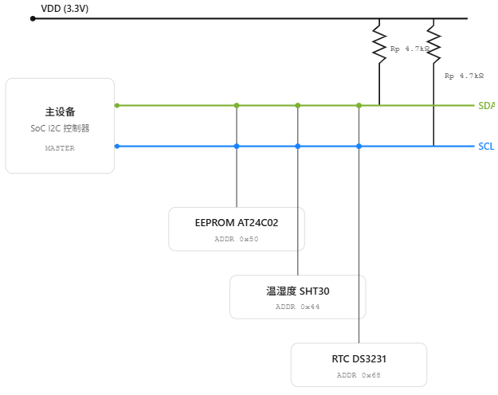
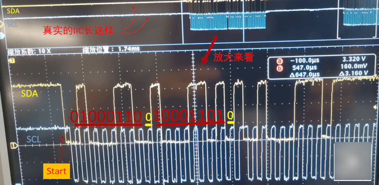

# B-B.3.1 I2C 物理层与电气特性

> 所属章节：第五部 B. 总线协议 > B-B.3 I2C 总线
>
> 难度：[B] Beginner / [I] Intermediate | 预计阅读时间：35 分钟

## <span class="blue"> 本节导读

I2C（Inter-Integrated Circuit）只用两根线挂接多个设备，是嵌入式领域覆盖面最广的低速串行总线：EEPROM、温湿度传感器、RTC、触摸屏、电量计都挂在它上面。

两根线换多设备的代价，是物理层设计比 SPI、UART 复杂——为什么引脚必须开漏、上拉电阻怎么算、总线能挂几个设备、地址撞车会发生什么，答案全在物理层。

本节覆盖：SDA/SCL 的分工与半双工的含义、开漏结构与"线与"逻辑、速率模式与时序参数、上拉电阻与总线电容的工程计算、电平兼容、多主仲裁、7 位地址空间与冲突规避。

> 💡 **本系列五篇的分工（先看清自己在哪一层）。** 
> 
> I2C 从硅片到应用分五篇讲完：
> 
> - 本篇（3.1）物理层——电气结构、上拉与电容，由硬件工程师在原理图阶段定型，**软件要会的是核算与排障，不是设计**；
> - 3.2 协议层——帧格式与时序，看懂逻辑分析仪抓包的基础；
> - 3.3 Linux 驱动框架——你的主要工作层；
> - 3.4 调试工具——i2cdetect/i2cget 的日常用法；
> - 3.5 实战——AT24C02 从设备树到读写全链路。

---

## <span class="blue"> 两条线，各管一件事

I2C 的两根信号线：

- **SDA**（Serial Data）：数据线。地址、数据、应答，全部都经它传输
- **SCL**（Serial Clock）：时钟线。由主设备的 I2C 控制器产生，SDA 上每一位都占一个 SCL 周期

I2C 是**同步串行总线**。"串行"指数据一位一位按顺序传；"同步"指收发双方靠 SCL 这根专用时钟线对齐节拍——接收方在 SCL 高电平期间采 SDA，不需要像 UART 那样事先约定波特率。由此得到一个直接推论：I2C 换速率只需要主设备改 SCL 频率，从设备在自己能力范围内天然跟得上节拍。

> 双向（bidirectional）：同一根线上的信号方向会反转。SDA 就是双向线——主设备发地址时它是主设备的输出，从设备回 ACK 时方向调转，从设备变成驱动方。

<!-- -->

> 单工 / 半双工 / 全双工：单工 = 只能一个方向走（广播）；半双工 = 两个方向都可以，但同一时刻只能走一个；全双工 = 两个方向同时进行。I2C 是**半双工**：SDA 只有一根，发与收必须分时轮流。对照 SPI：MOSI、MISO 各一根线，收发同时进行，是全双工。SPI 用更多的线换双向同时，I2C 用更少的线接受分时——这是两线方案省线的直接代价。

半双工对软件的直接后果：一次 I2C 事务中传输方向要按位切换。<BR>
地址帧之后紧跟的第 9 拍 ACK 就是方向第一次调转；读事务的数据阶段方向再调转一次。方向调度由协议层的 R/W 位控制，见 B-B.3.2。

---

## <span class="blue"> 开漏输出：I2C 的物理基石

### 先看你熟悉的：推挽

GPIO 篇（B-B.2.1）讲过的推挽输出，是大多数数字引脚的默认形态：引脚内部上下各有一只 MOSFET 开关管——上管导通把引脚接到 VDD（输出 1），下管导通把引脚接到 GND（输出 0）。两个方向都有管子主动驱动，所以推挽输出的高低电平都很"有力"，边沿快、带载能力强。

> MOSFET：电压控制的电子开关。栅极加一个控制电压，漏极与源极之间导通或断开。软件视角只需记住两点：导通 ≈ 两根线短接，截止 ≈ 两根线断开；导通电阻很小（欧姆级到几十欧姆），所以"短接"意味着几乎无阻碍的直流通路。

### 开漏：把上管拆掉

开漏（open-drain）输出把上管（接 VDD 的那只）直接拿掉，只留下管。引脚只剩下两种状态：

- **输出 0**：下管导通，引脚接到 GND——主动、有力地拉低
- **输出 1**：下管截止，引脚进入高阻态——**什么都不做，等于放手**

> 高阻态（Hi-Z，high impedance）：引脚既不接 VDD 也不接 GND，对外呈现极大的电阻，几乎没有电流进出。效果等同于这根引脚"不存在"——它不影响线上的电平，只被动观察。

问题随之而来：所有设备都"放手"时，线上是什么电平？没有谁驱动它高，也没有谁驱动它低——电压浮空，受干扰随机漂移。<BR>
这就是**上拉电阻**存在的原因：每根总线经一个电阻接到 VDD，没人拉低时，电阻把线"提"到 VDD。开漏与上拉电阻是两件套，缺一不可。


<!-- 【待补图】images/b-b-3-1-open-drain.png（优先级：★必要）
图名：I2C 开漏结构与"线与"原理图
生图提示词：电路原理示意图，白底，扁平矢量风格。顶部一条水平电源轨标注"VDD（3.3V/5V）"，经两个锯齿电阻符号（标注"Rp 上拉电阻，每条线各一个"）分别接到两条水平总线：上方 SDA、下方 SCL。总线下方并排画三个设备方框（标注"主设备 SoC""EEPROM""传感器"），每个方框向两条总线各引出一个 NMOS 符号（栅极接设备、漏极接总线、源极接 GND 三横线符号），NMOS 旁标注"只会拉低、不会推高"。图下方两行结论小字："任一设备导通 → 总线为 0（任何设备都能强制出 0）""全部截止 → 上拉电阻拉回 1（没人驱动才是 1）"。右下角小注"这就是线与（Wired-AND）：总线电平 = 所有设备输出的与"。蓝色总线、灰色器件、绿色结论文字，中文标注，比例 16:9。 -->

> ⚠️ I2C 引脚绝不可配成推挽输出。两个设备一高一低时：输出高的那台经上管接 VDD，输出低的那台经下管接 GND，VDD 到 GND 之间只剩两只管子的导通电阻——3.3 V 近似直接短接，直通电流数十 mA 起步，轻则通信全灭，重则烧掉输出级。<BR>
> SoC 侧确认引脚复用到 I2C 控制器（控制器引脚本身是开漏），不要用普通 GPIO 推挽去"客串" I2C。

---

## <span class="blue"> 线与（Wired-AND）：总线电平是集体决策

开漏加上拉，产生了一个贯穿 I2C 全部上层机制的性质——**线与**。

**硬件层面**：总线电平等于所有设备输出的逻辑与。任何一个设备把下管导通（输出 0），电流经上拉电阻流入该设备到 GND，总线被拉到 0；只有当**所有**设备都放手（高阻态），上拉电阻才能把线拉到 1。两个设备的全部组合：

| 设备 A | 设备 B | 总线电平 | 原因 |
|--------|--------|----------|------|
| 放手（1） | 放手（1） | 1 | 没人拉低，上拉电阻起作用 |
| 放手（1） | 拉低（0） | 0 | B 的 NMOS 直通 GND |
| 拉低（0） | 放手（1） | 0 | A 的 NMOS 直通 GND |
| 拉低（0） | 拉低（0） | 0 | 都拉低 |

四行可以压成一句话：**0 永远赢过 1**。任何一个参与者都有一票把总线拉低的权力，谁也不用跟谁商量。

**软件层面**的理解更关键：每个设备都把总线当成"可写也可读"的——写就是驱动自己的下管，读就是采样总线电平。因为线与，**设备读到的电平不一定是自己发的那个**：你输出 1（放手），别人可能正在拉低，你读回来的就是 0。"发完再读回去核对一眼"这个能力，是 I2C 三个核心机制的共同地基：

1. **ACK 应答**：发送方在第 9 拍放手，接收方趁机拉低 SDA 表示"收到"——发送方读回 0，才知道对方真的收到了（本文波形部分细讲）
2. **多主仲裁**：两个主设备同时发送，各自边发边读回核对，发现"我发的是 1、线上却是 0"的那方退出（本文末细讲）
3. **时钟延展**：从设备可以拉住 SCL 不放，强迫主设备等它准备好（B-B.3.2 细讲）

三个机制看起来互不相干，拆开都是同一句话：任何设备都能强制总线为 0。

---

## <span class="blue"> 拓扑：所有设备并联在同两条线上

"并联"在这里的含义很直白：主设备、EEPROM、传感器、RTC 的 SDA 引脚，全部接在**同一根铜线**上；SCL 同理。<br>
挂一个新设备不需要拉新线，并上去就行。

这是 I2C 相对 SPI 最大的结构优势——SPI 每多挂一个设备要多拉一根片选线，I2C 不加线。



这张图有两个要点值得说透。

1. 第一，顶部两个 Rp 是**整条总线仅有的两个上拉电阻**——不是每个设备各配一套，而是 SDA 一个、SCL 一个，所有设备共用。
2. 第二，每个设备方框与两根线的交互方式只有两种：拉低，或者放手。
3. 没有第三种动作，这就是开漏的全部。

一条总线能挂多少设备，有两个不同维度的上限，别混在一起：

- **协议上限：112 个可用地址**。7 位地址空间去掉保留段后剩 112 个（本文末详述），这是"每个设备要有唯一名字"的限制
- **电气上限：总线电容 ≤ 400 pF**。每多挂一个设备、每多走一段线，电容都在累加；超过 400 pF，上升沿慢到超标，通信开始出错。这是"线本身扛不住"的限制

实际工程中**先到的一定是电容上限**：一个设备引脚 10~20 pF，十几个设备加走线就逼近 400 pF，远用不满 112 个地址。<BR>
所以"I2C 能挂 112 个设备"是个有误导性的说法——地址从来不是瓶颈，电容才是。

---

## <span class="blue"> 速率模式：SCL 打多快，数据就走多快

同步总线里 SDA 上每一位占一个 SCL 周期，所以 **SCL 的频率就是总线的比特率**。SCL 由主设备的控制器硬件产生，软件的入口是设备树：

```dts
i2c1: i2c@fe5a0000 {
    compatible = "rockchip,rk3568-i2c", "rockchip,rk3399-i2c";
    reg = <0x0 0xfe5a0000 0x0 0x1000>;
    clock-frequency = <400000>;        /* SCL 跑 400 kHz */
    ...
};
```

规范历史上定义了四档速率，频率一档比一档高，驱动力是数据量：1982 年的 EEPROM 一次读几个字节的校准数据，100 kHz 足够；触摸屏要连续上报坐标流，就需要上 Fm+。

| 模式 | 最大频率 | 引入年份 | 典型设备 |
|------|----------|----------|----------|
| Standard-mode（Sm） | 100 kHz | 1982 | EEPROM、RTC（AT24C02、DS3231） |
| Fast-mode（Fm） | 400 kHz | 1992 | 主流传感器（SHT30、BMP280） |
| Fast-mode Plus（Fm+） | 1 MHz | 2006 | 大容量 EEPROM、触摸屏 |
| High-speed mode（Hs） | 3.4 MHz | 2000 | 高速 ADC/DAC（Hs 改了电气规则，少用） |

表中 Hs 模式需要单独说一句：为了冲到 3.4 MHz，它把主机侧的上拉电阻换成了主动电流源，电气规则与前三档不完全兼容，消费与工控领域很少见到，知道存在即可。

两个工程结论比表格本身更值得记住：

- **默认 400 kHz**。兼容性最好（1992 年后的器件基本都支持 Fm），速度对传感器类场景够用
- **总线速率按最慢的设备配**。速率是主设备设定的、对整条总线全局生效：一个只支持 100 kHz 的 RTC 和一群 400 kHz 传感器挂在同一条总线上，整条总线只能跑 100 kHz。硬跑 400 kHz 的症状是慢设备偶发 NACK、其余设备正常——极易误判成器件或焊接问题

最后把期望摆正：400 kHz 下每传一个字节要 9 个 SCL 拍（8 位数据 + 1 位 ACK），再扣掉地址帧与 START/STOP 的开销，有效数据率约 30~40 KB/s。<br>
I2C 是控制与传感器通道，不是数据通道——摄像头图像、音频流这类流量不要打它的主意。

---

## <span class="blue"> 时序参数：规范到底在约束什么

数字信号不是瞬间跳变的：电压从低爬到高、从高跌到低都要时间，接收方也需要时间在采样前让信号站稳。<BR>
规范里全部时序参数，就是在给"跳变要多快、站稳要多久、帧与帧之间歇多久"划下限。

按用途分四组理解，比背表格有效：

**组一：帧边界**——t_HD; <BR>
STA 是 START 条件的保持时间（SDA 拉低后到 SCL 第一个下降沿之间要等待的时长），t_BUF 是 STOP 到下一次 START 之间的总线空闲时间。它们保证接收方看得清一帧的头和尾，两帧之间不会糊在一起。

**组二：数据有效性**——t_SU; <BR>
 DAT 是 SDA 在 SCL 上升沿到来之前必须提前稳定的时间。接收方在 SCL 高电平期间采样，数据如果踩着沿才变化，采到的就是未定值。

**组三：时钟占空**——t_LOW 与 t_HIGH 分别约束 SCL 低电平和高电平的最短持续时间。<BR>
t_LOW 期间是允许数据变化的窗口，也是从设备做内部处理的时间，压得太短从设备跟不上。

**组四：边沿速度**——t_R 是上升时间（电平从 0.3×VDD 爬到 0.7×VDD 的时间上限），t_F 是下降时间。<BR>
这组参数的特殊之处在于**它不由控制器决定**：下降沿由 NMOS 直接对地放电，天然很快；上升沿靠上拉电阻给总线电容充电，快慢取决于 Rp 和 C_bus 这两个板级参数。t_R 超标是 I2C 物理层故障的第一名，下一节的上拉电阻计算就是为它服务的。

规范值摘录（UM10204）：

| 参数 | 符号 | Sm 100k | Fm 400k | Fm+ 1M |
|------|------|---------|---------|--------|
| SCL 频率 | f_SCL | ≤100 kHz | ≤400 kHz | ≤1 MHz |
| START 保持时间 | t_HD;STA | 4.0 μs | 0.6 μs | 0.26 μs |
| 总线空闲时间 | t_BUF | 4.7 μs | 1.3 μs | 0.5 μs |
| SDA 建立时间 | t_SU;DAT | 250 ns | 100 ns | 50 ns |
| SCL 低电平 | t_LOW | 4.7 μs | 1.3 μs | 0.5 μs |
| SCL 高电平 | t_HIGH | 4.0 μs | 0.6 μs | 0.26 μs |
| 上升时间 | t_R | ≤1000 ns | ≤300 ns | ≤120 ns |
| 下降时间 | t_F | ≤300 ns | ≤300 ns | ≤120 ns |

软件工程师不直接配置这些参数——SoC 的 I2C 控制器按所配速率自动满足。<br>
这张表的用途是**排障时的对照基准**：拿示波器抓到波形，一格一格对着这张表量，超标的参数就是病灶。

---

## <span class="blue"> 一次完整传输的波形

四条铁律先立住，它们是读一切 I2C 波形的前提：

- **START**：SCL 保持高电平期间，SDA 由高变低。<BR>
  平时 SDA 的跳变都发生在 SCL 低电平期间，所以"SCL 高时 SDA 动了"这个事件本身就构成一帧的开始信号，不占用任何数据位
- **STOP**：SCL 保持高电平期间，SDA 由低变高。<BR>
  与 START 互为镜像，标志一帧结束、总线回归空闲
- **数据位**：SCL 低电平期间允许 SDA 变化，高电平期间必须稳定——采样点在高电平
- **ACK/NACK**：每 8 位之后有一个第 9 拍，接收方拉低为 ACK、保持高为 NACK


<!-- 【待补图】images/b-b-3-1-timing.png（优先级：★必要）
图名：I2C 完整传输时序图（START/地址/ACK/数据/STOP）
生图提示词：数字波形时序图，两条波形线：SDA（上方，蓝色）与 SCL（下方，深灰色）。展示一次完整写传输：START 条件（SCL 高电平时 SDA 下降沿，绿色高亮标注）→ 7 位地址 + R/W 位（8 个 SCL 周期，每个数据位用斜线交叉的方波表示，标注"数据在 SCL 低电平变化、高电平稳定采样"）→ 第 9 拍 ACK（SDA 被从机拉低，橙色高亮标注"接收方拉低应答"）→ 8 位数据字节 → ACK → STOP 条件（SCL 高电平时 SDA 上升沿，绿色高亮标注）。在 SDA 波形变化沿与 SCL 采样高电平之间画竖直虚线辅助对齐，关键参数 t_HD;STA、t_SU;DAT 用双向箭头标注。示波器截图风格的专业时序图，白底，蓝色为主色、绿橙双色高亮关键事件，中文标注，比例 16:9。 -->

### ACK 与 NACK：第 9 拍的方向调转

第 9 拍值得单独拆开，因为它是整帧里传输方向第一次调转，也是线与逻辑的第一次实战。

这一拍的总线使用权属于**接收方**，过程分三步：

1. 发送方发完 8 位后**释放 SDA**——自己的下管截止、进入高阻态，并开始回读总线
2. 接收方若正确收到，在第 9 拍的 SCL 高电平期间**把 SDA 拉低**——发送方读到 0，这就是 ACK
3. 接收方若不拉低，上拉电阻让 SDA 保持 1——发送方读到 1，这就是 NACK

注意"电平是谁给的"：ACK 不是发送方发出的，是**接收方拉出来的**；发送方此刻的职责是放手和观察。

这正是不需要任何额外线路就能实现应答的原因——线与结构让接收方能临时"借用"同一根 SDA。

NACK 不是"出错"的同义词，它是协议里的常规词汇，有三种典型含义：

- **寻址无应答**：主设备发出地址后没有任何设备拉低——这个地址上没有设备：没焊上、地址算错、或设备没上电
- **从设备忙**：设备内部还在处理上一条命令，用 NACK 告诉主设备稍后重试。EEPROM 写入后的内部烧写周期内正是这个行为，B-B.3.5 实战篇会遇到
- **主设备主动 NACK**：读事务中主设备收到最后一个字节后故意回 NACK，告诉从设备"够了，别再发了"，随后发 STOP 结束事务



---

## <span class="blue"> 上拉电阻与总线电容：一笔 RC 的账

### 为什么有这笔账：放电快、充电慢

总线从 1 到 0：某个设备的 NMOS 导通，总线电容里存着的电荷经导通电阻（几欧到几十欧）直接泄放到 GND——路径上几乎没有阻力，所以**下降沿又快又陡**，t_F 从来不超标。

总线从 0 回到 1：所有设备都放手，没有任何器件主动驱动——只能等上拉电阻 Rp 给总线电容 C_bus **充电**。Rp 是千欧级，C_bus 是百 pF 级，充电沿指数曲线慢慢爬，**上升沿又缓又圆**，t_R 容易超标。

所以 I2C 波形在示波器上的特征形状是下降沿陡、上升沿缓——看到对称的方波反而要怀疑抓错了线。物理层的大部分工程计算，都是在给"充电慢"这个先天短板兜底。

### 上拉电阻的上下限

规范给出的上限公式（TI SLVA689 同式）：

```
Rp(max) = t_R / (0.8473 × C_bus)
```

`t_R` 查上一节的表，`C_bus` 为总线总电容。<br>
**0.8473 不是拟合系数，是 RC 充电的定义产物**：t_R 按电平从 0.3×VDD 升到 0.7×VDD 的时间定义（示波器上升沿的行业标准量法），RC 充电曲线 `V(t) = VDD × (1 − e^(−t/RC))` 从 30% 走到 70% 恰好耗时 `RC × ln(7/3) ≈ 0.8473 × RC`。

整个公式就是一句话的反解：上拉电阻必须在规定的 t_R 内把总线电容充过 70% 电平。

下限由灌电流决定：标准/快速模式器件只保证 3 mA 的灌电流能力，`Rp(min) = (VDD − V_OL) / 3mA`。<BR>
电阻再小，设备拉低总线时流进引脚的电流就超标。

计算示例（C_bus = 100 pF，VDD = 3.3 V）：

| 模式 | t_R | Rp(max) | Rp(min) | 工程取值 |
|------|-----|---------|---------|----------|
| Sm 100k | 1000 ns | 11.8 kΩ | ≈1 kΩ | 4.7 kΩ~10 kΩ |
| Fm 400k | 300 ns | 3.54 kΩ | ≈1 kΩ | 1.5 kΩ~4.7 kΩ |
| Fm+ 1M | 120 ns | 1.42 kΩ | ≈1 kΩ | 1.0 kΩ~2.2 kΩ |

读这张表的方式：速率每上一档，t_R 收紧，Rp 上限就被压小——**速度、电容、电阻三个量绑在一根 RC 绳子上**。<BR>
3.3 V 系统盲选 4.7 kΩ（Sm/Fm 都安全）；总线长或设备多时按公式重新核算，盲选值可能直接不合法（自查 Q7 就是这种情形）。

### 电容从哪来

C_bus 不是某个元件的参数，是整条总线上所有寄生电容的总和：

| 电容来源 | 典型值 | 为什么会有 |
|----------|--------|------------|
| 设备引脚 | 10~20 pF/个 | 引脚内部的 ESD 保护结构与封装焊盘对地形成电容 |
| PCB 走线 | 1~3 pF/cm | 铜走线与下方地平面是天然的平板电容 |
| 连接器 | 2~5 pF/引脚 | 金属 pin 之间的耦合电容 |
| 外部线缆 | 50~100 pF/m | 长导线的寄生电容远大于 PCB 走线 |
| **规范上限** | **≤400 pF** | 超过后上升沿无法满足任何速率档的 t_R |

由这张表能推出几条工程直觉：**设备数量本身不是主要矛盾**（十几个设备才 200 pF 上下）；板上走线 1 米以内通常安全；把 I2C 用排线或电缆拉出板外，电容急剧上升，是最常见的超标场景。

估算示例：4 个设备（60 pF）+ 1 个连接器（5 pF），走线按 2 pF/cm 计，400 pF 上限下剩余裕量 335 pF，可走线约 1.6 m——板内怎么布都够，一旦拉外线就要小心。

---

## <span class="blue"> 电平兼容与混合电压总线

I2C 没有独立的"逻辑电平标准"——**总线电平由上拉电阻接到哪个 VDD 决定**。输入阈值按 VDD 比例定义：低电平上限 V_IL ≈ 0.3×VDD，高电平下限 V_IH ≈ 0.7×VDD。3.3 V 系统中逻辑高必须 ≥ 2.31 V，5 V 系统则要求 ≥ 3.5 V。

这就是混合电压总线的问题根源：上拉接 3.3 V 的总线，高电平够不着 5 V 器件的 V_IH，后者会把"1"误判为"0"。三种典型组合的对策：

| 组合 | 风险 | 对策 |
|------|------|------|
| 3.3 V 主控 + 3.3 V 器件 | 无 | 直接上拉到 3.3 V，最常见形态 |
| 3.3 V 主控 + 5 V 供电但 I/O 兼容 3.3 V 的器件 | 无 | 查器件手册 V_IH，确认 ≤ 2.31 V 即可同样上拉 3.3 V；多数现代 5 V 传感器属此类 |
| 3.3 V 主控 + 真 5 V 逻辑器件 | 高电平识别失败、5 V 灌入 3.3 V 引脚 | 需双向电平转换器（PCA9306/TXS0102 类）分两侧各自上拉 |

反向风险同样存在：5 V 上拉的总线直接挂 3.3 V 器件，高电平超过其引脚耐压（多数 3.3 V 引脚绝对最大值 3.6~3.9 V），长期工作损伤输入级。**先查每个器件手册的 V_IH 与引脚耐压，再决定上拉电压，这是混合电压设计的第一步**。

<!-- 【待补图】images/b-b-3-1-level-shift.png（优先级：△有更好）
图名：PCA9306 双向电平转换接线原理
生图提示词：电路原理示意图，左侧 3.3V 域：3.3V 电源经上拉电阻接 SDA/SCL 低压侧，挂 SoC I2C 控制器；右侧 5V 域：5V 电源经上拉电阻接 SDA/SCL 高压侧，挂 5V 传感器与 EEPROM；中间为 PCA9306 芯片（标注 EN 接 3.3V、VREF1 接 3.3V、VREF2 经 200kΩ 接 5V），左右两侧各两条信号线穿过芯片。用虚线框区分两个电压域并标注"3.3V 域""5V 域"，两侧上拉电阻旁标注"各自上拉到本侧电平"。扁平电路示意图风格，白底，蓝灰双色区分两电压域，中文标注，比例 16:9。 -->

电平转换器能用一个 N-FET 就实现双向转换，前提恰恰又是开漏结构：器件只拉低、不推高，转换器做双向导通与隔离即可，两侧各自上拉到自己的电平。推挽总线（如 SPI）不能这么玩，需要单向缓冲或专用转换芯片——这是开漏设计的又一个隐性红利。

---

## <span class="blue"> 多主仲裁：基于线与的无损选举

先立边界：仲裁只在"总线上挂有两个及以上独立主控"时才可能触发，而嵌入式里绝大多数 I2C 是单主结构，一颗 SoC 挂若干传感器和 EEPROM，根本不存在第二个能发起 START 的设备，控制器里的仲裁逻辑永远睡着。

多主是少数派，但真实存在：

- **服务器主板**：BMC（基板管理控制器，主 CPU 关机时也能监控机器的独立芯片）和主 CPU 共用管理总线，访问温度传感器和 FRU EEPROM
- **笔记本电脑**：EC（嵌入式控制器，管键盘、电池、风扇的小芯片）和南桥共享电池电量计、充电管理芯片
- **SMBus 智能电池**：电池包和充电器都能当主设备，规范上就是按多主设计的
- **外置 MCU 与 SoC 共用器件**：一颗外挂单片机和主 SoC 读写同一片 EEPROM

这些场景里两个主控跑的是两套独立软件，甚至可能一边 Linux 一边裸机，没有任何跨芯片的互斥手段，撞车只能由硬件现场裁决。谁先谁后没有调度器：I2C 用线与逻辑在传输过程中现场裁决，这就是仲裁（arbitration）。

过程只有一条规则：**每个主设备发出每一位的同时，回读 SDA 的实际电平**。

- 双方发出的位相同：总线电平与各自预期一致，谁都察觉不到对方，继续
- 出现分歧的那一位：发 0 的一方把线拉低；发 1 的一方本来放手，回读却读到 0，"我发的是 1、线上却是 0，有别人在发"，立即停止驱动，退出本次传输

逐位走一遍：

```
周期:     1   2   3   4
主A 发:   0   1   0   1
主B 发:   0   1   1   0
SDA 实际: 0   1   0   0     ← 线与：任何 0 胜出

周期 1/2：双方一致，各自匹配，继续
周期 3：  A 发 0 读到 0（匹配）；B 发 1 读到 0（不匹配）→ B 退出
周期 4：  A 独自完成传输
```

仲裁的"无损"二字值得展开：赢家从头到尾发出的每一位都与总线实际电平一致，它的传输不受任何干扰地完成，**甚至不知道发生过竞争**；输家安静退场，等 STOP 之后总线空闲再重试整帧。没有数据损坏，没有撞车后的垃圾时间。这与以太网 CSMA/CD（撞车后双方都退避重发）形成鲜明对照：I2C 是"发着发着就选出来了"，以太网是"撞了再重来"。

胜出规律：逐位比较中先发 0 的一方赢，等价于**数值较小的地址/数据胜出**。

软件视角要分清两层。

1. **第一层是软件锁，主动避免竞争**：Linux 的 `i2c_transfer()` 发起传输前先拿适配器的总线锁（`drivers/i2c/i2c-core-base.c:2279` 的 `__i2c_lock_bus_helper()`，底层是 rt_mutex，见同文件 :842），同一颗 SoC 上的多个线程、多个驱动、多个用户态进程同时发起传输，都会被串行排队，竞争根本到不了总线上。
2. **第二层是硬件仲裁，撞上之后的兜底**：锁只能管住自己芯片内的软件，管不了总线上另一颗独立芯片，这时才靠控制器的逐位回读裁决，驱动与应用代码全程不参与；少数平台在仲裁丢失后上报错误并由控制器自动重试。

需要带走的只有两条：单主系统里软件锁已把竞争消掉，仲裁逻辑存在但永不触发，传输延迟是确定的；多主系统里一次传输可能延迟一个帧的时间才真正开始，别把 I2C 当事务延迟有硬保证的通道。

---

## <span class="blue"> 地址空间与冲突规避

### 为什么是 128 个，又为什么只剩 112 个

7 位地址就是地址帧里的 7 个比特，2^7 = 128 种组合。规范从 128 里挖掉了两段保留区：

| 范围 | 用途 |
|------|------|
| 0x00 | 通用呼叫（General Call）：主设备对总线上**所有**设备广播的地址，用于软复位类操作 |
| 0x01~0x07 | 历史保留（CBUS 等老协议兼容） |
| 0x08~0x77 | 用户设备，共 112 个 |
| 0x78~0x7F | 10 位地址模式的前缀（11110xx）与保留 |

可用地址 = 128 − 16 = 112。10 位地址模式把地址扩到 1024 个，靠 0x78~0x7F 段做前缀与 7 位老设备区分；现代器件极少使用，知道存在即可。

### 地址冲突会发生什么

地址是设备在总线上的唯一身份。两个设备地址撞车时，用线与逻辑一步步推演全过程：

1. 主设备发地址帧——两个设备都认为"在叫我"，第 9 拍**两个都拉低 SDA**。线与之后还是 0，主设备收到 ACK——**看起来一切正常**
2. 写数据阶段：两个设备同时收下同样的字节，各自写各自的寄存器——一个可能写成功、一个可能没成功，行为开始发散
3. 读数据阶段最糟：两个设备**同时驱动 SDA 输出各自的数据**，线与之后主设备读到的是两路数据流的按位与——既不是 A 的也不是 B 的，是一团无意义的混合值

典型症状正是"单独测每个都正常，全挂上就出灵异问题"：单挂时地址唯一，一切正常；同挂时 ACK 照常、数据错乱，极易误判成信号质量问题，在波形上浪费大量时间。原理图评审阶段维护一张 I2C 地址分配表，是成本最低的预防。

### 规避方案

| 方案 | 适用场景 |
|------|----------|
| 芯片地址引脚（ADDR/A0~A2 接高低组合） | EEPROM、传感器自带，首选 |
| I2C 多路复用器（PCA9548 等，一分八） | 同型号设备必须共存（如 8 个相同传感器） |
| 选不同地址的替代型号 | 设计阶段零成本方案 |
| GPIO 模拟 I2C（独立软件总线） | 设备极少、速率无要求时的兜底 |

---

## <span class="blue"> 常见故障

物理层故障有一个共同特征：**万用表和示波器上看得到，内核日志里看不到**。

按现场出现频率讲五类。

**上拉电阻缺失或虚焊。** 现象是完全无通信或随机性成功。量法：断电或空闲状态下用万用表量 SDA/SCL 对地电压——正常应 ≈VDD（被上拉着）；接近 0 V 说明有设备死拉总线，浮空不定说明上拉缺失。新打样的板子，上电第一件事就是量这个。

**推挽引脚客串 I2C。** 引脚没复用到 I2C 控制器，被配成了普通 GPIO 推挽。线与失效，两个设备一高一低直接短路，多设备通信全灭，严重时芯片发烫。确认方法：查引脚复用配置（pinctrl），不要用示波器猜。

**总线电容超标。** 现象是间歇性 ACK 丢失、数据错乱，常与温度相关（电容随温度变化）。确认方法：示波器量上升沿，对照前文的 t_R 表。对策：换更小的上拉电阻（受灌电流下限约束），或加总线缓冲器（PCA9515/TCA9517 类）把总线切成两段，电容各算各的。

**速率配错。** 总线按快速率配置，慢速设备跟不上，症状是该设备偶发 NACK、其余设备正常。把 `clock-frequency` 降到最慢设备支持的模式即消失，可据此确诊。

**地址冲突。** ACK 正常但数据错乱，单独测试全部正常——见上一节的推演。

排查顺序固定为：**空闲量电平 → `i2cdetect` 扫描 → 示波器看上升沿**（工具细节见 B-B.3.4），绝大多数物理层故障在前两步就能现形。

---

## <span class="blue"> 本节总结

I2C 物理层的全部复杂性都来自一个设计决策：开漏。<BR>
因为引脚只会拉低、不会推高，所以必须配上拉电阻，于是有了 Rp 与总线电容这笔 RC 的账；因为任何设备都能强制出 0，线与成立，于是 ACK 应答、时钟延展、多主无损仲裁才有了共同的物理地基；也因为不主动推高，双向电平转换才能用一颗 FET 实现。

记住"开漏是因、其余是果"，物理层的每条规则都能推回这个根。

工程上带走三个数字和一条顺序：400 pF 是设备数量的真实上限（不是 112 个地址），4.7 kΩ 是 3.3 V 系统的盲选上拉，400 kHz 是兼容性最好的默认速率；排查顺序固定为"空闲量电平 → i2cdetect 扫描 → 示波器看上升沿"。

速率、电容、电阻绑在同一根 RC 绳子上——改任何一个，另外两个都要重算。

**速查表**

| 项 | 要点 |
|----|------|
| 通信方式 | 同步串行、半双工；SCL 频率 = 比特率，设备树 `clock-frequency` 配置 |
| 电气结构 | 开漏 + 上拉 = 线与；0 永远赢，是 ACK/仲裁/时钟延展的共同地基 |
| 速率档位 | Sm 100k / Fm 400k（默认）/ Fm+ 1M / Hs 3.4M，按最慢设备配置 |
| 时序四组 | 帧边界 / 数据建立 / 时钟占空 / 边沿速度；t_R 唯一由板级 Rp×C_bus 决定 |
| 上拉计算 | Rp(max) = t_R / (0.8473 × C_bus)；Rp(min) = (VDD − V_OL) / 3 mA；盲选 4.7 kΩ |
| 电容上限 | ≤400 pF；引脚 10~20 pF/个 + 走线 1~3 pF/cm + 线缆 50~100 pF/m |
| 电平兼容 | 总线电平 = 上拉电压；V_IH ≈ 0.7×VDD；真 5 V 逻辑上 PCA9306 |
| 仲裁 | 边发边读回，发 1 读到 0 即退出；无损，小地址胜出 |
| 排查顺序 | 空闲电平 → i2cdetect → 示波器上升沿 |

---

## <span class="blue"> 本节自查

**通信方式**

??? details "Q1. I2C 为什么是半双工？与 SPI 的全双工差在哪？对软件的直接后果是什么？"
    SDA 只有一根，发数据与收数据必须分时轮流，同一时刻只能走一个方向，所以是半双工。SPI 有 MOSI、MISO 两根数据线，收发同时进行，是全双工。直接后果：一次 I2C 事务中方向要按位切换——地址帧后第 9 拍 ACK 是第一次调转，读事务数据阶段是第二次；方向调度由协议层 R/W 位控制（B-B.3.2）。

**电气结构**

??? details "Q2. 开漏输出的两种状态分别是什么？为什么"输出 1"其实是放手？"
    开漏只有下拉 NMOS、没有上拉管。输出 0：NMOS 导通，引脚接 GND，主动拉低。输出 1：NMOS 截止，引脚进入高阻态——既不接 VDD 也不接 GND，等效于"不存在"，这就是"放手"。真正的 1 靠公共上拉电阻把线提到 VDD，所以开漏与上拉两件套缺一不可。

??? details "Q3. 用真值表解释"线与"，并说清为什么"发完读回"是 ACK、仲裁、时钟延展的共同地基。"
    线与：总线电平 = 所有设备输出的逻辑与——任一设备拉低则总线为 0，全部放手才由上拉拉回 1，即"0 永远赢过 1"。因为线与，设备读到的电平不一定是自己发的（你放手，别人可能在拉低）。"发完读回核对"因此成为可能：ACK 是发送方第 9 拍放手让接收方拉低；仲裁是双主边发边读、发 1 读到 0 者退出；时钟延展是从设备拉住 SCL 强迫主设备等待。三个机制拆开都是同一句话：任何设备都能强制总线为 0。

**拓扑与速率**

??? details "Q4. 为什么"I2C 能挂 112 个设备"是有误导性的说法？真实瓶颈是什么？"
    112 是协议上限（7 位地址去保留段），约束的是"每个设备要有唯一名字"；电气上限是总线电容 ≤400 pF，约束的是"线本身扛不扛得住"。一个引脚 10~20 pF，十几个设备加走线就逼近 400 pF，远用不满 112 个地址——实际工程中先到的永远是电容上限，地址从来不是瓶颈。

??? details "Q5. 400 kHz 下有效带宽大约多少？总线上混挂快慢设备时频率怎么定？慢设备超速率跑的症状是什么？"
    每字节占 9 拍（8 数据 + 1 ACK），扣掉地址帧与 START/STOP 开销，有效数据率约 30~40 KB/s——I2C 是控制与传感器通道，不是数据通道。混挂时按**最慢设备**配置 SCL 频率。慢设备被迫超速率跑的症状：该设备偶发 NACK、其余设备正常，极易误判为焊接或器件问题。

**协议细节**

??? details "Q6. 第 9 拍 ACK/NACK 中，谁放手、谁拉低、谁观察？NACK 的三种正常含义是什么？"
    发送方发完 8 位后释放 SDA（高阻态）并开始回读；接收方拉低 SDA 即 ACK，不拉低（上拉保持 1）即 NACK；发送方读回电平做判断——ACK 电平是**接收方**拉出来的。NACK 三义：① 寻址无应答（该地址无设备）；② 从设备忙（如 EEPROM 内部写周期中），稍后重试；③ 主设备读够最后一字节后主动 NACK，配合 STOP 结束读事务。

**工程计算**

??? details "Q7. C_bus = 200 pF、Fm 模式，核算 Rp 的合法区间（写出公式与数值）。"
    上限：Rp(max) = t_R / (0.8473 × C_bus) = 300 ns / (0.8473 × 200 pF) ≈ 300e-9 / 1.695e-10 ≈ **1.77 kΩ**。下限：Rp(min) = (VDD − V_OL) / 3 mA = (3.3 − 0.4) / 3 mA ≈ **0.97 kΩ**。合法区间约 1.0 ~ 1.77 kΩ，工程取 **1.5 kΩ**。注意 Fm 下 200 pF 已把 4.7 kΩ 盲选值排除在外——这就是总线长/设备多时必须重新核算的原因。

??? details "Q8. 多主仲裁为什么是无损的？为什么赢家不知道发生过竞争？胜出规律是什么？"
    赢家发出的每一位都与总线实际电平完全一致（它发 0 时总线本就是 0），传输不受干扰地完成；退出方静默离开、等总线空闲再重试，没有数据损坏也没有垃圾时间——所以无损。赢家全程观测不到任何异常电平，所以不知情。胜出规律：逐位比较中先发 0 者赢，等价于数值较小的地址/数据胜出。

??? details "Q9. 两个同地址设备挂在同一条总线上，主设备读数据时读到什么？为什么 ACK 阶段看起来正常？"
    ACK 阶段：两个设备都认为"在叫我"，第 9 拍同时拉低 SDA——线与后还是 0，主设备收到 ACK，一切看似正常。读数据阶段：两个设备同时驱动 SDA 输出各自的数据，主设备读到的是两路数据流的**按位与**——既不是 A 的也不是 B 的。这就是"单独测都好、全挂上出灵异问题"的完整机理。

---

## <span class="blue"> 下一步

物理层就绪后进入协议层：**B-B.3.2 I2C 协议层与帧格式**——地址帧与读写位、完整读写事务的帧序列、重复 START 的用途、10 位地址与时钟延展。

随后 **B-B.3.3** 讲 Linux 驱动框架，**B-B.3.5 实战篇**用 AT24C02 EEPROM 把物理层到代码全链路走一遍。

> 💡 螺旋衔接：本篇的开漏/线与正是 B-B.2.1「开漏必配上拉」的总线级应用；设备树里 I2C 控制器挂在 APB 上的位置，回看 B-A.1.1 的地址映射。
