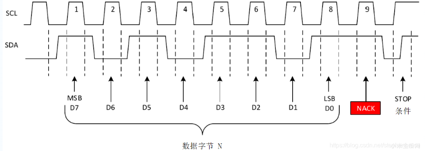

# B-B.3.1 I2C 物理层与电气特性

> 所属章节：第五部 B. 总线协议 > B-B.3 I2C 总线
>
> 难度：[B→I] Beginner → Intermediate | 预计阅读时间：40 分钟

## <span class="blue">本节导读：一条总线怎样才算可靠

I2C（Inter-Integrated Circuit）用 SDA、SCL 两根信号线连接多个设备，常用于 EEPROM、传感器和实时时钟等低速外设。少接线并不等于少约束：引脚为什么不能主动输出高电平，软件设定速率后为什么仍要检查实际波形，增加设备后为什么可能先遇到电气问题而不是地址耗尽，都要从物理层回答。

本节只解决一个主问题：**一条 3.3 V I2C 总线为什么能够可靠通信，软件人员应怎样判断问题能否通过配置解决？**

全文围绕同一条总线展开：片上系统（SoC）作为主设备，挂接 AT24C02 EEPROM、SHT30 温湿度传感器和 DS3231 实时时钟。EEPROM 用来保存少量非易失数据，实时时钟（RTC）在主系统断电后继续保持时间。初始设计为 100 kHz、SDA 和 SCL 各用一只 4.7 kΩ 上拉电阻；后文以升速和增加设备为情境，检查频率、物理边沿、电平和地址条件。

硬件与软件的责任也要分开：原理图决定上拉、电平和走线，器件手册决定速率与耐压边界，软件配置控制器并处理访问冲突。软件人员不一定要独立完成原理图，但必须能读懂这些约束并定位异常。

> 💡 **本系列六篇的分工**
>
> - **本篇 B-B.3.1**：电气结构、速率与物理边沿、电平兼容、仲裁和地址冲突。
> - **B-B.3.2**：START、STOP、地址帧、读写位和完整事务的帧格式。
> - **B-B.3.3**：Linux I2C 驱动框架与设备接入。
> - **B-B.3.4**：扫描、读写、示波器与逻辑分析仪等调试方法。
> - **B-B.3.5**：AT24C02 从设备树到读写验证的完整实战。
> - **B-B.3.6**：SMBus、PMBus 与 I2C 的关系及额外约束。

---

## <span class="blue">两根线与两种动作

### SDA 传数据，SCL 给节拍



- **SDA**（Serial Data Line）承载地址、数据和应答，是双向信号线。
- **SCL**（Serial Clock Line）提供采样节拍。常见的单主系统中由主设备控制器驱动；从设备在特定条件下也能拉住它，时钟延展留到 B-B.3.2 讨论。

I2C 是同步串行总线。“串行”表示数据逐位传输，“同步”表示收发双方利用 SCL 对齐每一位，不需要像 UART 那样各自依靠事先约定的波特率计时。这不表示速率可以任意设置，主设备仍须把 SCL 限制在整条总线上所有器件都能工作的范围内。

SDA 只有一根，发送与接收必须分时进行，所以 I2C 属于半双工。B-B.4.1 介绍的 SPI 使用独立的 MOSI、MISO，可以同时收发，属于全双工。I2C 用分时复用减少连线，SPI 用更多信号线换取同时双向传输。

### 开漏只能拉低或放手

B-B.2.1 已介绍推挽输出：内部上管把引脚接向电源以输出高电平，下管把引脚接向地以输出低电平。I2C 的开漏（open-drain）输出不主动接上电源，只保留下拉通路，因此每个引脚只有两种动作：

| 引脚动作 | 内部状态 | 对总线的影响 |
|---|---|---|
| 拉低 | 下拉管导通 | 把信号线主动拉向地（GND） |
| 放手 | 下拉管截止，引脚呈高阻态 | 不主动驱动信号线，只读取实际电平 |

高阻态不是输出高电平。若所有器件都放手且没有上拉，信号线会浮空，电平不能确定。因此 SDA、SCL 各需要一只上拉电阻 Rp 接到电源电压 VDD：至少一个器件拉低时，总线为低；全部器件放手时，电阻把总线拉回高电平。

这也解释了为什么不能用普通推挽 GPIO 直接代替 I2C 输出。一个器件主动推高、另一个主动拉低时，会形成电源到地的低阻通路，不再只是通信错误，还可能损坏输出级。正常使用时应把引脚复用给 I2C 控制器，并确认该控制器及板级电路符合开漏要求。

下面的交互图用于观察“拉低”和“放手”两种输出状态。上升沿和下降沿均为机制示意，不是实测波形；实际速度由 Rp、总线电容和器件驱动能力决定。

<div class="interactive-demo">
  <iframe
    src="../html/open-drain-demo.html"
    title="开漏输出：拉低与放手交互演示"
    loading="lazy"
    style="width:100%;height:640px;border:0;"
  ></iframe>
</div>

### 线与让接收方也能控制同一根线

多个开漏输出并接后形成线与（wired-AND）：任何一个器件输出 0，总线就是 0；只有所有器件都放手，总线才为 1。可以把器件“放手”记作逻辑 1，得到下面的完整组合：

| 器件 A | 器件 B | 总线电平 |
|---|---|---|
| 放手（1） | 放手（1） | 1 |
| 放手（1） | 拉低（0） | 0 |
| 拉低（0） | 放手（1） | 0 |
| 拉低（0） | 拉低（0） | 0 |

关键不只是“0 优先”，而是**器件读回的电平可能不同于自己试图输出的电平**。发送方放手准备读 1，却读到 0，就说明另一个器件正在拉低。

应答（ACK，Acknowledge）、时钟延展和多主仲裁都建立在这个能力上。<br>
以 ACK 为例，发送方发完 8 位后在第 9 个时钟周期释放 SDA；接收方拉低 SDA 表示 ACK，发送方读回 0 才知道对方应答。若接收方不拉低，上拉使 SDA 保持 1，发送方读到非应答（NACK，Not Acknowledge）。这里只解释电气机制，完整帧中谁在第 9 拍应答、主设备何时主动发送 NACK，由 B-B.3.2 展开。

下面先分别切换器件 A、B 的“拉低／放手”，观察总线电平与读回结果；再对比第 9 拍的 ACK、NACK。动画用于说明逻辑关系，波形不是实测结果。

<div class="interactive-demo">
  <iframe
    src="../html/wired-and-ack-demo.html"
    title="线与、读回与 ACK/NACK 交互演示"
    loading="lazy"
    style="width:100%;height:820px;border:0;"
  ></iframe>
</div>

---

## <span class="blue">贯穿实例：并联共享两条线

主设备和三个从设备的 SDA 全部接在同一根线上，SCL 也全部接在另一根线上。新设备通过并联接入，不需要像 SPI 那样为每个从设备增加独立片选线。


图中两条总线各自只有一只公共上拉电阻，不是每个设备各配一套。若某些 breakout 模块（把芯片引脚引出的转接小板）已经自带上拉，并联后等效电阻会变小，判断实际上拉条件时不能只数原理图上“那一对电阻”。

“最多能挂多少设备”包含两个彼此独立的判断：

1. **地址是否唯一**。7 位地址去掉保留值后，普通设备可使用 112 个地址，本文末尾再讨论冲突。
2. **电气条件是否满足**。器件引脚、焊盘、走线、连接器和线缆都会贡献电容，上升时间还受上拉电阻限制。Sm、Fm 模式规范给出的总线电容上限是 400 pF，但是否能够可靠工作仍须结合实际波形和器件条件判断。

因此，112 不是保证可接入的设备数量，400 pF 也不是脱离条件的故障分界线。设计时要分别检查地址分配和实际电气条件。

---

## <span class="blue">速率提高后，哪些约束会收紧

### 整线频率按最慢设备确定

SDA 上每一位通常占一个 SCL 周期，所以 SCL 频率等于总线比特率。常见模式如下：

| 模式 | SCL 上限 | 本文关注点 |
|---|---:|---|
| Standard-mode（Sm） | 100 kHz | 上升时间上限 1000 ns |
| Fast-mode（Fm） | 400 kHz | 上升时间上限 300 ns |
| Fast-mode Plus（Fm+） | 1 MHz | 电气驱动和电容规则另有变化，不沿用本文 Fm 示例 |
| High-speed mode（Hs） | 3.4 MHz | 使用额外传输与电气机制，不在本篇展开 |

100 kHz 的低速兼容范围更广，400 kHz 是许多板内器件的常见折中，但不存在适用于所有设计的“默认最佳速率”。同一条总线上的设备共享 SCL 时，应按最慢设备和支持的电气条件选择频率。

例如，只支持 100 kHz 的器件与支持 400 kHz 的器件挂在同一根总线上，主设备应使用 100 kHz。若强行提速，慢器件可能不应答或读错数据，而其他器件仍然正常，所以“别的设备能通信”不能证明速率配置正确。

Linux 设备树中的 `clock-frequency` 只是控制器工作频率的配置入口，例如：

```dts
&i2c1 {
    clock-frequency = <100000>;  /* 目标 SCL 频率：100 kHz */
    status = "okay";
};
```

具体节点写法取决于 SoC 和板级设备树，B-B.3.3、B-B.3.5 会结合驱动继续说明。这个属性不会替硬件工程师保证波形合格，控制器能产生 400 kHz 时钟，也不表示板上的上升沿一定满足 Fm 要求。

### 时序参数是在约束波形，不是装饰表格

START 是 SCL 为高时 SDA 由高变低，STOP 则是 SCL 为高时 SDA 由低变高，二者标记事务边界。普通数据位在 SCL 低电平期间变化，在 SCL 高电平期间保持稳定供接收方采样；完整帧序列由 B-B.3.2 讲解。

接收方需要在采样前看到稳定电平，帧边界和空闲间隔也需要足够时间。常见参数包括：

- `t_SU;DAT`：数据在采样前必须提前稳定的时间。
- `t_HD;STA`：START 后需要保持的时间。
- `t_LOW`、`t_HIGH`：SCL 低、高电平的最短持续时间。
- `t_R`、`t_F`：信号上升、下降所允许的时间。

这些参数由 NXP UM10204 规范按模式给出。这里重点关注 `t_R`：Sm 的上升时间上限为 1000 ns，Fm 收紧为 300 ns。其余帧级参数和波形位置放在 B-B.3.2，避免在这里同时展开两套问题。

下降沿由器件的下拉管主动放电；无源上拉总线的上升沿则要靠 Rp 给总线电容 C_bus 充电。因此，即使控制器配置完全不变，只增加走线电容或增大上拉电阻，也可能让上升沿变慢并超出 `t_R`。

下面的演示先标出各时序参数在波形上的位置，再通过滑块观察 Rp、C_bus 与上升时间的关系。RC 数值由理想模型计算，只用于理解变化趋势，不作为具体板卡的电阻选型或实测结论。

<div class="interactive-demo">
  <iframe
    src="../html/i2c-timing-rc-demo.html"
    title="I2C 时序参数与 RC 上升沿交互演示"
    loading="lazy"
    style="width:100%;height:960px;border:0;"
  ></iframe>
</div>

---

## <span class="blue">软件配置为什么改变不了物理边沿

控制器配置的是目标时钟，不是引脚上最终形成的模拟波形。开漏总线释放后，上拉电阻 Rp 要给器件引脚、焊盘、走线和连接线共同形成的总电容 C_bus 充电，所以上升沿需要一定时间；拉低时则由器件的下拉管主动放电，两种边沿的形成机制不同。

这意味着：

```text
软件设置目标频率
→ 控制器按该频率产生 SCL
→ 但实际上升速度还受 Rp 和总线电容影响
→ 上升过慢时，接收方到采样点可能仍未识别出可靠高电平
→ 表现为不应答、数据错误或偶发失败
```

因此，同样一块板在 100 kHz 下能工作，不代表把 `clock-frequency` 改为 400000 后仍满足时序。设备树属性不会替硬件保证波形合格，控制器能够产生某个频率，也不表示接收端看到的高电平已经及时稳定。

降速可以作为一种对照实验：若降频后错误消失，说明问题可能与时序或电气裕量有关，但这不等于根因已经修复。需要进一步确认时，应使用示波器检查实际边沿和电平，并对照当前模式的 `t_R` 要求；逻辑分析仪偶尔解码成功不能代替这项检查。电阻选型、总线电容预算和板级整改属于硬件设计工作，本篇不展开计算。

上拉缺失或总线浮空时，空闲电平可能异常；有器件持续拉低时，SDA 或 SCL 可能一直接近 0 V。B-B.3.4 会给出扫描、总线恢复和仪器操作步骤，本篇只需要知道何时应停止修改软件，转而检查物理连接与波形。

---

## <span class="blue">电平兼容：软件配置改变不了识别门限与引脚耐压

总线高电平由上拉电压决定。接入前需要确认两件事：接收方能否识别这个高、低电平，以及引脚能否承受总线电压。器件手册中的输入电平条件和绝对最大额定值回答的是这两个不同问题，不能用常见的比例阈值代替具体型号的数据。

“器件使用 5 V 供电”不等于“I2C 必须上拉到 5 V”；反过来，“I2C 是开漏”也不等于 3.3 V 器件可以直接接 5 V 总线。即使器件没有主动输出 5 V，其引脚仍可能承受外部上拉电压。

若识别门限或耐压不满足，应由硬件调整上拉电压或增加合适的电平转换，不能靠修改设备树或驱动解决。电平转换电路的具体设计不在本篇展开。

---

## <span class="blue">多主仲裁：逐位比较，不是预设地址优先级

单主系统只有一个能主动发起事务的主设备，不会发生两个主控之间的线上仲裁。若两颗独立 SoC 或微控制器（MCU）共用同一条 I2C 总线，它们可能几乎同时开始传输，此时控制器通过逐位回读进行仲裁。

从共同的 START 开始，每个主设备在发送每一位时都读取 SDA：

1. 双方发送相同的位，总线电平与各自预期一致，双方继续。
2. 第一次出现分歧时，发送 0 的一方把 SDA 拉低，读到 0，继续传输。
3. 发送 1 的一方只是释放 SDA，本应读到 1，却实际读到 0，于是退出本次传输并停止驱动。

```text
位序号：     1   2   3   4
主 A 发送：  0   1   0   1
主 B 发送：  0   1   1   0
SDA 实际：   0   1   0   1

第 3 位出现第一次分歧：A 发 0，继续；B 发 1 却读到 0，退出。
```

获胜方发送的每一位都与总线实际电平一致，所以本次数据不会因竞争而被破坏。退出方应在总线恢复空闲后按控制器与软件规则重试完整事务，不能从失败的那一位接着发。

只有当分歧发生在地址段时，才能概括为“数值较小的地址优先”。若地址相同、进入数据阶段后才出现差异，决定退出的就是数据位，而不是再次比较地址。

Linux 适配器锁只能串行化本系统内经过同一适配器提交的传输，管不到另一颗独立芯片。即使本机软件已经排队，多主硬件仲裁仍然必要；也不能因为使用了软件锁，就推断多主系统的传输延迟确定。

---

## <span class="blue">7 位地址：为什么 ACK 正常仍可能读错

### 128 个编码中有 112 个普通可用值

7 位地址共有 `2^7 = 128` 种编码。规范保留最低 8 个和最高 8 个值，普通 7 位设备使用 `0x08` 至 `0x77`，共 112 个。

| 地址范围 | 用途 |
|---|---|
| `0x00` 至 `0x07` | 通用呼叫及其他保留用途 |
| `0x08` 至 `0x77` | 普通 7 位设备地址，共 112 个 |
| `0x78` 至 `0x7F` | 10 位地址前缀及其他保留用途 |

设备手册有时给出 7 位地址，有时给出包含读/写（R/W）位的 8 位地址字节，两者不能直接混填。地址帧和这两种写法的换算由 B-B.3.2 讲解；本篇关注的是两个设备使用同一 7 位地址后的电气后果。

### 同地址不是先到先得：两个设备会同时响应

假设设备 A 和设备 B 都使用地址 `0x50`，并且同时挂在这条总线上。**它们不会排队，也不会由先应答的设备独占本次事务。**地址 `0x50` 出现后，两个设备都会认为主设备正在访问自己，并跟随同一组 SCL 节拍参与后续传输。

1. **寻址与应答：两个设备同时 ACK。**主设备发送 `0x50` 后，A、B 都在第 9 拍拉低 SDA。两个 0 叠加仍是 0，主设备只看到一次正常 ACK，无法判断有一个还是两个响应者。
2. **主设备写入：两个设备同时接收。**A、B 都会收到相同字节，但可能把它解释成不同的寄存器地址、命令或数据。因此，一次写操作可能同时改变两台设备，也可能只有一台接受，并不是只有“先收到”的设备执行。
3. **主设备读取：两个设备同时输出。**A、B 按各自数据逐位拉低或释放 SDA。若某一位分别为 0 和 1，输出 0 的设备会把总线拉低，所以主设备读到的是两路数据的按位与，不会先读完 A 再读 B。

例如，两个设备在同一笔读取中分别返回 `0x5A` 和 `0x3C`：

```text
设备 A：0101 1010  = 0x5A
设备 B：0011 1100  = 0x3C
                ↓ 每一位都是只要有 0，总线就为 0
主设备读到：0001 1000  = 0x18  = 0x5A & 0x3C
```

这解释了“每个设备单独接上都正常，全接上后 ACK 正常但数据异常”的现象。ACK 只能证明至少有设备拉低，不能证明响应者唯一；读到 `0x18` 也不能说明某台设备真的保存了这个值。若两个设备恰好返回相同数据，错误还可能暂时被掩盖。

设计阶段应维护地址分配表，并依次考虑器件的 ADDR/A0 等地址引脚、不同地址的型号、独立总线或 PCA9548 一类多路复用器。多路复用器把下游分成可选择的分支，但分支切换和地址规划需要由软件配合，不能把它当作无配置的自动修复器。

---

## <span class="blue">本节总结

开漏与公共上拉使多个器件能够共享两条线，也带来线与、回读、应答和仲裁。可靠通信还要同时满足频率、电平和地址条件，任何一个单项正常都不能代替整体验证。

对软件工程师，物理层需要保留三个判断边界：

1. 总线频率要受最慢器件和实际波形共同约束，`clock-frequency` 只设置控制器目标，不保证接收端及时看到稳定电平。
2. 降速后恢复可以作为时序或电气裕量不足的线索，但不能代替示波器检查和根因定位。
3. 识别门限、引脚耐压、上拉和总线电容不属于驱动配置能力；发现这些方向的问题时，应停止盲目修改软件，转查原理图、器件手册和实际波形。

| 检查项 | 要回答的问题 |
|---|---|
| 电气结构 | 是否只能拉低或释放，两条线是否各有正确等效上拉 |
| 速率与时序 | 最慢设备支持什么频率，实测边沿是否满足对应模式 |
| 物理边沿 | 软件配置之外，实际上升沿和电平是否满足接收要求 |
| 电平兼容 | 每个接收方能否识别，每个引脚能否承受总线电压 |
| 多主与地址 | 独立主控如何仲裁，是否存在同地址响应者 |

---

## <span class="blue">本节自查 Q&A

??? details "Q1. 开漏器件输出 1 时为什么没有主动输出高电平？这与 ACK 有什么关系？"
    开漏输出 1 实际是下拉管截止，引脚进入高阻态；高电平由公共上拉建立。发送方在第 9 拍释放 SDA 后，接收方可以拉低它形成 ACK，发送方再通过回读 0 确认应答。若发送方用推挽主动推高，接收方就不能安全地共用这根线。

??? details "Q2. 为什么控制器已经设为 400 kHz，总线仍可能不满足 Fm 时序？"
    `clock-frequency` 配置的是控制器目标时钟，不能改变板级上拉电阻和总线电容。释放后的上升沿由这些物理条件共同决定；若接收方在采样点仍未识别出稳定高电平，就可能出现不应答或数据错误。需要结合示波器检查实际边沿，而不是只核对软件配置。

??? details "Q3. 降速后通信恢复，能否证明驱动问题已经修复？"
    不能。降速增加了每位可用的采样时间，因此可以作为时序或电气裕量不足的对照实验，但没有消除上拉、总线电容、电平或布局等根因。它提供的是下一步检查方向，不是完整的修复证明。

??? details "Q4. 两个设备地址相同，为什么扫描或寻址可能仍有 ACK，读取却不可靠？"
    地址应答时两个设备同时拉低 SDA，主设备只能看到一个 0，无法判断响应者数量。读取时若两个设备在同一位输出不同值，发 0 的设备会把总线拉低，主设备读到两路数据的按位与。ACK 正常因此不能证明地址没有冲突。

??? details "Q5. 多主仲裁是否总是数值较小的地址获胜？"
    不是。基本规则是逐位回读，第一次分歧时发 0 者继续，发 1 却读到 0 者退出。只有分歧位于地址段时才表现为较小地址优先；若进入数据阶段才分歧，就由数据位决定。

??? details "Q6. 5 V 供电的器件能否直接挂在 3.3 V 上拉的 I2C 总线上？"
    只凭供电电压无法判断。先查该器件的输入高、低电平条件，确认它能识别 3.3 V 总线电平，再检查所有引脚的耐压和输出低电平条件。若任一条件不满足，应由硬件调整接口或增加合适的电平转换，不能靠驱动配置解决。
