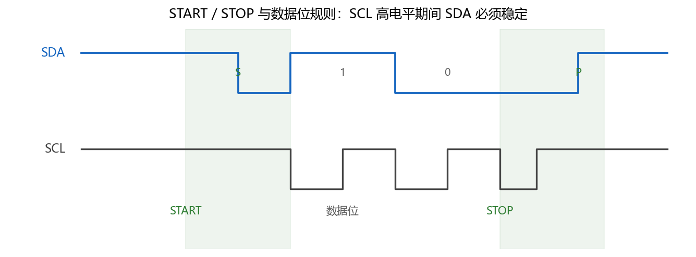
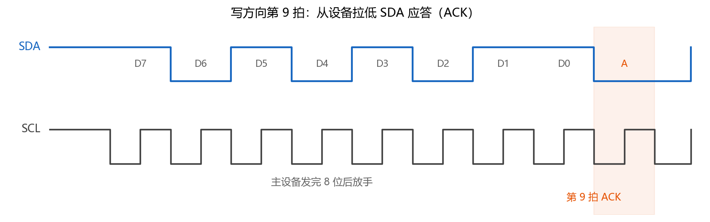
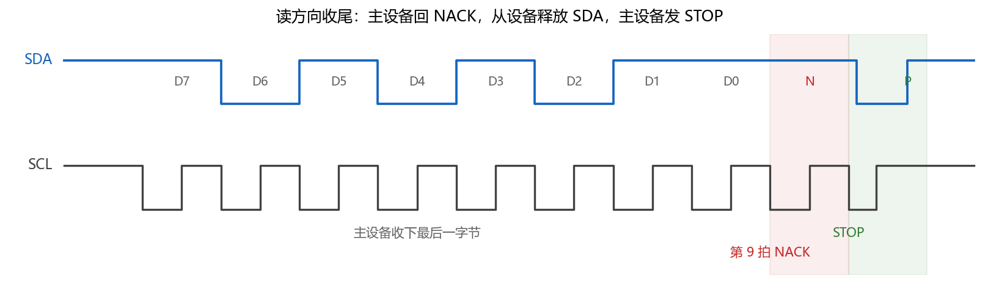
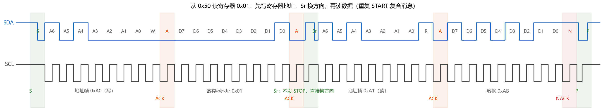

# B-B.3.2 I2C 协议层与帧格式

> 所属章节：第五部 B. 总线协议 > B-B.3 I2C 总线
>
> 难度：[B→I] Beginner → Intermediate | 预计阅读时间：35 分钟

## <span class="blue"> 本节导读：从软件请求读到一笔抓包

B-B.3.1 解释了 SDA、SCL 上的电平怎样形成。本篇只回答一个主问题：

> 软件要求“从 0x50 设备的寄存器 0x01 读取一个字节”，控制器怎样把请求变成线上帧，读者又怎样从抓包确认最终返回了 0xAB？

这里的 **0x50 是设备地址**，用来在共享总线上选中一个从设备；**0x01 是寄存器地址**，用来选择该设备内部的一个存储单元；**0xAB 是本例读回的数据**。十六进制前缀 `0x` 只是数值记法。

主设备是发起事务并提供时钟的一方，通常是 SoC 中的 I2C 控制器；从设备是被地址选中后参与传输的一方，例如传感器或存储器。软件通常不逐位驱动引脚，而是把设备地址、读写方向、寄存器地址和数据长度交给控制器及驱动。控制器负责把这些输入组织成线上的位序列。

本例的完整帧序列如下。它是为了讲解协议而构造的推演示例，不是一次实测抓包：

```text
S → 0xA0 + ACK → 0x01 + ACK → Sr
  → 0xA1 + ACK → 0xAB + NACK → P
```

先把记号说清：

- `S` 是 START，`P` 是 STOP，分别标记事务开始和结束。
- `Sr` 是重复 START，表示不结束当前事务就重新寻址。
- `0xA0` 表示“选择 0x50，主设备准备写”；`0xA1` 表示“仍选择 0x50，但主设备准备读”。
- `ACK` 是接收确认，`NACK` 是没有确认。本例最后的 NACK 是主设备主动结束读取的正常动作。

软件输入到最终结果的完整链路是：

```text
软件提供 0x50、0x01 和读取长度 1
→ START、写方向地址 0xA0
→ 从设备 ACK
→ 主设备发送寄存器地址 0x01，从设备保存访问位置并 ACK
→ 重复 START、读方向地址 0xA1
→ 从设备 ACK，并发送数据 0xAB
→ 主设备回 NACK，从设备释放 SDA
→ STOP，总线重新空闲
→ 软件得到数据 0xAB 和传输完成结果
```

沿这条链，可以分出三个经常混用的粒度：

- **字节帧**：8 个地址位或数据位，再加第 9 个应答拍。0xA0、0x01、0xA1、0xAB 各自都是一个字节帧。
- **消息段**：同一方向连续传输的一段内容。本例先写 0x01，再读一个字节，共两个消息段。下一篇 Linux 驱动框架会用一个 `i2c_msg` 描述其中一段。
- **总线事务**：从 START 到 STOP 的一次完整总线占用。本例的两个消息段由重复 START 连接，共同组成一笔事务，也可称为一笔**复合事务**。

这三个名称不是同一事物的三种叫法。尤其不能把两个消息段误说成“两笔互不相干的通信”：中间的重复 START 没有释放总线。

---

## <span class="blue"> START、STOP 与普通数据位：先找到事务边界

从设备看到的第一样东西不是“地址”这个抽象概念，而是一串电平。它必须先知道从哪里开始数，才能把 8 位组成字节。I2C 没有额外的片选线，而是用 SDA、SCL 的特殊跳变标记边界。

普通数据位遵守一条约束：**SDA 只能在 SCL 低电平期间变化，在 SCL 高电平期间必须稳定。** 因此，接收方在 SCL 高电平期间采样，读到的是稳定电平，而不是跳变过程中的电压。

这条约束留下了两种不会出现在普通数据位中的情况：

- **START**：SCL 为高时，SDA 从高变低。
- **STOP**：SCL 为高时，SDA 从低变高。

下图把两种边界与普通数据位放在一起。即使不看图，上面的电平规则也足以判断一个事件：先确认 SCL 为高，再看 SDA 的跳变方向。



STOP 不是简单地把两根线同时放开。正常收尾时，主设备先在 SCL 低电平期间让 SDA 为低，再把 SCL 拉高；等 SCL 稳定为高后释放 SDA，SDA 的上升沿才构成 STOP。此后 SDA、SCL 都保持高，总线空闲。

总线状态因此可以沿本例推演：

```text
两线空闲
→ S：总线被当前事务占用
→ 0xA0 + ACK：0x50 被选中
→ Sr：重新寻址，事务仍在继续，总线没有释放
→ 最后 NACK：从设备停止发送并释放 SDA，但事务尚未结束
→ P：主设备结束事务，总线回到空闲
```

STOP 释放的是**总线占用状态**，不等于从设备掉电复位，也不等于清除设备内部的寄存器内容或访问位置。后者是否保留，由具体器件手册规定。

对抓包而言，正确顺序是先找边界，再按“8 位加第 9 拍”分组。若把 SCL 低电平期间的一次普通 SDA 变化误认作 START，后面的地址、数据和应答都会错位。

---

## <span class="blue"> 地址帧与第 9 拍：选中设备，再确认接收

### 软件里的 0x50 为什么变成线上的 0xA0

START 后的第一个字节包含两部分：高 7 位是设备地址，最低位是 R/W 方向位。R/W 描述主设备接下来的动作：`0` 表示主设备写，`1` 表示主设备读。

一个字节的位编号从 bit7 到 bit0，其中 bit7 是最高位，bit0 是最低位。7 位地址左移一位后占 bit7～bit1，方向位填进 bit0：

```text
线上地址字节 = (7 位设备地址 × 2) + R/W 方向位
```

对 0x50 而言：

- 写方向：0x50 × 2 + 0 = **0xA0**，二进制为 `1010 0000`。
- 读方向：0x50 × 2 + 1 = **0xA1**，二进制为 `1010 0001`。

所以 0xA0、0xA1 不是两个设备，而是同一设备在两种方向下的线上地址字节。Linux I2C 接口和后面的 i2c-tools 命令通常把“设备地址”与“读写操作”分开表达，因此软件应传 **0x50**，不要把线上字节 0xA0 当成设备地址传入。

地址位和数据位都按最高位先发的顺序上线。主设备发送 0x01 时，线上依次出现 `0 0 0 0 0 0 0 1`；发送 0xAB 时，依次出现 `1 0 1 0 1 0 1 1`。

### 每 8 位之后，为什么还有第 9 拍

主设备发出地址或数据，并不代表对方一定收到。设备可能不在线、地址不匹配或暂时不能接收，因此协议在每个字节后安排一个应答拍。SCL 仍由主设备提供，SDA 则在这一拍交给接收方回答。

以主设备写为例：

1. 主设备发完 8 位后释放 SDA。
2. 被寻址的从设备若正确收到该字节，就在第 9 拍拉低 SDA，形成 **ACK**。
3. 主设备在第 9 拍的高电平期间回读 SDA。读到低是 ACK；若 SDA 保持高，则是 **NACK**。

下图展示写方向的 ACK。关键不是“第 9 位等于 0”这一句，而是发送方先放手、接收方再拉低这条操作顺序。



读方向的数据由从设备发送、主设备接收，所以应答者也换成主设备：**谁接收这 8 位，谁负责第 9 拍。** 主设备若还要下一字节，就回 ACK；收到最后一字节后回 NACK，通知从设备停止发送。

本例只读一个字节，其收尾顺序是：

1. 从设备发完 0xAB，释放 SDA。
2. 主设备收下 0xAB，在第 9 拍不拉低 SDA，形成 NACK。
3. 从设备看到 NACK，不再发送下一字节，并继续释放 SDA。
4. 主设备产生 STOP，事务结束。



这里必须区分两件事：

- **ACK 证明的内容**：接收方在这一字节后给出了接收确认，链路可以继续。
- **ACK 不能证明的内容**：寄存器地址一定合法、写入值一定符合业务要求、设备内部操作已经完成，或后续读回的数据一定正确。

因此，地址 NACK、写数据 NACK 和“每拍应答正常但数据不对”是三类不同问题，不能都用一句“I2C 不通”概括。

---

## <span class="blue"> 重复 START 与内部访问位置：两个消息段为什么必须连成一笔事务

很多从设备内部有多个寄存器。配置量程、读取温度或访问存储位置前，主设备不仅要选择设备，还要说明访问设备内部的哪个位置。这就是本例同时出现 0x50 和 0x01 的原因。

本例约定器件具有如下寄存器语义：收到写方向的第一个数据字节 0x01 后，把它保存为后续访问位置；下一次读操作返回该位置的数据。这个“内部访问位置”是**具体器件实现的状态**，不是每个 I2C 设备都自动具备的通用协议字段。它是否自动递增、STOP 后是否保留，都必须查器件手册。

为了让方向从写切换到读，主设备在 0x01 的 ACK 后再发 START，并重新发送同一设备的地址，但这次 R/W 改为读。这个 START 称为**重复 START**，因为它前面没有 STOP，总线始终处于当前事务中。



图中的 Sr 与普通 START 使用相同的电平定义：SCL 为高时，SDA 从高变低。它之前的准备动作不构成新数据位；它之后必须重新出现地址帧，不能只把方向位单独翻转。

### 如果中间改成 STOP，会发生什么

单主设备系统中，有些器件允许“先写位置并发 STOP，稍后再读”，但这不是可以推广到所有器件的规则。多主设备系统还多了一层风险。下面用一个明确约定“收到寄存器地址就更新内部指针，STOP 不清零”的通用寄存器型从设备推演；这段讨论不把该行为强加给 AT24C02 或其他具体芯片。

假设主设备 M1 想读寄存器 0x01，主设备 M2 随后要读寄存器 0x02。如果 M1 把设置位置和读取拆成两笔事务，操作序列可能是：

```text
M1：S → 设备写地址 → 0x01 + ACK → P
    从设备内部位置现在是 0x01，M1 已释放总线

M2：S → 设备写地址 → 0x02 + ACK → P
    M2 插入一笔事务，从设备内部位置被改为 0x02

M1：S → 设备读地址 → 从设备发送数据 → P
    M1 以为自己读 0x01，实际收到的是 0x02 位置的数据
```

这里每一次 ACK 都可以正常，三笔事务在协议上也都完整，但 M1 的业务结果仍然错了。问题不在电气波形，而在“设置位置”和“读取数据”之间允许了另一个主设备改变共享的器件状态。

若 M1 使用重复 START，则顺序变为：

```text
M1：S → 设备写地址 → 0x01 + ACK
    → Sr → 设备读地址 → 数据 → P

M2：只有等 M1 的 P 释放总线后，才能开始自己的事务
```

重复 START 保持的是**总线事务的原子性**，让 M2 不能插到两个消息段之间。它并不会锁定从设备内部寄存器，也不会阻止 M1 在 STOP 后执行其他操作。

在 Linux 中，下一篇会把这两段分别组织成写、读两个 `i2c_msg`，再一次性提交。传输入口的返回值用于判断实际完成了多少段消息，读到的数据则放在调用者提供的缓冲区中；不能只看“函数返回了”就认为读值一定正确。具体代码由 B-B.3.3 展开，本篇只需要能把它与线上同一笔事务对应起来。

---

## <span class="blue"> 时钟延展与总线清除：等待和恢复不是一回事

前面的序列默认从设备能及时准备下一位或下一字节。实际器件可能还在保存数据、处理命令或完成内部转换。支持时钟延展的从设备可以暂时拉住 SCL，让主设备等待；这个机制叫 **Clock Stretching**。

一次字节级延展可以按下面的顺序理解：

1. 主设备完成 SCL 的低电平阶段，随后释放 SCL，等待上拉电阻把它拉高。
2. 从设备尚未准备好，于是继续把 SCL 拉低。
3. 主设备回读 SCL，发现实际电平仍为低，就不能进入本拍的高电平采样阶段。
4. 从设备准备完成后释放 SCL，SCL 才升高，主设备继续当前拍和后续传输。

有些器件还能在更细的位级位置延展时钟。时钟延展是可选能力，并非所有从设备都支持；支持的位置和最长等待要求应查器件手册。它改变的是当前低电平持续时间，不是永久修改主设备配置的时钟频率。

硬件控制器通常负责回读并等待 SCL。若用 GPIO 软件模拟 I2C，就不能只执行“拉高、固定延时、继续下一位”，而必须确认 SCL 实际已经变高。等待也应有系统定义的超时上限，否则异常器件一直拉住 SCL，会让软件永久卡住。

### SDA 卡低时，补 9 拍解决的是什么

若读事务在字节中途被异常打断，从设备可能仍停在发送状态，继续把 SDA 拉低。此时主设备看到 SDA 为低，不能正常开始新事务。NXP I2C 规范给出的总线清除方法是：主设备发送 **9 个时钟脉冲**，让残留发送有机会走完；拉住 SDA 的设备应在这 9 拍内释放。

补钟期间要观察 SDA。若 9 拍后仍为低，就不能继续声称“总线已经恢复”，而应使用器件硬件复位或重新上电。若 SDA 已释放，主设备再按控制器和总线状态完成收尾。

### SCL 持续为低时，为什么不能靠补钟恢复

SCL 若被从设备持续拉低，主设备无法凭自身意愿产生完整时钟脉冲，补钟方法失去前提。规范优先建议使用器件的硬件复位信号；没有复位输入时，再通过重新上电触发上电复位。

因此，**时钟延展是正常流控，补 9 拍是针对 SDA 残留低电平的总线清除，硬件复位或重新上电才是更严重卡死时的恢复手段。** 三者不能混写成一个“多打几拍就好”的万能结论。具体 Linux 控制器提供哪些恢复接口、超时怎样报告，留到驱动框架和排障篇讨论。

---

## <span class="blue"> 10 位地址：能辨认扩展寻址即可

7 位地址空间有限，其中还包含协议保留地址，因此 I2C 另定义了 10 位寻址。它不如 7 位寻址常见，但抓包时不能把它的两个地址字节误认成“地址加数据”。

10 位寻址的首字节格式为：

```text
11110 + A9 A8 + R/W
```

其中 `A9 A8` 是 10 位地址的最高两位，第二字节携带低 8 位 `A7～A0`。首字节会落在 0xF0～0xF7，这个范围提示解码者继续读取第二个地址字节。

以 10 位地址 **0x155** 为例，它的最高两位是 `01`，低 8 位是 `0x55`：

- 初始写寻址：首字节 **0xF2**，第二字节 **0x55**。
- 若随后改为读：先发重复 START，再发首字节 **0xF3**，此时 R/W 为 1；不再发送第二地址字节。

10 位读取之所以这样组织，是因为从设备先在写方向的两个字节中收到完整地址；重复 START 后，它再凭相同的首字节高 7 位和读方向进入发送状态。实际软件仍应使用控制器和接口提供的 10 位寻址能力，不要把 0xF2、0x55 手工拼成一个值交给普通的 7 位地址参数。

---

## <span class="blue"> 回到同一笔抓包：逐字段证明软件得到了 0xAB

现在不再引入新例子，只解码开场那一笔。即使删除全文所有图和表，也可以按下面的顺序完成判读。

### 第一步：确定一笔事务的范围

最前面的 `S` 是起点，最后的 `P` 是终点，中间还有 `Sr`。因此这不是“写一笔、读一笔”两笔独立事务，而是从 START 到 STOP 的一笔复合事务。

按 8 位加第 9 拍分组，可还原为：

```text
S
0xA0  ACK
0x01  ACK
Sr
0xA1  ACK
0xAB  NACK
P
```

### 第二步：解释两个地址字节

`0xA0` 的 bit7～bit1 还原为 0x50，bit0 为 0，表示主设备写。随后从设备 ACK，说明有一个匹配该地址的接收方确认了地址帧。

`0xA1` 仍还原为 0x50，但 bit0 为 1，表示主设备读。第二个 ACK 后，数据方向反转为从设备发送、主设备接收。

### 第三步：区分寄存器地址和读回数据

写方向的 `0x01` 不是“设备地址”，而是发给已选中设备的寄存器地址。它得到 ACK，说明设备确认收到了这个字节；后续能否按预期解释 0x01，还要结合器件手册。

读方向的 `0xAB` 才是本例请求的数据。主设备只要求一个字节，所以在其后回 NACK，再发 STOP。这个 NACK 不是从设备拒绝读取，也不是错误返回。

### 第四步：判断结果属于哪一类问题

- **0xA0 后是 NACK**：尚未完成设备寻址。先核对 7 位地址、地址引脚、供电和器件是否具备应答条件。
- **0xA0 有 ACK，但 0x01 后是 NACK**：设备已回应地址，却没有确认当前写数据。应核对寄存器地址、器件状态和手册规定的写序列。
- **0xA1 后是 NACK**：写位置阶段已有回应，但读方向重新寻址未获确认。应核对器件要求的复合读时序和控制器配置。
- **所有应答都符合本例，但读值不是预期的 0xAB**：帧传输成立，不代表业务数据正确。继续核对实际寄存器位置、数据长度、字节序和器件内部状态。
- **位边界、应答位置或电平无法按上述规则稳定辨认**：先确认采样与解码设置；若边沿和电平本身不合规，再回到 B-B.3.1 排查电气层。

软件层面的验证也必须对应这两个结果：一是传输是否按预期完成，二是接收缓冲区是否得到 0xAB。只打印一个“成功”日志而不检查返回数据，不能证明这笔读取达到了目的。

---

## <span class="blue"> 本节总结

一笔 I2C 事务可以按同一条链理解：START 占用总线，地址帧选择设备并决定方向，数据帧逐字节传输，接收方在第 9 拍回应，STOP 释放总线。读寄存器时，写寄存器地址与读数据是两个消息段，却可以通过重复 START 组成一笔复合事务。

本例从软件输入到结果的对应关系是：0x50 经方向组合后变成 0xA0 和 0xA1，0x01 作为写数据选择设备内部位置，0xAB 作为读数据返回；最后的 NACK 是主设备正常停止读取，STOP 才结束事务。ACK 只证明当前字节的接收确认，不能替代寄存器语义和数据正确性的验证。

时钟延展让从设备通过拉住 SCL 争取时间；SDA 卡低时可按规范尝试 9 拍总线清除；SCL 持续卡低或 9 拍无效时，则需要硬件复位或重新上电。三者分别属于流控、总线清除和故障恢复，边界不同。

**速查表**

| 项目 | 本篇结论 |
|:---|:---|
| 字节帧 | 8 个地址位或数据位，加第 9 个应答拍 |
| 消息段 | 同一方向的一段内容；下一篇对应一个 `i2c_msg` |
| 总线事务 | START 到 STOP 的完整占用；可含重复 START 和多个消息段 |
| START / STOP | SCL 高时，SDA 下降沿开始、上升沿结束 |
| 7 位地址帧 | 地址占 bit7～bit1，方向占 bit0；0x50 写为 0xA0、读为 0xA1 |
| ACK / NACK | 接收方在第 9 拍拉低为 ACK，保持高为 NACK |
| 读方向收尾 | 中间字节由主设备 ACK，最后一字节 NACK，然后 STOP |
| 重复 START | 不先发 STOP 就重新寻址；本例用它保持寄存器读取的事务原子性 |
| 时钟延展 | 从设备拉住 SCL 使主设备等待；主设备须回读实际电平并考虑超时 |
| 总线清除 | SDA 卡低时发送 9 拍并观察释放；无效或 SCL 卡低时考虑复位、重新上电 |
| 10 位地址 | 首字节以 `11110` 开头；初始寻址用两字节，读时 Sr 后重发首字节 |

---

## <span class="blue"> 本节自查

??? details "Q1. 本例为什么是两个消息段、一笔事务，而不是两笔事务？"
    写 0x01 与读 0xAB 的方向不同，所以是两个消息段；但两段之间使用重复 START，没有 STOP，总线始终未释放，因此从 START 到最后 STOP 仍是一笔复合事务。粒度应分别按方向段和总线占用范围判断。

??? details "Q2. 地址帧和每个数据帧都得到 ACK，能否证明读回的数据一定正确？"
    不能。ACK 只说明接收方确认了当前字节，不证明寄存器地址具有预期语义，也不证明设备内部状态和数据内容正确。数据是否符合业务预期，还要结合器件手册、访问位置和接收缓冲区验证。

??? details "Q3. M1 设置寄存器位置后若先发 STOP，M2 怎样在不产生任何 NACK 的情况下让 M1 读错？"
    M1 写入 0x01 后 STOP，器件内部位置为 0x01；M2 随后写入 0x02 并 STOP，把共享位置改为 0x02；M1 再发起读取时，虽然所有字节均可正常 ACK，读到的却是 0x02 位置的数据。重复 START 把 M1 的设置和读取保留在同一事务中，阻止 M2 插入两者之间。

??? details "Q4. 本例最后的 NACK 为什么不是故障？它和地址 NACK 的区别是什么？"
    最后的 NACK 出现在主设备已经收到所需数据之后，用来通知从设备停止发送，随后主设备发 STOP，是正常收尾。地址 NACK 则发生在寻址阶段，表示没有接收方确认该地址，事务通常无法按预期进入数据传输。

??? details "Q5. 主设备释放 SCL 后为什么还必须回读？它怎样区分正常等待与永久卡死？"
    支持时钟延展的从设备可能继续拉住 SCL，所以主设备释放引脚并不代表总线已经变高。回读仍为低时必须等待；但若超过系统允许的超时仍未释放，就不能无限等待，而应报错并进入恢复流程。

??? details "Q6. 为什么“补 9 拍”不能作为所有 I2C 卡死的统一恢复方法？"
    9 拍清除针对的是从设备残留发送导致 SDA 卡低，让残余传输有机会完成。若 9 拍后 SDA 仍低，或持续为低的是 SCL，补钟就不能保证恢复；此时应按硬件条件使用复位或重新上电，而不是继续宣称总线已恢复。

??? details "Q7. 抓到 0xF2、0x55 后，为什么不能直接解释为“7 位设备地址加普通数据”？"
    0xF2 的高 5 位是 `11110`，符合 10 位寻址首字节格式。此时低两位包含 10 位地址的最高位，R/W 在 bit0，0x55 则是第二地址字节。若后续重复 START 后出现 0xF3，表示对同一 10 位地址切换为读方向。
