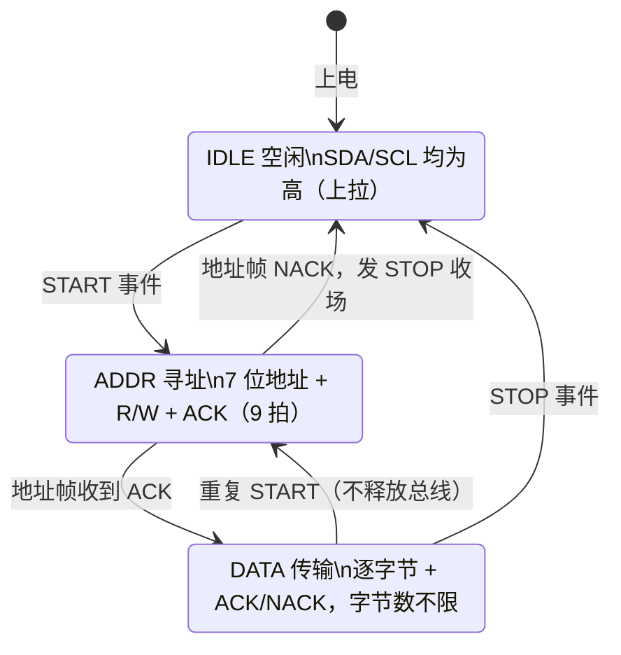

# B-B.3.2 I2C 协议层与帧格式

> 所属章节：第五部 B. 总线协议 > B-B.3 I2C 总线
>
> 难度：[B] Beginner / [I] Intermediate | 预计阅读时间：35 分钟

## <span class="blue"> 本节导读

物理层解决的是"电信号怎么在线上传"，协议层解决的是"这些电信号在说什么"。I2C 的每一笔通信都遵循同一套骨架：START 开场、地址帧点名、数据帧传输、STOP 收场，中间靠 ACK/NACK 一拍一拍确认。读懂这套帧格式，就能对着逻辑分析仪或示波器的波形逐位还原总线上发生的一切，这是调试任何 I2C 问题的基本功。

动笔之前先划清责任线，本篇涉及的每个动作分别由谁完成：

| 层 | 负责什么 | 对读者的要求 |
|:---|:---|:---|
| I2C 控制器（SoC 片内硬件） | 产生 START/STOP、输出时钟、逐位收发、采样 ACK、等待时钟延展 | 了解即可，不用写代码产生这些动作 |
| 内核 I2C 子系统 + 控制器驱动 | 把一条消息翻译成一串总线动作，处理收尾与错误恢复 | 了解即可，B-B.3.3 展开 |
| 自己写的驱动或应用 | 组织消息：目标地址、读写方向、数据内容；解读返回值 | 要会写 |
| 读者本人（排障时） | 抓一笔波形逐位解码，把故障定位到帧 | 要会读 |

也就是说，本篇讲的每个波形动作都由控制器自动完成，但每一笔都要能看懂：波形里哪个字节是地址、第 9 拍谁在应答、哪里是换方向，这是软件工程师在 I2C 问题上的排查话语权。

本节覆盖：三状态两事件的通信骨架、事务记法、7 位与 10 位地址帧格式、ACK/NACK 的角色规则与收尾链条、时钟延展、重复 START 与复合消息、三种完整事务演练、协议层故障定位与总线恢复。

---

## <span class="blue"> 三个状态与两个事件：通信的骨架

I2C 总线在任何时刻只处于三个状态之一：**空闲**（IDLE）、**寻址**（ADDR）、**传数据**（DATA）。START 和 STOP 不是状态，而是两个瞬时事件：它们各是一个电平边沿，总线不会"停留"在里面。把它们分开数，很多看似复杂的波形立刻变得可数。

一笔通信的完整生命周期是：上电后总线空闲，SDA 与 SCL 都被上拉电阻顶在高电平（为什么"没人驱动就是高"，是 B-B.3.1 开漏与上拉一节的内容）；主设备制造 START 事件，总线进入寻址；地址被应答后进入传数据；数据阶段可以用重复 START 回到寻址重新点名，全程不换总线主人；最后 STOP 事件把总线放回空闲。若地址没人应答，主设备应直接发 STOP 收场，这笔通信以"点名失败"告终。



两个边界事件的电气定义，B-B.3.1 的波形一节已作为四条铁律讲过：SCL 保持高电平期间，SDA 下降沿是 START，上升沿是 STOP。这里只收走协议层的读法：正常数据位被约束在 SCL 低电平期间变化、高电平期间稳定待采样，于是 SCL 高电平期间的 SDA 边沿被"空"了出来，协议把这两个边沿独占为帧边界的编码。读波形时的动作顺序因此固定：先用 SCL 高电平期间的 SDA 边沿把帧切开，再在帧内逐位读数据。

---

## <span class="blue"> 事务记法：后文的共同词汇

后文要反复书写事务序列，先统一定义记法，之后不再解释：

| 记号 | 含义 |
|:---|:---|
| `[S]` | START 事件 |
| `[Sr]` | 重复 START（Repeated START，不发 STOP 直接再次开场） |
| `[P]` | STOP 事件 |
| `[A]` / `[N]` | 第 9 拍的 ACK / NACK |
| `[Addr+W]` / `[Addr+R]` | 地址帧，方向分别为写 / 读 |

读法示例：`[S][Addr+W][A][0x01][A][P]` 读作"开场；点名某设备并声明要写；对方应答；发出字节 0x01；对方应答；收场"。这套记法与逻辑分析仪软件的解码视图一一对应，看懂它就等于看懂抓包结果。

---

## <span class="blue"> 地址帧：先点名，再说话

I2C 是点名制总线：START 之后的第一个字节永远是地址帧，回答两个问题：这一帧跟谁说话、要做什么。线上字节从最高位开始发（MSB first，MSB 即最高有效位，一个字节里权重最大的那一位），8 位的分工是前 7 位放从设备地址，最后 1 位放方向：0 表示主设备要写，1 表示主设备要读。

```
地址帧（1 字节 = 8 位，从左到右依次上线）：
┌─────┬─────┬─────┬─────┬─────┬─────┬─────┬─────┐
│ A6  │ A5  │ A4  │ A3  │ A2  │ A1  │ A0  │ R/W │
└─────┴─────┴─────┴─────┴─────┴─────┴─────┴─────┘
  ↑ 最高位先发                            ↑ 0=写，1=读
```

以 EEPROM AT24C02 为例把换算推演一遍。它的 7 位地址是 0x50，写成二进制：0x50 = 80 = 64 + 16，即 `101 0000`。上线时这 7 位占据字节的高 7 位，最低位腾给方向，效果等于整个地址左移一位再拼上方向位：写方向拼 0，得 `1010 0000` = 0xA0；读方向拼 1，得 `1010 0001` = 0xA1。

| 操作 | 线上字节 | 二进制 |
|------|----------|--------|
| 写 | 0xA0 | `10100000`（R/W=0） |
| 读 | 0xA1 | `10100001`（R/W=1） |

所以同一个设备，写波形里第一个字节是 0xA0，读波形里是 0xA1。抓波形时看到这两个值，要能立刻反推出"这是 0x50 号设备"。

> ⚠️ 软件和文档里统一使用 7 位地址，R/W 位由控制器或驱动拼接。Linux 的 `i2c_msg.addr` 和 i2c-tools 都按 7 位语义解释传入值：如果把拼好方向位的 0xA0 当地址传进去，160 已超出 7 位地址的上限 0x7F，传入的参数非法，设备毫无响应。把 8 位值当地址传，是"地址帧 NACK"最高发的人为原因。

### 10 位地址扩展

7 位地址留给用户设备的是 112 个（保留段的账在 B-B.3.1 算过），设备密集的系统可能不够用，协议为此预留了 10 位地址模式，用两个字节完成寻址：

```
第一字节：┌───┬───┬───┬───┬───┬────┬────┬─────┐
          │ 1 │ 1 │ 1 │ 1 │ 0 │ A9 │ A8 │ R/W │   高 5 位固定 0b11110
          └───┴───┴───┴───┴───┴────┴────┴─────┘
第二字节：┌────┬────┬────┬────┬────┬────┬────┬────┐
          │ A7 │ A6 │ A5 │ A4 │ A3 │ A2 │ A1 │ A0 │
          └────┴────┴────┴────┴────┴────┴────┴────┘
```

首字节高 5 位固定为 `0b11110`，这一段落在 7 位地址的保留段（0x78 以上）里，7 位设备不会应答它，因此 10 位设备与 7 位设备可以混挂在同一条总线上互不干扰。随后两位是 10 位地址的最高两位 A9、A8，第二字节携带低 8 位。

写方向的事务序列直观：

```
[S][11110 A9 A8 0][A][A7~A0][A][数据][A]...[P]
```

读方向有一个反直觉处：第二个地址字节只在写方向下发送，所以 10 位读必须先按写方向发完两字节地址，再用重复 START 换方向、把第一字节重发一遍（这次 R/W=1）：

```
[S][11110 A9 A8 0][A][A7~A0][A][Sr][11110 A9 A8 1][A][数据][N][P]
```

记忆方法是：寻址永远是"写"动作，方向位只决定寻址完成之后数据往哪流。Linux 中把一个客户端标记为 10 位地址用的是 `I2C_M_TEN` 标志（`drivers/i2c/i2c-core-base.c:2306` 处可见它被拼入消息标志）。实际产品中 10 位设备很罕见，但调试时看到线上出现 0xF0 开头的地址帧，要知道这是 10 位寻址的首字节，而不是哪个 7 位设备在应答。

---

## <span class="blue"> ACK/NACK：第 9 拍谁说了算

每传完 8 位，第 9 个时钟是应答拍。这一拍的电气过程（发送方先放手、上拉电阻把线顶高、接收方拉低、发送方读回）B-B.3.1 已按线与逻辑逐拍推过，这里不重复。协议层要带走的是角色规则：**谁接收，谁应答**。发完 8 位的那一方在第 9 拍变成听众，接收方用这一拍回话：拉低是 ACK（"收到，继续"），不拉是 NACK。

按"此刻谁该应答"把三种时刻分开，含义和应对各不相同：

| 时刻 | 谁应答 | NACK 的含义 | 主设备应对 |
|------|--------|-------------|------------|
| 地址帧第 9 拍 | 从设备 | 该地址上无设备：没焊上、未上电、地址算错 | 发 STOP 收场，查物理层与地址 |
| 写方向数据帧第 9 拍 | 从设备 | 拒绝接收：寄存器地址非法、内部忙、缓冲区满 | 发 STOP 或重复 START 换策略 |
| 读方向数据帧第 9 拍 | 主设备 | "这是最后一字节，别再发了" | 随后发 STOP |

第一行是点名失败，问题多半不在协议层。第二行是对方拒绝，要核对寄存器表。第三行最容易记反，值得按拍推一遍完整的收尾链条：

1. 主设备收完想要的最后一字节，在第 9 拍故意不拉 SDA，这就是 NACK；
2. 从设备读到 NACK，明白"到此为止"，从下一拍起不再驱动 SDA；
3. SDA 空出来了，主设备才能制造 STOP 所需的"SCL 高电平期间 SDA 上升沿"；
4. 假如最后一字节错回了 ACK，从设备会认为还有下一个字节要发，继续占着 SDA 输出；主设备此刻想发 STOP，但 SDA 可能正被从设备按在 0 上，上升沿出不来，STOP 发不出去，总线就此挂住。

所以"读事务的最后一字节必须回 NACK"不是风格建议，而是 STOP 能发出去的前提。用 Linux 的 `i2c_transfer()` 时这条链条由内核保证；自己用 GPIO 模拟时，它是收尾代码里最容易漏的一拍，漏掉的后果就是后文"总线恢复"一节要处理的局面。

---

## <span class="blue"> 时钟延展：从设备的"等一下"

> 时钟延展（Clock Stretching）：从设备处理不过来时，把 SCL 按住拉低、强迫主设备暂停打钟的机制。主设备每一拍都要回读 SCL，确认线真的升高了才继续。

开漏结构下主设备并不会把 SCL 主动"推"高，它只是放手（B-B.3.1 的开漏一节）。这给了从设备一个合法的话语权，完整过程分五步：

1. 主设备打完低电平半拍，松开 SCL；
2. 正常情况下上拉电阻把线顶高，主设备回读到高电平，进入高电平半拍；
3. 若从设备还没准备好（低速 MCU 在处理中断、EEPROM 在内部烧写），它用自己的下管把 SCL 继续按住；
4. 主设备回读发现 SCL 仍是低：说明自己说了不算，停在原地等，不再推进这一拍；
5. 从设备就绪后放手，SCL 升高，主设备回读到高电平才继续。

<svg viewBox="0 0 800 240" style="max-width:800px;width:100%" xmlns="http://www.w3.org/2000/svg">
<text x="20" y="24" fill="currentColor" font-size="14">正常：主设备连续输出 4 拍时钟</text>
<polyline points="80,60 80,30 120,30 120,60 160,60 160,30 200,30 200,60 240,60 240,30 280,30 280,60 320,60 320,30 360,30 360,60 400,60" fill="none" stroke="currentColor" stroke-width="2"/>
<text x="20" y="110" fill="currentColor" font-size="14">延展：第 3 拍的低电平被从设备拖长</text>
<rect x="240" y="140" width="240" height="55" fill="currentColor" opacity="0.08"/>
<polyline points="80,190 80,160 120,160 120,190 160,190 160,160 200,160 200,190 240,190 480,190 480,160 520,160 520,190 560,190" fill="none" stroke="currentColor" stroke-width="2"/>
<text x="252" y="178" fill="currentColor" font-size="13">从设备按住 SCL 不放，主设备回读为低，停在原地等</text>
<text x="490" y="150" fill="currentColor" font-size="13">从设备放手，SCL 升高，主设备继续</text>
</svg>

对软件的直接要求是：主机侧每一拍都必须回读 SCL 并带超时。Linux 的 GPIO 模拟实现在 `drivers/i2c/algos/i2c-algo-bit.c` 的 `sclhi()` 里就是这么做的（:75-111）：抬高 SCL 后进入 `while (!getscl(adap))` 等待循环，超过 `adap->timeout` 仍未升高则返回 `-ETIMEDOUT`；硬件控制器则在硅片里完成同样的等待。

> ⚠️ 时钟延展死锁。从设备固件 bug 拉低 SCL 后死机，SCL 永远回不来，整条总线瘫痪。更隐蔽的是某些软件模拟实现不回读 SCL、盲目输出时钟，遇到延展直接跑飞：它以为自己打了 9 拍，线上实际只有 3 拍。产品级驱动必须带超时检测，必要时配合看门狗。

<!-- -->

> bit-bang：用普通 GPIO 由软件逐位模拟 I2C 时序的做法（bit-bang 直译"位敲打"），不占用 SoC 的 I2C 控制器。时序完全可控，代价是延展处理、错误恢复都要自己写对。

<!-- -->

> 💡 部分传感器（如 BMP280）上电后做内部校准，会主动延展时钟几百微秒。初始化阶段的 timeout 报错，先确认是不是设备在合法延展时钟，再怀疑地址或线路。

---

## <span class="blue"> 重复 START 与复合消息

从传感器或 EEPROM 读一个寄存器是两步操作：先写入寄存器地址，再读回数据。朴素做法在两步之间发 STOP：

```
[S][Addr+W][A][RegAddr][A][P]     ← 释放总线
[S][Addr+R][A][Data][N][P]        ← 重新寻址
```

重复 START（Repeated START，记作 `[Sr]`）省去中间的 STOP，不释放总线直接换方向：

```
[S][Addr+W][A][RegAddr][A][Sr][Addr+R][A][Data][N][P]
                            ↑
                  不发 STOP，直接再次开场
```

> 复合消息（combined message）：一次 START 到 STOP 之间包含多段消息，段与段之间用 Sr 衔接、中间不发 STOP 的事务形态。

<!-- -->

> 多主总线：一条 I2C 上挂有多个能主动发起通信的主设备，谁先用谁占线，同时发起时靠仲裁现场裁决（仲裁机制在 B-B.3.1，软件不参与）。

省掉 STOP 的收益有两个。一是效率：少发一次地址帧，省去 STOP、总线空闲、再次 START 的开销。二是原子性，这一条在多主总线上是硬需求：从 START 到 STOP 之间总线归当前主设备独占，中间插入 STOP 等于让出总线，其他主设备可能插队进去操作同一个从设备，把刚写好的寄存器指针改掉，第二笔通信读回的就是错误数据。复合消息把"写寄存器地址 + 读数据"锁成一笔不可分割的事务。

Linux 的 `i2c_transfer()` 天然表达复合消息：传入 `i2c_msg` 数组，内核注释明确"每条消息以 START 开始，所有消息执行完毕才发 STOP"（`drivers/i2c/i2c-core-base.c:2242-2253`），相邻消息之间自动生成重复 START。原子性在内核里是两层：电线上靠 START 到 STOP 的独占，防其他硬件主设备；软件上 `i2c_transfer()` 调用期间持有该适配器的总线锁（同文件 :2279-2284），防同一条总线上的其他驱动插队。

---

## <span class="blue"> 完整事务演练

### 写单字节到寄存器

向 0x50 的寄存器 0x01 写入 0xAB。逐段拆开：开场；点名 0x50 并声明写方向，线上字节是 0xA0；对方应答；第一个数据字节 0x01 被 EEPROM 解释为寄存器地址；应答；第二个数据字节 0xAB 被写入该寄存器；应答；收场。

```
[S][ 1 0 1 0 0 0 0 0 ][A][0x01][A][ 1 0 1 0 1 0 1 1 ][A][P]
    └─ 0x50<<1 | 0 = 0xA0 ┘       └─ 数据 0xAB ─┘
 ↑START        ↑从设备 ACK        ↑从设备 ACK        ↑STOP
```

### 读寄存器（重复 START 复合消息）

从 0x50 的寄存器 0x01 读 1 字节。第一段是写：点名写方向、发出寄存器地址 0x01，这一步的作用是告诉从设备"接下来要读哪里"；Sr 换方向；第二段是读：点名读方向，主设备变成接收方收下数据，回 NACK 收尾，STOP 收场。

```
[S][Addr+W][A][0x01][A][Sr][Addr+R][A][Data][N][P]
   └── 第一段：写寄存器地址 ┘  ↑换方向  └── 第二段：读数据 ┘
```

<!-- 【待补图】images/b-b-3-2-repeated-start.png（优先级：★必要）
图名：读寄存器复合消息完整波形（Repeated START 高亮）
生图提示词：数字波形时序图，SDA（蓝色）与 SCL（深灰）两条波形，展示从 0x50 读寄存器 0x01 的完整复合消息：START → 地址帧 0xA0+W（从机 ACK 橙色高亮）→ 寄存器地址 0x01（ACK）→ Repeated START（绿色高亮框标注"不发 STOP 直接换方向，总线保持独占"）→ 地址帧 0xA1+R（ACK）→ 数据字节（主机接收）→ 主机 NACK（红色高亮标注"最后一字节 NACK 收尾"）→ STOP。每个字段下方用带括号的文字标注字段名与线上字节值，Sr 处画竖直虚线与普通 START 对比。示波器风格专业时序图，白底，蓝/橙/绿/红四色区分事件类型，中文标注，比例 16:9。 -->

### 连续读（Burst Read）

```
[S][Addr+R][A][Data0][A][Data1][A]...[DataN-1][N][P]
                └── 中间字节全部 ACK ──┘   ↑最后一字节 NACK 收尾
```

传感器批量读、EEPROM 顺序读都是这个模式：主设备全程是接收方，中间每个字节回 ACK 让从设备继续发，只在最后一字节回 NACK。收尾动作不是可选项：最后一字节的 NACK 是上一节收尾链条的前提，少了它 STOP 发不出去，从设备继续占线，下一笔通信就会撞上一根被占用的 SDA。

---

## <span class="blue"> 协议层故障定位

协议层异常的第一排查手段：**抓一笔完整波形，先解码 START 之后的第一个字节**。第 9 拍有没有 ACK，直接把故障分成三大类：

- **地址帧 NACK**：点名失败。设备不存在、地址算错、设备未上电、总线电平没拉起来。问题在物理层或配置层，不要往数据内容里查。
- **地址有 ACK 但数据异常**：点名成功、对话内容出错。查寄存器地址表、读写方向、字节序，问题在协议理解层。
- **波形本身畸形**（边沿圆钝、毛刺、高电平不达标）：这不是协议问题，回物理层按 B-B.3.1 核算上拉电阻与总线电容。

无仪器时的替代路径：`i2cdetect` 的扫描本质就是逐个地址发地址帧看 ACK，扫不到等于地址帧 NACK；扫得到但 `i2cget` 读回 0xff 或明显错误值，问题在数据帧。三条最常用的实测命令（工具全集见 B-B.3.4）：

```bash
i2cdetect -y -r 1            # 扫描总线 1（本质：逐个地址发地址帧看 ACK）
i2cget -y 1 0x50 0x00        # 从 0x50 读寄存器 0x00（内部走重复 START 复合消息）
i2cset -y 1 0x50 0x00 0xAB   # 向 0x50 的寄存器 0x00 写 0xAB
```

### 高频错误对照表

下表按"第几拍出问题、该拉低的一方拉没拉"归类，每行对应前文一个机制：

| 错误类型 | 根本原因 | 波形/工具症状 | 处理 |
|:---|:---|:---|:---|
| 地址 NACK | 地址错误、设备未上电、设备损坏 | 地址帧第 9 拍为高 | 核对手册地址与硬件地址引脚；查供电 |
| 数据 NACK（写方向） | 寄存器地址非法、从设备缓冲区满 | 数据帧第 9 拍为高 | 核对寄存器表；稍后重试 |
| 时钟延展死锁 | 从设备拉低 SCL 后死机 | SCL 持续为低 | 复位从设备；驱动加超时 |
| 总线卡死 | 上次读事务末字节错回 ACK 或异常终止，未发 STOP | SDA 或 SCL 持续为低 | clock out 恢复（见下） |
| 数据错乱 | 上拉/电容问题、速率过高 | 边沿圆钝、毛刺 | 回物理层按 B-B.3.1 核算 |

### 总线恢复：clock out

> clock out（总线恢复）：总线被卡死（SDA 或 SCL 持续为低）时，主设备手动补打时钟，把停在字节中途的从设备"推"完当前传输的恢复手法。

为什么偏偏是 9 拍：从设备可能停在一个字节的任意一位上，最坏情况是它刚进入一个新字节，还剩 8 个数据位加 1 个应答位没走完；补 9 个时钟保证任何位置的从设备都被推完当前字节并落到应答位。每打一拍回读一次 SDA，一旦读到高电平说明从设备已经发完放手，可以提前停止补钟。最后再补一个 STOP，让总线正式回到空闲状态。

下面的代码是恢复逻辑的示意（理解用，GPIO 编号与延时按平台定义；实战请用内核现成的恢复机制）：

```c
/* GPIO 模拟 SCL 输出最多 9 个时钟，促使从设备释放 SDA */
for (int i = 0; i < 9; i++) {
    gpio_set_value(scl_gpio, 0);
    udelay(5);                          /* 低半拍，按时钟速率调整 */
    gpio_set_value(scl_gpio, 1);
    udelay(5);                          /* 高半拍 */
    if (gpio_get_value(sda_gpio) == 1)  /* 从设备已放手，SDA 释放 */
        break;
}
/* 补一个 STOP 条件：SCL 高电平期间让 SDA 上升 */
gpio_direction_output(sda_gpio, 0);
gpio_set_value(scl_gpio, 1);
udelay(5);
gpio_set_value(sda_gpio, 1);            /* SDA 上升沿 @ SCL=H */
```

Linux 内核已实现了同一套逻辑：`i2c_generic_scl_recovery()`（`drivers/i2c/i2c-core-base.c:220-289`）。对照内核实现可以看到示意的每个要点都被落实：恢复时钟约 100 kHz（`RECOVERY_NDELAY` = 5000 ns，:217）；固定最多补 9 拍（`RECOVERY_CLK_CNT`，:218）；补钟期间让 SDA 跟随 SCL 慢半拍，顺带自然叠出 STOP（:230-241 的注释说明了这一设计）；若发现连 SCL 都被卡死则报 `-EBUSY` 退出（:249-254）。控制器驱动把它挂进 `i2c_adapter` 的 `bus_recovery_info`，通信超时后由内核自动执行恢复，自己的驱动一般不用重写这段逻辑。

---

## <span class="blue"> 方案对比（Trade-off）

| 维度 | 收益 | 代价 |
|------|------|------|
| 重复 START | 原子性、省一次寻址开销 | 个别老器件不支持复合消息 |
| 10 位地址 | 地址空间扩到 1024 个 | 每帧多一字节开销；读方向时序繁琐；实际产品罕见 |
| 容忍时钟延展 | 兼容慢速从设备 | 吞吐不再确定；主机驱动必须回读 SCL 并加超时 |
| bit-bang | 不占控制器、时序完全可控 | CPU 占用；延展与恢复逻辑要自己写对 |

---

## <span class="blue"> 排障速查

| 症状 | 根因 | 定位动作 |
|------|------|----------|
| 设备完全无响应，地址帧 NACK | 把 0xA0 这类拼好方向位的 8 位值当地址传入，超出 7 位范围 | 统一传 7 位地址；抓波形核对首字节实际值 |
| 读操作后总线挂死，SDA 被占用 | 读方向最后一字节回了 ACK，从设备继续占线等读 | 最后一字节必须 NACK；用 `i2c_transfer()` 由内核保证收尾 |
| 多主环境读回错误数据 | 读写之间插了 STOP，总线被其他主设备抢占 | 改用 `i2c_transfer()` 消息数组，保证复合消息原子性 |
| bit-bang 总线数据全部错位 | 软件模拟不回读 SCL，遇到时钟延展继续打钟 | 检查 bit-bang 实现的 SCL 回读与超时逻辑 |
| 初始化阶段偶发 timeout | 传感器上电校准主动延展时钟数百微秒，被误判为故障 | 先看 SCL 是否被拉低（延展），再怀疑地址或线路 |

---

## <span class="blue"> 本节总结

协议层的骨架只有三个状态和两个事件，但两个"第九拍"承载了全部可靠性设计：地址帧第九拍的 ACK 回答"设备在不在"，数据帧第九拍的 ACK/NACK 回答"还要不要继续"。唯一反直觉的是读方向由主设备应答，记住"谁接收谁应答"即可；而最后一字节的 NACK 是整条收尾链条的第一环，从设备据此释放 SDA，主设备才可能发出 STOP，一环都不能省。

时钟延展和重复 START 是协议给现实的两个妥协：前者承认从设备可能比主设备慢，代价是主机侧每拍都要回读 SCL 并加超时；后者承认多主环境中 STOP 就是让出总线，代价是从设备必须支持复合消息。调试时这两点是分水岭：波形里 SCL 的低电平被拖长是延展，地址帧重复出现而中间没有 STOP 是复合消息。认出它们，逻辑分析仪的波形就从天书变成了逐位可读的对话记录。而软件侧最大的自保只有一句话：传 7 位地址、用消息数组、别自己写收尾，内核已经把最容易错的收尾与恢复做对了。

**速查表**

| 项 | 要点 |
|----|------|
| 骨架 | IDLE/ADDR/DATA 三状态 + START/STOP 两事件；Sr 回 ADDR 不释放总线 |
| START/STOP | SCL 高电平期间 SDA 下降沿/上升沿；数据位只在 SCL 低电平期变化 |
| 地址帧 | 7 位地址 + R/W 位，高位先发；软件统一用 7 位（0x50），线上是 0xA0/0xA1 |
| 10 位地址 | 首字节 `11110 A9 A8 R/W`；读方向必须先写两字节再 Sr 重发首字节 |
| ACK/NACK | 第 9 拍接收方拉低为 ACK；读方向主设备应答、末字节 NACK 收尾 |
| 时钟延展 | 从设备按住 SCL 拖慢总线；主机驱动必须回读 SCL + 超时保护 |
| 重复 START | 效率 + 多主原子性；`i2c_transfer()` 消息数组自动生成 |
| 排查锚点 | 抓波形看地址帧第 9 拍：NACK 查物理/配置，ACK 后异常查协议理解 |
| 总线恢复 | 卡死时 clock out 补 9 拍 + STOP；内核 `i2c_generic_scl_recovery()` |

**本节自查**

1. 为什么 SCL 高电平期间的 SDA 边沿能独占用来编码 START/STOP？
2. 软件里写地址 0x50，写和读时线上第一个字节各是什么？把 0xA0 传给 `i2cget` 会怎样？
3. 10 位设备读数据时，为什么要先按写方向发两字节、再 Sr 重发首字节？
4. 读方向最后一字节错回 ACK，从"从设备继续占线"到"总线挂死"的完整链条是什么？
5. 主设备怎么发现自己被时钟延展了？主机驱动必须为此做哪两件事？
6. 抓波形发现地址帧有 ACK 但读回全是 0xff，故障在哪一层？下一步查什么？
7. 总线卡死时为什么补 9 个时钟就能恢复？补钟期间为什么还要回读 SDA？

---

## <span class="blue"> 下一步

协议层之后是软件层：**B-B.3.3 I2C Linux 驱动框架与 SMBus**，讲 I2C 子系统的三层架构（Core / Adapter / Client）、`i2c_driver` 的 probe/remove、`i2c_transfer()` 与 `i2c_smbus_*()` API 的分工、设备树节点写法。**B-B.3.5 实战篇**会用 AT24C02 把本篇的帧格式与驱动代码逐行对上。

> 💡 螺旋衔接：本篇 ACK、时钟延展依赖的开漏与线与结构在 B-B.3.1；波形排障时用到的电气参数表也在 B-B.3.1。驱动侧的 probe 流程衔接第二部第 11 章设备模型与 D 扩展驱动专题。
