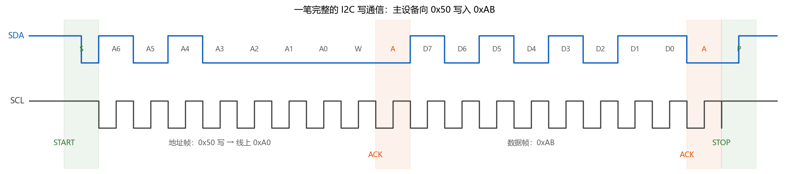
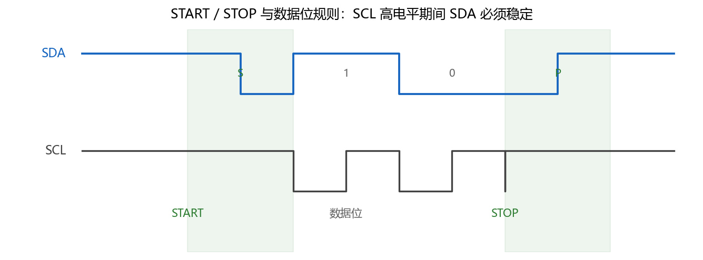
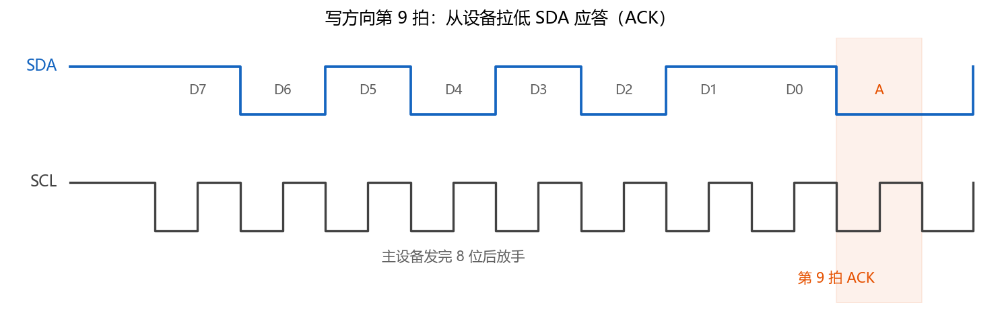
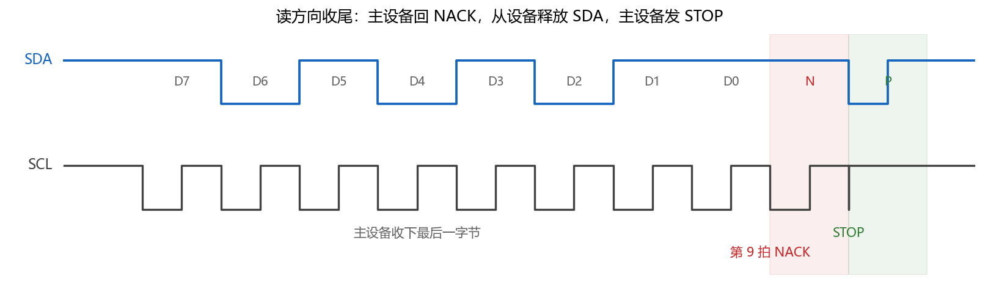
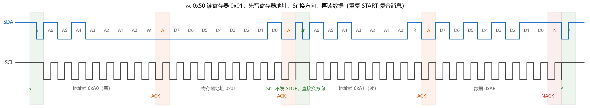

# B-B.3.2 I2C 协议层与帧格式

> 所属章节：第五部 B. 总线协议 > B-B.3 I2C 总线
>
> 难度：[B→I] Beginner → Intermediate | 预计阅读时间：35 分钟

## <span class="blue"> 本节导读

I2C（Inter-Integrated Circuit）是一种通过 SDA、SCL 两根线连接多个设备的总线。B-B.3.1 解决了“0 和 1 怎样变成这两根线上的电平”，本篇继续解决“这些 0 和 1 按什么顺序排列，才能表达一次读写”。这里的 SDA 是数据线，SCL 是时钟线。

实际调试中，这层知识对应一个很具体的任务：逻辑分析仪已经抓到两条波形，怎样确认主设备找了哪个地址、准备读还是写、从设备有没有回应、最后为何没有正常结束。逻辑分析仪是一种把数字引脚电平按时间记录下来，并可按协议解码的仪器。

> 帧（frame）：为完成一个明确动作而组织起来的一段位序列。本篇先接触地址帧和数据帧，它们都包含 8 个数据位，后面还紧跟一个应答拍。

这些动作大部分不需要软件逐位实现，但软件必须知道自己交给硬件的内容最终在线路上变成了什么：

| 层 | 负责什么 | 本篇对读者的要求 |
|:---|:---|:---|
| SoC（主控芯片）里的 I2C 控制器 | 产生时钟和帧边界，逐位收发，采样应答 | 理解它在线路上做了什么 |
| Linux 内核与控制器驱动 | 把软件提交的读写请求交给控制器，报告错误 | 知道有这层即可，B-B.3.3 展开 |
| 自己编写的驱动或应用 | 提供设备地址、读写方向和数据 | 必须分清 7 位地址与线上字节 |
| 排障时的读者本人 | 从波形还原一笔通信，定位失败发生在哪一段 | 能独立读完一笔抓包 |

本节覆盖：一笔完整写通信、START 与 STOP、7 位地址帧、ACK/NACK、重复 START 与寄存器读取、时钟延展、10 位地址，以及总线卡死后的恢复原理。叙述顺序就是读波形的顺序：先看完整通信，再逐段拆开。

---

## <span class="blue"> 先看一笔完整通信

先不谈状态机，也不背记号。只看一个最小实例：主设备向地址为 0x50 的从设备发送一个字节 0xAB。

主设备是发起通信并提供 SCL 时钟的一方，通常是主控芯片；从设备是被地址选中后参与通信的一方，例如传感器或存储器。这里的 0x50 是从设备地址，0xAB 是要发送的数据。十六进制数前面的 `0x` 只是记法，`0xAB` 写成二进制是 `1010 1011`。

下图从左向右读。SDA 每传一位，SCL 走完一个周期；接收方在 SCL 高电平期间读取 SDA。图中 `A6` 到 `A0` 表示 7 个地址位，`W` 表示写，`D7` 到 `D0` 表示 8 个数据位。单独的 `A` 表示 ACK，`S` 和 `P` 分别表示 START 和 STOP，后文会解释这些动作为什么存在。



这笔通信可以按时间分成六步：

1. **主设备发出 START。** 它告诉总线上的所有从设备：一笔通信即将开始，接下来的第一个字节是地址。
2. **主设备发送地址帧。** 前 7 位指出目标设备，第 8 位 `W=0` 表示主设备接下来要写数据。0x50 与写方向组合后，线上这个字节是 0xA0，换算过程在地址帧一节展开。
3. **被寻址的从设备回 ACK。** 地址字节占 8 拍，第 9 拍由接收方回答“收到了”。ACK 是 Acknowledgement 的缩写，意为确认。
4. **主设备发送数据帧。** 0xAB 按 `10101011` 逐位上线，最高位先发送。一个字节是 8 位，所以 `D7` 最先出现，`D0` 最后出现。
5. **从设备再次回 ACK。** 这表示它收下了 0xAB。每个字节都有自己的第 9 拍，不是整笔通信结束才统一确认一次。
6. **主设备发出 STOP。** 一笔通信结束，总线回到空闲状态。

这张图已经包含了协议层的主干：**START 定起点，地址帧选设备并定方向，数据帧承载内容，ACK 逐字节确认，STOP 定终点。** 后面的每一节都只是把其中一段放大，解释它为什么必须这样设计。

---

## <span class="blue"> START 与 STOP：不增加信号线，怎样标出边界

一笔通信首先是连续的高低电平。如果没有明确的开始和结束标记，从设备就无法知道第一个地址位从哪里开始，也无法知道当前字节结束后该不该继续接收。

I2C 没有再增加“开始”和“结束”两根线，而是利用了普通数据位的一条约束：**SDA 只能在 SCL 低电平期间变化，在 SCL 高电平期间必须保持稳定。** 这样，接收方在 SCL 高电平期间读到的就是稳定数据，不会读到变化中间的电压。

这条约束还留下了两个特殊情况：如果 SCL 已经是高电平，SDA 却发生了跳变，它就不可能是普通数据位。协议据此定义两个帧边界事件：

- **START**：SCL 保持高电平时，SDA 从高变低。主设备用它开始一笔通信。
- **STOP**：SCL 保持高电平时，SDA 从低变高。主设备用它结束一笔通信，随后 SDA、SCL 都保持高电平，总线空闲。

下图中，中间两个普通数据位只在 SCL 低电平期间改变；左侧 START 的 SDA 下降沿和右侧 STOP 的 SDA 上升沿，都发生在 SCL 高电平期间。



因此，读抓包时不必从第一个边沿开始盲目数位。先找出 START 和 STOP，把一笔通信的范围确定下来，再从 START 后按“8 个数据位加 1 个应答拍”分组，地址、数据和应答就能各归其位。

软件通常不用自己制造这两个边沿，I2C 控制器会完成。需要掌握的是它们的判读价值：**找不到 STOP，说明上一笔通信可能没有正常收尾；把 SCL 低电平期间的 SDA 变化误认为 START，则会把后续所有位都解错。**

---

## <span class="blue"> 地址帧：软件里的 0x50，为什么上线变成 0xA0

多个从设备共享同一组 SDA、SCL，主设备必须先说明这次要和谁通信。START 后的第一个字节就承担这个任务，称为地址帧。

地址帧的 8 位分为两部分：高 7 位是从设备地址，最低位是 R/W 方向位。R/W 是 Read/Write 的缩写，但它描述的是主设备接下来的动作：`0` 表示主设备要写，数据从主设备流向从设备；`1` 表示主设备要读，数据从从设备流向主设备。

7 位地址来自器件手册及其地址引脚配置，方向则来自本次软件操作。控制器把两者拼成线上字节。对软件工程师，最直接的换算就是：

```c
线上字节 = (7 位地址 << 1) | 方向位
```

`<< 1` 是左移一位，把原来的 7 个地址位整体移到字节的 bit7 至 bit1，最低位 bit0 因此空出来；`|` 是按位或，用来把方向位填入 bit0。写时方向位是 0，读时方向位是 1。

以 EEPROM AT24C02 为例。EEPROM 是掉电后仍能保存内容的小容量存储器，AT24C02 在本例中的 7 位地址是 0x50，写成 7 位二进制是 `101 0000`：

- 写方向：`(0x50 << 1) | 0`，得到 `1010 0000`，即 0xA0。
- 读方向：`(0x50 << 1) | 1`，得到 `1010 0001`，即 0xA1。

可见，0xA0 和 0xA1 不是两个设备，而是同一个 0x50 设备在两种方向下的地址帧字节。回看第一张完整写通信，START 后的 `10100000` 正是在表达“选择 0x50，主设备准备写”。

软件接口通常把“找谁”和“做什么”分成两个参数，因此只接收 7 位地址，方向由读写接口另行表达。Linux 的 I2C 驱动接口，以及 B-B.3.4 将使用的 i2c-tools 用户态调试命令，都采用这个约定。用户态指内核之外运行普通应用程序和命令行工具的环境。

> ⚠️ 给软件传设备地址时传 0x50，不要传 0xA0 或 0xA1。7 位地址最大只有 0x7F，0xA0 已经超出这个范围；即使某个不规范的调用路径没有立即报错，这个值也不表示“0x50 设备的写地址”。只有分析线上原始字节时，才把 0xA0 当作地址帧来解释。

---

## <span class="blue"> ACK/NACK：每 8 位之后，接收方用第 9 拍回话

主设备发出一个字节，并不意味着对方一定收到。设备可能不存在、还未准备好，也可能已经收满。协议需要在每个字节后立即得到反馈，但又没有多余的信号线，于是把 SDA 的第 9 个时钟拍交给接收方。

这一拍有两种结果：ACK 表示接收方拉低 SDA，确认收到；NACK 是 Negative Acknowledgement 的缩写，线上表现为 SDA 保持高电平。**NACK 不总等于故障，它在读通信末尾还是正常的结束信号。**

### 写方向：从设备怎样回 ACK

以主设备写数据为例，第 9 拍按以下顺序发生：

1. 主设备发完 8 位后释放 SDA，不再主动拉低它。I2C 引脚采用开漏结构，只会主动拉低，不会主动推高；释放后引脚进入高阻状态，也就是既不接高电平也不接地，电平改由总线上的其他设备决定。
2. 从设备如果正确收到这个字节，就在第 9 拍拉低 SDA。
3. 主设备仍负责给出 SCL 时钟，同时在 SCL 高电平期间回读 SDA。读到 0 是 ACK，读到 1 则说明从设备没有应答，即 NACK。

下图把重点放在第 9 拍：前 8 位由主设备发送，橙色应答拍由从设备拉低。ACK 不是主设备自己发完后又写上的一个 0，而是主设备放手后，从设备在同一条 SDA 上给出的回答。



### 读方向：为什么最后一字节由主设备回 NACK

读数据时，SDA 上的角色调换了：从设备发送数据，主设备接收数据，所以第 9 拍也改由主设备应答。规则仍然只有一句：**谁接收这 8 位，谁负责第 9 拍。**

如果主设备还想继续读，它在每个中间字节后回 ACK，从设备看到 ACK 就继续发送下一字节。收到最后一字节后，主设备不再拉低 SDA，以 NACK 表示“数据够了”。完整的收尾顺序是：

1. 主设备收下最后一字节，在第 9 拍保持 SDA 为高，形成 NACK。
2. 从设备读到 NACK，停止发送，并释放 SDA。
3. 主设备确认 SDA 已由自己控制，再把 SCL 保持为高，让 SDA 从低变高，形成 STOP。
4. STOP 完成后，双方都不驱动总线，SDA、SCL 由上拉电阻保持高电平。上拉电阻是连接信号线与电源的电阻，在无人拉低时把信号线拉回高电平。

下图展示了最后一字节、主设备 NACK 和 STOP 的先后关系。最后这个 NACK 是协议规定的正常动作，不是读取失败。



如果最后一字节错误地回了 ACK，从设备会认为主设备还要下一字节，并准备继续驱动 SDA。此时主设备若直接尝试 STOP，SDA 可能仍被从设备拉低，无法产生所需的上升沿。这就是某些异常读操作之后总线卡死的协议层原因。

把三种第 9 拍放在一起，含义就清楚了。表只是对上面过程的归纳：

| 刚传完的 8 位 | 第 9 拍由谁应答 | NACK 在这里表示什么 |
|:---|:---|:---|
| 地址帧 | 从设备 | 没有设备确认这个地址，常见原因是地址错误、设备未上电或未接入 |
| 写方向数据帧 | 从设备 | 从设备当前不能或不愿继续接收，例如内部忙或不接受该数据 |
| 读方向数据帧 | 主设备 | 主设备已经读够，要求从设备停止发送 |

---

## <span class="blue"> 重复 START：读寄存器前，为什么不能直接发读命令

很多 I2C 设备内部不只有一个数据值，而是有一组寄存器。寄存器是设备内部可读写的小存储单元，每个单元有一个编号，这个编号叫寄存器地址。配置量程、读取温度、访问 EEPROM 的某个位置，都要先说明寄存器地址。

这里有两个不同层次的地址，必须分开：

- **设备地址**例如 0x50，用于在整根总线上选中一个设备。
- **寄存器地址**例如 0x01，用于在已选中的设备内部选中一个存储单元。

因此，“读设备 0x50 的寄存器 0x01”实际包含两段动作：先用写方向把寄存器地址 0x01 告诉设备，再用读方向接收该寄存器的数据。设备收到寄存器地址后，会把它作为接下来读写的位置。

两段动作之间需要再次给出地址帧，因为方向要从写切换为读。协议允许在这里直接再发一次 START，称为**重复 START**（Repeated START，图中简写为 `Sr`）。它与普通 START 的电平定义相同，区别是前面没有 STOP，总线没有回到空闲状态。

一次从 START 到最终 STOP 之间包含多段读写、段间用重复 START 衔接的通信，称为**复合消息**。一次典型的单字节寄存器读取按以下顺序完成：

1. 主设备发 START，再发 `0xA0`，选中 0x50 并声明写方向；从设备回 ACK。
2. 主设备发出寄存器地址 `0x01`；从设备回 ACK，并记住后续访问位置。
3. 主设备不发 STOP，直接发重复 START。
4. 主设备发 `0xA1`，仍选择 0x50，但方向改为读；从设备回 ACK。
5. 从设备发送寄存器数据，本例为 `0xAB`；主设备接收。
6. 主设备只读一个字节，因此在数据后回 NACK，再发 STOP 结束。



图中可以看到，重复 START 前后各有一个地址帧：前者是 0xA0，后者是 0xA1。它省掉的是中间的 STOP 和总线空闲过程，不是第二次寻址。

重复 START 还有一个关键作用：从第一次 START 到最终 STOP，当前主设备一直占用总线。若中间发 STOP，在多个主设备共存的系统里，另一个主设备可能插入一笔通信，改变同一从设备的内部访问位置，后续读回的数据就不再对应刚才设置的寄存器。复合消息把“指定位置”和“读取数据”保持在同一笔通信中。即使系统只有一个主设备，很多器件的读寄存器流程本身也要求使用这种时序。

Linux 内核用 `i2c_transfer()` 这类传输接口组织连续的多段消息，具体参数和驱动写法在 B-B.3.3 展开。本篇只需要建立对应关系：**软件提交“先写寄存器地址、再读数据”的两段请求，线路上就应看到图中的重复 START。**

---

## <span class="blue"> 时钟延展：从设备没准备好时，怎样让主设备等待

前面的波形默认从设备能跟上主设备的时钟，但实际器件可能需要更长的内部处理时间。例如处理速度较慢的从设备正在执行其他任务，传感器还在完成一次内部转换。若主设备继续打钟，从设备就会错过数据。

I2C 给从设备保留了一个流控手段：**时钟延展**（Clock Stretching）。流控是让发送速度适应接收方处理能力的机制。在这里，从设备通过继续拉低 SCL，使当前时钟拍无法进入高电平阶段，主设备必须等待。

> 时钟延展：从设备暂时按住 SCL，让主设备暂停推进时序的机制。它延展的是 SCL 的低电平时间，不是修改主设备配置的时钟频率。

一次延展按以下顺序发生：

1. 主设备完成 SCL 的低电平阶段，随后释放 SCL，等待上拉电阻把它拉高。
2. 如果从设备尚未准备好，它继续把 SCL 拉低。开漏结构决定了任何一方拉低，整条线都保持低。
3. 主设备回读 SCL，发现它并没有升高，于是不进入本拍的高电平采样阶段。
4. 从设备完成内部处理后释放 SCL，上拉电阻终于能把线拉高。
5. 主设备回读到高电平，继续完成当前拍，后续通信按原速率进行。

<svg viewBox="0 0 800 240" style="max-width:800px;width:100%" xmlns="http://www.w3.org/2000/svg">
<text x="20" y="24" fill="currentColor" font-size="14">正常：主设备连续输出 4 拍时钟</text>
<polyline points="80,60 80,30 120,30 120,60 160,60 160,30 200,30 200,60 240,60 240,30 280,30 280,60 320,60 320,30 360,30 360,60 400,60" fill="none" stroke="currentColor" stroke-width="2"/>
<text x="20" y="110" fill="currentColor" font-size="14">延展：第 3 拍的低电平被从设备拖长</text>
<rect x="240" y="140" width="240" height="55" fill="currentColor" opacity="0.08"/>
<polyline points="80,190 80,160 120,160 120,190 160,190 160,160 200,160 200,190 240,190 480,190 480,160 520,160 520,190 560,190" fill="none" stroke="currentColor" stroke-width="2"/>
<text x="252" y="178" fill="currentColor" font-size="13">从设备按住 SCL 不放，主设备回读为低，停在原地等</text>
<text x="490" y="150" fill="currentColor" font-size="13">从设备放手，SCL 升高，主设备继续</text>
</svg>

硬件 I2C 控制器通常会处理这段等待，软件不需要逐拍干预。若用普通 GPIO（通用输入输出引脚）由软件逐位模拟 I2C，则必须在每次释放 SCL 后回读实际电平，不能只按固定延时继续运行。

等待也不能没有上限。如果从设备因异常一直拉住 SCL，正常延展就变成总线故障，因此主机实现还需要超时保护：超过允许时间仍等不到 SCL 升高，就终止本次传输并进入错误处理。相关驱动接口在 B-B.3.3 讨论。

---

## <span class="blue"> 10 位地址：知道怎样辨认即可

7 位地址中有一些值被协议预留作特殊用途，不能分配给普通设备。去掉这些保留值后，普通设备可用的地址有限，协议因此定义了 10 位地址模式，用两个地址字节容纳更多设备。它在实际产品中较少见，本篇不要求像 7 位地址那样熟练推算完整通信，但抓包时要认得出来。

10 位寻址的第一个字节仍以 `11110` 开头，随后两位是 10 位地址的最高两位 `A9`、`A8`，最后一位仍是 R/W；第二个字节携带地址的低 8 位 `A7` 至 `A0`。因此，线上第一个地址字节落在 0xF0 至 0xF7 时，应按 10 位寻址继续解读，不能把它当成一个普通的 7 位地址帧。

写方向的两个地址字节可以连续发送。读方向多一步：先按写方向发完两个地址字节，再用重复 START 重发第一个地址字节，这次 R/W 改为 1，随后才接收数据。原因是第二个地址字节只在写方向阶段发送，协议借这一阶段把完整地址交给从设备。

日常 Linux 驱动和用户态工具仍主要使用 7 位地址。遇到 10 位器件时，应以器件手册和控制器的 10 位寻址支持为准，不要手工把两个线上字节拼成一个值传给普通的 7 位地址接口。

---

## <span class="blue"> 总线卡死：为什么恢复时最多补 9 个时钟

一笔读通信如果在字节中途被异常打断，从设备可能仍认为传输尚未结束，继续拉低 SDA。主设备下次发起通信时，看到的就不是两根线都为高的空闲总线，普通 START 也无法正常开始。

这时可以使用 **clock out** 恢复：主设备控制 SCL 额外补打若干时钟，同时不再主动占用 SDA，让停在字节中途的从设备把剩余位发完并释放总线。clock out 描述的是“补时钟把残余传输走完”，不是提高通信速率。

上限通常取 9 拍，因为从设备最坏可能刚进入一个新字节，还剩 8 个数据位和 1 个应答位没有走完。补钟期间每拍都要回读 SDA：一旦 SDA 变高，说明从设备已经释放，可以停止补钟；最后再按正常规则产生 STOP，让总线明确回到空闲状态。

如果持续为低的是 SCL，而不是 SDA，补时钟本身无法解决，需要进一步检查从设备复位、供电或硬件状态。Linux 内核和部分控制器已经提供总线恢复机制，实际驱动优先使用现成能力，不必自行重写这段时序。

---

## <span class="blue"> 拿到一笔抓包，按什么顺序读

协议知识最终要落到抓包分析。分析顺序不应是“看到一串字节就猜含义”，而应沿着本篇的结构逐层缩小范围。回看这张完整写通信，先找边界，再看地址，再看每个第 9 拍，最后才解释数据。


第一步找 START 和 STOP，确定分析的是哪一笔通信；有重复 START 时，则把同一笔通信中的读写分段。第二步解 START 后的地址帧：右移一位还原 7 位设备地址，最低位判断读写方向。第三步逐段检查第 9 拍：

- **地址帧后是 NACK**：通信在选中设备阶段就失败了。先核对地址和设备是否具备应答条件，不必继续分析后面的数据内容。
- **地址帧有 ACK，写数据后是 NACK**：设备已经被选中，但没有接受当前数据。接下来核对器件手册中的寄存器地址、数据含义和设备忙闲状态。
- **各段都有正常应答，但数据不符合预期**：传输过程本身成立，应检查读写的寄存器、重复 START 流程和数据解释方式。若波形边沿变形、电平不达标，则回到 B-B.3.1 查电气问题。

这套顺序把“协议没走完”和“协议走完了但内容不对”分开，也把软件配置问题与电气问题分开。它比记住一张故障对照表更重要，因为任何一笔新抓包都可以按同样的步骤阅读。

---

## <span class="blue"> 本节总结

一笔 I2C 通信可以始终按同一条主线阅读：START 确定起点，地址帧选择设备并决定方向，数据帧逐字节传输，接收方在第 9 拍回应，STOP 确定终点。重复 START 只是在同一笔通信中重新寻址和换方向，时钟延展则是从设备拖长 SCL 低电平来争取处理时间。

对软件工程师，最容易造成实际错误的两个点是地址口径和读收尾：软件传 7 位地址，线上地址帧才是 `(addr << 1) | rw`；读方向由主设备应答，最后一字节用 NACK 让从设备停止，再发 STOP。掌握这两点后，地址换算、复合消息和总线卡死就不再是彼此孤立的结论。

**速查表**

| 项目 | 读法 |
|:---|:---|
| START / STOP | SCL 高电平期间，SDA 下降沿开始、上升沿结束 |
| 7 位地址帧 | 高 7 位是地址，bit0 是方向；写 `(addr << 1) | 0`，读 `(addr << 1) | 1` |
| ACK / NACK | 每 8 位后由接收方应答；拉低为 ACK，保持高为 NACK |
| 读方向收尾 | 中间字节由主设备 ACK，最后一字节 NACK，然后 STOP |
| 重复 START | 中间不发 STOP，再次寻址；用于写寄存器地址后读数据等复合消息 |
| 时钟延展 | 从设备拉住 SCL 让主设备等待；主机要回读 SCL 并有超时 |
| 10 位地址 | 首字节以 `11110` 开头，两字节寻址；读方向需重复 START 后重发首字节 |
| 总线恢复 | 从设备残留传输可最多补 9 拍并回读 SDA，释放后补 STOP |

---

## <span class="blue"> 本节自查

??? details "Q1. 面对一笔 I2C 抓包，为什么要先找 START 和 STOP，而不是直接从左到右解释每个字节？"
    START 和 STOP 给出一笔通信的边界。边界确定后，才能从 START 后按“8 个数据位加 1 个应答拍”分组，把地址帧、数据帧和应答各自归位。若不先定边界，一个普通的 SDA 跳变就可能被误当成帧起点，后续解释全部错位。

??? details "Q2. 为什么 START 和 STOP 不需要额外的信号线，也不会与普通数据位混淆？"
    普通数据位只能在 SCL 低电平期间变化，SCL 高电平期间必须稳定。START 和 STOP 则特意定义为 SCL 高电平期间的 SDA 下降沿和上升沿。普通数据不会使用这两种情况，所以从设备能仅凭现有两根线识别帧边界。

??? details "Q3. 7 位地址 0x50 在写、读两种方向下，线上地址字节分别是什么？为什么软件不能只传 0xA0？"
    写方向是 `(0x50 << 1) | 0 = 0xA0`，读方向是 `(0x50 << 1) | 1 = 0xA1`。0x50 表示设备身份，0xA0 和 0xA1 还额外包含本次方向。软件接口通常分别接收地址和读写操作，因此地址参数应保持 7 位口径；0xA0 也超过了 7 位地址最大值 0x7F。

??? details "Q4. 写方向和读方向的第 9 拍分别由谁应答？共同的判断规则是什么？"
    写方向由从设备接收，所以从设备应答；读方向由主设备接收，所以主设备应答。共同规则是“谁接收这 8 位，谁负责第 9 拍”。发送方在这一拍释放 SDA 并回读，接收方拉低表示 ACK，不拉低形成 NACK。

??? details "Q5. 为什么读通信最后一字节要由主设备回 NACK，随后才能正常发 STOP？"
    中间字节的 ACK 会让从设备继续发送。最后一字节回 NACK，是通知从设备停止并释放 SDA。SDA 不再被从设备占用后，主设备才能在 SCL 高电平期间制造 SDA 上升沿，形成 STOP。若错回 ACK，从设备可能继续拉住 SDA，STOP 就无法形成。

??? details "Q6. 读寄存器为什么要先写一次，再读一次？重复 START 在这里起什么作用？"
    第一段写操作把寄存器地址告诉设备，确定设备内部的访问位置；第二段读操作才接收该位置的数据。重复 START 在不发 STOP、不释放总线的情况下重新寻址并切换方向，把“指定位置”和“读取数据”保留在同一笔复合消息中，避免访问位置被其他主设备插入的通信改变。

??? details "Q7. 主设备怎样识别时钟延展？为什么等待 SCL 时还必须有超时？"
    主设备释放 SCL 后回读，如果总线仍为低，说明从设备正在拉住 SCL，本拍不能继续，必须等它释放。若从设备异常并一直不释放，无限等待会让整条总线瘫痪，所以超过允许时间后要终止传输并报错，再按平台能力进行恢复。

??? details "Q8. 总线恢复为什么通常最多补 9 个时钟，补钟时为什么还要回读 SDA？"
    最坏情况下，从设备刚进入新字节，还剩 8 个数据位和 1 个应答位，所以 9 拍能覆盖残余传输。实际从设备可能早已发完并释放 SDA，回读发现高电平后即可提前停止，避免产生无意义的额外时钟，最后再补 STOP 让总线回到空闲。

---

## <span class="blue"> 下一步

协议层之后进入软件层：**B-B.3.3 I2C Linux 驱动框架与 SMBus**。SMBus 是基于 I2C 物理层、面向系统管理的一套更严格协议。该篇说明应用或驱动提交的地址、方向和数据怎样经过 Linux I2C 子系统到达控制器，`i2c_transfer()` 又怎样表达本篇的复合消息。随后 **B-B.3.4** 介绍调试工具，**B-B.3.5** 用 AT24C02 把波形、描述硬件连接的设备树和读写代码对应起来。

> 💡 螺旋衔接：本篇的 ACK 和时钟延展都依赖 B-B.3.1 的开漏、上拉与线与结构。若已经理解“任何设备都能拉低，全部释放才为高”，本篇不再把它当作新的电气知识，而是继续观察这个性质怎样支撑协议协作。
