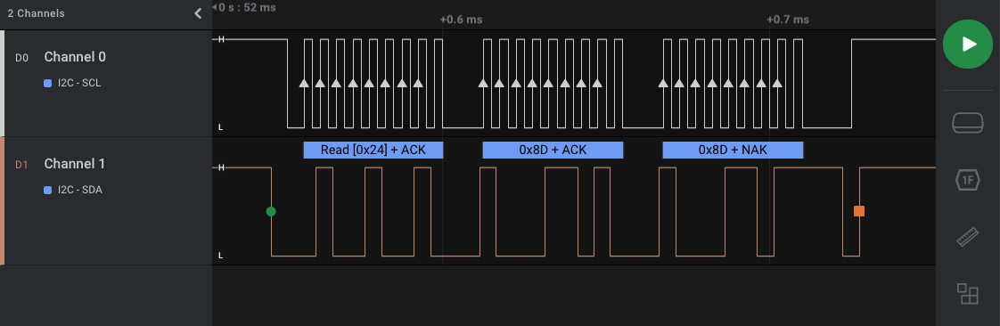
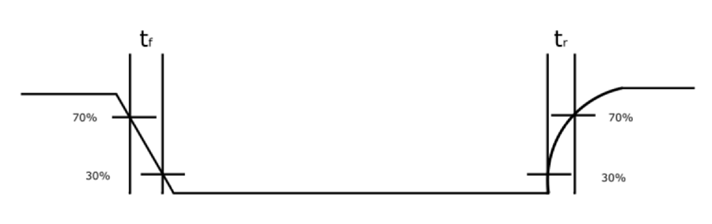

# B-B.3.4 I2C 调试工具与故障排查

> 所属章节：第五部 B. 总线协议 > B-B.3 I2C 总线
>
> 难度：[I] Intermediate | 预计阅读时间：50 分钟

## <span class="blue"> 本节导读

面对一笔失败的 I2C 访问，本节只回答一个问题：**怎样把“我想读什么”“内核实际做了什么”“线上实际发生了什么”对齐，从而知道下一步该查哪一层？**

全篇使用同一笔受控实验：RK3568 的 `/dev/i2c-1` 接有一片 AT24C02，7 位设备地址为 `0x50`，从内部偏移 `0x10` 读取 4 字节，预期内容是 `Hell`：

```bash title="主实例：一次传输包含写偏移和读数据两条消息"
i2ctransfer -y 1 w1@0x50 0x10 r4
```

AT24C02 是带 I2C 接口的 EEPROM，即掉电后仍能保存数据的小容量存储器。`0x50` 用来选择总线上的芯片，`0x10` 用来选择芯片内部的存储位置，二者不是同一种地址。设备地址、重复 START 和 `i2c_msg` 的原理分别见 B-B.3.2、B-B.3.3；本篇负责把命令、完整用户程序、内核路径、trace 和仪器证据接起来。

> 🔴 先确认这是一片允许做实验的器件。`i2cdetect`、`i2cdump`、`i2cget`、`i2cset` 和 `i2ctransfer` 都可能改变器件状态，并非绝对安全的“只读工具”。`-y` 只跳过交互确认，`-f` 才绕过忙设备检查；后者可能扰乱内核驱动，本文不使用它。

> **验证边界。** 本篇以 Linux v6.6 和 i2c-tools v4.4 源码为核对基准。命令输出、trace 和仪器序列均为依据官方源码构造的预期示例，不是 RK3568 上板实录。原创 C 程序与 trace 脚本尚未在目标板编译、运行；交互实验室是源码模型，不连接真实硬件。

---

## <span class="blue"> 先确认总线与占用，不要拿扫描当万能枚举

### `/dev/i2c-1` 是否就是原理图上的 I2C1

设备树别名、控制器注册顺序和动态加入的 USB 适配器都可能影响编号。先用 i2c-tools 列出适配器并查询能力：

```bash
i2cdetect -l
i2cdetect -F 1
```

`-l` 列出总线编号和适配器名称，用来把命令中的 `1` 对回具体控制器。`-F` 查询适配器能力；主实例需要普通 I2C 消息传输，对应能力位 `I2C_FUNC_I2C`。这个宏的值为 `0x00000001`，表示适配器提供 `master_xfer()` 所需的普通 I2C 能力，不是“总线上存在一个地址为 1 的设备”。

`/dev/i2c-N` 由 i2c-dev 字符设备接口提供。若设备文件不存在，应检查内核是否启用 `CONFIG_I2C_CHARDEV` 以及对应模块是否加载；若编号不符，应回查设备树别名和注册信息，不能逐个总线盲目扫描。

### 扫描输出中的 `50`、`--`、`UU` 分别是什么

确认目标适配器后，才可按器件风险决定是否扫描：

```bash
i2cdetect -y 1
```

下面是**依据 v4.4 手册构造的格式示例**，只表达 `0x50` 有应答，不是实测：

```text
     0  1  2  3  4  5  6  7  8  9  a  b  c  d  e  f
00:                         -- -- -- -- -- -- -- --
10: -- -- -- -- -- -- -- -- -- -- -- -- -- -- -- --
20: -- -- -- -- -- -- -- -- -- -- -- -- -- -- -- --
30: -- -- -- -- -- -- -- -- -- -- -- -- -- -- -- --
40: -- -- -- -- -- -- -- -- -- -- -- -- -- -- -- --
50: 50 -- -- -- -- -- -- -- -- -- -- -- -- -- -- -- 
60: -- -- -- -- -- -- -- -- -- -- -- -- -- -- -- --
70: -- -- -- -- -- -- -- --
```

行首是地址高 4 位，列名是低 4 位，所以 `50:` 行与 `0` 列相交即 `0x50`。默认范围是 `0x08` 至 `0x77`，因此第一行前八格留空。格子的含义必须分开：

- 十六进制数字：该地址对**本次探测**作出了应答，但不能据此识别芯片型号；
- `--`：工具执行了探测而没有收到应答，可能涉及地址、供电、接线或器件状态；
- `UU`：工具**跳过**探测，因为该地址已绑定内核驱动。它暗示内核知道这里有一颗设备，不等于刚刚收到线上 ACK。

I2C 没有通用的无损枚举命令。`i2cdetect` 借用 SMBus Quick Write 或 Receive Byte 探测；SMBus 的固定事务格式见 B-B.3.6。`-q` 强制 Quick Write，官方手册列出其损坏 AT24RF08 EEPROM 的案例；`-r` 强制 Receive Byte，也有使某些只写器件总线异常的案例。两者都不是通用的“更温和”开关。未知器件应先查手册，必要时用首尾地址参数缩小范围，而不是扩大访问。

### `UU` 出现时，两个访问者怎样相遇

假设另一块实验板的 `1-0050` 已由 at24 驱动绑定。sysfs 是内核导出设备与驱动关系的虚拟文件系统，可用下面两条命令确认：

```bash
cat /sys/bus/i2c/devices/1-0050/name
readlink /sys/bus/i2c/devices/1-0050/driver
```

`1-0050` 由适配器号 1 和四位十六进制地址 `0050` 组成。`name` 是设备名称属性，`cat` 读取并打印它；`driver` 是指向已绑定驱动的符号链接，`readlink` 读出链接目标。若没有绑定驱动，后一条命令不会给出有效驱动路径。

此时按顺序推演两个参与者：

1. at24 驱动持有设备模型创建的正式 `i2c_client`，维护 EEPROM 访问状态。
2. 用户进程打开 `/dev/i2c-1`，得到另一个匿名 client，并没有接管 at24 的对象。
3. i2c-tools 默认先执行 `ioctl(fd, I2C_SLAVE, 0x50)` 检查占用。`fd` 是本次打开得到的文件描述符，`I2C_SLAVE` 给匿名 client 设置目标地址；v6.6 的 `i2cdev_ioctl()` 发现该地址已绑定时返回 `-EBUSY`，不会执行后续 `I2C_RDWR`。
4. 用户态 `ioctl()` 把内核负错误码转换成 `-1`，并设置 `errno`；工具据此拒绝访问，`i2cdetect` 则显示 `UU`。所以 `UU` 不是 NACK。

若用 `-f` 或 `I2C_SLAVE_FORCE` 绕过检查，Core 仍能让每笔总线传输排队，却不知道 AT24C02 的内部偏移和 at24 驱动的业务状态。两个访问者仍可能交叉修改器件状态。受控调试应先停止正常业务，再按 B-B.3.5 处理测试器件绑定；产品运行时不把强制访问当并发方案。

---

## <span class="blue"> 同一笔读取：命令、消息和线上字节怎样对应

### 固定事务够用时用 `i2cget`

只读主实例的第一个字节，可以写：

```bash
i2cget -y 1 0x50 0x10
```

最后的 `0x10` 是器件内部地址。未指定模式时，`i2cget` 默认执行 SMBus Read Byte Data：先写命令字，再通过重复 START 读 1 字节。对 AT24C02 而言，命令字就是存储偏移，所以这个固定事务恰好符合随机读一字节的时序。若该处预先保存 `0x48`，**预期输出**为：

```text
0x48
```

`0x48` 是读回数据，不是函数返回值，也不能证明后续三个地址的内容。适合 SMBus Word Data 的器件可在末尾加 `w`，但其字节顺序和事务格式已经固定；若器件手册规定另一套 16 位帧格式，不能靠读后交换字节补救。

### 需要明确消息组合时用 `i2ctransfer`

主实例需要一次读 4 字节，因此使用：

```bash
i2ctransfer -y 1 w1@0x50 0x10 r4
```

v4.4 `tools/i2ctransfer.c:202-278` 逐个解析描述符，`333-352` 再提交并打印。参数与两条消息一一对应：

- `w1@0x50`：向 7 位地址 `0x50` 写 1 字节；后面的 `0x10` 是这条消息的数据；
- `r4`：读 4 字节，省略 `@地址` 就沿用前一条消息的 `0x50`；
- 两个描述符合在一次 `I2C_RDWR` 中，中间是重复 START，不是 STOP 后再开一笔传输。

若偏移 `0x10` 至 `0x13` 已保存 ASCII 字符 `Hell`，`H/e/l/l` 分别编码为十六进制 `48/65/6c/6c`，**预期输出**是：

```text
0x48 0x65 0x6c 0x6c
```

每条读消息在标准输出中单独占一行，写消息默认不打印。`echo $?` 可查看上一条 shell 命令的退出状态：0 表示工具报告成功，非 0 表示失败。它不能替代后面的内核返回值和 trace。

`i2ctransfer` 的优势是可自定义消息数量、方向和长度，并非它独占了重复 START。选择依据始终是器件手册规定的线上事务。

### `i2cdump` 与 `i2cset` 为什么必须后退一步

对已知按字节随机读没有副作用的实验 AT24C02，可以限制范围查看局部内容：

```bash
i2cdump -y -r 0x00-0x1f 1 0x50 b
```

这里 `-r` 是 `i2cdump` 的寄存器范围选项，与 `i2cdetect -r` 不是同一含义；`b` 表示逐字节读取。**预期格式示例**为：

```text
     0  1  2  3  4  5  6  7  8  9  a  b  c  d  e  f
00: ff ff ff ff ff ff ff ff ff ff ff ff ff ff ff ff
10: 48 65 6c 6c 6f 00 ff ff ff ff ff ff ff ff ff ff
```

此时行首和列名表示器件内部地址，不是总线设备地址。`10:` 行前四项与主实例一致，可作为第二份用户态证据。但 FIFO 会在读取后弹出数据，有些状态寄存器读取后会清零，未知器件不能照搬。

`i2cset -y 1 0x50 0x10 0x5a` 会改写偏移 `0x10` 并触发 EEPROM 内部写周期，不再是只读验证。写入等待、读回比较和页边界属于 B-B.3.5，本篇不修改主实例的数据基线。

---

## <span class="blue"> 不用现成工具：完整 C 程序怎样复现同一笔读取

### 先看清用户态与内核之间的两个结构体

Linux UAPI 是用户态与内核共同遵守的二进制接口定义。主实例使用 `<linux/i2c.h>` 中的 `struct i2c_msg`，以及 `<linux/i2c-dev.h>` 中的 `struct i2c_rdwr_ioctl_data`。字段保留 v6.6 定义，注释说明本次赋什么值：

```c title="include/uapi/linux/i2c.h 与 i2c-dev.h：主实例实际使用的字段"
struct i2c_msg {
    __u16 addr;   // 7 位设备地址，本例为 0x50
    __u16 flags;  // 方向与特殊选项；普通写为 0，读带 I2C_M_RD
    __u16 len;    // 本消息的数据字节数，本例分别为 1 和 4
    __u8  *buf;   // 用户态数据缓冲区；进入内核后会被复制
};

#define I2C_M_RD 0x0001  // 数据方向为从设备到主设备

struct i2c_rdwr_ioctl_data {
    struct i2c_msg __user *msgs;  // 指向用户态消息数组
    __u32 nmsgs;                  // 数组项数，本例为 2
};
```

`__u16`、`__u32`、`__u8` 是接口约定宽度的无符号整数类型；`__user` 标记该指针指向用户态地址，内核不能直接把它当普通内核指针解引用。`I2C_RDWR` 是命令号 `0x0707`，语义是“把整组消息作为一次传输执行，只在末尾 STOP”。

### 完整程序从哪里来，怎样构建和运行

本篇原创文件 [i2c-rdwr-read.c](./code/B-B.3.4/i2c-rdwr-read.c) 不依赖 i2c-tools 库，只使用 Linux 系统调用和上述 UAPI 头文件。它保存于本篇 `code/B-B.3.4/`，在已安装对应头文件的 Linux 构建环境中编译，再到具有 `/dev/i2c-1` 的目标系统运行；不是内核模块，也不应在 MkDocs 所在 Windows 主机上直接访问板卡。

同目录 [Makefile](./code/B-B.3.4/Makefile) 把构建命令集中起来：

```bash title="在目标工具链环境中构建；CC 按实际编译器替换"
make clean
make CC=aarch64-linux-gnu-gcc
# 将生成的 i2c-rdwr-read 部署到目标板后执行：
./i2c-rdwr-read 1 0x50 0x10
```

三个参数依次是总线号、7 位地址和单字节内部偏移。程序固定读 4 字节，避免把本篇主线扩成通用寄存器工具。当前环境的 `PATH` 中未找到 `aarch64-linux-gnu-gcc`、`gcc` 或 `clang`，所以这里给出的是**构建与运行方法，不是已成功执行的记录**。

### 消息初始化与提交：每一行怎样落到主实例

下面是完整 `main()` 中从准备消息到判断结果的核心段。它前面已经解析参数、打开设备并查询 `I2C_FUNC_I2C`；完整参数检查、所有错误出口和 `close()` 都在同一文件中，不另造一份简化副本。

```c title="code/B-B.3.4/i2c-rdwr-read.c:81-117"
/* 与 i2ctransfer 默认行为一致：先拒绝已由内核驱动占用的地址。 */
if (ioctl(fd, I2C_SLAVE, address) < 0) {
    fprintf(stderr, "选择地址 0x%02lx 失败：%s\n", address,
        strerror(errno));
    goto out;
}

write_buf[0] = (unsigned char)offset;
memset(msgs, 0, sizeof(msgs));
msgs[0].addr = (__u16)address;
msgs[0].flags = 0;
msgs[0].len = sizeof(write_buf);
msgs[0].buf = write_buf;
msgs[1].addr = (__u16)address;
msgs[1].flags = I2C_M_RD;
msgs[1].len = sizeof(read_buf);
msgs[1].buf = read_buf;

rdwr.msgs = msgs;
rdwr.nmsgs = 2;
ret = ioctl(fd, I2C_RDWR, &rdwr);
if (ret < 0) {
    fprintf(stderr, "I2C_RDWR 失败：%s\n", strerror(errno));
    goto out;
}
if (ret != 2) {
    fprintf(stderr, "事务不完整：只完成 %d/2 条消息，丢弃读缓冲区\n", ret);
    goto out;
}

printf("offset 0x%02lx:", offset);
for (i = 0; i < READ_LENGTH; i++)
    printf(" 0x%02x", read_buf[i]);
putchar('\n');
```

`I2C_SLAVE` 在这里先完成默认占用检查；真正的 `I2C_RDWR` 仍从每个 `msgs[i].addr` 取地址。`memset()` 把整个消息数组清零，避免未初始化标志进入内核。`write_buf[0]` 接收偏移 `0x10`，第一条消息长度因此为 1；`read_buf` 是 4 字节数组，第二条消息带 `I2C_M_RD`，长度因此为 4。`rdwr.nmsgs = 2` 表示提交两条消息，不表示“读 2 字节”。

`ioctl()` 的用户态返回口径必须与内核内部返回值分开：内核返回负错误码时，libc 让 `ioctl()` 返回 `-1` 并把错误号放入 `errno`，`strerror(errno)` 把它转成可读文本；成功或部分完成时，`ret` 是完成的消息数。只有 `ret == 2` 才打印缓冲区，`ret < 0` 和其他非负值都进入失败出口。`goto out` 汇到同一个 `close()`，避免不同分支忘记关闭文件。

主实例成功时，完整程序的**预期输出**为：

```text
offset 0x10: 0x48 0x65 0x6c 0x6c
ASCII: Hell
```

若地址已绑定，`I2C_SLAVE` 失败并打印 `Device or resource busy`；若控制器返回错误，`I2C_RDWR` 失败并打印对应错误文本；若只完成 1 条消息，程序明确报告 `1/2` 并丢弃读缓冲区。这三种情况都不能打印 `Hell` 冒充成功。

---

## <span class="blue"> 跟入内核：匿名 client、缓冲区和返回值怎样变化

### 打开文件时创建什么，关闭时销毁什么

v6.6 `drivers/i2c/i2c-dev.c:585-624` 给出一次打开文件的对象生命周期：

1. 系统初始化时，控制器驱动已经注册 `i2c_adapter`，它代表一条可访问总线。运行命令不会重新创建控制器。
2. `i2cdev_open()` 先用 `i2c_get_adapter(minor)` 按设备次编号取得适配器引用，再用 `kzalloc()` 分配并清零一个匿名 `i2c_client`。`client->adapter = adap` 建立“本次打开属于哪条总线”的关系，`file->private_data = client` 把对象挂到这次打开文件上。
3. 这个匿名 client 只保存本次用户态访问的寻址状态，**不会注册成新的 `1-0050`，也不会与外设驱动匹配**。主实例每条消息已经带地址，因此传输本身不依赖 client 中另存一份地址。
4. `i2cdev_release()` 在关闭文件时执行 `i2c_put_adapter()` 放下适配器引用，`kfree(client)` 释放匿名对象，再把 `file->private_data` 置空。它不会注销适配器，也不销毁设备树创建的正式 client。

因此，“每次命令创建的匿名 client”和“系统启动时创建的正式设备对象”属于两条不同生命周期。用户态扫描不会向系统注册一颗新硬件。

### `I2C_RDWR` 先复制参数，再复制每条消息的数据

`i2cdev_ioctl()` 在 `:434-458` 处理 `I2C_RDWR`：先用 `copy_from_user()` 复制 `rdwr_arg`，检查消息指针非空、数量非 0 且不超过 `I2C_RDWR_IOCTL_MAX_MSGS`（v6.6 为 42），再用 `memdup_user()` 复制消息数组。它随后调用 `i2cdev_ioctl_rdwr()`，后者继续处理数据缓冲区：

```c title="drivers/i2c/i2c-dev.c:247-263：保存用户指针并建立内核缓冲区"
res = 0;
for (i = 0; i < nmsgs; i++) {
    if (msgs[i].len > 8192) {
        res = -EINVAL;
        break;
    }

    data_ptrs[i] = (u8 __user *)msgs[i].buf;
    msgs[i].buf = memdup_user(data_ptrs[i], msgs[i].len);
    if (IS_ERR(msgs[i].buf)) {
        res = PTR_ERR(msgs[i].buf);
        break;
    }
    /* memdup_user allocates with GFP_KERNEL, so DMA is ok */
    msgs[i].flags |= I2C_M_DMA_SAFE;
}
```

`data_ptrs` 是动态分配的数组，逐项保存原始用户缓冲区地址。`memdup_user()` 分配内核内存并复制用户数据，返回错误指针时，`IS_ERR()` 识别错误、`PTR_ERR()` 取出负错误码。成功后，`msgs[i].buf` 已改为内核缓冲区，原用户地址只留在 `data_ptrs[i]`。`I2C_M_DMA_SAFE` 表示该缓冲区可用于 DMA；DMA 是控制器不依赖 CPU 逐字节搬运数据的直接内存访问方式。主实例两条消息各复制一次，长度 1 和 4 都远低于单消息 8192 字节上限。

参数或内存检查失败时，`:288-295` 释放已经建立的缓冲区、`data_ptrs` 和消息数组后返回，**尚未进入总线传输**。

### Core 持锁执行两条消息，控制器返回完成数

`i2c_transfer()` 位于 `drivers/i2c/i2c-core-base.c:2254-2288`。它先确认 `adap->algo->master_xfer` 存在，再通过 `__i2c_lock_bus_helper()` 取得适配器锁，调用 `__i2c_transfer()`，最后用 `i2c_unlock_bus()` 解锁。`adap` 是当前适配器，`algo` 是控制器注册的操作集合，`master_xfer()` 是普通 I2C 消息执行入口。

`__i2c_transfer()` 在 `:2207-2235` 先为每条消息记录 `trace_i2c_write()` 或 `trace_i2c_read()`，再调用 `master_xfer()`。主实例在 RK3568 上最终进入 `i2c-rk3x.c` 注册的控制器实现；寄存器细节属于 B-B.3.3，本篇只要求它返回“完成消息数或负错误码”。总线锁避免两笔软件传输在同一适配器上交错，但不理解 EEPROM 内部偏移，因此不能替代前面的占用协调。

控制器返回后，Core 只为已完成且属于读方向的消息记录 `trace_i2c_reply()`，再记录 `trace_i2c_result()`。主实例提交 2 条消息，因此判断口径是：

- 返回 2：两条消息都完成，4 字节读缓冲区才可使用；
- 返回负值：传输失败，负值是内核错误码；
- 返回其他非负值：预期事务未完整完成，不能把缓冲区当完整结果。

### 读数据怎样回到用户态，`EFAULT` 为什么不代表没发总线

`i2cdev_ioctl_rdwr()` 的返回与清理路径必须和前面的复制一起看：

```c title="drivers/i2c/i2c-dev.c:297-308：总线已返回后才复制读数据并清理"
res = i2c_transfer(client->adapter, msgs, nmsgs);
while (i-- > 0) {
    if (res >= 0 && (msgs[i].flags & I2C_M_RD)) {
        if (copy_to_user(data_ptrs[i], msgs[i].buf,
                 msgs[i].len))
            res = -EFAULT;
    }
    kfree(msgs[i].buf);
}
kfree(data_ptrs);
kfree(msgs);
return res;
```

`res` 先保存 Core 的传输结果。只有 `res >= 0` 且消息带 `I2C_M_RD` 时，`copy_to_user()` 才把内核读缓冲区复制回 `data_ptrs[i]` 指向的用户地址；写消息不需要回写。随后每条消息的内核缓冲区都被 `kfree()` 释放，最后释放指针数组和消息数组。

若 `copy_to_user()` 失败，`res` 被改为 `-EFAULT`，表示用户缓冲区访问错误。此时硬件事务**已经执行过**，可能只是结果无法送回用户态；不能把 `-EFAULT` 翻译成“设备没有应答”。若 Core 已返回负值，则跳过读数据回写但仍释放所有内存。若 Core 返回短计数，例如 1，当前源码会在 `res >= 0` 条件下回写读消息，因此用户程序仍必须再检查 `ret == 2`，不能因“内存里有几个字节”就接受结果。

### 交互跟随：同一步同时看代码、对象与返回值

下面的实验室把正常路径拆成“组织消息—打开—复制—持锁—执行—返回—回写—打印—关闭”。还可切换地址占用、NACK、短事务和 `EFAULT`，观察哪些步骤被跳过、哪些清理仍必须发生。

<div class="interactive-demo">
  <iframe
    src="../html/i2cdev-lab.html"
    title="B-B.3.4 i2c-dev 调用链交互实验室"
    loading="lazy"
    style="width:100%;height:960px;border:0;"
  ></iframe>
</div>

[在新窗口打开 i2c-dev Lab](./html/i2cdev-lab.html){: target="_blank" rel="noopener noreferrer" }。步骤片段、完整函数和源码工作台读取同目录保存的 v6.6／v4.4 快照；它们是依据源码构造的模型，不证明硬件已经运行。

---

## <span class="blue"> 用 tracepoint 把软件消息与返回值对齐

用户态输出只能证明工具最终报告了什么。tracepoint 是内核在固定位置预留的观测点；启用后，事件进入跟踪缓冲区，不需要为本次观察修改外设驱动。v6.6 的 `include/trace/events/i2c.h` 定义四类事件：`i2c_write`、`i2c_read` 在控制器执行前记录请求，`i2c_reply` 在控制器返回后记录已完成读消息，`i2c_result` 记录整组结果。

### 用自动收尾脚本，而不是忘记关闭 `trace_pipe`

tracefs 是导出跟踪开关和缓冲区的虚拟文件系统，常见路径为 `/sys/kernel/tracing` 或 `/sys/kernel/debug/tracing`。本篇原创 [trace-i2c-read.sh](./code/B-B.3.4/trace-i2c-read.sh) 自动寻找可写的 I2C 事件开关，保存原状态，清旧记录，执行主命令，停止记录并打印当前缓冲区；退出或收到中断时通过 `trap` 恢复原开关，同时保留主命令退出状态。

```sh title="脚本核心顺序；完整参数检查与恢复逻辑见同目录文件"
printf '0\n' > tracing_on
: > trace
printf '1\n' > events/i2c/enable
printf '1\n' > tracing_on

i2ctransfer -y 1 w1@0x50 0x10 r4
command_status=$?

printf '0\n' > tracing_on
cat trace
exit "$command_status"   # trap 0 在退出时恢复原开关
```

运行前需要 root 权限、已挂载 tracefs 和已安装的 `i2ctransfer`。`tracing_on` 控制是否记录，`: > trace` 清空旧缓冲区，`events/i2c/enable` 一次控制整组 I2C 事件。脚本已在本机通过 `bash -n` 语法检查，但本机没有目标 tracefs，**尚未实际执行**。

### 四个事件逐字段对回主实例

成功时，事件载荷应是下面的结构。以下省略 CPU、进程和时间戳前缀，是**依据 v6.6 `TP_printk` 格式构造的预期示例**：

```text
i2c_write: i2c-1 #0 a=050 f=0000 l=1 [10]
i2c_read: i2c-1 #1 a=050 f=0001 l=4
i2c_reply: i2c-1 #1 a=050 f=0001 l=4 [48 65 6c 6c]
i2c_result: i2c-1 n=2 ret=2
```

- `#0`、`#1`：消息在本次传输中的零起始序号，分别对应写偏移和读数据；
- `a=050`：消息的 7 位设备地址，不包含方向位；
- `f=0000`：写消息没有读标志；`f=0001`：读消息带 `I2C_M_RD`；
- `l=1`、`l=4`：消息长度，单位为字节；
- 方括号：写请求数据或读回复数据，`10` 是偏移，`48 65 6c 6c` 是读回内容；
- `n=2`：本次提交两条消息；`ret=2`：控制器报告两条均完成。

这组事件与终端输出形成闭环：终端得到 4 字节，trace 证明它们来自 `i2c-1` 上地址 `0x50` 的第 1 条读消息，整笔返回值又是 2。若 `ret < 0`，负值是内核错误码；若出现其他非负值，则事务未完整执行。NACK 是否定应答，`-EIO` 是通用输入输出错误；不同控制器对 NACK、超时等结果的错误码映射可能不同，不能把所有 `-EIO` 都直接翻译成同一硬件根因。

tracepoint 位于软件请求与控制器执行之间，不能证明 SDA/SCL 的实际电平，也不会自动给出业务层调用原因。要认定某次访问来自哪个程序，应先停止无关访问，再用受控命令复现，不能只凭时间相近的一条事件认定调用者。

### `dmesg` 与动态调试只补充已有日志

`dmesg` 读取内核日志环形缓冲区，适合查看驱动主动报告的错误：

```bash
dmesg | grep -Ei 'i2c|at24|24c02'
```

`grep -Ei` 按不区分大小写的扩展正则过滤日志。没有匹配行不等于没有故障：普通 NACK、应用传错地址或 `compatible` 不匹配，并不保证每个驱动都会打印直接原因。`compatible` 是设备树描述兼容型号的字符串，Core 用它匹配外设驱动。

动态调试可以打开源码中已有的 `pr_debug()`、`dev_dbg()` 打印点，但不能凭空生成逐笔消息记录：

```bash
echo 'file i2c-core-base.c +p' > /sys/kernel/debug/dynamic_debug/control
# 观察结束后恢复：
echo 'file i2c-core-base.c -p' > /sys/kernel/debug/dynamic_debug/control
```

`+p` 启用匹配文件的打印，`-p` 关闭。动态调试需要相应内核配置和 debugfs 支持，输出是否进入当前控制台还受日志级别影响；逐笔消息仍以前面的 tracepoint 为主。

---

## <span class="blue"> 仪器只回答软件证据答不了的问题

终端和 trace 已表明软件提交正确，但线上仍失败时，才把观察点移到引脚。逻辑分析仪回答“协议帧走到哪里”，示波器回答“电压与时间是否满足要求”，二者不能互相替代。

### 逻辑分析仪：事务是否按协议走完

逻辑分析仪按数字阈值记录高低电平，并把 SDA、SCL 解码为 I2C 事件。连接时必须让仪器与板卡共地，确认通道耐压和板上电平匹配。采样率要足以分辨当前 SCL 与边沿，具体取值结合仪器手册确定；对 400 kHz 总线选择数 MHz 采样只是起点，不是保证解码正确的通用定律。



*图 1：Saleae 官方软件解码示例，不是本篇 AT24C02 抓包。绿色圆点表示 START，橙色方块表示 STOP；默认地址按 7 位显示。图片来源于 Saleae《I2C Analyzer - User Guide》，用于说明解码器界面和标记。*

若仪器支持协议触发，应把 START 或目标地址作为条件。单独的“SDA 下降沿”不必然是 START，因为普通数据位也会在 SCL 低电平期间下降；真正的 START 要求 SCL 为高时 SDA 从高变低。若只能边沿触发，先采集完整流量，再通过解码器定位主实例。

主实例成功时，解码序列应与软件两条消息逐段对应：

```text
S → 0xA0 + ACK → 0x10 + ACK → Sr
  → 0xA1 + ACK
  → 0x48 + ACK → 0x65 + ACK → 0x6c + ACK → 0x6c + NACK
  → P
```

`S` 是 START，`Sr` 是重复 START，`P` 是 STOP。把 7 位地址 `0x50` 左移一位，最低位填 0 得到写方向地址字节 `0xA0`，填 1 得到读方向地址字节 `0xA1`。ACK 是肯定应答；前三个读数据字节后由主设备回 ACK，表示继续读取。最后一个字节后由主设备回 NACK，表示已经读够，随后 STOP。这个末尾 NACK 是正常收尾，不是故障。

抓包把失败位置进一步缩小：

- `0xA0` 后就 NACK：设备没有在寻址阶段应答，先查地址、供电、连接和器件是否可用；
- 地址已 ACK，写 `0x10` 后 NACK：设备已被选中，但没有接受当前偏移或当前状态不允许访问，应查手册和器件状态；
- 地址、偏移、重复 START 和数据都完整，但数值不对：通信帧已经成立，应查内部地址、数据解释和其他访问者；
- SCL 低电平在某拍明显延长：可能是从设备时钟延展，应对照器件允许的处理时间和控制器超时，不设统一“数毫秒”阈值。

若软件 trace 成功而抓包不同，还要确认二者捕获的是否同一笔事务，以及总线上是否有其他主设备或访问者。证据必须先对齐，再谈矛盾。

### 示波器：电平与边沿是否满足器件要求

逻辑分析仪把电压转换成 0 和 1 后，可能掩盖缓慢上升、低电平偏高、毛刺和振铃。毛刺是短暂异常跳变，振铃是边沿后逐渐衰减的来回振荡；示波器保留电压随时间变化的形态，适合解释“协议偶尔解错”背后的电气原因。



*图 2：`tr` 是从 30% 到 70% 的上升时间，`tf` 是从 70% 到 30% 的下降时间。图片来源于 Analog Devices《I2C Timing: Definition and Specification Guide (Part 2)》Figure 2，是定义示意，不是本篇实测波形。*

测量时让总线保持实际通信负载，分别观察 SDA、SCL，并使用短接地连接降低探头引入的额外振铃。判读围绕四个量展开：

1. **上升时间。** 按图示 30% 至 70% 口径测量，再与当前速率档和器件手册比较。Fast-mode（快速模式，最高 400 kHz）常见的上升时间上限是 300 ns；超标时回查上拉电阻与总线电容，而不是只看协议解码。
2. **低电平幅度。** 第 9 拍 ACK 是否真正进入接收方的低电平识别范围。上拉过小会让低电平驱动端承担过大电流，驱动能力不足或异常争用也可能使低电平抬高。
3. **高电平幅度与稳定时间。** 稳定高电平偏低应检查供电、漏电或异常争用；上拉过大首先表现为上升缓慢，两者不要混为同一根因。
4. **毛刺与振铃。** 重点看 SCL 高电平期间的 SDA 异常跳变，因为它可能被识别成 START 或 STOP。探头引入的假象也要通过缩短接地和改变测点排除。

降低总线速率可以作为对照实验：若降速后错误消失，说明问题与时序或电气裕量相关，但降速本身不等于完成根因修复。上拉、电容和速率的重新核算回到 B-B.3.1。

若总线已经卡死，还要先分清谁拉住哪根线。SDA 因异常中断的读传输而保持低电平时，可按 B-B.3.2 的机制尝试补时钟并补 STOP；SCL 被设备持续拉低时，补 SCL 时钟本身无法解决，需要检查器件复位、供电和控制器恢复能力。

---

## <span class="blue"> 回到主实例：让每个证据改变下一步

**扫描显示 `UU`。** 工具跳过了线上探测。先查 sysfs 绑定关系，再把内核驱动和用户进程视为两个独立访问者处理；不能把 `UU` 当成设备无应答，也不能直接强制访问。

**扫描显示 `--`，trace 在寻址后返回负错误码，抓包看到 `0xA0` 后 NACK。** 三类证据都指向寻址未成功，接下来核对地址引脚、供电、接线和器件状态。即使读缓冲区全为 `0xff`，也只是结果表象，不能反过来证明“数据帧无应答”。

**trace 显示两条请求及 `ret=2`，抓包也有完整地址和重复 START，但读数不对。** 软件传输和协议帧均已成立，应比较 i2cdump 的局部内容、器件手册和实际数据顺序。全 `0xff` 可能意味着 SDA 在读取期间一直保持高，也可能是该位置本来就保存 `0xff`，必须结合初始化内容和波形区分。

**同一命令偶发失败，软件参数每次相同。** 用 trace 对齐失败传输，用逻辑分析仪确认失败发生在哪一拍，再用示波器检查对应时段的边沿和电平。只有完成这层对应，才能把“偶发”落实到协议位置或电气条件，而不是直接更换上拉电阻。

这套方法不要求机械执行固定数量的命令，而要求每一步都改变证据状态：确认适配器后排除错误总线，解释 `UU` 后排除错误占用判断，对齐消息后排除错误事务，读取返回值后排除假成功，最后才用仪器检查协议和电气。

---

## <span class="blue"> 本节总结

I2C 排障的关键是把同一笔事务在不同层的证据对齐：命令行说明想做什么，完整 C 程序明确消息和成功判据，i2c-dev 与 Core 说明实际提交及返回，tracepoint 给出消息、数据和完成数，逻辑分析仪确认线上时序，示波器再解释数字协议无法呈现的电气质量。`UU`、NACK、全 `0xff` 和偶发失败都只是证据起点，不能单独承担根因结论。

本篇完成了命令和内核路径的**机制验证方法**；设备树、at24 驱动、sysfs EEPROM 读写、页写和写周期属于 B-B.3.5 的**系统集成**。源码与官方手册已经核对，trace 脚本通过 Shell 语法检查；C 程序未编译，所有命令、脚本、trace 和仪器流程均未在本篇环境中运行或上板验证。

---

## <span class="blue"> 本节自查

??? details "Q1. 为什么主实例必须同时检查 `ret < 0`、`ret != 2` 和最终四字节，而不能只看命令是否打印？"
    `ret < 0` 表示用户态 `ioctl()` 失败，应继续看 `errno`；非负返回值表示完成的消息数，主实例必须恰好为 2。只有满足这个条件，程序才打印 4 字节。终端文本、返回值和 trace 必须指向同一结论，否则可能把短事务或残留缓冲区误认为成功。

??? details "Q2. 打开 `/dev/i2c-1` 后创建的匿名 client 与 at24 的正式 client 有何不同？`UU` 时二者分别怎样行动？"
    匿名 client 由 `i2cdev_open()` 为当前打开文件分配，挂在 `file->private_data` 上，不注册进设备模型；正式 client 由 Core 根据硬件描述创建并绑定 at24。用户工具默认执行 `I2C_SLAVE` 时，内核发现正式设备已绑定就返回 `-EBUSY`，工具停止；at24 继续持有自己的对象。`UU` 表示跳过探测，不是 NACK。

??? details "Q3. `data_ptrs`、`msgs[i].buf` 和 `copy_to_user()` 在一次读取中各承担什么角色？为什么 `EFAULT` 时硬件可能已经执行？"
    `data_ptrs[i]` 保存原始用户缓冲区地址，`memdup_user()` 后 `msgs[i].buf` 改指内核副本，Core 和控制器只使用内核缓冲区。传输返回后，`copy_to_user()` 把读消息复制回用户地址。若这一步失败，结果变为 `-EFAULT`，但 `i2c_transfer()` 已经调用过控制器，所以不能说总线未执行；清理路径仍会释放内核内存。

??? details "Q4. 主实例的 trace 中 `#/a/f/l/n/ret` 怎样证明操作完整？短事务时为什么不能只看有没有读数据？"
    `#0/#1` 是写、读序号，`a=050` 是 7 位地址，`f=0000/0001` 区分写和读，`l=1/4` 是消息字节数，`n=2` 是提交数，`ret=2` 才是两条均完成。短计数仍可能留下部分数据，v6.6 在非负结果下还会回写读消息；调用者必须按预期消息数拒绝不完整结果。

??? details "Q5. `i2cget` 与 `i2ctransfer` 都能产生重复 START，应依据什么选择？"
    `i2cget` 默认的 SMBus Read Byte Data 已包含“写命令字、重复 START、读一字节”；`i2ctransfer` 允许显式组合多条消息。器件事务符合固定 SMBus 格式时用前者更直接，需要自定义消息数量、方向或长度时用后者。选择依据是器件手册，不是命令长短。

??? details "Q6. 为什么 `i2cdetect -q`、`-r` 和 `i2cdump` 不能作为未知器件的默认安全动作？"
    I2C 没有通用无损探测。Quick Write 和 Receive Byte 对特定器件都可能产生副作用，两种强制模式均有官方风险案例；`i2cdump` 会连续访问内部地址，对 FIFO、读取清状态或无寄存器器件可能改变状态。未知器件应先查手册并限制范围。

??? details "Q7. 逻辑分析仪与示波器分别能把主实例缩小到哪类问题？"
    逻辑分析仪验证 START、地址、重复 START、数据和 ACK/NACK，能指出寻址失败、偏移未接受或末尾正常 NACK等协议位置；示波器验证 30%/70% 上升时间、电平、毛刺和振铃，能解释偶发解码错误背后的电气裕量。二者都不能单独说明软件为什么组织出这笔事务，需要与命令和 trace 对齐。

??? details "Q8. 本篇哪些结论已经核验，哪些仍需上板？"
    命令语义、UAPI 字段、对象生命周期、缓冲区复制、返回口径和 trace 格式已对照 Linux v6.6 与 i2c-tools v4.4 源码；Shell 脚本通过语法检查，图片来自 Saleae 与 Analog Devices 官方资料。C 程序尚未编译，脚本和命令尚未在目标 Linux 运行，AT24C02 数据、trace、逻辑分析仪和示波器结果均未上板验证。
