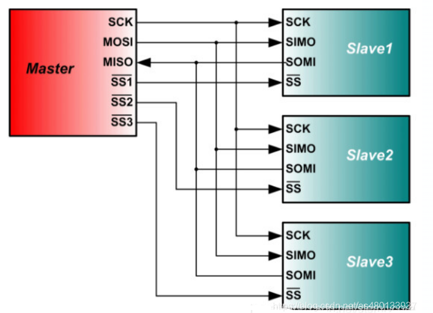
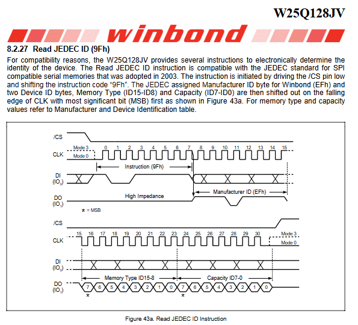

<div class="reader-b2" markdown="1">

# B-B.4.1 SPI 物理层与四种模式

> 所属章节：第五部 B. 总线协议 > B-B.4 SPI 总线
>
> 难度：[B→I] Beginner / Intermediate | 预计阅读时间：40 分钟

## <span class="blue"> 本节导读

SPI（Serial Peripheral Interface，串行外设接口）是一种用于板内短距离通信的主从式、同步、全双工串行接口，常用来连接控制器与 Flash（闪存）、传感器或显示屏。先把这三个基本词展开：

- **主从式**：主机选择要通信的从机并提供时钟，从机按这个节拍收发数据。
- **同步**：数据传输有专门的时钟线，双方按约定的时钟边沿采样，不需要各自猜测每一位持续多久。
- **全双工**：主机到从机、从机到主机各有一条数据线，两个方向可以在同一组时钟中同时传位。

再看标准四线 SPI 各自负责什么：

- **CS（Chip Select，片选）**：决定哪颗从机参与本次通信。本例低有效，拉低选中，拉高释放。
- **SCLK（Serial Clock，串行时钟）**：主机输出的节拍信号，每一位都在它的边沿附近更新或被采样。
- **MOSI（Master Out Slave In，主机输出、从机输入）**：主机发往从机的数据线。
- **MISO（Master In Slave Out，主机输入、从机输出）**：从机发往主机的数据线。

因此，一笔通信可以先概括为：**主机选中从机并连续提供时钟，MOSI 把主机一侧的位移给从机，MISO 同时把从机一侧的位移给主机。读取从机数据时，主机也要继续提供时钟，不能发完命令就停在那里等数据。**

下图用于核对这些方向。多个从机可以共享 SCK、MOSI 和 MISO，但每个从机有独立的片选；图中 `SCK` 对应 `SCLK`，`SIMO` 对应 `MOSI`，`SOMI` 对应 `MISO`。不同资料会使用不同缩写，先确认方向，再对照名称。多从机的驱动权问题放到第 6 节展开。



现在把这笔通信落到具体器件。本节只回答一个主问题：**以 RK3568 为主机、Winbond W25Q128JV-IQ/JQ 为从机，双方怎样用 32 个时钟完成 `9F 00 00 00 → ?? EF 40 18`，读到这颗 Flash 的身份？采样边沿和电气条件为什么会影响结果？**

W25Q128JV 是一颗 SPI NOR Flash，可保存固件和数据。`0x9F` 是 Read JEDEC ID 命令，JEDEC ID 是器件按 JEDEC 标准返回的身份标识，本例包含一个制造商字节和两个器件标识字节。实例采用标准四线 SPI、8 位字长和 MSB-first（Most Significant Bit first，最高有效位先发），即每 8 拍组成一个字节，每个字节先传最高位。

```text
MOSI：  9F   00   00   00
MISO：  ??   EF   40   18
拍号：01～08 09～16 17～24 25～32
```

前 8 拍发送命令，后 24 拍主机继续提供时钟并接收三个身份字节。`??` 表示命令阶段采回的位不参与身份判断，不表示它们必为 `00` 或 `FF`。`EF` 是 Winbond 制造商 ID，`40` 是 Memory Type，`18` 是 Capacity。**`EF 40 18` 只适用于本例 IQ/JQ 后缀；手册给 IM/JM 后缀列出的 Device ID 是 `7018h`，不能套用本例答案。**

本例先约定 SCLK 空闲为低、上升沿采样、下降沿更新，第 3 节会把这种约定命名为 Mode 0，并由 CPOL、CPHA 重新推导出来。SPI 没有统一的器件地址帧，也没有标准化的 ACK（Acknowledgement，接收确认）；线路发出了时钟，不等于从机已经正确理解数据，字节含义要由具体器件手册规定。



本节只讲物理层与四种模式。详细命令帧和 AC（Alternating Current，交流）时序预算归 B-B.4.2，Linux 设备配置与驱动实现归 B-B.4.3，spidev 工具排障归 B-B.4.4；这些后续内容都不是理解本篇 32 拍的前置条件。

[点击查看 W25Q128JV 数据手册](images/W25Q128JV_RevF.pdf)

---

## <span class="blue"> 怎样阅读这组短页面

这组页面始终沿同一笔 `9F 00 00 00 → ?? EF 40 18` 读取展开，但分别处理接线、逐拍推演、模式推广和真实电气条件。首读按顺序前进；交互实验室用于逐拍观察，正文仍然保留不依赖动画的完整推演。

1. **导读与实例地图**：认识四线职责，固定器件、事务和预期身份；
2. **接线、驱动权与全双工**：把信号落到引脚，理解高阻、争用和双向移位；
3. **CPOL／CPHA 与 Mode 0 的 32 拍**：逐拍核对采样、更新和字节边界；
4. **四种模式与多从机**：从两个参数推导模式，再管理共享 MISO；
5. **频率、电气条件与验证**：理解真实采样窗口，并区分推演、逻辑分析仪和示波器证据。

[开始阅读：接线、驱动权与全双工](B-B.4.1_SPI物理层与四种模式_wiring.md)。

---

[下一页：接线、驱动权与全双工](B-B.4.1_SPI物理层与四种模式_wiring.md)

</div>
