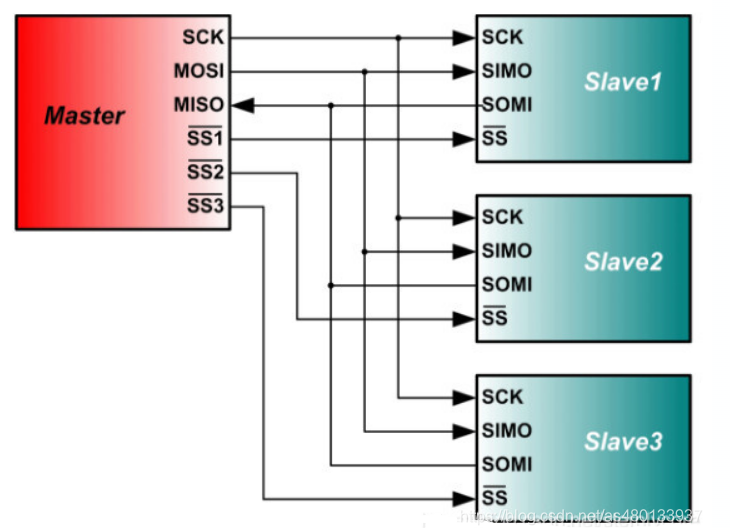
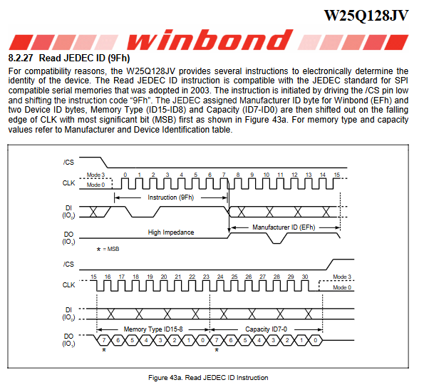
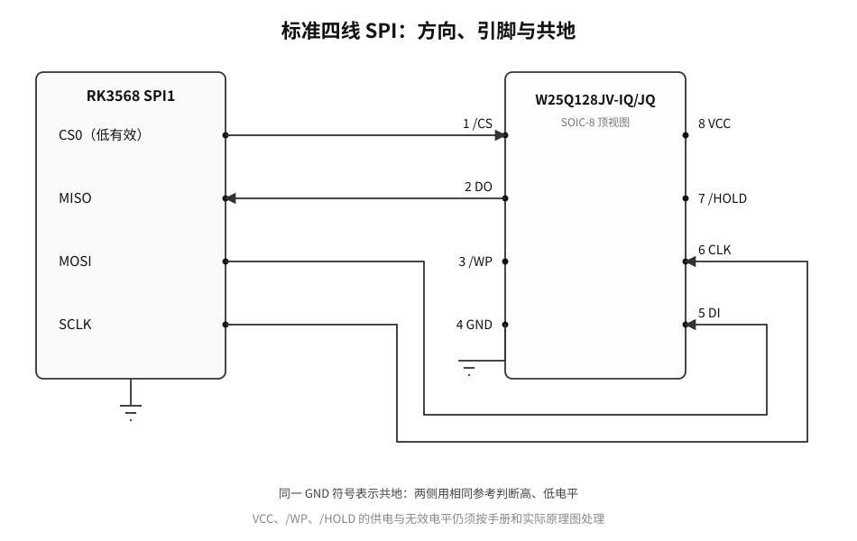
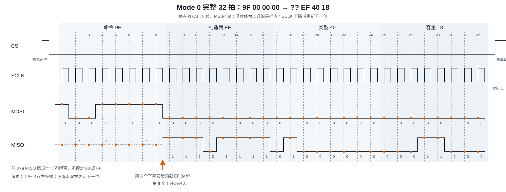

# B-B.4.1 SPI 物理层与四种模式

> 所属章节：第五部 B. 总线协议 > B-B.4 SPI 总线
>
> 难度：[B→I] Beginner / Intermediate | 预计阅读时间：40 分钟

## <span class="blue"> 本节导读

SPI（Serial Peripheral Interface，串行外设接口）用时钟和两条单向数据线逐位交换信息，用片选决定哪个从机参与本次交换。它没有统一的器件地址帧，也没有标准化的 ACK（Acknowledgement，接收确认）。线路发出了时钟，不等于从机已经正确理解数据；数据是什么意思，要由具体器件手册规定。



本节只回答一个主问题：**一个主机和 W25Q128JV 通过 CS、SCLK、MOSI、MISO 交换位流时，双方怎样在 Mode 0 下用 32 个时钟完成 `9F 00 00 00 → ?? EF 40 18`？CPOL、CPHA 和电气条件为什么决定采样结果？**

贯穿实例固定为 RK3568 SPI1 + Winbond W25Q128JV-IQ/JQ，采用标准四线 SPI、8 位字长、MSB-first（Most Significant Bit first，最高有效位先发）和低有效 CS（Chip Select，片选）。<br>
> Mode 0 在本例中表示：SCLK 空闲为低，上升沿采样，下降沿更新；即Mode 0 = CPOL 0 + CPHA 0。 第 3 节会由 CPOL、CPHA 重新推出这个结论，而不是把它当成需要死记的名称。

`0x9F` 是 Read JEDEC ID 命令。JEDEC ID 是固态技术协会标准化的器件身份标识；本例预期收到一个制造商字节和两个器件标识字节。四个发送字节与四个接收位置如下：

```text
MOSI：  9F   00   00   00
MISO：  ??   EF   40   18
拍号：01～08 09～16 17～24 25～32
```

`??` 表示命令阶段采回的位不参与身份判断，不表示它们必为 `00` 或 `FF`。`EF` 是 Winbond 制造商 ID，`40` 是 Memory Type，`18` 是 Capacity。**`EF 40 18` 只适用于本例 IQ/JQ 后缀；手册给 IM/JM 后缀列出的 Device ID 是 `7018h`，不能套用本例答案。**



本节只讲物理层与四种模式。<br>
详细命令帧和 AC（Alternating Current，交流）时序预算归 B-B.4.2，Linux 设备配置与驱动实现归 B-B.4.3，spidev 工具排障归 B-B.4.4；这些后续内容都不是理解本篇 32 拍的前置条件。

[点击查看 W25Q128JV 数据手册](../../../help-docs/W25Q128JV_RevF.pdf)

---

## <span class="blue"> 1. 四线连接与手工完整基线

### 1.1 先分清四根线的方向

W25Q128JV 的标准 SPI 使用 `/CS`、`DI`、`DO`、`CLK`。映射到主机常用名称，就是 CS、MOSI、MISO、SCLK：

- **SCLK（Serial Clock，串行时钟）**：主机输出的时钟，接 Flash 的 6 脚 `CLK`。它的边沿决定何时更新输出、何时采样输入。
- **MOSI（Master Out Slave In，主机输出、从机输入）**：接 Flash 的 5 脚 `DI`，本例承载 `0x9F` 和后续三个占位字节。
- **MISO（Master In Slave Out，主机输入、从机输出）**：接 Flash 的 2 脚 `DO`，本例承载三个身份字节。
- **CS/SS（Chip Select/Slave Select，片选）**：接 Flash 的 1 脚 `/CS`。斜杠表示低有效：拉低选中，拉高释放。

下图用于核对方向、物理引脚和共同参考。先看左侧主机信号，再沿连线看到右侧 Flash 引脚，最后看两侧相同的 GND（Ground，地）符号。8 脚 VCC（电源）、3 脚 `/WP`（写保护）和 7 脚 `/HOLD`（暂停）也必须按手册与实际原理图处理，只是不进入本篇位流主线。



即使不看图，也可以按方向完成接线：主机 CS 接从机 `/CS`，主机时钟输出接从机 `CLK`，主机数据输出接从机 `DI`，从机 `DO` 接主机数据输入，双方 GND 相连。MOSI 与 MISO 不是两根可以按名字任意互换的对称线；接反后，主机命令根本到不了 Flash 的 DI。

厂商也会使用 SDI/SDO（Serial Data Input/Output，串行数据输入/输出）、COPI/CIPO（Controller Out/Peripheral In、Controller In/Peripheral Out，控制器输出/外设输入、控制器输入/外设输出）等名称。先确认每一端方向，再对照缩写，不能只凭名称猜测。

### 1.2 不用任何软件术语，先排出一笔事务

本例的完整手工基线只有五步：

1. 空闲时 CS 为高，SCLK 为低，双方已经约定 8 位、MSB-first 和 Mode 0。
2. 主机拉低 CS，选中这一颗 Flash，并在第一个上升沿前把 `0x9F` 的最高位放到 MOSI。
3. 主机连续提供 32 个 SCLK。每个上升沿，Flash 采样 MOSI，主机采样 MISO；每个下降沿，输出端准备下一位。
4. 前 8 拍让 Flash 收齐 `0x9F`；后 24 拍中，主机继续发送 `00 00 00`，同时依次收齐 `EF`、`40`、`18`。
5. 第 32 个上升沿采到最后一位后，SCLK 回到空闲低，主机释放 CS；Flash 结束本次指令并释放 DO。

这里的三个 `00` 称为**占位字节**。它们不是三条新命令，作用是让主机继续提供时钟，因为 Flash 只有收到时钟，才能逐位移出身份数据。

由此先得到一个不依赖任何图示的结论：**一笔读取不是“只发 8 拍命令，然后数据自动出现”，而是命令 8 拍加响应 24 拍，共 32 拍；MOSI 与 MISO 在每一个时钟里都同时存在。**

---

## <span class="blue"> 2. 推挽、高阻、全双工移位和驱动权

### 2.1 推挽主动形成电平，高阻退出线路驱动

常见 SPI 信号采用**推挽输出**：输出级既能主动把引脚拉高，也能主动把引脚拉低。因此，高电平不依赖 I2C 开漏总线那种上拉电阻。**高阻态**则是另一件事：输出级既不主动拉高，也不主动拉低，相当于退出对线路的驱动。推挽与高阻的基础还可回看 B-B.3.1。

W25Q128JV 手册规定，`/CS` 为高时器件未被选中，DO 处于高阻；`/CS` 拉低后才接受指令。所以 CS 不只决定“是否解释命令”，也决定这颗 Flash 是否可以驱动共享 MISO。

下面动画分三种状态阅读。第一步看一个有效推挽输出怎样主动驱动主机输入；第二步看未选中的从机怎样断开驱动；第三步沿橙色路径看两个从机一高一低同时驱动时，电流为什么会从电源穿过两个输出级流向地。可播放、暂停或单步切换，默认停在第一种状态；争用只作机制演示，不是上板试验步骤。

<div class="interactive-demo">
  <iframe
    src="../html/spi-mechanism-lab.html?view=drive"
    title="SPI 推挽、高阻与 MISO 驱动权动画"
    loading="lazy"
    style="width:100%;height:650px;border:0;"
  ></iframe>
</div>

[在新标签页打开 MISO 驱动权动画](html/spi-mechanism-lab.html?view=drive){ target="_blank" rel="noopener" }

<details class="static-fallback">
<summary>展开静态图：推挽、高阻与两个从机争用 MISO</summary>

</details>

两个推挽输出若同时把共享 MISO 分别拉向高、低电平，就会形成“电源 → 一个输出级 → MISO → 另一个输出级 → 地”的直通电流路径。结果不仅是电平和数据不可信，还可能使输出级过热或损坏。因此，未选中的从机能否释放 MISO，必须逐颗核对器件手册，不能用“SPI 通常如此”代替。

“推挽不需要 I2C 式上拉”也不等于任何 SPI 引脚都禁止上拉。CS 等引脚可能因上电状态或器件建议而需要上拉，应以手册和原理图为准。

### 2.2 全双工是两个方向同时移位

MOSI 与 MISO 是两条独立数据线，所以双方可以在同一组时钟中同时发送，这称为**全双工**。可以用两个 8 位移位寄存器理解：移位寄存器是一串按时钟移动的位，一端把当前输出位送到引脚，另一端把刚采样的输入位移入。

下面动画直接展开主事务的第 9～16 拍：MOSI 是占位字节 `00000000`，MISO 是制造商 ID `11101111`。先看两侧已经预载的 `b7`，再逐拍观察同一边沿怎样把 MOSI 的 0 采入 Flash、把 MISO 的 1 或 0 采入主机，最后核对主机得到 `EF`、Flash 得到 `00`。这里不是 `0x9F` 命令的前 8 拍。

<div class="interactive-demo">
  <iframe
    src="../html/spi-mechanism-lab.html?view=shift"
    title="SPI 全双工逐位交换动画：00 与 EF"
    loading="lazy"
    style="width:100%;height:730px;border:0;"
  ></iframe>
</div>

[在新标签页打开全双工逐位交换动画](html/spi-mechanism-lab.html?view=shift){ target="_blank" rel="noopener" }

<details class="static-fallback">
<summary>展开静态图：SPI 全双工移位</summary>

</details>

按 MSB-first，第 1 拍双方输出各自的 `b7`，第 2 拍输出 `b6`，直到第 8 拍输出 `b0`。8 个采样边沿后，主机原字节移入 Flash，Flash 原字节也移入主机。连续重复四组，就得到本例 32 拍。

全双工不表示两个方向始终都有协议意义。前 8 拍中，主机仍采样 MISO，但手册没有把这段 DO 定义为身份响应，所以 `??` 不解释；后 24 拍中，Flash 仍采样 MOSI 上的三个 `00`，但它们只是给接收提供时钟的占位数据。**关闭任何一条数据线都不是完成本例读取的前提，继续提供时钟才是。**

---

## <span class="blue"> 3. 先定义 CPOL、CPHA、预载、更新和采样

CPOL（Clock Polarity，时钟极性）回答：**没有传输时，SCLK 停在高电平还是低电平？**

- CPOL=0：空闲低，每个时钟周期的第一个边沿是上升沿，第二个边沿是下降沿。
- CPOL=1：空闲高，每个时钟周期的第一个边沿是下降沿，第二个边沿是上升沿。

CPHA（Clock Phase，时钟相位）回答：**接收器在一个周期的第几个边沿采样？** CPHA=0 在第一个边沿采样，CPHA=1 在第二个边沿采样。另一个边沿用于更新输出。

这里把三个动作分开：

- **采样**：接收端在指定边沿读取输入电平，并把它保存为一个位。
- **更新**：发送端在另一个边沿把下一位送到输出引脚。
- **预载**：首位不等待某个更新边沿，而是在首次采样前就已经放到引脚上并保持稳定。

本例 Mode 0 是 CPOL=0、CPHA=0。由定义直接推出：空闲低，第一个边沿是上升沿，所以**上升沿采样、下降沿更新**。又因为第一个上升沿就要采样，双方的首位必须在它到来前预载，不能等上升沿到了才临时取出。

接收端并非在理想边沿瞬间看一眼就必然可靠。**建立时间**要求数据在采样边沿前至少稳定多久，**保持时间**要求它在采样边沿后再保持稳定多久。更新与采样分开，为数据稳定留出时间；实际最小窗口仍以双方手册为准。

---

## <span class="blue"> 4. 逐拍推演 Mode 0 的 32 拍

### 4.1 第 1～8 拍：Flash 收齐命令，主机不解释首字节

`0x9F` 的二进制是 `10011111`。MSB-first 的 MOSI 位序因此是 `1、0、0、1、1、1、1、1`。

CS 拉低后、第 1 个上升沿前，主机已经把 `b7=1` 预载到 MOSI。第 1 个上升沿，Flash 采样这个 `1`，主机也采样一次 MISO；第 1 个下降沿，主机把 MOSI 更新为 `b6=0`。第 2 个上升沿采样 `0`，随后的下降沿再更新为 `b5=0`。如此重复，第 8 个上升沿采样 `b0=1`，Flash 收齐 `10011111`，即 `0x9F`。

主机也在这 8 个上升沿采样了 8 个 MISO 位，但手册图 43a 把命令阶段的 DO 画为高阻，没有把它们定义为身份响应。因此首字节写成 `??`，不能把它固定译成 `00` 或 `FF`，更不能拿它判断器件身份。

### 4.2 第 9～32 拍：继续给钟，收齐三个身份字节

第 8 个下降沿之后，Flash 准备 `0xEF` 的最高位。`0xEF=11101111`，所以第 9 个上升沿主机采到 `1`，随后各拍依次采到 `1、1、0、1、1、1、1`，第 16 个上升沿收齐 `EF`。

同样的过程重复两次：第 17～24 拍接收 `0x40=01000000`，位序为 `0、1、0、0、0、0、0、0`；第 25～32 拍接收 `0x18=00011000`，位序为 `0、0、0、1、1、0、0、0`。与此同时，MOSI 在这 24 拍始终发送三个 `0x00` 的位，以维持时钟。

下表把每个上升沿实际采到的位全部展开。先看拍号，再看 MOSI 从 `9F` 进入三个 `00`，最后看 MISO 从不解释阶段进入 `EF 40 18`。

| 拍号 | MOSI 被 Flash 采样 | MISO 被主机采样 | 所属字节 |
|:---:|:---:|:---:|:---|
| 1～8 | `1、0、0、1、1、1、1、1` | `?、?、?、?、?、?、?、?` | `9F`；`??` 不解释 |
| 9～16 | `0、0、0、0、0、0、0、0` | `1、1、1、0、1、1、1、1` | 占位 `00`；`EF` |
| 17～24 | `0、0、0、0、0、0、0、0` | `0、1、0、0、0、0、0、0` | 占位 `00`；`40` |
| 25～32 | `0、0、0、0、0、0、0、0` | `0、0、0、1、1、0、0、0` | 占位 `00`；`18` |

即使删去表格，前面三段也已经给出全部 32 个采样位：第 1～8 拍发送 `10011111`，第 9～16 拍接收 `11101111`，第 17～24 拍接收 `01000000`，第 25～32 拍接收 `00011000`，后 24 拍 MOSI 全为 0。拍号、位序和字节边界没有依赖表格才能补齐的信息。

### 4.3 把 CS、SCLK、MOSI、MISO 对齐

下图把同一笔事务画在共同时间轴上。先沿 CS 找到拉低与释放位置，再数 SCLK 的 32 个上升沿；竖虚线与橙色点标出采样位置。随后对照 MOSI 的 `9F 00 00 00` 和 MISO 的 `?? EF 40 18`，特别看第 8 个下降沿与第 9 个上升沿之间 `EF` 最高位的预载。该图是依据手册作出的机制推演，不是实测截图。



不看图也能复核关键时刻：第 8 个上升沿收齐命令，第 8 个下降沿后 Flash 准备 `EF` 的 `b7`，第 9 个上升沿主机采入该位；第 16、24、32 个上升沿分别收齐 `EF`、`40`、`18`。第 32 个上升沿后，SCLK 回到空闲低，CS 拉高，Flash 的 DO 再次进入高阻。

CS 释放只界定本次串行指令结束，不表示从机返回了 ACK，也不自动证明身份正确。支持本例身份判断的证据是有效偏移处的 `EF 40 18`，不是“32 拍发完了”或“CS 已拉高”。

### 4.4 用 Timing Lab 逐拍核对

下面的纯波形实验室用于练习同一过程。先选择模式，再按“下一拍”观察当前位、采样边沿和已接收位；也可按“播放”连续推进，用“暂停”停在某拍，并切换 0.5×、1×、2× 速度。任何手动逐拍、复位或模式切换都会停止自动播放；第 32 拍后自动停止并释放 CS。用“上一拍”回退，用“复位”回到 CS 空闲。Mode 0 对应本例；Mode 1、2 是通用模式推演，不是本例 Flash 的可用配置。

<div class="interactive-demo">
  <iframe
    src="../html/spi-timing-lab.html"
    title="SPI 四种模式与 32 拍波形实验室"
    loading="lazy"
    style="width:100%;height:820px;border:0;"
  ></iframe>
</div>

[在新标签页打开 SPI Timing Lab](html/spi-timing-lab.html){ target="_blank" rel="noopener" }

如果 iframe 不可用，仍可按 4.1～4.3 的文字完成同一推演：Mode 0 首位预载，上升沿采样、下降沿更新；连续 8 拍一个字节，前 8 拍命令，后 24 拍三个身份字节。实验室只是逐拍视图，不提供正文没有交代的新规则。

---

## <span class="blue"> 5. 从同一规则推导四种模式

把 CPOL 的两种空闲电平与 CPHA 的两种采样位置组合起来，就得到四种模式，不需要分别死记：

- **Mode 0（CPOL=0，CPHA=0）**：空闲低，第一个边沿是上升沿，所以上升沿采样、下降沿更新；首位在第一个上升沿前预载。
- **Mode 1（CPOL=0，CPHA=1）**：空闲低，第二个边沿是下降沿，所以下降沿采样、上升沿更新；第一个上升沿先更新首位。
- **Mode 2（CPOL=1，CPHA=0）**：空闲高，第一个边沿是下降沿，所以下降沿采样、上升沿更新；首位在第一个下降沿前预载。
- **Mode 3（CPOL=1，CPHA=1）**：空闲高，第二个边沿是上升沿，所以上升沿采样、下降沿更新；第一个下降沿先更新首位。

| 模式 | CPOL | CPHA | 空闲电平 | 采样边沿 | 更新边沿 | 首位上线时机 |
|:---:|:---:|:---:|:---:|:---:|:---:|:---|
| Mode 0 | 0 | 0 | 低 | 上升沿 | 下降沿 | 第一个上升沿前预载 |
| Mode 1 | 0 | 1 | 低 | 下降沿 | 上升沿 | 第一个上升沿更新 |
| Mode 2 | 1 | 0 | 高 | 下降沿 | 上升沿 | 第一个下降沿前预载 |
| Mode 3 | 1 | 1 | 高 | 上升沿 | 下降沿 | 第一个下降沿更新 |

下面动画的每格只画前两个时钟，四组共用同步播放头。阅读顺序固定为：先看空闲高或低，再找 `S` 标记落在第一还是第二个边沿，最后看 `b7` 是提前预载，还是由第一个边沿更新。`U` 标记表示更新下一位。播放、暂停或单步只改变观察位置，不改变四种模式的定义。

<div class="interactive-demo">
  <iframe
    src="../html/spi-mechanism-lab.html?view=modes"
    title="SPI 四种模式同步对比动画"
    loading="lazy"
    style="width:100%;height:1040px;border:0;"
  ></iframe>
</div>

[在新标签页打开四种模式同步对比动画](html/spi-mechanism-lab.html?view=modes){ target="_blank" rel="noopener" }

<details class="static-fallback">
<summary>展开静态图：SPI 四种模式的空闲、首位、采样和更新</summary>

</details>

不看图和表，也能从两个参数重新推导：CPOL 决定第一个边沿的方向，CPHA 决定这个边沿是采样还是更新；若 CPHA=0，首位必须预载，若 CPHA=1，首位可由第一个边沿更新。

W25Q128JV 支持 Mode 0 和 Mode 3。两者都是上升沿采样 DI、下降沿更新 DO，差别是空闲电平以及首位预载还是首边沿更新。**Mode 1、Mode 2 在这里只用于理解通用机制，不能写成本例 Flash 的可用配置。**

四种模式没有天然的性能优劣，主从双方必须使用器件要求的组合。模式不匹配可能采到旧位、相邻位、固定值或不确定电平，也可能让器件状态机收到错误命令，不能概括成“数据一定整体移一位”。

---

## <span class="blue"> 6. 独立片选的多从机：共享线路，不共享驱动权

常见多从机接法是让所有从机共享 SCLK、MOSI、MISO，再为每个从机分配独立 CS。N 个从机通常需要 N+3 根信号线。主机只拉低目标从机的 CS，其他 CS 保持无效。

一次完整交换可以按下面的顺序理解：

1. 总线空闲时，所有 CS 都无效，SCLK 保持在即将使用的模式所要求的空闲电平。
2. 主机只选中目标从机；目标从机获得响应时钟和在适当阶段驱动 MISO 的权利。
3. 其他从机忽略本次交换，并按各自手册让 MISO 保持高阻。
4. 主机释放目标 CS，等本次交换完全结束后，才能选中另一个从机。

不同从机可以要求不同模式，但必须在前一笔事务已经结束、所有 CS 均无效后改变时钟约定，再开始下一笔。不能在一次器件事务中途改变 CPOL 或 CPHA。

多从机问题的关键不是“共享线越多越省”这么简单，而是**任一时刻只能有一个从机主动驱动共享 MISO**。若某器件在 CS 无效时不能释放 MISO，就要按器件手册增加三态缓冲或改变连接方式，不能靠软件忽略错误数据来消除电气争用。

---

## <span class="blue"> 7. 通用分频、电气条件和仪器证据

### 7.1 请求值不等于引脚频率

主机通常对源时钟进行整数分频来产生 SCLK：

```text
SCLK 频率 = 源时钟频率 ÷ 整数分频数 N
```

下面只是通用硬件分频的**教学推导，不是 RK3568 的固定源时钟，也不是当前板卡实测**：假设源时钟为 100 MHz，目标上限为 30 MHz，并且硬件要求选择不超过目标上限的可用整数分频。

- 理想分频是 `100 ÷ 30 ≈ 3.33`，不是整数。
- 若取 N=3，会得到约 33.33 MHz，超过目标上限。
- 最小满足“不超过目标”的整数是 N=4，所以得到 `100 MHz ÷ 4 = 25 MHz SCLK`。

25 MHz 只在这组假设下成立。换源时钟、分频约束或目标上限，结果都可能改变。实际可用频率还必须同时满足控制器能力、Flash 手册限制和板级信号质量，取三者中最严格的上限。

在这组假设下，32 拍的纯时钟时间为 `32 ÷ 25 MHz = 1.28 μs`。它不包含准备、等待和片选间隔，不能当成整笔操作耗时，更不能把 25 MHz 或 1.28 μs 写成仪器测得的结果。

### 7.2 模式正确，仍可能因电气条件采错

**共地与电平兼容**是第一层条件。接收器按输入门限把模拟电压判成 0 或 1；没有共地，双方就失去共同的电压参考。供电范围、输入门限和绝对最大额定值是不同指标，不能因为“都是 SPI”就默认任意 1.8 V、3.3 V 或 5 V 引脚可以直接互连。需要电平转换时，还要核对方向、速度和通道特性。

**真实传播与采样窗口**是第二层条件。发送端更新后，数据不会在同一瞬间于接收端稳定；SCLK 也需要传播。只有数据在采样前满足建立时间、采样后满足保持时间，收到的位才可信。速率提高后，原有稳定窗口可能不再足够。详细的输出有效延迟、传播与输入时序预算属于 B-B.4.2，本节只建立物理后果。

**信号完整性**是第三层条件。走线、连接器与负载会形成分布电感和电容，快速边沿可能产生过冲、下冲和振铃。若振铃反复穿过输入门限，接收器可能在一次预期跳变附近作出错误判决；边沿过慢则会压缩有效采样窗口。影响边沿的不只是 SCLK 标称频率，驱动强度和上升、下降时间同样重要。

不存在适用于所有板卡的固定走线长度或串联电阻答案。源端串联阻尼是否有效、阻值多大，需要结合输出阻抗、走线、负载和接收端实测波形决定；“降速后读数稳定”也只能提示问题可能与速度、时序或信号质量有关，不能单独证明协议逻辑完全正确。

### 7.3 两类仪器各看什么

**逻辑分析仪**适合核对数字关系：CS 是否覆盖整笔事务，SCLK 是否有 32 拍，空闲电平和采样边沿是否符合模式，MOSI 是否依次出现 `9F 00 00 00`，MISO 的有效位置是否依次出现 `EF 40 18`。它能帮助判断位流是否符合解码规则，但不能完整揭示模拟电平裕量。

**示波器**适合观察真实电压和边沿：接收端高、低电平是否越过门限，是否有过冲、下冲、振铃或缓慢边沿，数据在采样附近是否稳定。测量时应尽量观察接收端附近，并注意接地与探测方式本身也会改变结果。

因此，本例至少要区分三类证据：手工推演说明“应该出现什么”，逻辑分析仪说明“数字线路上出现了什么”，示波器说明“这些电平和边沿是否具备可靠的模拟质量”。任何一类都不能自动代替另外两类。

本文的器件结论依据 Winbond《W25Q128JV》Revision F：第 3.1 节为 SOIC-8 引脚，第 4.1～4.2 节为 CS、高阻与 DI/DO 边沿，第 6.1 节为 Mode 0/3，第 8.1.1 节为 IQ/JQ 与 IM/JM 的 Device ID 区分，第 8.2.27 节及图 43a 为 `0x9F` 和三个身份字节。所有波形均为机制示意；本文未执行目标板运行、逻辑分析仪抓取或示波器测量。

---

## <span class="blue"> 本节总结 [B→I]

主机与 W25Q128JV 的这笔交换可以压缩成一条物理链：CS 选中器件并赋予 MISO 驱动权，主机提供 SCLK，MOSI 与 MISO 在同一组时钟中全双工移位，CPOL 决定空闲电平，CPHA 决定第一还是第二个边沿采样，电气条件决定接收端能否把边沿处的电压判成正确位。

Mode 0 下，首位预载、上升沿采样、下降沿更新。第 1～8 拍发送 `10011111`，即 `0x9F`；第 9～16、17～24、25～32 拍分别接收 `11101111`、`01000000`、`00011000`，即 `EF 40 18`。首字节 `??` 不解释，后 24 拍的三个 `00` 用于维持时钟。32 拍完成与 CS 释放都不是 ACK，有效身份数据才是本例的协议证据。

四种模式不是四组孤立口诀，而是 CPOL 与 CPHA 的四种组合。多从机共享线路时必须用独立 CS 管理 MISO 驱动权；速率、建立与保持、电平和信号完整性则共同决定理想位序能否在真实板卡上成立。

## <span class="blue"> 本节自查

??? details "Q1. 为什么本例要发送 4 个字节才能读到 3 字节 JEDEC ID？首字节为什么不解释？"
    第 1 字节的 8 拍用于发送 `0x9F`，后 3 字节的 24 拍持续提供时钟并接收 `EF 40 18`，总共 32 拍。命令阶段的 DO 没有被手册定义为身份响应，因此首字节写成 `??`，不能固定当成 `00` 或 `FF`。

??? details "Q2. 在 Mode 0 中，`0x9F` 的 b7 为什么必须在第一个 SCLK 边沿前上线？第 8 个下降沿和第 9 个上升沿分别发生什么？"
    CPHA=0 要在第一个边沿采样，因此 b7 必须提前预载并满足建立时间。第 8 个下降沿后，Flash 准备 `EF` 的 b7；第 9 个上升沿，主机采入这一位，开始接收制造商 ID。

??? details "Q3. 已知 SCLK 空闲为高、第二个边沿采样，这是哪种模式？首位何时上线？它是否适用于本例 Flash？"
    空闲高说明 CPOL=1，第二个边沿采样说明 CPHA=1，因此是 Mode 3。第一个下降沿先更新 b7，第二个上升沿再采样。W25Q128JV 支持 Mode 3，但本贯穿实例固定使用 Mode 0。

??? details "Q4. 为什么模式不匹配不能简单理解为‘数据一定整体移一位’？"
    错误配置会改变采样相对于数据跳变的位置，可能采到旧位、相邻位或不确定电平，结果取决于真实波形和器件行为。SPI 没有标准 ACK，主机也不能仅凭时钟发完就发现这些错误。

??? details "Q5. 两个独立 CS 的从机同时驱动共享 MISO，为什么会比‘数据错乱’更严重？"
    若一个推挽输出把 MISO 拉向电源，另一个把它拉向地，会形成从电源经两个输出级到地的直通电流，既使电平与数据不可信，也可能损伤输出级。未选中的从机必须按各自手册释放 MISO。

??? details "Q6. 100 MHz 源时钟、30 MHz 目标上限为什么在教学算例中得到 25 MHz？这个结果是不是实测频率？"
    理想分频约为 3.33；分频 3 会产生约 33.33 MHz，超过目标上限，最小满足条件的整数分频是 4，所以计算结果为 25 MHz。它只是给定假设下的通用分频推导，不是当前板卡的仪器实测。

??? details "Q7. 逻辑分析仪看到 32 拍且解码为 `9F 00 00 00 / ?? EF 40 18`，为什么仍不能代替示波器？"
    逻辑分析仪主要证明数字线路在其解码门限下呈现预期位流，不能完整揭示过冲、振铃、边沿形态和模拟电平裕量。模拟质量仍需用示波器和正确探测方法检查。

??? details "Q8. 为什么 `EF 40 18` 不能用于所有名为 W25Q128JV 的器件？"
    手册按后缀区分 Device ID：本例 IQ/JQ 对应 `4018h`，IM/JM 对应 `7018h`。因此只有先确认器件后缀，才能把 `EF 40 18` 当作预期身份数据。
