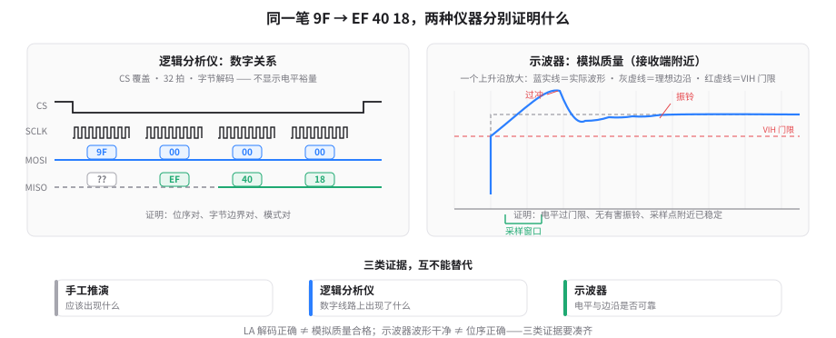

<div class="reader-b2" markdown="1">

# 频率、电气条件与验证：模式正确为什么仍会读错

> 所属章节：第五部 B. 总线协议 > B-B.4 SPI 总线 > B-B.4.1 SPI 物理层与四种模式
>
> 本组阅读：第 5 页，共 5 页

本页只回答一个问题：**理想的 32 拍到了真实引脚上为什么会失真，又怎样用不同证据验证数字位流和模拟质量？**

---

## <span class="blue"> 7. 模式正确，为什么仍会读错？

前六节推演的是理想条件下的 32 拍。本节继续回答导读的后半个问题：这些拍在真实引脚上为什么可能不再可信。先看请求频率怎样经过分频变成实际 SCLK，再看电气条件怎样破坏采样，最后分别用推演、逻辑分析仪和示波器验证。

### 7.1 请求的频率怎样变成引脚上的实际 SCLK？

本例的 32 拍不会因频率改变，改变的是每拍持续时间，以及发送端能否在采样前把数据稳定下来。要知道这段时间，先看请求值怎样变成引脚上的实际时钟。

主机通常对源时钟进行整数分频来产生 SCLK：

```text
SCLK 频率 = 源时钟频率 ÷ 整数分频数 N
```

下面只是通用硬件分频的**教学推导，不是 RK3568 的固定源时钟，也不是当前板卡实测**：假设源时钟为 100 MHz，目标上限为 30 MHz，并且硬件要求选择不超过目标上限的可用整数分频。

- 理想分频是 `100 ÷ 30 ≈ 3.33`，不是整数。
- 若取 N=3，会得到约 33.33 MHz，超过目标上限。
- 最小满足“不超过目标”的整数是 N=4，所以得到 `100 MHz ÷ 4 = 25 MHz SCLK`。

25 MHz 只在这组假设下成立。换源时钟、分频约束或目标上限，结果都可能改变。实际可用频率还必须同时满足控制器能力、Flash 手册限制和板级信号质量，取三者中最严格的上限。

在这组假设下，32 拍的纯时钟时间为 `32 ÷ 25 MHz = 1.28 μs`。它不包含准备、等待和片选间隔，不能当成整笔操作耗时，更不能把 25 MHz 或 1.28 μs 写成仪器测得的结果。频率升高后，每拍时间缩短，下一节的采样窗口也会随之收紧。

### 7.2 Mode 0 配置正确，为什么还会采错？

**共地与电平兼容**是第一层条件。接收器按输入门限把模拟电压判成 0 或 1；没有共地，双方就失去共同的电压参考。供电范围、输入门限和绝对最大额定值是不同指标，不能因为“都是 SPI”就默认任意 1.8 V、3.3 V 或 5 V 引脚可以直接互连。需要电平转换时，还要核对方向、速度和通道特性。

**真实传播与采样窗口**是第二层条件。发送端更新后，数据不会在同一瞬间于接收端稳定；SCLK 也需要传播。只有数据在采样前满足建立时间、采样后满足保持时间，收到的位才可信。速率提高后，原有稳定窗口可能不再足够。详细的输出有效延迟、传播与输入时序预算属于 B-B.4.2，本节只建立物理后果。

**信号完整性**是第三层条件。走线、连接器与负载会形成分布电感和电容，快速边沿可能产生过冲、下冲和振铃。若振铃反复穿过输入门限，接收器可能在一次预期跳变附近作出错误判决；边沿过慢则会压缩有效采样窗口。影响边沿的不只是 SCLK 标称频率，驱动强度和上升、下降时间同样重要。

不存在适用于所有板卡的固定走线长度或串联电阻答案。源端串联阻尼是否有效、阻值多大，需要结合输出阻抗、走线、负载和接收端实测波形决定；“降速后读数稳定”也只能提示问题可能与速度、时序或信号质量有关，不能单独证明协议逻辑完全正确。

### 7.3 怎样验证拍序、位流和电平？



**逻辑分析仪**适合核对数字关系：CS 是否覆盖整笔事务，SCLK 是否有 32 拍，空闲电平和采样边沿是否符合模式，MOSI 是否依次出现 `9F 00 00 00`，MISO 的有效位置是否依次出现 `EF 40 18`。它能帮助判断位流是否符合解码规则，但不能完整揭示模拟电平裕量。

**示波器**适合观察真实电压和边沿：接收端高、低电平是否越过门限，是否有过冲、下冲、振铃或缓慢边沿，数据在采样附近是否稳定。测量时应尽量观察接收端附近，并注意接地与探测方式本身也会改变结果。

因此，本例至少要区分三类证据：手工推演说明“应该出现什么”，逻辑分析仪说明“数字线路上出现了什么”，示波器说明“这些电平和边沿是否具备可靠的模拟质量”。任何一类都不能自动代替另外两类。

本文的器件结论依据 Winbond《W25Q128JV》Revision F：第 3.1 节为 SOIC-8 引脚，第 4.1～4.2 节为 CS、高阻与 DI/DO 边沿，第 6.1 节为 Mode 0/3，第 8.1.1 节为 IQ/JQ 与 IM/JM 的 Device ID 区分，第 8.2.27 节及图 43a 为 `0x9F` 和三个身份字节。所有波形均为机制示意；本文未执行目标板运行、逻辑分析仪抓取或示波器测量。

---

## <span class="blue"> 本节总结 [B→I]

主机与 W25Q128JV 的这笔交换可以压缩成一条物理链：CS 选中器件并赋予 MISO 驱动权，主机提供 SCLK，MOSI 与 MISO 在同一组时钟中全双工移位，CPOL 决定空闲电平，CPHA 决定第一还是第二个边沿采样，电气条件决定接收端能否把边沿处的电压判成正确位。

Mode 0 下，首位预载、上升沿采样、下降沿更新。第 1～8 拍发送 `10011111`，即 `0x9F`；第 9～16、17～24、25～32 拍分别接收 `11101111`、`01000000`、`00011000`，即 `EF 40 18`。首字节 `??` 不解释，后 24 拍的三个 `00` 用于维持时钟。32 拍完成与 CS 释放都不是 ACK，有效身份数据才是本例的协议证据。

四种模式其实就是 CPOL 与 CPHA 的四种组合。多从机共享线路时必须用独立 CS 管理 MISO 驱动权；速率、建立与保持、电平和信号完整性则共同决定理想位序能否在真实板卡上成立。

## <span class="blue"> 本节自查

??? details "Q1. 为什么本例要发送 4 个字节才能读到 3 字节 JEDEC ID？首字节为什么不解释？"
    第 1 字节的 8 拍用于发送 `0x9F`，后 3 字节的 24 拍持续提供时钟并接收 `EF 40 18`，总共 32 拍。命令阶段的 DO 没有被手册定义为身份响应，因此首字节写成 `??`，不能固定当成 `00` 或 `FF`。

??? details "Q2. 在 Mode 0 中，`0x9F` 的 b7 为什么必须在第一个 SCLK 边沿前上线？第 8 个下降沿和第 9 个上升沿分别发生什么？"
    CPHA=0 要在第一个边沿采样，因此 b7 必须提前预载并满足建立时间。第 8 个下降沿后，Flash 准备 `EF` 的 b7；第 9 个上升沿，主机采入这一位，开始接收制造商 ID。

??? details "Q3. 已知 SCLK 空闲为高、第二个边沿采样，这是哪种模式？首位何时上线？它是否适用于本例 Flash？"
    空闲高说明 CPOL=1，第二个边沿采样说明 CPHA=1，因此是 Mode 3。第一个下降沿先更新 b7，第二个上升沿再采样。W25Q128JV 支持 Mode 3，但本贯穿实例固定使用 Mode 0。

??? details "Q4. 为什么模式不匹配不能简单理解为‘数据一定整体移一位’？"
    错误配置会改变采样相对于数据跳变的位置，可能采到旧位、相邻位或不确定电平，结果取决于真实波形和器件行为。SPI 没有标准 ACK，主机也不能仅凭时钟发完就发现这些错误。

??? details "Q5. 两个独立 CS 的从机同时驱动共享 MISO，为什么会比‘数据错乱’更严重？"
    若一个推挽输出把 MISO 拉向电源，另一个把它拉向地，会形成从电源经两个输出级到地的直通电流，既使电平与数据不可信，也可能损伤输出级。未选中的从机必须按各自手册释放 MISO。

??? details "Q6. 100 MHz 源时钟、30 MHz 目标上限为什么在教学算例中得到 25 MHz？这个结果是不是实测频率？"
    理想分频约为 3.33；分频 3 会产生约 33.33 MHz，超过目标上限，最小满足条件的整数分频是 4，所以计算结果为 25 MHz。它只是给定假设下的通用分频推导，不是当前板卡的仪器实测。

??? details "Q7. 逻辑分析仪看到 32 拍且解码为 `9F 00 00 00 / ?? EF 40 18`，为什么仍不能代替示波器？"
    逻辑分析仪主要证明数字线路在其解码门限下呈现预期位流，不能完整揭示过冲、振铃、边沿形态和模拟电平裕量。模拟质量仍需用示波器和正确探测方法检查。

??? details "Q8. 为什么 `EF 40 18` 不能用于所有名为 W25Q128JV 的器件？"
    手册按后缀区分 Device ID：本例 IQ/JQ 对应 `4018h`，IM/JM 对应 `7018h`。因此只有先确认器件后缀，才能把 `EF 40 18` 当作预期身份数据。

---

[上一页：四种模式与多从机](B-B.4.1_SPI物理层与四种模式_modes.md) · [回到导读与实例地图](B-B.4.1_SPI物理层与四种模式.md)

</div>
