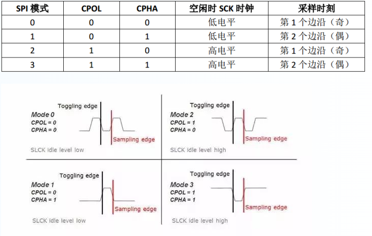
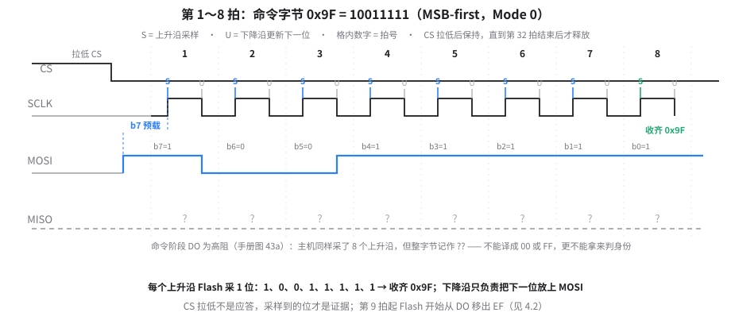
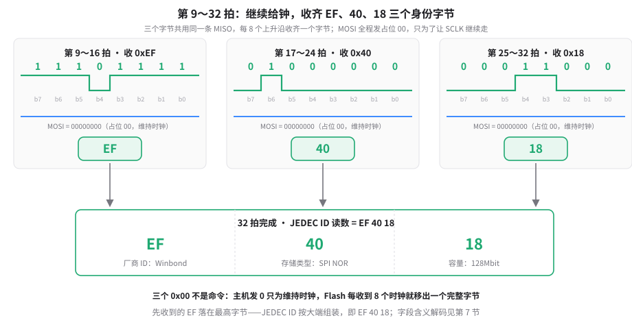
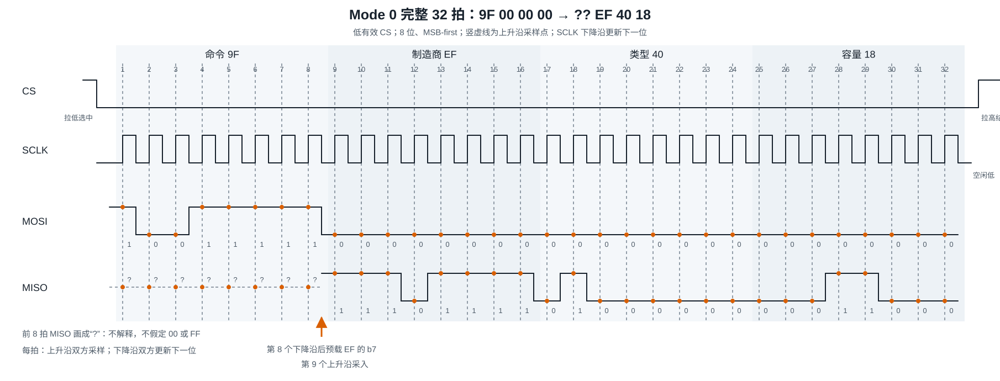

# CPOL／CPHA 与 Mode 0：怎样逐拍读完 32 位

> 所属章节：第五部 B. 总线协议 > B-B.4 SPI 总线 > B-B.4.1 SPI 物理层与四种模式
>
> 本组阅读：第 3 页，共 5 页

本页只回答一个问题：**CPOL 和 CPHA 怎样决定采样位置，Mode 0 又怎样逐拍完成 `0x9F` 命令与 `EF 40 18` 响应？**

---

##  3. CPOL 与 CPHA 怎样决定采样

CPOL（Clock Polarity，时钟极性）回答：**没有传输时，SCLK 停在高电平还是低电平？**

- CPOL=0：空闲低，每个时钟周期的第一个边沿是上升沿，第二个边沿是下降沿。
- CPOL=1：空闲高，每个时钟周期的第一个边沿是下降沿，第二个边沿是上升沿。

CPHA（Clock Phase，时钟相位）回答：**接收器在一个周期的第几个边沿采样？** CPHA=0 在第一个边沿采样，CPHA=1 在第二个边沿采样。另一个边沿用于更新输出。

这里把三个动作分开：

- **采样**：接收端在指定边沿读取输入电平，并把它保存为一个位。
- **更新**：发送端在另一个边沿把下一位送到输出引脚。
- **预载**：首位不等待某个更新边沿，而是在首次采样前就已经放到引脚上并保持稳定。

本例 Mode 0 是 CPOL=0、CPHA=0。由定义直接推出：空闲低，第一个边沿是上升沿，所以**上升沿采样、下降沿更新**。又因为第一个上升沿就要采样，双方的首位必须在它到来前预载，不能等上升沿到了才临时取出。

接收端并非在理想边沿瞬间看一眼就必然可靠。**建立时间**要求数据在采样边沿前至少稳定多久，**保持时间**要求它在采样边沿后再保持稳定多久。更新与采样分开，为数据稳定留出时间；实际最小窗口仍以双方手册为准。

---

##  4. 逐拍推演 Mode 0 的 32 拍

### 4.1 第 1～8 拍：接收 0x9F

`0x9F` 的二进制是 `10011111`。MSB-first 的 MOSI 位序因此是 `1、0、0、1、1、1、1、1`。

CS 拉低后、第 1 个上升沿前，主机已经把 `b7=1` 预载到 MOSI。第 1 个上升沿，Flash 采样这个 `1`，主机也采样一次 MISO；第 1 个下降沿，主机把 MOSI 更新为 `b6=0`。第 2 个上升沿采样 `0`，随后的下降沿再更新为 `b5=0`。如此重复，第 8 个上升沿采样 `b0=1`，Flash 收齐 `10011111`，即 `0x9F`。

主机也在这 8 个上升沿采样了 8 个 MISO 位，但手册图 43a 把命令阶段的 DO 画为高阻，没有把它们定义为身份响应。因此首字节写成 `??`，不能把它固定译成 `00` 或 `FF`，更不能拿它判断器件身份。

### 4.2 第 9～32 拍：读出 EF 40 18

第 8 个下降沿之后，Flash 准备 `0xEF` 的最高位。`0xEF=11101111`，所以第 9 个上升沿主机采到 `1`，随后各拍依次采到 `1、1、0、1、1、1、1`，第 16 个上升沿收齐 `EF`。

同样的过程重复两次：第 17～24 拍接收 `0x40=01000000`，位序为 `0、1、0、0、0、0、0、0`；第 25～32 拍接收 `0x18=00011000`，位序为 `0、0、0、1、1、0、0、0`。与此同时，MOSI 在这 24 拍始终发送三个 `0x00` 的位，以维持时钟。

下表把每个上升沿实际采到的位全部展开。先看拍号，再看 MOSI 从 `9F` 进入三个 `00`，最后看 MISO 从不解释阶段进入 `EF 40 18`。

| 拍号 | MOSI 被 Flash 采样 | MISO 被主机采样 | 所属字节 |
|:---:|:---:|:---:|:---|
| 1～8 | `1、0、0、1、1、1、1、1` | `?、?、?、?、?、?、?、?` | `9F`；`??` 不解释 |
| 9～16 | `0、0、0、0、0、0、0、0` | `1、1、1、0、1、1、1、1` | 占位 `00`；`EF` |
| 17～24 | `0、0、0、0、0、0、0、0` | `0、1、0、0、0、0、0、0` | 占位 `00`；`40` |
| 25～32 | `0、0、0、0、0、0、0、0` | `0、0、0、1、1、0、0、0` | 占位 `00`；`18` |

即使删去表格，前面三段也已经给出全部 32 个采样位：第 1～8 拍发送 `10011111`，第 9～16 拍接收 `11101111`，第 17～24 拍接收 `01000000`，第 25～32 拍接收 `00011000`，后 24 拍 MOSI 全为 0。拍号、位序和字节边界没有依赖表格才能补齐的信息。

### 4.3 在共同时间轴核对四根信号

下图把同一笔事务画在共同时间轴上。先沿 CS 找到拉低与释放位置，再数 SCLK 的 32 个上升沿；竖虚线与橙色点标出采样位置。随后对照 MOSI 的 `9F 00 00 00` 和 MISO 的 `?? EF 40 18`，特别看第 8 个下降沿与第 9 个上升沿之间 `EF` 最高位的预载。该图是依据手册作出的机制推演，不是实测截图。

不看图也能复核关键时刻：第 8 个上升沿收齐命令，第 8 个下降沿后 Flash 准备 `EF` 的 `b7`，第 9 个上升沿主机采入该位；第 16、24、32 个上升沿分别收齐 `EF`、`40`、`18`。第 32 个上升沿后，SCLK 回到空闲低，CS 拉高，Flash 的 DO 再次进入高阻。

CS 释放只界定本次串行指令结束，不表示从机返回了 ACK，也不自动证明身份正确。支持本例身份判断的证据是有效偏移处的 `EF 40 18`，不是“32 拍发完了”或“CS 已拉高”。

### 4.4 用 Timing Lab 逐拍验证

下面的纯波形实验室用于练习同一过程。先选择模式，再按“下一拍”观察当前位、采样边沿和已接收位；也可按“播放”连续推进，用“暂停”停在某拍，并切换 0.5×、1×、2× 速度。任何手动逐拍、复位或模式切换都会停止自动播放；第 32 拍后自动停止并释放 CS。用“上一拍”回退，用“复位”回到 CS 空闲。Mode 0 对应本例；Mode 1、2 是通用模式推演，不是本例 Flash 的可用配置。

  <iframe
    src="../html/spi-timing-lab.html"
    title="SPI 四种模式与 32 拍波形实验室"
    loading="lazy"
    style="width:100%;height:820px;border:0;"
  ></iframe>

[在新标签页打开 SPI Timing Lab](html/spi-timing-lab.html){ target="_blank" rel="noopener" }

<!-- 如果 iframe 不可用，仍可按 4.1～4.3 的文字完成同一推演：Mode 0 首位预载，上升沿采样、下降沿更新；连续 8 拍一个字节，前 8 拍命令，后 24 拍三个身份字节。实验室只是逐拍视图，不提供正文没有交代的新规则。 -->

---

[上一页：接线、驱动权与全双工](B-B.4.1_SPI物理层与四种模式_wiring.md) · [下一页：四种模式与多从机](B-B.4.1_SPI物理层与四种模式_modes.md)

