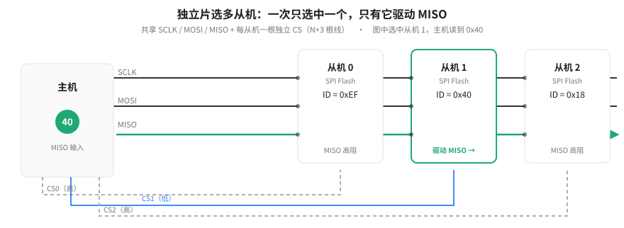

# 四种模式与多从机：怎样推广约定并管理共享 MISO

> 所属章节：第五部 B. 总线协议 > B-B.4 SPI 总线 > B-B.4.1 SPI 物理层与四种模式
>
> 本组阅读：第 4 页，共 5 页

本页只回答一个问题：**怎样由 CPOL×CPHA 推导四种模式，并用独立 CS 避免多个从机同时驱动 MISO？**

---

##  5. 由 CPOL×CPHA 推导四种模式

把 CPOL 的两种空闲电平与 CPHA 的两种采样位置组合起来，就得到四种模式，不需要分别死记：

- **Mode 0（CPOL=0，CPHA=0）**：空闲低，第一个边沿是上升沿，所以上升沿采样、下降沿更新；首位在第一个上升沿前预载。
- **Mode 1（CPOL=0，CPHA=1）**：空闲低，第二个边沿是下降沿，所以下降沿采样、上升沿更新；第一个上升沿先更新首位。
- **Mode 2（CPOL=1，CPHA=0）**：空闲高，第一个边沿是下降沿，所以下降沿采样、上升沿更新；首位在第一个下降沿前预载。
- **Mode 3（CPOL=1，CPHA=1）**：空闲高，第二个边沿是上升沿，所以上升沿采样、下降沿更新；第一个下降沿先更新首位。

| 模式 | CPOL | CPHA | 空闲电平 | 采样边沿 | 更新边沿 | 首位上线时机 |
|:---:|:---:|:---:|:---:|:---:|:---:|:---|
| Mode 0 | 0 | 0 | 低 | 上升沿 | 下降沿 | 第一个上升沿前预载 |
| Mode 1 | 0 | 1 | 低 | 下降沿 | 上升沿 | 第一个上升沿更新 |
| Mode 2 | 1 | 0 | 高 | 下降沿 | 上升沿 | 第一个下降沿前预载 |
| Mode 3 | 1 | 1 | 高 | 上升沿 | 下降沿 | 第一个下降沿更新 |

下面动画的每格只画前两个时钟，四组共用同步播放头。阅读顺序固定为：先看空闲高或低，再找 `S` 标记落在第一还是第二个边沿，最后看 `b7` 是提前预载，还是由第一个边沿更新。`U` 标记表示更新下一位。播放、暂停或单步只改变观察位置，不改变四种模式的定义。

  <iframe
    src="../html/spi-mechanism-lab.html?view=modes"
    title="SPI 四种模式同步对比动画"
    loading="lazy"
    style="width:100%;height:1040px;border:0;"
  ></iframe>

[在新标签页打开四种模式同步对比动画](html/spi-mechanism-lab.html?view=modes){ target="_blank" rel="noopener" }

展开静态图：SPI 四种模式的空闲、首位、采样和更新

不看图和表，也能从两个参数重新推导：CPOL 决定第一个边沿的方向，CPHA 决定这个边沿是采样还是更新；若 CPHA=0，首位必须预载，若 CPHA=1，首位可由第一个边沿更新。

W25Q128JV 支持 Mode 0 和 Mode 3。两者都是上升沿采样 DI、下降沿更新 DO，差别是空闲电平以及首位预载还是首边沿更新。**Mode 1、Mode 2 在这里只用于理解通用机制，不能写成本例 Flash 的可用配置。**

**SPI 是全人工约定的总线，模式在"设计时"就定死了，上电后没有任何握手过程。** 
那么"选择模式"具体是谁在选?

分两步看：

**第一步：器件手册圈定范围。** 从机 datasheet 声明自己支持哪些模式。W25Q128JV 手册写的是支持 Mode 0 和 Mode 3——这是硅片内部采样逻辑决定的，用户改不了。

**第二步：主机软件配置四选一。** 主机控制器（RK3568 SPI1）上有 CPOL、CPHA 两个配置位，驱动初始化时写进控制器寄存器（RK 上是 `SPI_CTRLR0` 里的 SCPOL/SCPH 位，具体由设备树或驱动代码决定）。写哪个值？**必须落在从机支持的集合里**。W25Q128JV 支持 {0, 3}，所以主机只能配 0 或 3；你文档里选 Mode 0，就是这个"主机配置值"落在从机支持范围内的一个具体选择。

从机这边**永远收不到任何"模式通知"**。它没有配置寄存器告诉你"我工作在 Mode 0"，它只是被动地盯着 SCLK 边沿采样。所谓"双方约定 Mode 0"，准确说法是：**设计者和固件把主机配成了 Mode 0，而恰好这颗 Flash 能在 Mode 0 下正确工作**。约定发生在画图和写代码的时候，不在总线上。

四种模式没有天然的性能优劣，主从双方必须使用器件要求的组合。模式不匹配可能采到旧位、相邻位、固定值或不确定电平，也可能让器件状态机收到错误命令，不能概括成“数据一定整体移一位”。

---

##  6. 多从机怎样避免 MISO 争用

常见多从机接法是让所有从机共享 SCLK、MOSI、MISO，再为每个从机分配独立 CS。N 个从机通常需要 N+3 根信号线。主机只拉低目标从机的 CS，其他 CS 保持无效。

一次完整交换可以按下面的顺序理解：

1. 总线空闲时，所有 CS 都无效，SCLK 保持在即将使用的模式所要求的空闲电平。
2. 主机只选中目标从机；目标从机获得响应时钟和在适当阶段驱动 MISO 的权利。
3. 其他从机忽略本次交换，并按各自手册让 MISO 保持高阻。
4. 主机释放目标 CS，等本次交换完全结束后，才能选中另一个从机。

不同从机可以要求不同模式，但必须在前一笔事务已经结束、所有 CS 均无效后改变时钟约定，再开始下一笔。不能在一次器件事务中途改变 CPOL 或 CPHA。

多从机问题的关键不是“共享线越多越省”这么简单，而是**任一时刻只能有一个从机主动驱动共享 MISO**。若某器件在 CS 无效时不能释放 MISO，就要按器件手册增加三态缓冲或改变连接方式，不能靠软件忽略错误数据来消除电气争用。

---

[上一页：CPOL／CPHA 与 Mode 0 的 32 拍](B-B.4.1_SPI物理层与四种模式_mode0.md) · [下一页：频率、电气条件与验证](B-B.4.1_SPI物理层与四种模式_electrical.md)

