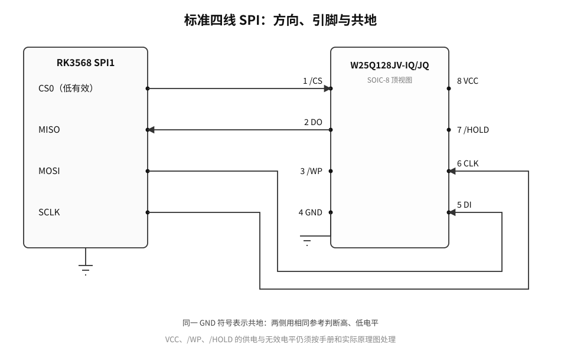
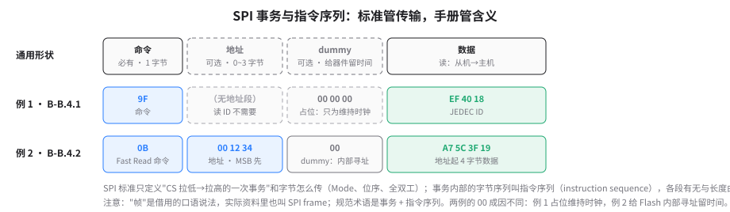
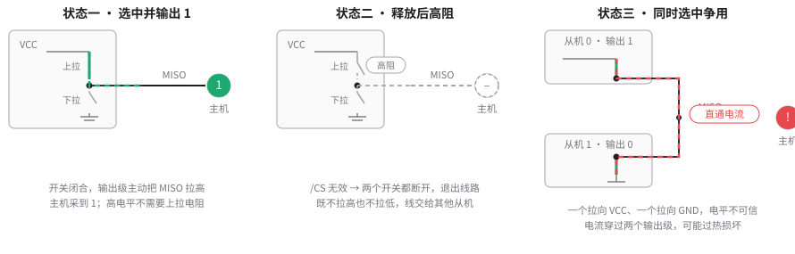
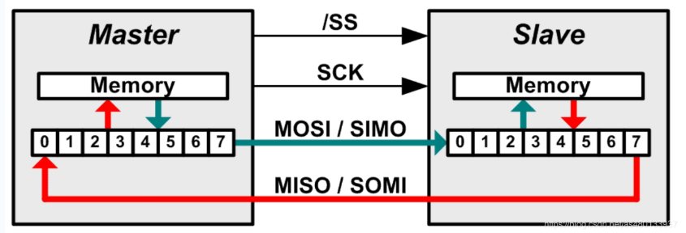

# 接线、驱动权与全双工：四线怎样完成一笔读取

> 所属章节：第五部 B. 总线协议 > B-B.4 SPI 总线 > B-B.4.1 SPI 物理层与四种模式
>
> 本组阅读：第 2 页，共 5 页

本页只回答一个问题：**四根信号怎样落到真实引脚，并在同一组时钟里完成双向移位而不争用 MISO？**

---

##  1. 四线怎样完成一笔读取

### 1.1 把四根线落到实际器件引脚

前面的 CS、SCLK、MOSI、MISO 是主机侧常用名称。W25Q128JV 在手册中把相应引脚称为 `/CS`、`CLK`、`DI`、`DO`：

- 主机 CS 接 Flash 的 1 脚 `/CS`，拉低选中，拉高释放。
- 主机 SCLK 接 Flash 的 6 脚 `CLK`，边沿决定何时更新输出、何时采样输入。
- 主机 MOSI 接 Flash 的 5 脚 `DI`，本例承载 `0x9F` 和后续三个占位字节。
- 主机 MISO 接 Flash 的 2 脚 `DO`，本例承载三个身份字节。

下图用于核对方向、物理引脚和共同参考。先看左侧主机信号，再沿连线看到右侧 Flash 引脚，最后看两侧相同的 GND（Ground，地）符号。8 脚 VCC（电源）、3 脚 `/WP`（写保护）和 7 脚 `/HOLD`（暂停）也必须按手册与实际原理图处理，只是不进入本篇位流主线。

即使不看图，也可以按方向完成接线：主机 CS 接从机 `/CS`，主机时钟输出接从机 `CLK`，主机数据输出接从机 `DI`，从机 `DO` 接主机数据输入，双方 GND 相连。MOSI 与 MISO 不是两根可以按名字任意互换的对称线；接反后，主机命令根本到不了 Flash 的 DI。

除了图中的 SIMO/SOMI，厂商也会使用 SDI/SDO（Serial Data Input/Output，串行数据输入/输出）、COPI/CIPO（Controller Out/Peripheral In、Controller In/Peripheral Out，控制器输出/外设输入、控制器输入/外设输出）等名称。先确认每一端方向，再对照缩写，不能只凭名称猜测。

### 1.2 先排出一笔完整事务

本例的完整手工基线只有五步：

1. 空闲时 CS 为高，SCLK 为低，双方已经约定 8 位、MSB-first 和 Mode 0。
2. 主机拉低 CS，选中这一颗 Flash，并在第一个上升沿前把 `0x9F` 的最高位放到 MOSI。
3. 主机连续提供 32 个 SCLK。每个上升沿，Flash 采样 MOSI，主机采样 MISO；每个下降沿，输出端准备下一位。
4. 前 8 拍让 Flash 收齐 `0x9F`；后 24 拍中，主机继续发送 `00 00 00`，同时依次收齐 `EF`、`40`、`18`。
5. 第 32 个上升沿采到最后一位后，SCLK 回到空闲低，主机释放 CS；Flash 结束本次指令并释放 DO。

这里的三个 `00` 称为**占位字节**。它们不是三条新命令，作用是让主机继续提供时钟，因为 Flash 只有收到时钟，才能逐位移出身份数据。

  <iframe
    src="../html/spi-transaction-player.html"
    title="开漏输出：拉低与放手交互演示"
    loading="lazy"
    style="width:100%;height:640px;border:0;"
  ></iframe>

由此先得到一个不依赖任何图示的结论：**一笔读取不是“只发 8 拍命令，然后数据自动出现”，而是命令 8 拍加响应 24 拍，共 32 拍；MOSI 与 MISO 在每一个时钟里都同时存在。**

把上面 32 拍里的字节排出来：9F 00 00 00 ?? EF 40 18 
CS 拉低期间传输的这串字节序列，就是这笔事务的帧。SPI 标准不规定帧长什么样；每个器件手册定义自己的帧。 
常见形状是四段：[命令][地址][dummy][数据]，后三段有没有、多长，全查手册。

---

##  2. 电平、移位与 MISO 驱动权

### 2.1 推挽与高阻怎样决定线路电平

常见 SPI 信号采用**推挽输出**：输出级既能主动把引脚拉高，也能主动把引脚拉低。因此，高电平不依赖 I2C 开漏总线那种上拉电阻。**高阻态**则是另一件事：输出级既不主动拉高，也不主动拉低，相当于退出对线路的驱动。推挽与高阻的基础还可回看 B-B.3.1。

W25Q128JV 手册规定，`/CS` 为高时器件未被选中，DO 处于高阻；`/CS` 拉低后才接受指令。所以 CS 不只决定“是否解释命令”，也决定这颗 Flash 是否可以驱动共享 MISO。

<!-- 下面动画分三种状态阅读。第一步看一个有效推挽输出怎样主动驱动主机输入；第二步看未选中的从机怎样断开驱动；第三步沿橙色路径看两个从机一高一低同时驱动时，电流为什么会从电源穿过两个输出级流向地。可播放、暂停或单步切换，默认停在第一种状态；争用只作机制演示，不是上板试验步骤。

  <iframe
    src="../html/spi-mechanism-lab.html?view=drive"
    title="SPI 推挽、高阻与 MISO 驱动权动画"
    loading="lazy"
    style="width:100%;height:650px;border:0;"
  ></iframe>

-->
[在新标签页打开 MISO 驱动权动画](html/spi-mechanism-lab.html?view=drive){ target="_blank" rel="noopener" } 

<!-- 

展开静态图：推挽、高阻与两个从机争用 MISO

 -->
<!--  -->

两个推挽输出若同时把共享 MISO 分别拉向高、低电平，就会形成“电源 → 一个输出级 → MISO → 另一个输出级 → 地”的直通电流路径。结果不仅是电平和数据不可信，还可能使输出级过热或损坏。因此，未选中的从机能否释放 MISO，必须逐颗核对器件手册，不能用“SPI 通常如此”代替。

“推挽不需要 I2C 式上拉”也不等于任何 SPI 引脚都禁止上拉。CS 等引脚可能因上电状态或器件建议而需要上拉，应以手册和原理图为准。

### 2.2 全双工是两个方向同时移位

MOSI 与 MISO 是两条独立数据线，所以双方可以在同一组时钟中同时发送，这称为**全双工**。可以用两个 8 位移位寄存器理解：移位寄存器是一串按时钟移动的位，一端把当前输出位送到引脚，另一端把刚采样的输入位移入。

下面动画直接展开主事务的第 9～16 拍：MOSI 是占位字节 `00000000`，MISO 是制造商 ID `11101111`。先看两侧已经预载的 `b7`，再逐拍观察同一边沿怎样把 MOSI 的 0 采入 Flash、把 MISO 的 1 或 0 采入主机，最后核对主机得到 `EF`、Flash 得到 `00`。这里不是 `0x9F` 命令的前 8 拍。

  <iframe
    src="../html/spi-mechanism-lab.html?view=shift"
    title="SPI 全双工逐位交换动画：00 与 EF"
    loading="lazy"
    style="width:100%;height:730px;border:0;"
  ></iframe>

[在新标签页打开全双工逐位交换动画](html/spi-mechanism-lab.html?view=shift){ target="_blank" rel="noopener" }

<!-- 
 -->
<!-- 
展开静态图：SPI 全双工移位
 -->
<!--  -->
<!-- 
 -->

按 MSB-first，第 1 拍双方输出各自的 `b7`，第 2 拍输出 `b6`，直到第 8 拍输出 `b0`。8 个采样边沿后，主机原字节移入 Flash，Flash 原字节也移入主机。连续重复四组，就得到本例 32 拍。

全双工不表示两个方向始终都有协议意义。前 8 拍中，主机仍采样 MISO，但手册没有把这段 DO 定义为身份响应，所以 `??` 不解释；后 24 拍中，Flash 仍采样 MOSI 上的三个 `00`，但它们只是给接收提供时钟的占位数据。**关闭任何一条数据线都不是完成本例读取的前提，继续提供时钟才是。**

---

[上一页：导读与实例地图](B-B.4.1_SPI物理层与四种模式.md) · [下一页：CPOL／CPHA 与 Mode 0 的 32 拍](B-B.4.1_SPI物理层与四种模式_mode0.md)

