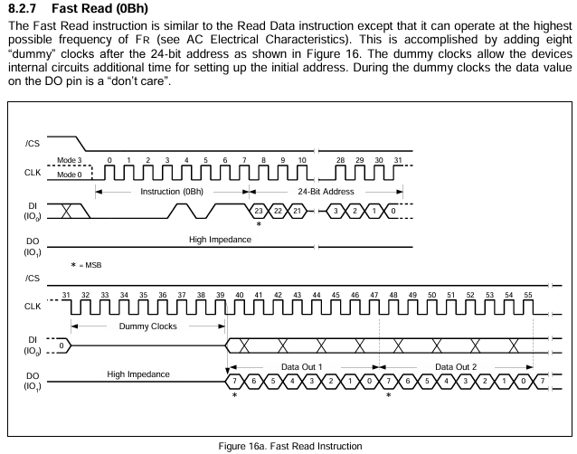
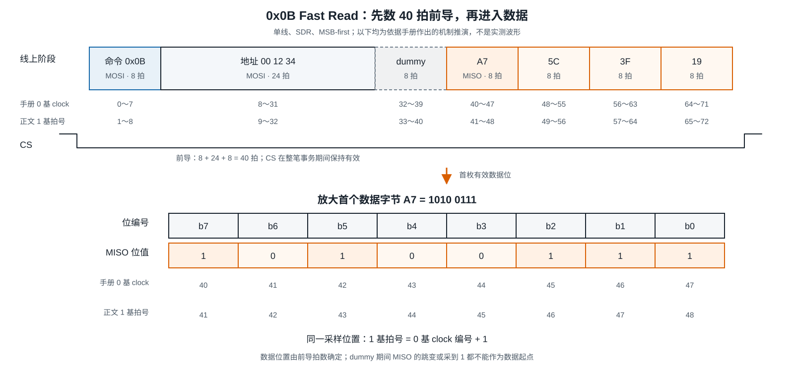
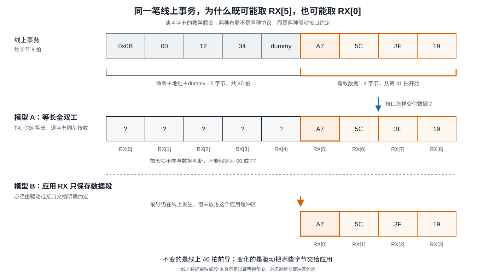
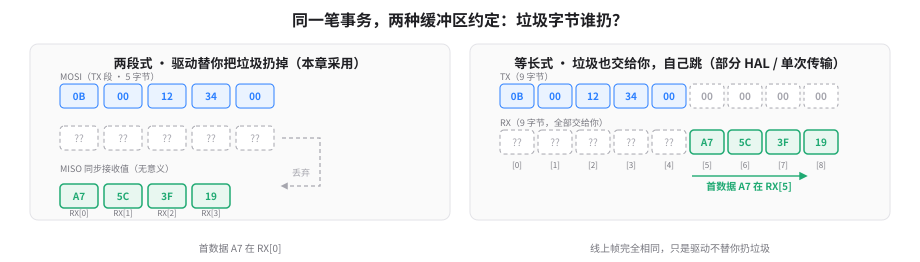
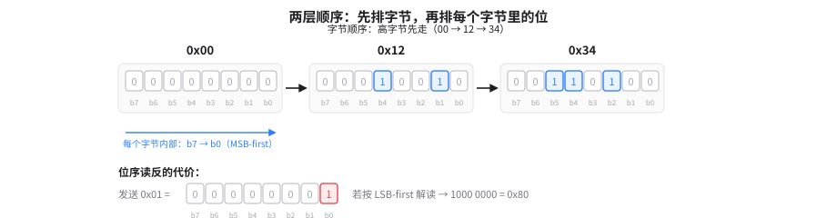
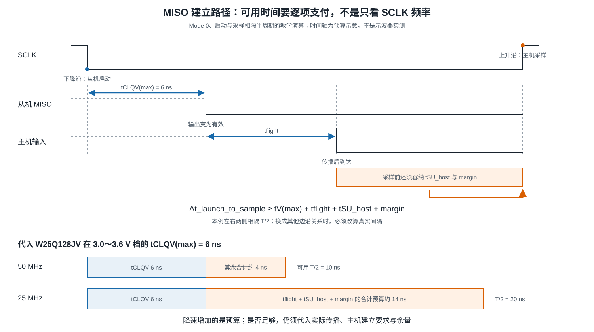

# B-B.4.2 SPI 协议层与时序

> 所属章节：第五部 B. 总线协议 > B-B.4 SPI 总线
>
> 难度：[B→I] Beginner → Intermediate | 预计阅读时间：30 分钟

## <span class="blue"> 本节导读

B-B.4.1 已经逐拍说明 SPI 怎样移动一个位，本篇继续追问：**主机把若干字节交给 SPI 控制器后，器件凭什么知道哪段是命令、哪段是地址、哪拍开始返回有效数据，软件又应从哪里取走结果？**

答案不在 SPI 这个名称里。SPI 只提供片选、时钟和双向位流，具体器件手册才定义一帧的内容。<br>
全文只跟随 W25Q128JV 串行 Flash 存储器的一条 Fast Read（快速读）命令 `0x0B`，从地址 `0x001234` 读取 4 字节。Flash 是掉电后仍能保存内容的存储芯片，本例只读，不改写其中内容。

```text
主机发送：0B 00 12 34 00 | 00 00 00 00
主机接收：?? ?? ?? ?? ?? | A7 5C 3F 19
阶段划分：前 5 字节前导 | 后 4 字节数据
```

竖线前是命令、24 位地址和 8 个 dummy clocks（等待时钟），竖线后是数据。`??` 表示这些接收位不承担数据语义，不表示它们必为 `00` 或 `FF`。

本节覆盖：一笔 Fast Read 的完整帧、线上字节到接收缓冲区的映射、dummy 的作用、位序、AC（Alternating Current，动态开关条件下的交流特性）时序预算，以及同一事务的验证顺序。<br>
Linux 对象与完整驱动代码归 B-B.4.3，工具操作归 B-B.4.4，Flash 产品接入与页写归 B-B.4.5。

[点击查看 W25Q128JV 数据手册](images/W25Q128JV_RevF.pdf)

---

## <span class="blue"> 1. 一笔事务的四个阶段

### 1.1 阶段划分与 40 拍前导

W25Q128JV 的 `0x0B` Fast Read 不是“发送命令后自动得到数据”。手册第 8.2.7 节和图 16a 规定了四个连续阶段：



1. **命令，8 拍**：主机在 MOSI 上发送 `0x0B`，说明要执行 Fast Read。
2. **地址，24 拍**：主机继续发送 `00 12 34`，选定首次读取地址 `0x001234`。
3. **dummy，8 拍**：主机继续提供时钟，让器件内部电路为初始地址建立留出时间；器件的 DO（Data Output，数据输出，接主机 MISO）在这段时间的值是 don't care，即不参与结果解释。
4. **数据，每字节 8 拍**：Flash 在 MISO 上输出数据，主机继续提供时钟并采样。每输出一字节，Flash 内部地址自动加一。

这里把“一个 SCLK 周期”简称为“一拍”。本例每条数据线每拍传 1 位，所以 8 拍组成 1 字节。<br>
首个数据位之前共有：

```text
8 拍命令 + 24 拍地址 + 8 拍 dummy = 40 拍前导
```

第 41 拍(clock 40)才采入首字节 `A7` 的最高位。<BR>
读取 4 字节还需要 `4 × 8 = 32` 拍，因此整笔事务共 **72 拍**，CS 在这段时间保持有效。

手册图 16a 的 CLK 编号从 0 起，所以同一首字节标为 clock 40～47；本文从 1 起数，标为第 41～48 拍。只是编号起点不同，不是两种时序。

### 1.2 72 拍时间轴与 A7 的位序

下图先看四个阶段及各自拍号，再沿橙色数据段核对首字节；下排只放大 `A7` 的位序，不再引入第二套编号。



按拍号展开：第 1～8 拍发送 `0B`，第 9～32 拍发送 `00 12 34`，第 33～40 拍经过 dummy，第 41～48、49～56、57～64、65～72 拍分别接收 `A7`、`5C`、`3F`、`19`。

`0xA7 = 1010 0111`，MSB-first 的接收顺序是 `1、0、1、0、0、1、1、1`。第 41 拍的 `1` 是 `b7`，第 48 拍的 `1` 是 `b0`，收齐后才能重组为 `A7`。若误按最低位先发重组，会得到 `E5`，这正是选择 `A7` 作教学数据的原因：位序一旦弄反，结果明显不同。

<div class="interactive-demo">
  <iframe
    src="../html/spi-fast-read-0b-player.html"
    title="开漏输出：拉低与放手交互演示"
    loading="lazy"
    style="width:100%;height:580px;border:0;"
  ></iframe>
</div>


CS 拉高表示本次串行指令结束，却不代表器件内部所有状态都被复位。页编程或擦除等内部操作可以在 CS 无效后继续。

---

## <span class="blue"> 2. 从线上帧到软件缓冲区

### 2.1 两段传输：TX 5 字节 + RX 4 字节

先把这笔事务的完整形状写成一行指令序列（器件手册的视角）：
```text
    0B | 00 12 34 | 00(dummy) | A7 5C 3F 19
```
而线上实际是两条线同时各走 9 个字节：MOSI 上前 5 个有意义、后 4 个是维持时钟的占位 00；MISO 上前 5 个是命令/地址阶段的同步接收值（无意义）、后 4 个才是数据：
```text
    MOSI：0B  00  12  34  00 | 00  00  00  00
    MISO：??  ??  ??  ??  ?? | A7  5C  3F  19
          └─── 前 40 拍 ──┘    └─ 后 32 拍 ─┘
```

软件不直接面对这两条线。<br>
控制器接口把一笔事务描述成两张清单：TX 单写明"MOSI 上要出现哪些字节"，RX 单写明"MISO 上哪些字节值得存进缓冲区"。<br>
本章与 B-B.4.3 统一采用下面的两段描述：

```text
第一段：TX = 0B 00 12 34 00    长度 5 字节，同步接收值丢弃
第二段：RX = A7 5C 3F 19       长度 4 字节，同步发送零值以提供时钟
```

TX 是发送缓冲区，RX 是接收缓冲区。两段合起来仍是上节同一笔 72 拍事务，中间不释放 CS。第一段产生前 40 拍，第二段产生后 32 拍。

<!-- <div class="interactive-demo">
  <iframe
    src="../html/spi-two-segment-pipeline.html"
    title="开漏输出：拉低与放手交互演示"
    loading="lazy"
    style="width:100%;height:640px;border:0;"
  ></iframe>
</div> -->
<div class="interactive-demo">
  <iframe
    src="../images/spi-two-segment-pipeline.html"
    title="两段传输：字节从 TX 出发、经 MISO 落入 RX"
    loading="lazy"
    style="width:100%;height:500px;border:0;"
  ></iframe>
</div>

> 数据专用接收缓冲区：只保存数据阶段移入字节的 RX。方括号内是从 0 开始的字节索引。本例驱动把前导段的同步接收值丢弃，因此 `A7` 位于 `RX[0]`，随后依次是 `RX[1]=5C`、`RX[2]=3F`、`RX[3]=19`。

第二段虽然只关心接收，SPI 物理层仍在全双工移位，即两个方向在同一组时钟中同时移动数据。控制器发送零值不是 Flash 协议新增的数据字段，只是维持时钟的一种发送约定；Flash 则继续输出地址 `0x001234` 起的内容。

下图把“线上发生什么”和“软件保存什么”并排对齐。<br>
重点不是多记一种结构，而是看清前导仍在线上存在，只是没有进入数据专用 RX。



因此，本例的数据定位可以独立完成：

```text
线上：40 拍前导之后，第 41 拍开始接收 A7
软件：5 字节前导段之后，4 字节数据段的 RX[0] 保存 A7
```

这两个位置描述的是同一事件。

### 2.2 为什么有的代码却从 RX[5] 取数据

2.1 的两段式不是唯一接口形态。<br>
由于 SPI 全双工，每发出一个字节物理上必同时收回一个字节，前导 40 拍收回的 5 个垃圾字节，驱动可以替你丢弃（两段式），也可以全部交给你自己跳（等长式）。



两种约定下的首数据位置不同，这就是有的代码从 RX[5] 取数的原因。<BR>
另一种常见接口把整笔事务放进等长的 TX/RX 缓冲区。读 4 字节时，两个缓冲区都为 9 字节：

```text
TX:    0B  00  12  34  00  00  00  00  00
RX:    ??  ??  ??  ??  ??  A7  5C  3F  19
索引:   0   1   2   3   4   5   6   7   8
```

前 5 个 RX 字节对应命令、地址和 dummy 的 40 拍，因此首数据位于 `RX[5]`。<br>
这与本节的 `RX[0]` 不矛盾：**线上帧没有改变，改变的是接口是否把前导阶段的接收字节也交给调用者。**

阅读实际代码时先看缓冲区约定，不能看到 Fast Read 就机械写死 `RX[0]` 或 `RX[5]`。本章后续统一使用数据专用 RX；等长模型只作为识别其他代码的对照。

---

## <span class="blue"> 3. dummy 与两层顺序

### 3.1 dummy：字节无意义，拍数有意义

dummy 不是 SPI 事务的必备段，而是逐条指令定义的：器件从"收完最后一个输入位"到"第一个输出位有效"之间，如果有内部工作来不及完成，手册就为这条指令规定若干 dummy 时钟；没有这段工作的指令就一拍都不给。

同一颗 W25Q128JV 上，0x03 普通读没有 dummy，0x0B Fast Read 有 8 拍，读状态寄存器、读 JEDEC ID 也都没有。

它的本质是厂商把内部操作延迟换算成的等待拍数。<br>
器件锁存地址后要完成译码、读出存储阵列、把结果送到输出寄存器，这段时间客观存在；SPI 里时钟在主机手里，从机无法让总线暂停，手册只能约定"地址给完后再白给 N 个时钟，之后的数据才算数"。

为什么前导给多给少都会错位？<br>
因为 Flash 从 CS 拉低起就是一台数时钟的状态机：数够 8 拍当命令、再 24 拍当地址、再 8 拍 dummy，之后每 8 拍吐一个数据字节。它不知道软件的预期，主机给的拍数和手册不一致，两边的"格子"就错了位。

还要注意：dummy 期间传输的字节本身没有意义（发 0 发 FF 都一样），有意义的是它的拍数, 那是手册为器件内部操作规定好的最小等待。

若软件只给命令和地址便立即按数据解释，第 33～40 拍仍处于 dummy，第 41 拍才会出现 `A7` 的 `b7`。把 dummy 当成有效数据，接收结果就会整体错位；多发额外 dummy 也会把软件预期的数据边界推向别的位置。

<div class="interactive-demo">
  <iframe
    src="../html/spi-dummy-align.html"
    title="dummy 对齐：前导拍数与数据格子的错位"
    loading="lazy"
    style="width:100%;height:400px;border:0;"
  ></iframe>
</div>

普通 Read Data `0x03` 可以用来核对这个差别：它同样发送 8 位命令和 24 位地址，但没有这 8 个 dummy clocks，所以首枚数据位从第 33 拍开始。`0x03` 与 `0x0B` 的差别不是笼统的“一个慢、一个快”，而是**前导分别为 32 拍和 40 拍，且允许的最高频率不同**。

dummy 也不能替代 Flash 的忙状态查询。读命令中的 dummy 由固定拍数结束；编程或擦除是否完成，则要按手册读取 BUSY（Erase/Write In Progress，擦除或写进行中）状态位。两者都可能表现为“暂时不能取结果”，完成条件却不同。

### 3.2 字节顺序 ≠ 位序

3.1 保证"第几拍是什么"不出错；这一节保证"每 8 拍的内容怎么排"不出错。<br>
两者都是 0x0B 读回正确数据的必要条件。

地址 `0x001234` 是一个三字节**字段**（字段 = 一段有含义的连续字节）。<br>
它上线时，"谁先走"有两个互相独立的决定：

- **字节顺序**：三个字节之间，`00 → 12 → 34`，高字节先走；
- **位序**：每个字节内部，`b7 → b0`，即 MSB-first（Most SignificantBit first，最高有效位先发；B-B.4.1 已定义）。

注意 "MSB first" 在这里一词两用：对整个地址字段，MSB 指最高的那个字节（0x00）；对每个字节，MSB 指 b7。<br>
手册用同一个词描述两层，但两层各自独立,知道一层推不出另一层，这就是"不能互相替代"的含义：



`0x01` 在 LSB-first（Least Significant Bit first，最低有效位先发）与 MSB-first 解释不一致时会变成 `0x80`，<br>
但只有在把发送输出接回接收输入的回环中，或已知发送数据的受控条件下，才能用这个现象明确检查位序。<br>
普通通信中收到 `0x80` 并不能单独证明位序错误。


---

## <span class="blue"> 4. 采样前的时间预算


协议帧（第 1～3 节）回答的是**逻辑上第几拍该收到什么数据**；这一节回答的是**物理上那一拍到来时，MISO 上的位是否已经稳定**<br>
不稳定，逻辑正确的第 41 拍也可能采到过渡态，RX[0] 里的 A7 就是错的。

两者的关系可以这样记：协议帧保证"格子位置对"，时序预算保证"格子里的数已准备好"。

---

#### 4.1 预算方程：数据到达时刻必须早于采样时刻

沿 MISO 走一遍完整的物理链路：

```
Flash 内部   →   引脚输出   →   PCB 走线   →   主机引脚   →   主机采样
              tCLQV        tflight        tSU_host      margin
```

| 符号 | 中文读法 | 含义 | 通常谁决定 |
|------|---------|------|-----------|
| tCLQV (或 tV) | 时钟低→Q有效 | Flash 收到时钟下降沿后，内部延迟多久才在引脚上放出有效数据 | **器件手册**，改不了；取最大值（最坏情况） |
| tflight | 飞行时间 | 信号从 Flash 引脚走到主机引脚的传播延迟 | **硬件**（走线长度）；软件只能等效补偿 |
| tSU_host | 主机建立时间 | 主机要求数据在采样边沿前至少稳定多久 | **芯片手册**；部分 SoC 软件可配采样延迟寄存器 |
| margin | 设计裕量 | 留给时钟抖动、温漂、工艺偏差的余量 | **设计规则**，通常取总预算的 20%～30% |

因此启动边沿到采样边沿的实际间隔至少要满足：

```text
Δt_launch_to_sample ≥ tCLQV(max) + tflight + tSU_host + margin
```

<div class="interactive-demo">
  <iframe
    src="../html/open-drain-demo.html"
    title="开漏输出：拉低与放手交互演示"
    loading="lazy"
    style="width:100%;height:640px;border:0;"
  ></iframe>
</div>

> **只有具体模式的启动沿与采样沿确实相隔半个周期时，左侧才能写成 T/2。**<br>
> Mode 0 的数据在下降沿更新、上升沿采样，正好隔 T/2；换模式要先确认哪条沿启动输出，不能默认 T/2。

---

#### 4.2 用两个频率算一遍，感受"预算够不够"

W25Q128JV Rev F 在 3.0～3.6 V 档给出 **tCLQV(max) = 6 ns**。<br>
这个 6 ns 是什么概念？电信号在电路板里走大约 1 米也要 6 ns；Flash 内部从"收到时钟"到"把位放到引脚上"，要走的等效路程正好是这个量级，**它不可能为零**。

现在选两个**教学频率**代入（50 MHz 是器件标称 Fast Read 上限，25 MHz 是常见保守值）：

| 频率 | T/2（采样间隔） | 扣除 tCLQV=6 ns | 留给 tflight + tSU_host + margin |
|------|----------------|------------------|----------------------------------|
| 50 MHz | 10 ns | 10 − 6 = **4 ns** | 只剩 4 ns 走线 + 主机建立 + 裕量 |
| 25 MHz | 20 ns | 20 − 6 = **14 ns** | 宽裕得多 |

**4 ns 是什么概念？**<br>
10 cm 量级 PCB 走线约消耗 0.5～1 ns，RK3568 这类 SoC 的建立时间约 3～5 ns，50 MHz 时这两项加完已经逼近甚至超过 4 ns，预算大概率不成立。25 MHz 时 14 ns 明显宽裕。

所以"降速增加的是可用预算，不直接证明通信已经可靠"。50 MHz 能不能用，取决于走线多长、主机多快、留多少裕量；25 MHz 也不是免死金牌，只是留给误差的空间大了。



---

#### 4.3 软件视角：预算不成立时，先动哪几个旋钮

对软件开发者来说，这一节的结论是**一张行动清单**：

| 预算项超标时 | 软件可调 | 具体操作 |
|-------------|---------|---------|
| T/2 太小（频率太高） | ✅ 是 | **降频**：设备树 `spi-max-frequency` 从 50 MHz 降到 25 MHz 或更低 |
| tCLQV 不够 | ❌ 否 | 换 Flash 型号；或检查供电电压（3.3 V vs 1.8 V 档的 tCLQV 不同） |
| tflight 太大 | ⚠️ 间接 | 降频等效于给 tflight 让出空间；PCB 整改归硬件 |
| tSU_host 太紧 | ✅ 部分 | 查 RK3568 手册有无 **采样延迟线（rx-sample-delay / rtsd）** 寄存器，软件可调几纳秒 |
| margin 不够 | ✅ 是 | 降频是最直接的 margin 提升手段 |

**诊断顺序（软件先做，再做硬件）：**

1. 先确认 CPOL/CPHA 配对正确（第 1 节），排除"采样沿选错了"这种逻辑错误；
2. 再降频（`spi-max-frequency`），看通信是否稳定，稳定了说明预算临界；
3. 再查 SoC 是否有采样延迟寄存器，微调采样点而不降频；
4. 以上调尽仍不稳定，移交硬件检查走线、端接、驱动强度。

---

## <span class="blue"> 5. 换一条命令，必须重新数线数和拍数

前面的 `0x0B` 在命令、地址和数据阶段都使用单线，记作 `1-1-1`。

同一颗 Flash 的 `0x6B` Fast Read Quad Output（四线输出快速读）则记作 `1-1-4`：命令和地址仍走单线，数据改用 IO0～IO3 四根双向输入输出线。`x-y-z` 记法的三个数依次对应命令、地址和数据阶段的线数。

`0x6B` 同样具有 8 拍命令、24 拍地址和 8 拍 dummy，前导仍是 40 拍；变化发生在数据阶段。<br>
读取 4 字节时：

```text
0x0B：40 拍前导 + 32 拍数据 = 72 拍
0x6B：40 拍前导 +  8 拍数据 = 48 拍
```

所以“四线”只把本例数据阶段从 32 拍缩为 8 拍，不会把整笔事务的所有开销都除以四。<br>
该命令还要求状态寄存器中的 QE（Quad Enable，四线功能使能）位已置 1；QE 是这条命令的前置条件，不改变前导阶段的线数。

这里不需要引入其他器件，也不需要背完整的 `x-y-z` 命令表。<br>
读手册时逐阶段问三个问题即可：**控制信息走几条线、地址走几条线、数据走几条线，各自需要多少拍？**DDR（Double Data Rate，双倍数据速率）或八线协议还会改变每拍位数和时序关系，不能沿用本篇 SDR 结论。

---

## <span class="blue"> 6. 协议验证清单

协议验证应抓一笔完整事务，而不是只看 MISO 有没有跳变。<br>
对本文实例，预期和判据都能提前写出：

1. **看边界**：CS 是否覆盖完整 72 拍，中途没有提前释放。
2. **看命令**：第 1～8 拍的 MOSI 是否按 MSB-first 重组为 `0B`。
3. **看地址**：第 9～32 拍是否依次为 `00 12 34`。
4. **看前导**：地址后是否恰好经过 8 个 dummy clocks，第 41 拍才进入数据。
5. **看数据**：第 41～48 拍是否采到 `1010 0111`，随后是否收齐 `5C 3F 19`。
6. **看软件交付**：两段数据专用模型中，RX 是否为 `A7 5C 3F 19`；等长模型中，是否改从 `RX[5]` 取同样四字节。

这些检查分别定位不同层次。<br>
命令解码不对，先查位序和采样模式；地址字节不对，查多字节顺序；数据整体错位，重新数 dummy 和前导；`A7` 被重组成 `E5`，在已知数据条件下检查位序；只有降速后恢复，再继续检查 AC 预算和信号质量。

全 `00`、全 `FF` 或非零数据都不能单独证明成功或指出唯一根因。<br>
可靠判断必须同时满足：**帧格式与手册一致，有效偏移处的数据与已知内容一致，采样时序具备足够余量。**逻辑分析仪用于核对数字位流，示波器用于观察真实电平与边沿，二者不能互相替代。

---

## <span class="blue"> 本节总结 [B→I]

SPI 协议层的核心，是把器件手册翻译成一笔可逐拍核对的事务。本文 `0x0B` Fast Read 由 8 拍命令、24 拍地址和 8 拍 dummy 组成 40 拍前导，第 41 拍开始接收 `A7 5C 3F 19`，读四字节共 72 拍。

线上位置与软件偏移要分开描述。两段数据专用模型丢弃前导接收值，首数据在 `RX[0]`；等长全双工缓冲保留前导，首数据才在 `RX[5]`。拍数正确仍不够，输出有效、传播、主机建立和余量必须共同满足采样前的时间预算。换命令时重新数阶段、线数和拍数，比背“命令—地址—数据”模板更可靠。

## <span class="blue"> 本节自查

??? details "Q1. 本文 Fast Read 的首枚有效数据位为什么从第 41 拍开始？读四字节总共需要多少拍？"
    命令 8 拍、地址 24 拍、dummy 8 拍，合计 40 拍前导，因此下一拍才是首枚有效数据位。四字节数据还需 32 拍，整笔事务共 72 拍。

??? details "Q2. 为什么本文数据从 RX[0] 开始，而有的等长缓冲区代码从 RX[5] 开始？"
    本文采用两段描述，前导段的同步接收值被丢弃，数据专用 RX 只保存四字节数据，所以首字节在 RX[0]。等长模型保留命令、地址和 dummy 对应的五个接收字节，首字节因此在 RX[5]。线上都是 40 拍前导。

??? details "Q3. 第二段只关心接收，为什么控制器仍在 MOSI 上发送零值？"
    SPI 数据需要时钟才能逐位移出。第二段发送零值用于持续提供 32 拍，同时接收四字节；这些零值是传输约定，不是 Fast Read 新增的协议字段。

??? details "Q4. 0x03 与 0x0B 的首数据位置为什么不同？dummy 能否代替编程完成后的 BUSY 查询？"
    两者都有 8 拍命令和 24 拍地址，但 0x03 没有 Fast Read 的 8 个 dummy clocks，所以首数据从第 33 拍开始，0x0B 则从第 41 拍开始。dummy 由固定拍数结束，编程或擦除是否完成要读 BUSY 状态，不能互相替代。

??? details "Q5. 地址 0x001234 的字节顺序与 A7 的位序分别是什么？把 A7 误读成 E5 说明应检查什么？"
    地址按 00、12、34 发送，每个字节内部按 MSB-first 从 b7 到 b0 发送。A7=1010 0111，若按相反位序重组会得到 E5；在已知数据的受控条件下，应检查主从位序配置是否一致。

??? details "Q6. 50 MHz 与 25 MHz 的教学演算为什么分别留下约 4 ns 和 14 ns 的合计预算？能否据此宣布 50 MHz 不可用？"
    Mode 0 本例的启动与采样相隔半周期。50 MHz 半周期为 10 ns，减去 tCLQV(max) 6 ns 后约剩 4 ns；25 MHz 半周期为 20 ns，约剩 14 ns。余下还要容纳传播、主机建立和余量，未代入实际参数前不能宣布任一频率必然可用或不可用。

??? details "Q7. 0x6B 为什么读四字节只需 48 拍，却不能说整笔事务提速四倍？"
    它与 0x0B 一样有 40 拍单线前导，但四线数据阶段每拍传 4 位，四字节只需 8 拍，总计 48 拍。四倍只描述数据阶段的理想位数关系，命令、地址、dummy 和其他事务开销并未全部除以四。

??? details "Q8. 如果逻辑分析仪解码得到 A7 5C 3F 19，为什么仍可能要查示波器？"
    解码结果支持数字位流符合当前预期，但不能完整揭示接收端电平裕量、过冲、振铃和边沿形态。若通信随频率、板卡或探测条件变化，还要用示波器检查模拟质量与时序余量。
