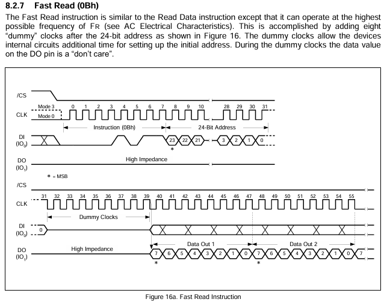
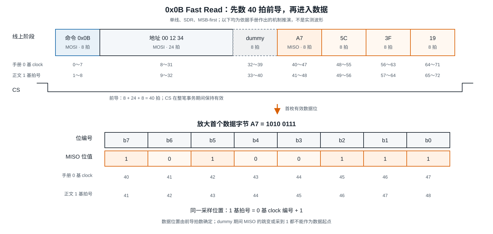

<div class="reader-b2" markdown="1">

# B-B.4.2 SPI 协议层与时序

> 所属章节：第五部 B. 总线协议 > B-B.4 SPI 总线
>
> 难度：[B→I] Beginner → Intermediate | 预计阅读时间：30 分钟

## <span class="blue"> 本节导读

B-B.4.1 已经逐拍说明 SPI 怎样移动一个位，本篇继续追问：**主机把若干字节交给 SPI 控制器后，器件凭什么知道哪段是命令、哪段是地址、哪拍开始返回有效数据，软件又应从哪里取走结果？**

答案不在 SPI 这个名称里。SPI 只提供片选、时钟和双向位流，具体器件手册才定义一帧的内容。<br>
全文只跟随 W25Q128JV 串行 Flash 存储器的一条 Fast Read（快速读）命令 `0x0B`，从地址 `0x001234` 读取 4 字节。Flash 是掉电后仍能保存内容的存储芯片，本例只读，不改写其中内容。

```text
主机发送：0B 00 12 34 00 | 00 00 00 00
主机接收：?? ?? ?? ?? ?? | A7 5C 3F 19
阶段划分：前 5 字节前导 | 后 4 字节数据
```

竖线前是命令、24 位地址和 8 个 dummy clocks（等待时钟），竖线后是数据。`??` 表示这些接收位不承担数据语义，不表示它们必为 `00` 或 `FF`。

本节覆盖：一笔 Fast Read 的完整帧、线上字节到接收缓冲区的映射、dummy 的作用、位序、AC（Alternating Current，动态开关条件下的交流特性）时序预算，以及同一事务的验证顺序。<br>
Linux 对象与完整驱动代码归 B-B.4.3，工具操作归 B-B.4.4，Flash 产品接入与页写归 B-B.4.5。

[点击查看 W25Q128JV 数据手册](images/W25Q128JV_RevF.pdf)

---

## <span class="blue"> 1. 一笔事务的四个阶段

### 1.1 阶段划分与 40 拍前导

W25Q128JV 的 `0x0B` Fast Read 不是“发送命令后自动得到数据”。手册第 8.2.7 节和图 16a 规定了四个连续阶段：



1. **命令，8 拍**：主机在 MOSI 上发送 `0x0B`，说明要执行 Fast Read。
2. **地址，24 拍**：主机继续发送 `00 12 34`，选定首次读取地址 `0x001234`。
3. **dummy，8 拍**：主机继续提供时钟，让器件内部电路为初始地址建立留出时间；器件的 DO（Data Output，数据输出，接主机 MISO）在这段时间的值是 don't care，即不参与结果解释。
4. **数据，每字节 8 拍**：Flash 在 MISO 上输出数据，主机继续提供时钟并采样。每输出一字节，Flash 内部地址自动加一。

这里把“一个 SCLK 周期”简称为“一拍”。本例每条数据线每拍传 1 位，所以 8 拍组成 1 字节。<br>
首个数据位之前共有：

```text
8 拍命令 + 24 拍地址 + 8 拍 dummy = 40 拍前导
```

第 41 拍(clock 40)才采入首字节 `A7` 的最高位。<BR>
读取 4 字节还需要 `4 × 8 = 32` 拍，因此整笔事务共 **72 拍**，CS 在这段时间保持有效。

手册图 16a 的 CLK 编号从 0 起，所以同一首字节标为 clock 40～47；本文从 1 起数，标为第 41～48 拍。只是编号起点不同，不是两种时序。

### 1.2 72 拍时间轴与 A7 的位序

下图先看四个阶段及各自拍号，再沿橙色数据段核对首字节；下排只放大 `A7` 的位序，不再引入第二套编号。



按拍号展开：第 1～8 拍发送 `0B`，第 9～32 拍发送 `00 12 34`，第 33～40 拍经过 dummy，第 41～48、49～56、57～64、65～72 拍分别接收 `A7`、`5C`、`3F`、`19`。

`0xA7 = 1010 0111`，MSB-first 的接收顺序是 `1、0、1、0、0、1、1、1`。第 41 拍的 `1` 是 `b7`，第 48 拍的 `1` 是 `b0`，收齐后才能重组为 `A7`。若误按最低位先发重组，会得到 `E5`，这正是选择 `A7` 作教学数据的原因：位序一旦弄反，结果明显不同。

<div class="interactive-demo">
  <iframe
    src="../html/spi-fast-read-0b-player.html"
    title="开漏输出：拉低与放手交互演示"
    loading="lazy"
    style="width:100%;height:580px;border:0;"
  ></iframe>
</div>


CS 拉高表示本次串行指令结束，却不代表器件内部所有状态都被复位。页编程或擦除等内部操作可以在 CS 无效后继续。

---

[下一页：软件缓冲区与数据对齐](B-B.4.2_SPI协议层与时序_buffer.md)

</div>
