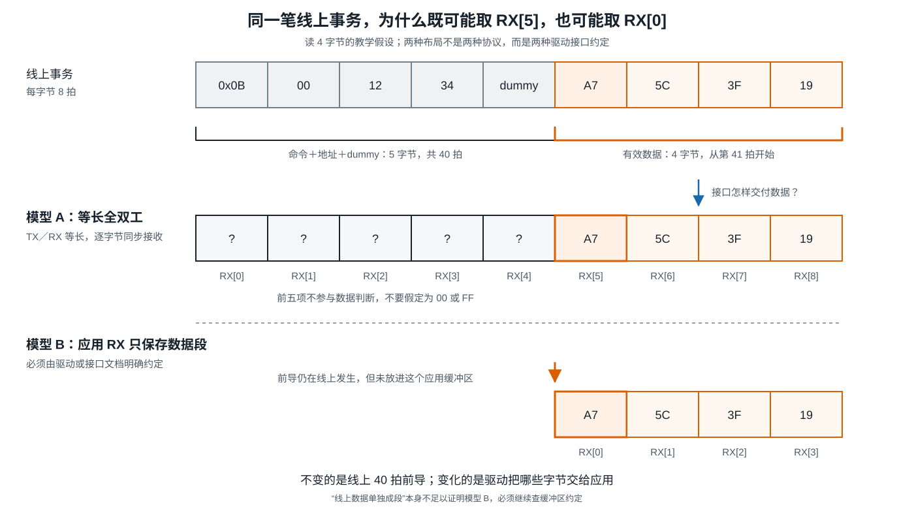
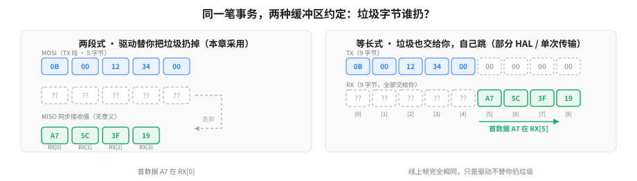
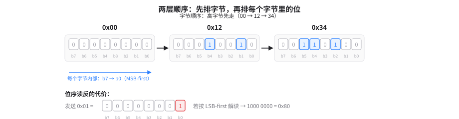

<div class="reader-b2" markdown="1">

# 软件缓冲区与数据对齐：首数据到底放在哪里

> 所属章节：第五部 B. 总线协议 > B-B.4 SPI 总线 > B-B.4.2 SPI 协议层与时序
>
> 本组阅读：第 2 页，共 4 页

本页只回答一个问题：**同一笔 72 拍事务怎样映射到 `RX[0]` 或 `RX[5]`，dummy、字节顺序和位序又怎样决定数据边界？**

---

## <span class="blue"> 2. 从线上帧到软件缓冲区

### 2.1 两段传输：TX 5 字节 + RX 4 字节

先把这笔事务的完整形状写成一行指令序列（器件手册的视角）：
```text
    0B | 00 12 34 | 00(dummy) | A7 5C 3F 19
```
而线上实际是两条线同时各走 9 个字节：MOSI 上前 5 个有意义、后 4 个是维持时钟的占位 00；MISO 上前 5 个是命令/地址阶段的同步接收值（无意义）、后 4 个才是数据：
```text
    MOSI：0B  00  12  34  00 | 00  00  00  00
    MISO：??  ??  ??  ??  ?? | A7  5C  3F  19
          └─── 前 40 拍 ──┘    └─ 后 32 拍 ─┘
```

软件不直接面对这两条线。<br>
控制器接口把一笔事务描述成两张清单：TX 单写明"MOSI 上要出现哪些字节"，RX 单写明"MISO 上哪些字节值得存进缓冲区"。<br>
本章与 B-B.4.3 统一采用下面的两段描述：

```text
第一段：TX = 0B 00 12 34 00    长度 5 字节，同步接收值丢弃
第二段：RX = A7 5C 3F 19       长度 4 字节，同步发送零值以提供时钟
```

TX 是发送缓冲区，RX 是接收缓冲区。两段合起来仍是上节同一笔 72 拍事务，中间不释放 CS。第一段产生前 40 拍，第二段产生后 32 拍。

<!-- <div class="interactive-demo">
  <iframe
    src="../html/spi-two-segment-pipeline.html"
    title="开漏输出：拉低与放手交互演示"
    loading="lazy"
    style="width:100%;height:640px;border:0;"
  ></iframe>
</div> -->
<div class="interactive-demo">
  <iframe
    src="../images/spi-two-segment-pipeline.html"
    title="两段传输：字节从 TX 出发、经 MISO 落入 RX"
    loading="lazy"
    style="width:100%;height:500px;border:0;"
  ></iframe>
</div>

> 数据专用接收缓冲区：只保存数据阶段移入字节的 RX。方括号内是从 0 开始的字节索引。本例驱动把前导段的同步接收值丢弃，因此 `A7` 位于 `RX[0]`，随后依次是 `RX[1]=5C`、`RX[2]=3F`、`RX[3]=19`。

第二段虽然只关心接收，SPI 物理层仍在全双工移位，即两个方向在同一组时钟中同时移动数据。控制器发送零值不是 Flash 协议新增的数据字段，只是维持时钟的一种发送约定；Flash 则继续输出地址 `0x001234` 起的内容。

下图把“线上发生什么”和“软件保存什么”并排对齐。<br>
重点不是多记一种结构，而是看清前导仍在线上存在，只是没有进入数据专用 RX。



因此，本例的数据定位可以独立完成：

```text
线上：40 拍前导之后，第 41 拍开始接收 A7
软件：5 字节前导段之后，4 字节数据段的 RX[0] 保存 A7
```

这两个位置描述的是同一事件。

### 2.2 为什么有的代码却从 RX[5] 取数据

2.1 的两段式不是唯一接口形态。<br>
由于 SPI 全双工，每发出一个字节物理上必同时收回一个字节，前导 40 拍收回的 5 个垃圾字节，驱动可以替你丢弃（两段式），也可以全部交给你自己跳（等长式）。



两种约定下的首数据位置不同，这就是有的代码从 RX[5] 取数的原因。<BR>
另一种常见接口把整笔事务放进等长的 TX/RX 缓冲区。读 4 字节时，两个缓冲区都为 9 字节：

```text
TX:    0B  00  12  34  00  00  00  00  00
RX:    ??  ??  ??  ??  ??  A7  5C  3F  19
索引:   0   1   2   3   4   5   6   7   8
```

前 5 个 RX 字节对应命令、地址和 dummy 的 40 拍，因此首数据位于 `RX[5]`。<br>
这与本节的 `RX[0]` 不矛盾：**线上帧没有改变，改变的是接口是否把前导阶段的接收字节也交给调用者。**

阅读实际代码时先看缓冲区约定，不能看到 Fast Read 就机械写死 `RX[0]` 或 `RX[5]`。本章后续统一使用数据专用 RX；等长模型只作为识别其他代码的对照。

---

## <span class="blue"> 3. dummy 与两层顺序

### 3.1 dummy：字节无意义，拍数有意义

dummy 不是 SPI 事务的必备段，而是逐条指令定义的：器件从"收完最后一个输入位"到"第一个输出位有效"之间，如果有内部工作来不及完成，手册就为这条指令规定若干 dummy 时钟；没有这段工作的指令就一拍都不给。

同一颗 W25Q128JV 上，0x03 普通读没有 dummy，0x0B Fast Read 有 8 拍，读状态寄存器、读 JEDEC ID 也都没有。

它的本质是厂商把内部操作延迟换算成的等待拍数。<br>
器件锁存地址后要完成译码、读出存储阵列、把结果送到输出寄存器，这段时间客观存在；SPI 里时钟在主机手里，从机无法让总线暂停，手册只能约定"地址给完后再白给 N 个时钟，之后的数据才算数"。

为什么前导给多给少都会错位？<br>
因为 Flash 从 CS 拉低起就是一台数时钟的状态机：数够 8 拍当命令、再 24 拍当地址、再 8 拍 dummy，之后每 8 拍吐一个数据字节。它不知道软件的预期，主机给的拍数和手册不一致，两边的"格子"就错了位。

还要注意：dummy 期间传输的字节本身没有意义（发 0 发 FF 都一样），有意义的是它的拍数, 那是手册为器件内部操作规定好的最小等待。

若软件只给命令和地址便立即按数据解释，第 33～40 拍仍处于 dummy，第 41 拍才会出现 `A7` 的 `b7`。把 dummy 当成有效数据，接收结果就会整体错位；多发额外 dummy 也会把软件预期的数据边界推向别的位置。

<div class="interactive-demo">
  <iframe
    src="../html/spi-dummy-align.html"
    title="dummy 对齐：前导拍数与数据格子的错位"
    loading="lazy"
    style="width:100%;height:400px;border:0;"
  ></iframe>
</div>

普通 Read Data `0x03` 可以用来核对这个差别：它同样发送 8 位命令和 24 位地址，但没有这 8 个 dummy clocks，所以首枚数据位从第 33 拍开始。`0x03` 与 `0x0B` 的差别不是笼统的“一个慢、一个快”，而是**前导分别为 32 拍和 40 拍，且允许的最高频率不同**。

dummy 也不能替代 Flash 的忙状态查询。读命令中的 dummy 由固定拍数结束；编程或擦除是否完成，则要按手册读取 BUSY（Erase/Write In Progress，擦除或写进行中）状态位。两者都可能表现为“暂时不能取结果”，完成条件却不同。

### 3.2 字节顺序 ≠ 位序

3.1 保证"第几拍是什么"不出错；这一节保证"每 8 拍的内容怎么排"不出错。<br>
两者都是 0x0B 读回正确数据的必要条件。

地址 `0x001234` 是一个三字节**字段**（字段 = 一段有含义的连续字节）。<br>
它上线时，"谁先走"有两个互相独立的决定：

- **字节顺序**：三个字节之间，`00 → 12 → 34`，高字节先走；
- **位序**：每个字节内部，`b7 → b0`，即 MSB-first（Most SignificantBit first，最高有效位先发；B-B.4.1 已定义）。

注意 "MSB first" 在这里一词两用：对整个地址字段，MSB 指最高的那个字节（0x00）；对每个字节，MSB 指 b7。<br>
手册用同一个词描述两层，但两层各自独立,知道一层推不出另一层，这就是"不能互相替代"的含义：



`0x01` 在 LSB-first（Least Significant Bit first，最低有效位先发）与 MSB-first 解释不一致时会变成 `0x80`，<br>
但只有在把发送输出接回接收输入的回环中，或已知发送数据的受控条件下，才能用这个现象明确检查位序。<br>
普通通信中收到 `0x80` 并不能单独证明位序错误。


---

[上一页：导读与 72 拍完整帧](B-B.4.2_SPI协议层与时序.md) · [下一页：采样前的时间预算](B-B.4.2_SPI协议层与时序_timing.md)

</div>
