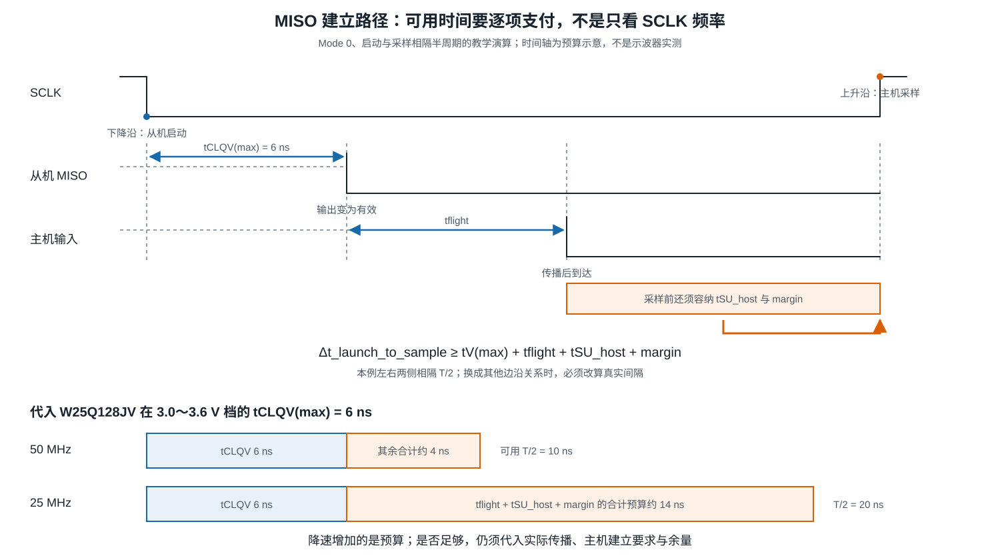

<div class="reader-b2" markdown="1">

# 采样前的时间预算：正确的第 41 拍为什么仍会采错

> 所属章节：第五部 B. 总线协议 > B-B.4 SPI 总线 > B-B.4.2 SPI 协议层与时序
>
> 本组阅读：第 3 页，共 4 页

本页只回答一个问题：**数据从 Flash 输出到主机采样要经过哪些延迟，软件可以怎样改善采样预算？**

---

## <span class="blue"> 4. 采样前的时间预算


协议帧（第 1～3 节）回答的是**逻辑上第几拍该收到什么数据**；这一节回答的是**物理上那一拍到来时，MISO 上的位是否已经稳定**<br>
不稳定，逻辑正确的第 41 拍也可能采到过渡态，RX[0] 里的 A7 就是错的。

两者的关系可以这样记：协议帧保证"格子位置对"，时序预算保证"格子里的数已准备好"。

---

#### 4.1 预算方程：数据到达时刻必须早于采样时刻

沿 MISO 走一遍完整的物理链路：

```
Flash 内部   →   引脚输出   →   PCB 走线   →   主机引脚   →   主机采样
                 tCLQV        tflight        tSU_host      margin
```

| 符号 | 中文读法 | 含义 | 通常谁决定 |
|------|---------|------|-----------|
| tCLQV (或 tV) | 时钟低→Q有效 | Flash 收到时钟下降沿后，内部延迟多久才在引脚上放出有效数据 | **器件手册**，改不了；取最大值（最坏情况） |
| tflight | 飞行时间 | 信号从 Flash 引脚走到主机引脚的传播延迟 | **硬件**（走线长度）；软件只能等效补偿 |
| tSU_host | 主机建立时间 | 主机要求数据在采样边沿前至少稳定多久 | **芯片手册**；部分 SoC 软件可配采样延迟寄存器 |
| margin | 设计裕量 | 留给时钟抖动、温漂、工艺偏差的余量 | **设计规则**，通常取总预算的 20%～30% |

因此启动边沿到采样边沿的实际间隔至少要满足：

```text
Δt_launch_to_sample ≥ tCLQV(max) + tflight + tSU_host + margin
```

<div class="interactive-demo">
  <iframe
    src="../html/spi-flash-timing-budget.html"
    title="开漏输出：拉低与放手交互演示"
    loading="lazy"
    style="width:100%;height:600px;border:0;"
  ></iframe>
</div>

> **只有具体模式的启动沿与采样沿确实相隔半个周期时，左侧才能写成 T/2。**<br>
> Mode 0 的数据在下降沿更新、上升沿采样，正好隔 T/2；换模式要先确认哪条沿启动输出，不能默认 T/2。

---

#### 4.2 用两个频率算一遍，感受"预算够不够"

W25Q128JV Rev F 在 3.0～3.6 V 档给出 **tCLQV(max) = 6 ns**。<br>
这个 6 ns 是什么概念？电信号在电路板里走大约 1 米也要 6 ns；Flash 内部从"收到时钟"到"把位放到引脚上"，要走的等效路程正好是这个量级，**它不可能为零**。

现在选两个**教学频率**代入（50 MHz 是器件标称 Fast Read 上限，25 MHz 是常见保守值）：

| 频率 | T/2（采样间隔） | 扣除 tCLQV=6 ns | 留给 tflight + tSU_host + margin |
|------|----------------|------------------|----------------------------------|
| 50 MHz | 10 ns | 10 − 6 = **4 ns** | 只剩 4 ns 走线 + 主机建立 + 裕量 |
| 25 MHz | 20 ns | 20 − 6 = **14 ns** | 宽裕得多 |

**4 ns 是什么概念？**<br>
10 cm 量级 PCB 走线约消耗 0.5～1 ns，RK3568 这类 SoC 的建立时间约 3～5 ns，50 MHz 时这两项加完已经逼近甚至超过 4 ns，预算大概率不成立。25 MHz 时 14 ns 明显宽裕。

所以"降速增加的是可用预算，不直接证明通信已经可靠"。50 MHz 能不能用，取决于走线多长、主机多快、留多少裕量；25 MHz 也不是免死金牌，只是留给误差的空间大了。



---

#### 4.3 软件视角：预算不成立时，先动哪几个旋钮

对软件开发者来说，这一节的结论是**一张行动清单**：

| 预算项超标时 | 软件可调 | 具体操作 |
|-------------|---------|---------|
| T/2 太小（频率太高） | ✅ 是 | **降频**：设备树 `spi-max-frequency` 从 50 MHz 降到 25 MHz 或更低 |
| tCLQV 不够 | ❌ 否 | 换 Flash 型号；或检查供电电压（3.3 V vs 1.8 V 档的 tCLQV 不同） |
| tflight 太大 | ⚠️ 间接 | 降频等效于给 tflight 让出空间；PCB 整改归硬件 |
| tSU_host 太紧 | ✅ 部分 | 查 RK3568 手册有无 **采样延迟线（rx-sample-delay / rtsd）** 寄存器，软件可调几纳秒 |
| margin 不够 | ✅ 是 | 降频是最直接的 margin 提升手段 |

**诊断顺序（软件先做，再做硬件）：**

1. 先确认 CPOL/CPHA 配对正确（第 1 节），排除"采样沿选错了"这种逻辑错误；
2. 再降频（`spi-max-frequency`），看通信是否稳定，稳定了说明预算临界；
3. 再查 SoC 是否有采样延迟寄存器，微调采样点而不降频；
4. 以上调尽仍不稳定，移交硬件检查走线、端接、驱动强度。

---

[上一页：软件缓冲区与数据对齐](B-B.4.2_SPI协议层与时序_buffer.md) · [下一页：命令变体与协议验证](B-B.4.2_SPI协议层与时序_validation.md)

</div>
