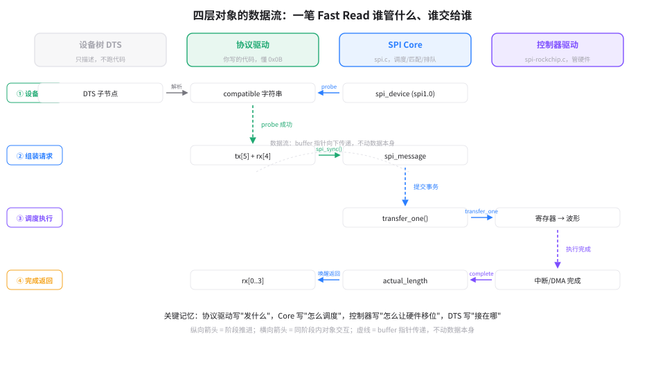

<div class="reader-b2" markdown="1">

# B-B.4.3 SPI Linux 驱动框架

> 所属章节：第五部 B. 总线协议 > B-B.4 SPI 总线
>
> 难度：[I] Intermediate

## <span class="blue"> 本节导读

B-B.4.2 已经把一笔 W25Q128JV Fast Read 拆成确定的线上字节：主机发送 `0B 00 12 34 00`，再提供读取 4 字节所需的时钟。

<div class="interactive-demo">
  <iframe
    src="../html/spi-4-3-intro-pipeline.html"
    title="开漏输出：拉低与放手交互演示"
    loading="lazy"
    style="width:100%;height:640px;border:0;"
  ></iframe>
</div>

本节追问同一笔操作在 Linux 中的完整路径：**设备树怎样变成一个可供驱动使用的设备对象，外设驱动怎样描述这两段传输，SPI Core 和 RK3568 控制器驱动怎样执行它，结果或错误又怎样回到调用者。**

贯穿实例仍是 RK3568 SPI1、W25Q128JV-IQ/JQ、Mode 0、8 位、MSB-first、低有效 CS。事务固定为：

```text
地址 0x001234 的 Fast Read
第一段 TX：0B 00 12 34 00       长度 5 字节
第二段 RX：D0 D1 D2 D3           长度 4 字节
成功时 actual_length：9 字节
```

`D0～D3` 是 Flash 当前地址中的内容，不由 SPI 框架决定。后文用 `A7 5C 3F 19` 解释日志时，它只是**教学假设数据**，不是实测结果。

本节覆盖：五类 SPI 对象的生命周期、DTS 建链与驱动匹配、手工双段 `spi_message`、v6.6 真实调用链、CS 和返回语义、`spi_write_then_read()` 的封装边界，以及完整教学模块、DTS、Makefile 和观察步骤。<br>
spidev 工具排障归 B-B.4.4；`jedec,spi-nor → MTD` 的产品接入和烧录归 B-B.4.5。

---

## <span class="blue"> 怎样阅读这组短页面

这组页面沿用同一笔 5＋4 字节 Fast Read，但把对象创建、代码组装、底层执行、封装选择和实际观察分开。

完整教学文件、真实源码与 Framework Lab 始终用于回查，不让某一段孤立代码承担整个子系统的解释。

1. **SPI Linux 驱动框架概述**：说明有哪些角色，以及一次传输的完整流程；
2. **设备描述、注册与驱动匹配**：说明 DTS、`spi_device`、`spi_driver` 和 probe 的关系；
3. **SPI 传输请求的组织**：说明 message、transfer、缓冲区和返回值；
4. **SPI Core 与控制器驱动的执行过程**：说明请求怎样交给硬件，结果怎样返回；
5. **常用传输接口及其适用场景**：说明基础接口与便捷接口的关系和选择依据；
6. **驱动构建、运行验证与应用边界**：说明怎样编译观察，以及教学驱动和产品驱动的区别。

[开始阅读：设备描述、注册与驱动匹配](B-B.4.3_SPI Linux驱动框架_startup.md)。

---

## <span class="blue"> SPI 驱动框架与一次传输流程

B-B.4.2 算清了 72 拍在引脚上怎么跑；写代码时，要把这 72 拍装进`spi_message` 和 `spi_transfer`，让 Linux 替你发出去。

本节先看一笔最小读取长什么样，再顺着执行路径确认：<br>
命令在哪层组装、时钟在哪层产生、出错时该翻哪份代码。

四类对象的边界先记一句话: 后面路径表里还会反复见到：

- **协议驱动**：你写的代码，管 0x0B 和地址怎么拆，不管 RK3568 寄存器。
- **控制器驱动**（`spi-rockchip.c`）：管时钟、CS、GPIO，不管 0x0B 是什么意思。
- **SPI Core**（`spi.c`）：管调度、排队、匹配，让上面两层接上头。
- **设备树（DTS）**：只描述"芯片接在哪"，不跑代码。



一笔成功读取要经过的完整路径是：

```text
板级 DTS 中的 spi-frame-observer@0
→ SPI Core 创建 spi_device（设备名 spi1.0）
→ compatible 匹配教学 spi_driver，进入 probe
→ probe 组出 5 字节 TX + 4 字节 RX 的 spi_message
→ spi_sync() 校验并提交
→ SPI Core 逐段调用 RK3568 的 transfer_one
→ 控制器产生 CS/SCLK 并交换 MOSI/MISO 位流
→ Core 完成缓冲区回收与完成通知
→ spi_sync() 返回 0，外设驱动取得 4 字节数据
```

这条路径也给出源码地图。<br>
行号均按本项目保存的 Linux v6.6 快照核对，阅读代码时应先定位函数，再观察它的正常路径和错误路径。

| 责任 | v6.6 位置 | 本例要看的内容 |
|---|---|---|
| SPI1 硬件描述 | [`arch/arm64/boot/dts/rockchip/rk356x.dtsi:1291-1303`](code/B-B.4.3/kernel-v6.6/arch/arm64/boot/dts/rockchip/rk356x.dtsi){: data-code-viewer="true" data-code-title="rk356x.dtsi" data-code-path="Linux v6.6 · arch/arm64/boot/dts/rockchip/rk356x.dtsi" data-code-lines="1291-1303"} | `spi1: spi@fe620000`、时钟、DMA、pinctrl、默认 disabled |
| 设备创建与匹配 | [`drivers/spi/spi.c:2226-2392, 376-470`](code/B-B.4.3/kernel-v6.6/drivers/spi/spi.c){: data-code-viewer="true" data-code-title="spi.c" data-code-path="Linux v6.6 · drivers/spi/spi.c" data-code-lines="2226-2392,376-470"} | 解析子节点、创建 `spi_device`、匹配并调用 probe |
| 同步传输 | [`drivers/spi/spi.c:4190-4274`](code/B-B.4.3/kernel-v6.6/drivers/spi/spi.c){: data-code-viewer="true" data-code-title="spi.c" data-code-path="Linux v6.6 · drivers/spi/spi.c" data-code-lines="4190-4274"} | 校验、排队或直接执行、等待、返回状态 |
| 默认逐段执行 | [`drivers/spi/spi.c:1481-1590`](code/B-B.4.3/kernel-v6.6/drivers/spi/spi.c){: data-code-viewer="true" data-code-title="spi.c" data-code-path="Linux v6.6 · drivers/spi/spi.c" data-code-lines="1481-1590"} | 遍历 transfer、调用 `transfer_one`、处理 CS 和错误 |
| 对象与 API 定义 | [`include/linux/spi/spi.h:127-210, 975-1165`](code/B-B.4.3/kernel-v6.6/include/linux/spi/spi.h){: data-code-viewer="true" data-code-title="spi.h" data-code-path="Linux v6.6 · include/linux/spi/spi.h" data-code-lines="127-210,975-1165"} | 设备字段、全双工语义、message 和 transfer |
| RK3568 硬件适配 | [`drivers/spi/spi-rockchip.c:668-722, 752-928`](code/B-B.4.3/kernel-v6.6/drivers/spi/spi-rockchip.c){: data-code-viewer="true" data-code-title="spi-rockchip.c" data-code-path="Linux v6.6 · drivers/spi/spi-rockchip.c" data-code-lines="668-722,752-928"} | 注册控制器、配置并执行一个 transfer |

这里的源码地图不是另一条学习主线。<br>
后文每次放大其中一个区间，都要回到同一笔 5＋4 字节读取，确认它处于全路的哪一步。

SPI Framework Lab 把同一笔读取拆成可单步的代码位置和对象状态：<br>
可以先跟完 DTS 建链、双段提交、两段计数与释放，再切换“模型注入首段 `-EIO`”，观察第二段为何不执行、CS 何时撤销、负错误怎样穿过同步调用和 probe。<br>
每一步都能在片段与完整函数间切换，源码工作台提供正文使用的三份教学文件。

<div class="interactive-demo">
  <iframe
    src="../html/spi-framework-lab.html"
    title="B-B.4.3 SPI Framework Lab"
    loading="lazy"
    style="width:100%;height:960px;border:0;"
  ></iframe>
</div>

[在新窗口打开 SPI Framework Lab](./html/spi-framework-lab.html){: target="_blank" rel="noopener noreferrer" }。


---

## <span class="blue"> 本页自查

??? details "Q1. 为什么外设协议驱动不需要直接读写 RK3568 SPI 寄存器？"

    协议驱动的职责是把 W25Q128JV 的命令翻译成 message 和 transfer。Core 负责校验、调度与完成通知，Rockchip 控制器驱动通过 `transfer_one` 配置硬件并完成位移。分层后，同一颗 Flash 的协议代码不必随 SoC 寄存器变化而重写。

---

[下一页：设备描述、注册与驱动匹配](B-B.4.3_SPI Linux驱动框架_startup.md)

</div>
