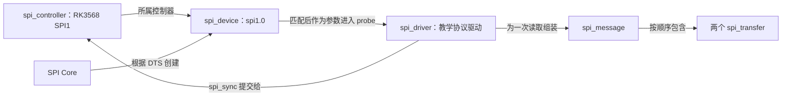

# B-B.4.3 SPI Linux 驱动框架

> 所属章节：第五部 B. 总线协议 > B-B.4 SPI 总线
>
> 难度：[I] Intermediate | 预计阅读时间：55 分钟

## <span class="blue"> 本节导读

B-B.4.2 已经把一笔 W25Q128JV Fast Read 拆成确定的线上字节：主机发送 `0B 00 12 34 00`，再提供读取 4 字节所需的时钟。本节追问同一笔操作在 Linux 中的完整路径：**设备树怎样变成一个可供驱动使用的设备对象，外设驱动怎样描述这两段传输，SPI Core 和 RK3568 控制器驱动怎样执行它，结果或错误又怎样回到调用者。**

贯穿实例仍是 RK3568 SPI1、W25Q128JV-IQ/JQ、Mode 0、8 位、MSB-first、低有效 CS。事务固定为：

```text
地址 0x001234 的 Fast Read
第一段 TX：0B 00 12 34 00       长度 5 字节
第二段 RX：D0 D1 D2 D3           长度 4 字节
成功时 actual_length：9 字节
```

`D0～D3` 是 Flash 当前地址中的内容，不由 SPI 框架决定。后文用 `A7 5C 3F 19` 解释日志时，它只是**教学假设数据**，不是实测结果。

本节覆盖：五类 SPI 对象的生命周期、DTS 建链与驱动匹配、手工双段 `spi_message`、v6.6 真实调用链、CS 和返回语义、`spi_write_then_read()` 的封装边界，以及完整教学模块、DTS、Makefile 和观察步骤。spidev 工具排障归 B-B.4.4；`jedec,spi-nor → MTD` 的产品接入和烧录归 B-B.4.5。

---

## <span class="blue"> 先沿一笔读取看清责任线

SPI 软件框架不是在用户态和引脚之间增加一层笼统的“驱动”，而是把不同责任交给不同对象。板级 DTS（Device Tree Source，设备树源文件）描述哪颗芯片接在哪个控制器的哪根 CS 上；外设协议驱动理解 `0x0B` 命令和 24 位地址；SPI Core 提供排队、校验、同步等待等公共服务；控制器驱动只负责让 RK3568 硬件完成规定的位移。

> SPI Core：Linux 在 `drivers/spi/spi.c` 中提供的总线核心，负责设备注册、驱动匹配、传输校验、调度和完成通知，不理解某颗 Flash 的命令集。

<!-- -->

> 外设协议驱动：与具体器件协议对应的 `spi_driver`。它通过 SPI API 访问从设备，不直接操作 RK3568 控制器寄存器。

<!-- -->

> 控制器驱动：与 SoC 中 SPI 硬件对应的驱动。本例是 `drivers/spi/spi-rockchip.c`，它执行 Core 交给它的一段传输（transfer），不理解 `0x0B` 在 Flash 协议中的含义。

`probe` 是设备与驱动匹配成功后由 Core 调用的驱动入口。路径中的 message 表示一笔由若干段组成的事务，transfer 表示其中一段；后文会把它们落到具体结构体和代码。

一笔成功读取要经过的完整路径是：

```text
板级 DTS 中的 spi-frame-observer@0
→ SPI Core 创建 spi_device（设备名 spi1.0）
→ compatible 匹配教学 spi_driver，进入 probe
→ probe 组出 5 字节 TX + 4 字节 RX 的 spi_message
→ spi_sync() 校验并提交
→ SPI Core 逐段调用 RK3568 的 transfer_one
→ 控制器产生 CS/SCLK 并交换 MOSI/MISO 位流
→ Core 完成缓冲区回收与完成通知
→ spi_sync() 返回 0，外设驱动取得 4 字节数据
```

这条路径也给出源码地图。行号均按本项目保存的 Linux v6.6 快照核对，阅读代码时应先定位函数，再观察它的正常路径和错误路径。

| 责任 | v6.6 位置 | 本例要看的内容 |
|---|---|---|
| SPI1 硬件描述 | `arch/arm64/boot/dts/rockchip/rk356x.dtsi:1291-1303` | `spi1: spi@fe620000`、时钟、DMA、pinctrl、默认 disabled |
| 设备创建与匹配 | `drivers/spi/spi.c:2226-2392, 376-470` | 解析子节点、创建 `spi_device`、匹配并调用 probe |
| 同步传输 | `drivers/spi/spi.c:4190-4274` | 校验、排队或直接执行、等待、返回状态 |
| 默认逐段执行 | `drivers/spi/spi.c:1481-1590` | 遍历 transfer、调用 `transfer_one`、处理 CS 和错误 |
| 对象与 API 定义 | `include/linux/spi/spi.h:127-210, 975-1165` | 设备字段、全双工语义、message 和 transfer |
| RK3568 硬件适配 | `drivers/spi/spi-rockchip.c:668-722, 752-928` | 注册控制器、配置并执行一个 transfer |

这里的源码地图不是另一条学习主线。后文每次放大其中一个区间，都要回到同一笔 5＋4 字节读取，确认它处于全路的哪一步。

---

## <span class="blue"> 从控制器节点到外设 probe

### SoC 先描述控制器，板级文件再描述接线结果

RK3568 的 SoC 级 DTSI 已经给出 SPI1 的硬件事实。DTSI 是被板级 DTS 包含的设备树源文件，用来复用同一颗 SoC 的公共描述；板级 DTS 再记录某块板实际启用了哪些控制器和接入了哪些器件。

`rk356x.dtsi` 中的关键片段是：

```dts
spi1: spi@fe620000 {
    compatible = "rockchip,rk3568-spi", "rockchip,rk3066-spi";
    reg = <0x0 0xfe620000 0x0 0x1000>;
    interrupts = <GIC_SPI 104 IRQ_TYPE_LEVEL_HIGH>;
    clocks = <&cru CLK_SPI1>, <&cru PCLK_SPI1>;
    clock-names = "spiclk", "apb_pclk";
    dmas = <&dmac0 22>, <&dmac0 23>;
    dma-names = "tx", "rx";
    pinctrl-names = "default";
    pinctrl-0 = <&spi1m0_cs0 &spi1m0_cs1 &spi1m0_pins>;
    #address-cells = <1>;
    #size-cells = <0>;
    status = "disabled";
};
```

`spi@fe620000` 中的地址来自 SoC 地址映射，不是外设驱动分配的。`compatible` 让 Rockchip 平台驱动识别这套硬件；`reg` 给出寄存器窗口；`clocks` 提供控制器工作时钟；`dmas` 声明可用 DMA 通道；`pinctrl-0` 选择引脚复用组合。DMA（Direct Memory Access，直接内存访问）允许硬件在内存与外设之间搬运数据，减少 CPU 逐字参与。`status = "disabled"` 表示 SoC 文件只声明能力，不替每块板默认启用。

Rockchip 驱动进入 `rockchip_spi_probe()` 后，用 `spi_alloc_host()` 创建 `spi_controller`，设置模式能力、速度范围、`setup`、`set_cs` 和 `transfer_one` 等回调，最后调用 `devm_spi_register_controller()`。这里的 `devm` 表示设备模型管理资源，控制器解绑或销毁时按设备资源路径释放，不要求外设协议驱动介入。

> `spi_controller`：一个 SPI 主机控制器在内核中的对象。它保存总线编号、片选数量、支持的模式与字长、速度范围和硬件操作回调；本例由 Rockchip 控制器驱动在 probe 中创建。

控制器注册成功并不等于 Flash 已经可以访问。Core 还要遍历控制器节点下的可用子节点，把板级接线描述变成外设对象。

### 教学 DTS 只改变匹配对象，不改变器件协议

为了观察 `spi_driver` 的匹配和传输过程，本篇使用一个只发起 Fast Read 的教学驱动。配套文件 [`spi-frame-observer.dts`](code/B-B.4.3/spi-frame-observer.dts) 完整内容如下：

```dts
// 板级 DTS 片段；不是可独立编译的完整 DTS，也不是带 /plugin/ 的 overlay。
&spi1 {
    status = "okay";

    spi_frame_observer: spi-frame-observer@0 {
        compatible = "kimi,spi-frame-observer";
        reg = <0>;
        spi-max-frequency = <1000000>;
    };
};
```

`&spi1` 引用 SoC 文件中已有的节点，板级片段将状态改为 `okay`。`reg = <0>` 选择 CS0，不是 I2C 那样的总线地址。`spi-max-frequency` 是该板级外设允许使用的上限，1 MHz 只是受控教学配置，不是 W25Q128JV 的最高速率，也不是实测推荐值。节点不写 `spi-cpol`、`spi-cpha`、`spi-lsb-first` 和 `spi-cs-high`，对应 Mode 0、MSB-first、低有效 CS 的默认设置。

pinctrl 沿用 `rk356x.dtsi` 的 SPI1 m0 组合。实际板卡必须确认原理图确实接到这组引脚；若板级设计使用其他复用组，应修改板级 pinctrl，而不是保留这里的默认假设。

> 🔴 教学节点和正式 `jedec,spi-nor` 节点不能同时占用 SPI1 CS0。做本实验时，应替换或禁用同片选上的其他子节点，并确认没有第二个驱动绑定它。教学模块只读不写，但错误绑定仍会让对象归属和日志判断失去意义。

Core 在 `spi_register_controller()` 中调用 `of_register_spi_devices()`。后者遍历可用子节点，对每个节点执行三个关键动作：

1. `spi_alloc_device()` 分配 `spi_device`。
2. `of_spi_parse_dt()` 读取布尔模式属性、`reg` 和 `spi-max-frequency`，分别写入模式、片选和速度字段。
3. `spi_add_device()` 注册设备。注册阶段的初始设置会经过 `spi_setup()`；未显式设置的字长默认为 8 位，速度还会受控制器上限约束。

因此，外设协议驱动通常不需要在每次 probe 中机械调用一次 `spi_setup()`。只有驱动要修改字长、模式或速度等设备设置时，才需要理解并再次应用相应配置；不能把“存在这个 API”误读成“所有驱动必须重复调用”。

> `spi_device`：挂在某个控制器和片选上的从设备对象。本例的 `spi1.0` 保存控制器指针、CS0、1 MHz 上限、Mode 0 和 8 位字长，并携带设备树节点信息。

### compatible 把设备对象和协议驱动接起来

`spi_device` 表示“这里有一颗设备”，`spi_driver` 表示“我知道怎样使用这类设备”。二者由 SPI 总线的匹配逻辑连接，而不是由 probe 自己解析 DTS 再创建一个设备。

> `spi_driver`：外设协议驱动对象，保存 `of_match_table`、`probe` 和 `remove` 等回调。教学模块加载时注册它，卸载时注销；它的生命周期不等于某颗 Flash 的生命周期。

v6.6 的 `spi_match_device()` 先尝试设备树匹配。若节点的 `compatible = "kimi,spi-frame-observer"` 与驱动 `of_match_table` 中的一项相符，`spi_probe()` 调用教学驱动的 `probe(spi)`，参数就是已经建好的 `spi_device`。probe 返回负错误码表示绑定失败；返回 0 才表示驱动接受该设备。卸载模块或解绑设备时，Core 调用 `remove()`，本例的 remove 只记录解绑，不额外释放 probe 中已经成功释放的传输缓冲区。

到这里，前三个对象已有明确关系：控制器驱动创建并持有控制器能力，Core 根据 DTS 创建外设对象，设备模型把外设对象交给匹配的协议驱动。剩下两个对象只在一次具体读取期间存在。



读这张图时先沿 `SPI Core → spi_device → spi_driver` 核对 probe 参数的来源，再沿 `spi_driver → spi_message → spi_controller` 看一次传输交给谁执行。删除图后，上文的创建与匹配顺序仍独立给出同一结论。

---

## <span class="blue"> 用手工双段 message 建立完整基线

便捷 API 会隐藏分段、缓冲区复制和返回值细节。本篇先手工构造一笔 message，确保每个字节和每种状态都能找到对应代码，再使用封装减少重复工作。

> `spi_transfer`：一段具有独立缓冲区和长度的传输描述。`tx_buf` 非空而 `rx_buf` 为空时，同时移入的数据被丢弃；`tx_buf` 为空而 `rx_buf` 非空时，控制器移出零并保存同时移入的数据。SPI 并不是在第二种情况下停止 MOSI 时钟。

<!-- -->

> `spi_message`：按顺序执行的一组 transfer。Core 把它作为一次总线事务调度，并记录总长度、实际完成长度和最终状态；同一 message 内通常保持从设备被选中。

下面的完整模块是本篇原创教学代码，面向 Linux v6.6 外设协议驱动模型。它不是 Rockchip 或 spi-nor 源码节选，也不提供产品级 Flash 管理。运行上下文是可睡眠的进程上下文：模块加载后，设备匹配触发 probe，probe 同步执行一次只读 Fast Read。

配套文件：[`spi_frame_observer.c`](code/B-B.4.3/spi_frame_observer.c)。

```c
// SPDX-License-Identifier: GPL-2.0
#include <linux/errno.h>
#include <linux/module.h>
#include <linux/of.h>
#include <linux/slab.h>
#include <linux/spi/spi.h>
#include <linux/string.h>

#define OBSERVER_CMD_LEN  5
#define OBSERVER_DATA_LEN 4

static int spi_frame_observer_read(struct spi_device *spi, u32 address,
                                   u8 *data)
{
    struct spi_transfer transfers[2] = { };
    struct spi_message message;
    u8 *tx_buf;
    u8 *rx_buf;
    int ret;

    if (address > 0xffffff)
        return -EINVAL;

    /* SPI Core 可按控制器需要映射这些 kmalloc 族缓冲区。 */
    tx_buf = kzalloc(OBSERVER_CMD_LEN, GFP_KERNEL);
    rx_buf = kzalloc(OBSERVER_DATA_LEN, GFP_KERNEL);
    if (!tx_buf || !rx_buf) {
        ret = -ENOMEM;
        goto out_free;
    }

    tx_buf[0] = 0x0b;
    tx_buf[1] = (address >> 16) & 0xff;
    tx_buf[2] = (address >> 8) & 0xff;
    tx_buf[3] = address & 0xff;
    tx_buf[4] = 0x00;              /* 8 个 dummy 时钟 */

    transfers[0].tx_buf = tx_buf;
    transfers[0].len = OBSERVER_CMD_LEN;
    transfers[1].rx_buf = rx_buf;
    transfers[1].len = OBSERVER_DATA_LEN;

    spi_message_init(&message);
    spi_message_add_tail(&transfers[0], &message);
    spi_message_add_tail(&transfers[1], &message);

    /* 同步返回前，栈上的 message 和 transfers 始终有效。 */
    ret = spi_sync(spi, &message);
    if (ret < 0)
        goto out_free;

    if (message.actual_length != OBSERVER_CMD_LEN + OBSERVER_DATA_LEN) {
        ret = -EIO;
        goto out_free;
    }

    memcpy(data, rx_buf, OBSERVER_DATA_LEN);

out_free:
    kfree(rx_buf);
    kfree(tx_buf);
    return ret;
}

static int spi_frame_observer_probe(struct spi_device *spi)
{
    u8 data[OBSERVER_DATA_LEN] = { };
    int ret;

    dev_info(&spi->dev,
             "matched: cs=%u, mode=0x%x, max_speed_hz=%u, bits_per_word=%u\n",
             spi->chip_select, spi->mode, spi->max_speed_hz,
             spi->bits_per_word);

    ret = spi_frame_observer_read(spi, 0x001234, data);
    if (ret < 0) {
        dev_err(&spi->dev, "fast_read failed: ret=%d\n", ret);
        return ret;
    }

    dev_info(&spi->dev,
             "fast_read: ret=0, addr=0x001234, data=%02x %02x %02x %02x\n",
             data[0], data[1], data[2], data[3]);
    return 0;
}

static void spi_frame_observer_remove(struct spi_device *spi)
{
    dev_info(&spi->dev, "unbound\n");
}

static const struct of_device_id spi_frame_observer_of_match[] = {
    { .compatible = "kimi,spi-frame-observer" },
    { }
};
MODULE_DEVICE_TABLE(of, spi_frame_observer_of_match);

static struct spi_driver spi_frame_observer_driver = {
    .driver = {
        .name = "spi_frame_observer",
        .of_match_table = spi_frame_observer_of_match,
    },
    .probe = spi_frame_observer_probe,
    .remove = spi_frame_observer_remove,
};
module_spi_driver(spi_frame_observer_driver);

MODULE_AUTHOR("Embedded Knowledge System V2026");
MODULE_DESCRIPTION("Read-only SPI framework teaching observer");
MODULE_LICENSE("GPL");
```

### 缓冲区、描述符和数据各有自己的生命期

`kzalloc()` 分配并清零内核内存，`GFP_KERNEL` 表示这里允许在分配过程中睡眠，适用于当前 probe 上下文。两个分配必须同时成功，否则进入 `out_free`。对空指针调用 `kfree()` 是允许的，所以失败路径和成功路径可以共用同一出口，不会漏掉另一个已经分配成功的缓冲区。

手工 transfer 的缓冲区需要能被 SPI Core 按控制器要求映射，本例使用 `kzalloc` 而不是把未说明约束的局部数组直接交给底层。`message` 和 `transfers` 是描述符，不是 DMA 数据缓冲区；它们位于栈上，但 `spi_sync()` 返回前函数不会退出，因此 Core 使用期间仍然有效。若改用异步提交，就不能让描述符或缓冲区在回调前失效。

`spi_message_init()` 将 message 清零并初始化链表，`spi_message_add_tail()` 按调用顺序追加两段。`transfers` 的零初始化使未设置的 `speed_hz`、`bits_per_word` 和 `cs_change` 保持默认值：继承设备配置，不在第一段之后主动改变 CS。

第一段只设置 `tx_buf`，长度是 5，表示命令、地址和 dummy 共用一段连续前导。第二段只设置 `rx_buf`，长度是 4，Core 因此提供 32 个额外时钟并把 MISO 数据放入 `rx_buf`。整个 message 仍交换 9 个全双工字节，只是第一段的同时接收值被丢弃，第二段的同时发送值由零填充。

### 返回值和数据必须分别判断

`spi_sync()` 的返回值不是字节数。v6.6 明确约定：**0 表示事务成功，负值表示错误。** 成功时，`message.actual_length` 累计成功完成的 transfer 长度，本例应等于 `5 + 4 = 9`。代码把长度不符转换为 `-EIO`，避免把不完整事务当成完整数据。

错误路径不复制 `rx_buf` 到调用者数组，也不打印伪造的数据结果。probe 将负错误码继续返回设备模型，驱动绑定因此失败。正常路径才复制 4 字节并打印。无论成功或失败，两个堆缓冲区都在函数返回前释放。

`module_spi_driver()` 展开为模块初始化和退出所需的驱动注册、注销样板。`MODULE_DEVICE_TABLE(of, ...)` 导出设备树匹配表，使用户空间模块自动加载机制能够识别匹配关系。它们只负责驱动生命周期，不改变 Fast Read 帧格式。

---

## <span class="blue"> spi_sync 之后，Core 和 Rockchip 各做什么

外设驱动调用 `spi_sync(spi, &message)` 后，最先发生的不是写寄存器，而是 Core 对同一笔 message 的校验与调度。沿 v6.6 源码可以把本例继续拆成七步。

1. **锁定并校验。** `spi_sync()` 获取控制器的 `bus_lock_mutex`，再进入 `__spi_sync()`。校验路径确认设备设置、transfer 缓冲区、字长和长度等条件；`spi_setup()` 的默认值和控制器能力检查也在设备使用路径中生效。
2. **选择执行路径。** 队列为空且控制器允许时，v6.6 可以走 noqueue 快路径，直接执行而不先排入异步队列；否则设置完成对象，排队并等待。两条路径都实现同一个同步语义，不应把“同步”理解成必定经过某一种队列。
3. **逐段取出 transfer。** 默认 `spi_transfer_one_message()` 先选中设备，再按链表顺序处理本例的前导段和数据段。Rockchip 在 probe 中把 `ctlr->transfer_one` 设为 `rockchip_spi_transfer_one`，不是直接替换整个 `transfer_one_message`。
4. **交给控制器驱动。** Core 对每个 transfer 调用 `ctlr->transfer_one(ctlr, msg->spi, xfer)`。Rockchip 函数检查长度和缓冲区，保存当前 transfer，并调用 `rockchip_spi_config()` 配置本次传输。
5. **选择 DMA 或中断驱动路径。** Rockchip 通过 `can_dma` 判断是否使用 DMA；v6.6 的条件包含 `xfer->len / bytes_per_word >= rs->fifo_len`，还要求 DMA 通道可用。FIFO 是控制器内部暂存收发数据的小容量硬件队列。这个条件说明选择依赖字数和控制器 FIFO，不存在通用的“数十字节就是 DMA 分水岭”。本例 5 字节和 4 字节是否走 DMA 要以实际控制器状态为准，本文不预写实测结论。
6. **完成并回到 Core。** 若控制器函数返回负值，默认 message 路径进入错误出口；若返回正值，Core 等待该 transfer 完成。成功段把长度累加到 `actual_length`，随后才处理下一段。
7. **收尾并唤醒调用者。** `spi_finalize_current_message()` 解除缓冲区映射、释放传输资源并执行完成通知。同步路径取得 `message->status` 后返回。外设驱动此时才能读取接收缓冲区并释放描述符。

正常路径和错误路径在 CS 上也有明确差别。默认情况下，两段之间不设置 `cs_change`，CS 保持有效，Flash 因而把前导段和数据段看成同一笔命令。第一段出错时，Core 跳到出口并撤销选中，不再把第二段伪装成成功。最后一段默认完成后也撤销选中。

`cs_change` 需要按位置解释：在非末段设置为 1，Core 会在段间短暂撤销再恢复选中；在末段设置为 1，默认路径把 `keep_cs` 置为真，表示可以让设备保持选中到后续操作。因此，“message 结束 CS 必定拉高”是错误概括。只有器件手册明确要求时才设置该字段；普通 Fast Read 的两段保持默认零值。

同步接口的便利有明确代价。`spi_sync()` 可以睡眠，并且源码没有为等待设置超时，不能用于不能睡眠的上下文。`spi_async()` 则要求提交者设置完成回调，并保持 message、transfer 和缓冲区直到回调结束。`spi_async()` 返回 0 只表示请求已被接受，不表示硬件已经完成；完成回调里的 `message->status` 才给出最终状态。v6.6 只承诺回调在**不能睡眠的上下文**运行，不能简单等同为硬中断上下文，也不能在回调中调用可能睡眠的函数。

SPI Framework Lab 把同一笔读取拆成可单步的代码位置和对象状态：可以先跟完 DTS 建链、双段提交、两段计数与释放，再切换“模型注入首段 `-EIO`”，观察第二段为何不执行、CS 何时撤销、负错误怎样穿过同步调用和 probe。每一步都能在片段与完整函数间切换，源码工作台提供正文使用的三份教学文件。**页面中的总线事件、假设数据和错误注入都是逻辑模型，不是实测波形或 dmesg；正文不依赖实验室也能独立成立。**

<div class="interactive-demo">
  <iframe
    src="../html/spi-framework-lab.html"
    title="B-B.4.3 SPI Framework Lab"
    loading="lazy"
    style="width:100%;height:960px;border:0;"
  ></iframe>
</div>

[在新窗口打开 SPI Framework Lab](./html/spi-framework-lab.html){: target="_blank" rel="noopener noreferrer" }。

---

## <span class="blue"> 便捷封装减少了什么，又没有改变什么

手工基线已经暴露了缓冲区分配、清零、分段和释放的重复工作。对于“小量命令写在前、数据读在后”的器件访问，`spi_write_then_read()` 可以把同一语义写得更短：

```c
static int spi_frame_observer_read_small(struct spi_device *spi, u8 *data)
{
    u8 tx[5] = { 0x0b, 0x00, 0x12, 0x34, 0x00 };
    int ret;

    ret = spi_write_then_read(spi, tx, sizeof(tx), data, 4);
    if (ret < 0)
        return ret;

    return 0;
}
```

这个函数仍是节选，不替代前面的完整模块。`spi` 是匹配得到的设备对象，`tx` 是 5 字节前导，`data` 至少要有 4 字节空间。成功返回 0，失败返回负错误码，依然不返回读取字节数。

v6.6 的实现并没有发明另一种传输：它初始化 message 和两个 transfer，把发送与接收数据复制到内部小缓冲区，再调用 `spi_sync()`；成功后把接收部分复制回调用者。也正因为实现负责复制，函数文档明确说传入缓冲区不必是 DMA-safe。这里的 DMA-safe 指可被控制器 DMA 映射和访问的内存属性，而不是“数据内容正确”。

封装没有改变三件事：前导段仍为 5 字节，读取段仍为 4 字节；两段默认仍处于同一 CS 有效周期；SPI 线上仍是全双位移。它减少的是样板代码，不是时钟、dummy 或错误判断。

`spi_write_then_read()` 面向小传输。性能敏感或批量传输仍应使用手工 message 和满足 DMA 要求的缓冲区，避免每次复制。选择依据来自实现中的复制成本和生命周期要求，而不是给使用频率编造比例。

---

## <span class="blue"> 构建、加载与观察同一笔事务

### 先准备与目标内核一致的构建环境

外部模块必须针对目标板的内核配置和构建树编译。`KDIR` 是内核构建目录，其中需要有匹配内核的 Makefile、配置和头文件；只下载若干源码快照不能替代完整构建树。交叉编译是“在 x86_64 开发机上生成 ARM64 目标文件”的过程，需要安装相应交叉工具链。

本机针对正在运行的内核构建时，进入配套目录后执行：

```bash
cd "docs/B. 总线协议/B. 低速外设接口/code/B-B.4.3"
make KDIR=/lib/modules/$(uname -r)/build
```

为 RK3568 的 ARM64 内核交叉构建时，把 `KDIR` 换成真实内核构建树，并确认工具链前缀存在：

```bash
make KDIR=/path/to/linux-v6.6 ARCH=arm64 CROSS_COMPILE=aarch64-linux-gnu-
```

配套 [`Makefile`](code/B-B.4.3/Makefile) 的完整内容是：

```makefile
obj-m += spi_frame_observer.o

KDIR ?= /lib/modules/$(shell uname -r)/build

all:
	$(MAKE) -C $(KDIR) M=$(CURDIR) modules

clean:
	$(MAKE) -C $(KDIR) M=$(CURDIR) clean
```

`obj-m` 请求把源文件构建为可加载模块；`M=$(CURDIR)` 让内核构建系统回到当前外部模块目录。本机构建不覆盖内核的默认架构设置；交叉构建命令中的 `ARCH` 和 `CROSS_COMPILE` 选择目标架构与工具链，并由递归调用的内核 make 继承。

教学 DTS 片段需要合入实际板级 DTS，再使用完整内核或 BSP（Board Support Package，板级支持包）构建树重编 DTB。DTB 是 DTS 编译得到的二进制设备树，启动时由内核读取。通用内核树可以在合入后执行：

```bash
make -C /path/to/linux-v6.6 ARCH=arm64 CROSS_COMPILE=aarch64-linux-gnu- dtbs
```

实际部署应只更新目标板对应 DTB，保留可恢复的原启动配置，并按板卡方式重新启动使新节点生效。随后确认 `spi1.0` 没有被 spi-nor 或其他驱动占用，再加载教学模块。

### 日志能证明什么，不能证明什么

以下命令在目标板具备匹配 DTB、模块和只读实验条件后执行：

```bash
insmod spi_frame_observer.ko
dmesg | grep -E 'spi_frame_observer|spi1.0'
ls -l /sys/bus/spi/devices/spi1.0/driver
rmmod spi_frame_observer
dmesg | grep -E 'spi_frame_observer|spi1.0'
```

若设备匹配成功且 Flash 在地址 `0x001234` 的教学假设内容为 `A7 5C 3F 19`，两次 dmesg 合起来可以看到以下格式的日志：

```text
spi_frame_observer spi1.0: matched: cs=0, mode=0x0, max_speed_hz=1000000, bits_per_word=8
spi_frame_observer spi1.0: fast_read: ret=0, addr=0x001234, data=a7 5c 3f 19
spi_frame_observer spi1.0: unbound
```

**这只是预期输出样式，不是本项目实板日志。** `mode=0x0` 对应未设置额外模式位；`ret=0` 说明 SPI 事务在软件层面成功；`data=...` 是本次从接收缓冲区读到的内容。`/sys/bus/spi/devices/spi1.0/driver` 的链接目标可以核对当前绑定驱动；第二次 dmesg 中的 `unbound` 对应 rmmod 触发的 remove 路径。

即使出现上述日志，也只能说明该次软件事务完成并返回了字节，不能单独证明全部电气裕量、长期稳定性或其他地址内容。若返回负错误码，应保留错误值并沿“设备是否创建、驱动是否匹配、传输是否提交、控制器是否报错”分层定位；具体 spidev 命令、逻辑分析仪设置和示波器测量由 B-B.4.4 展开。

### 正式产品不沿用教学绑定

教学驱动故意绕过上层 Flash 框架，只为看清 SPI 对象与传输路径。实际产品中的 W25Q128JV 应优先使用内核已有的 spi-nor 驱动，由它读取 JEDEC 标准定义的制造商标识和器件标识、处理擦除和编程约束，再接入 MTD。

> MTD：Memory Technology Devices，Linux 面向 NOR、NAND 等原始闪存设备的子系统。它向上提供擦除、读写和分区等接口，不等于 SPI 控制器驱动。

因此，正式节点的 `compatible`、识别流程、分区、烧录与校验应走 B-B.4.5 的 `jedec,spi-nor → MTD` 路径。本篇教学模块不承担这些职责，也不应被复制成量产 Flash 驱动。

---

## <span class="blue"> 本节总结

读懂 SPI Linux 驱动框架，关键不是背出三层或五个结构体，而是能沿一笔事务说清对象的交接：DTS 建出 `spi_device`，匹配得到 `spi_driver`，协议驱动把器件帧翻译成 message 和 transfer，Core 调度，控制器驱动完成位移，最后把状态和数据带回同一个调用点。

手工 message 适合展示分段、CS、缓冲区和返回路径；`spi_write_then_read()` 适合缩短小量“写后读”代码，但不会替调用者理解器件帧。教学观察可以暂时绕过上层框架，正式 W25Q 产品仍应进入 spi-nor 和 MTD，不让一个 probe 示例承担完整存储系统的职责。

**速查表**

| 对象或接口 | 在本例中的责任 | 生命期或返回约束 |
|---|---|---|
| `spi_controller` | 表示 RK3568 SPI1 及其硬件能力 | Rockchip probe 创建，控制器注销后失效 |
| `spi_device` | 表示 SPI1 CS0 上的教学设备 | Core 根据 DTS 创建并注册 |
| `spi_driver` | 理解 Fast Read 并构造传输 | 模块加载注册，卸载注销 |
| `spi_message` | 组织一次 5＋4 字节事务 | 同步调用期间有效，记录状态与完成长度 |
| `spi_transfer[0]` | 发送 `0B 00 12 34 00` | 长 5，丢弃同时接收的数据 |
| `spi_transfer[1]` | 提供时钟并接收 4 字节 | 长 4，同时移出零 |
| `spi_sync()` | 可睡眠的同步传输 | 成功 0，失败负错误码，不返回字节数 |
| `cs_change` | 请求改变 CS 行为 | 非末段与末段语义不同，本例保持 0 |
| `spi_write_then_read()` | 小量写后读的复制型封装 | 内部仍组 message 并调用 `spi_sync()` |
| 产品路径 | W25Q128JV 使用 spi-nor → MTD | 不使用教学 compatible 作为产品绑定 |

## <span class="blue"> 本节自查

??? details "Q1. 为什么外设协议驱动不需要直接读写 RK3568 SPI 寄存器？"

    协议驱动的职责是把 W25Q128JV 的命令翻译成 message 和 transfer。Core 负责校验、调度与完成通知，Rockchip 控制器驱动通过 `transfer_one` 配置硬件并完成位移。分层后，同一颗 Flash 的协议代码不必随 SoC 寄存器变化而重写。

??? details "Q2. `spi1.0` 这个设备对象是怎样出现的，probe 是否负责创建它？"

    Rockchip 注册控制器后，Core 遍历 SPI1 的可用子节点，分配 `spi_device`，解析 `reg`、速度和模式属性，再注册设备。compatible 匹配成功后，Core 才调用协议驱动的 probe，并把已经创建的 `spi_device` 作为参数传入。probe 不负责创建这个设备对象。

??? details "Q3. 为什么本例的第二段只设置 `rx_buf`，却仍会占用 SCLK？"

    SPI 传输始终同时移入和移出相同数量的字节。`tx_buf == NULL` 时，Core 的语义是移出零并填充 `rx_buf`，不是停止发送时钟。第二段长度 4，因此产生 32 个时钟并取得 4 个 MISO 字节。

??? details "Q4. 一笔成功读取的返回值和 `actual_length` 分别应是多少？"

    `spi_sync()` 成功返回 0，不返回 9。两段长度分别为 5 和 4，全部成功后 `message.actual_length` 为 9。只有返回值为 0 且完成长度符合预期，教学代码才把接收缓冲区复制为有效结果。

??? details "Q5. 为什么不能把“message 结束 CS 必定拉高”当作不变量？"

    默认路径通常在 message 完成后撤销选中，但末段 `cs_change = 1` 会设置 `keep_cs`，允许设备保持选中。非末段的 `cs_change = 1` 则用于段间短暂撤销并恢复选中，两处语义必须按位置区分。

??? details "Q6. `spi_write_then_read()` 相比手工基线省掉了什么，仍要检查什么？"

    它负责内部缓冲区复制、message 初始化、双段组装、同步调用和成功后的数据复制。调用者仍要提供正确的命令、地址、dummy 和接收长度，并检查返回值；封装不改变全双工、CS 边界和器件协议。

??? details "Q7. Rockchip 是否直接实现了默认 `transfer_one_message()`，DMA 又由什么条件决定？"

    v6.6 的 Rockchip 驱动设置的是 `ctlr->transfer_one = rockchip_spi_transfer_one`，默认 message 遍历仍由 Core 完成。DMA 由 `can_dma` 判断，条件包括传输字数与 `fifo_len` 的关系以及 DMA 通道是否可用，不能套用一个通用字节阈值。

??? details "Q8. 为什么教学模块能读 Fast Read，却不应成为正式 W25Q128JV 产品驱动？"

    教学模块只用于观察 SPI 设备匹配和传输路径，没有实现 Flash 识别、擦除、编程、分区和上层接口。正式产品应使用已有的 spi-nor 驱动并接入 MTD，避免重复实现存储器件约束。
