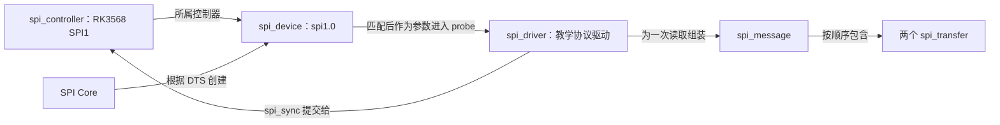

<div class="reader-b2" markdown="1">

# DTS 建链：spi_device 怎样进入 probe

> 所属章节：第五部 B. 总线协议 > B-B.4 SPI 总线 > B-B.4.3 SPI Linux 驱动框架
>
> 本组阅读：第 2 页，共 6 页

本页只回答一个问题：**spi_device 从哪里来，为什么 probe 不负责创建它？**

---

## <span class="blue"> 从控制器节点到外设 probe

### SoC 先描述控制器，板级文件再描述接线结果

RK3568 的 SoC 级 DTSI 已经给出 SPI1 的硬件事实。<br>
DTSI 是被板级 DTS 包含的设备树源文件，用来复用同一颗 SoC 的公共描述；板级 DTS 再记录某块板实际启用了哪些控制器和接入了哪些器件。

[`rk356x.dtsi`](code/B-B.4.3/kernel-v6.6/arch/arm64/boot/dts/rockchip/rk356x.dtsi){: data-code-viewer="true" data-code-title="rk356x.dtsi" data-code-path="Linux v6.6 · arch/arm64/boot/dts/rockchip/rk356x.dtsi" data-code-lines="1291-1303"} 中的关键片段是：

```dts
spi1: spi@fe620000 {
    // 驱动匹配：spi-rockchip.c 按 rockchip,rk3568-spi → rockchip,rk3066-spi 顺序尝试
    compatible = "rockchip,rk3568-spi", "rockchip,rk3066-spi";

    // 寄存器窗口：基址 0xfe620000，长度 0x1000，来自 SoC 地址映射，不是驱动分配的
    reg = <0x0 0xfe620000 0x0 0x1000>;

    // GIC 中断号 104，电平高触发；传输完成、FIFO 收发中断都走这一条
    interrupts = <GIC_SPI 104 IRQ_TYPE_LEVEL_HIGH>;

    // spiclk：控制器主时钟，SCK 由它分频得到；apb_pclk：APB 接口时钟，寄存器读写靠它
    clocks = <&cru CLK_SPI1>, <&cru PCLK_SPI1>;
    clock-names = "spiclk", "apb_pclk";

    // DMAC0 的 channel 22 发、23 收；声明了 dma-names 驱动就优先走 DMA，大数据量不吃 CPU
    dmas = <&dmac0 22>, &dmac0 23>;
    dma-names = "tx", "rx";

    // 引脚复用选 m0 方案：cs0/cs1 两个片选 + clk/miso/mosi 数据脚
    pinctrl-names = "default";
    pinctrl-0 = <&spi1m0_cs0 &spi1m0_cs1 &spi1m0_pins>;

    // 子节点按片选号寻址，不是内存地址，所以 size-cells = 0
    #address-cells = <1>;
    #size-cells = <0>;

    // SoC 文件只声明能力；启用是板级 dts 的决定，不替任何一块板默认开
    status = "disabled";
};
```

`spi@fe620000` 这个地址来自 SoC 地址映射，外设驱动不参与分配，它只负责认领。<br>
`status = "disabled"` 体现了分层原则：SoC 级文件只声明这颗芯片"有什么能力"，启不启用、接了什么器件，留给板级 DTS 描述。

Rockchip 驱动进入 `rockchip_spi_probe()` 后，用 `spi_alloc_host()` 创建 `spi_controller`，设置模式能力、速度范围、`setup`、`set_cs` 和 `transfer_one` 等回调，最后调用 `devm_spi_register_controller()`。<br>`devm` 表示资源挂在设备模型上，控制器解绑时按设备资源路径自动释放，不要求协议驱动介入。

> `spi_controller`：一个 SPI 主机控制器在内核中的对象。<br>
> 它保存总线编号、片选数量、支持的模式与字长、速度范围和硬件操作回调；本例由 Rockchip 控制器驱动在 probe 中创建。

控制器注册成功并不等于 Flash 已经可以访问。Core 还要遍历控制器节点下的可用子节点，把板级接线描述变成外设对象。

### 教学 DTS 只改变匹配对象，不改变器件协议

为了观察 `spi_driver` 的匹配和传输过程，本篇使用一个只发起 Fast Read 的教学驱动。<br>
配套文件 [`spi-frame-observer.dts`](code/B-B.4.3/spi-frame-observer.dts){: data-code-viewer="true" data-code-title="spi-frame-observer.dts" data-code-path="本篇教学配套 · code/B-B.4.3/spi-frame-observer.dts"} 完整内容如下：

```dts
// 板级 DTS 片段；不是可独立编译的完整 DTS，也不是带 /plugin/ 的 overlay。
&spi1 {
    // `&spi1` 引用 SoC 文件中已有的节点，板级片段将状态改为 `okay`。
    status = "okay";

    spi_frame_observer: spi-frame-observer@0 {
        compatible = "kimi,spi-frame-observer";
        reg = <0>; // `reg = <0>` 选择 CS0，不是 I2C 那样的总线地址。
        spi-max-frequency = <1000000>; // 该板级外设允许使用的上限，1 MHz 只是受控教学配置，
    };
};
```

节点不写 `spi-cpol`、`spi-cpha`、`spi-lsb-first` 和 `spi-cs-high`，对应 Mode 0、MSB-first、低有效 CS 的默认设置。

pinctrl 沿用 [`rk356x.dtsi`](code/B-B.4.3/kernel-v6.6/arch/arm64/boot/dts/rockchip/rk356x.dtsi){: data-code-viewer="true" data-code-title="rk356x.dtsi" data-code-path="Linux v6.6 · arch/arm64/boot/dts/rockchip/rk356x.dtsi" data-code-lines="1291-1303"} 的 SPI1 m0 组合。<br>
实际板卡必须确认原理图确实接到这组引脚；若板级设计使用其他复用组，应修改板级 pinctrl，而不是保留这里的默认假设。

```c
// drivers/spi/spi.c · of_register_spi_devices()（v6.6 节选，错误日志从略）
static void of_register_spi_devices(struct spi_controller *ctlr)
{
    struct spi_device *spi;
    struct device_node *nc;

    if (!ctlr->dev.of_node)
        return;

    // 只扫"可用"子节点：status 为 disabled 的不会进来
    for_each_available_child_of_node(ctlr->dev.of_node, nc) {
        // 动作 1：分配 spi_device，初始挂到 ctlr 下
        spi = spi_alloc_device(ctlr);
        if (!spi)
            continue;

        // 动作 2：解析 DT 属性；失败说明节点本身不合法（比如缺 reg）
        rc = of_spi_parse_dt(ctlr, spi, nc);
        if (rc) {
            spi_dev_put(spi);
            continue;
        }

        // 动作 3：注册设备；spi_add_device() 内部会走 spi_setup()
        rc = spi_add_device(spi);
        if (rc < 0)
            spi_dev_put(spi);
    }
}
```
Core 在 `spi_register_controller()` 中调用 `of_register_spi_devices()`。<br>
后者遍历可用子节点，对每个节点执行三个关键动作：

1. `spi_alloc_device()` 分配 `spi_device`。
2. `of_spi_parse_dt()` 读取布尔模式属性、`reg` 和 `spi-max-frequency`，分别写入模式、片选和速度字段。
3. `spi_add_device()` 注册设备。注册阶段的初始设置会经过 `spi_setup()`；未显式设置的字长默认为 8 位，速度还会受控制器上限约束。

因此，外设协议驱动通常不需要在每次 probe 中机械调用一次 `spi_setup()`。只有驱动要修改字长、模式或速度等设备设置时，才需要理解并再次应用相应配置；不能把“存在这个 API”误读成“所有驱动必须重复调用”。

### compatible 把设备对象和协议驱动接起来

`spi_device` 表示“这里有一颗设备”，`spi_driver` 表示“我知道怎样使用这类设备”。二者由 SPI 总线的匹配逻辑连接，而不是由 probe 自己解析 DTS 再创建一个设备。

> `spi_driver`：外设协议驱动对象，保存 `of_match_table`、`probe` 和 `remove` 等回调。教学模块加载时注册它，卸载时注销；它的生命周期不等于某颗 Flash 的生命周期。

v6.6 的 `spi_match_device()` 先尝试设备树匹配。若节点的 `compatible = "kimi,spi-frame-observer"` 与驱动 `of_match_table` 中的一项相符，`spi_probe()` 调用教学驱动的 `probe(spi)`，参数就是已经建好的 `spi_device`。probe 返回负错误码表示绑定失败；返回 0 才表示驱动接受该设备。卸载模块或解绑设备时，Core 调用 `remove()`，本例的 remove 只记录解绑，不额外释放 probe 中已经成功释放的传输缓冲区。

到这里，前三个对象已有明确关系：控制器驱动创建并持有控制器能力，Core 根据 DTS 创建外设对象，设备模型把外设对象交给匹配的协议驱动。剩下两个对象只在一次具体读取期间存在。



读这张图时先沿 `SPI Core → spi_device → spi_driver` 核对 probe 参数的来源，再沿 `spi_driver → spi_message → spi_controller` 看一次传输交给谁执行。删除图后，上文的创建与匹配顺序仍独立给出同一结论。

---

[在新窗口打开 SPI Framework Lab](./html/spi-framework-lab.html#mechanism){: target="_blank" rel="noopener noreferrer" }。在实验室中逐步观察控制器注册、DTS 建链与 probe 参数的来源。

## <span class="blue"> 本页自查

??? details "Q2. `spi1.0` 这个设备对象是怎样出现的，probe 是否负责创建它？"

    Rockchip 注册控制器后，Core 遍历 SPI1 的可用子节点，分配 `spi_device`，解析 `reg`、速度和模式属性，再注册设备。compatible 匹配成功后，Core 才调用协议驱动的 probe，并把已经创建的 `spi_device` 作为参数传入。probe 不负责创建这个设备对象。

---

[上一页：导读与责任地图](B-B.4.3_SPI Linux驱动框架.md) · [下一页：手工双段 message](B-B.4.3_SPI Linux驱动框架_message.md)

</div>
