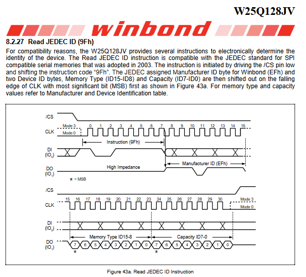

<div class="reader-b2" markdown="1">

# B-B.4.4 SPI 调试与选型

> 所属章节：第五部 B. 总线协议 > B-B.4 SPI 总线
>
> 难度：[B→I] Beginner → Intermediate

## <span class="blue"> 本节导读

SPI 读不到或读错数据时，实际调试不是把回环、短接、逻辑分析仪和示波器依次做一遍，而是根据**当前输出**选择下一项最能缩小范围的检查。

本页先用一笔已知答案的 JEDEC ID 读取建立主线：确认硬件对象和软件入口，发送命令，再按结果选择分支。随后把回环、短接、数字帧、模拟波形和降速完整保留为按需工具，需要时再展开阅读。

> JEDEC ID：器件按 JEDEC 标准返回的身份标识。它提供已知答案，避免用内容未知的数据区判断通信是否正确。

<!-- -->

> spidev：把 SPI 设备暴露为 `/dev/spidevB.C` 字符设备的内核驱动。B 是总线号，C 是片选号；用户态程序通过它直接发起 SPI 传输。

本例使用 W25Q128JV-IQ/JQ 的 Read JEDEC ID 命令：

```text
TX：9F 00 00 00
RX：?? EF 40 18
拍数：8 拍命令 + 24 拍响应 = 32 拍
```

`0x9F` 是命令，后三个 `00` 用于继续提供时钟。`RX[0]` 不参与身份判断，有效判据是 `RX[1]～RX[3] = EF 40 18`；其他器件后缀可能有不同 Device ID。

<div class="interactive-demo">
  <iframe
    src="../html/JEDEC_ID_read_code.html"
    title="JEDEC ID 读取事务"
    loading="lazy"
    style="width:100%;height:430px;border:0;"
  ></iframe>
</div>



[点击查看 W25Q128JV 数据手册](images/W25Q128JV_RevF.pdf)

## <span class="blue"> 先走一遍最小检查

### 先确认硬件对象和测试路径

先拿到板卡型号、原理图或连接器定义，确认：Flash 是否实际连接、供电和共地是否建立、总线与 CS 是否对应、当前节点是否被 spi-nor 或其他业务驱动使用。

正式 Linux 产品通常由 spi-nor 识别 Flash 并接入 MTD；`spidev_test` 是调试时的直接访问手段，不是产品验证的固定前置流程。

> 🔴 不要在启动盘、根文件系统或业务正在使用的 Flash 上随意换绑驱动。外部短接前必须断电，并隔离可能同时驱动 MISO 的 Flash。

再看驱动日志和设备节点：

```bash
dmesg | grep -i spi
ls -l /dev/spidev*
```

在一份 RK3576J 实测记录中，输出包括：

```text
rockchip-spi 2ad20000.spi: probed, ...
crw------- 1 root root 153, 0 ... /dev/spidev3.0
```

这说明控制器驱动执行了 probe，系统里出现了字符设备。**它还不能证明引脚上有波形，更不能证明 Flash 会回答。**如果没有 `/dev/spidev*`，下一步检查 DTS、控制器注册和绑定，机制见 B-B.4.3。

### 工具不存在时，先解决工具问题

```text
-bash: spidev_test: command not found
```

此时还没有开始验证 Flash。从与目标内核和头文件匹配的源码树取得 [`tools/spi/spidev_test.c`](https://github.com/torvalds/linux/blob/v6.6/tools/spi/spidev_test.c) 后编译：

```bash
gcc -Wall -O2 -o spidev_test spidev_test.c
```

编译失败时，应处理源码版本、头文件或工具链问题，不要直接跳到 Flash 排查。

### 发一笔已知命令

以 RK3568 SPI1 CS0 的教学节点为例：

```bash
spidev_test -D /dev/spidev1.0 -s 1000000 -p '\x9f\x00\x00\x00' -v
```

`-D` 选择设备，`-s 1000000` 设置 1 MHz 请求上限，`-p` 给出四个发送字节，`-v` 打印收发缓冲区。工具来自 Linux 源码的 [`tools/spi/spidev_test.c`](https://github.com/torvalds/linux/blob/v6.6/tools/spi/spidev_test.c)。

正常时至少应同时满足：工具调用正常返回，且 `RX[1]～RX[3]` 与器件手册给出的 ID 一致。`exit=0` 或出现 `spi mode`、`bits per word` 等打印，不等于器件身份正确；`max speed` 是软件读回的请求上限，不是实测 SCLK。

<iframe src="../html/spi-4-4-debug-path.html" title="SPI 调试输出与下一步检查" style="width:100%;height:680px;border:0;" loading="lazy"></iframe>

| 当前结果 | 下一步检查 | 现在不能下的结论 |
|---|---|---|
| 没有 `/dev/spidev*` | DTS、控制器注册、驱动绑定 | Flash 没上电 |
| `open()` 或配置失败 | 原始错误、权限、节点和绑定 | SPI 模式或接线错误 |
| RX 全 `00`／`FF` | 实际连接、CS、pinmux、完整数字帧 | 必然是 Flash 损坏或某根线固定电平 |
| 线上 ID 正确而用户 RX 错 | 接收长度、`RX[0]` 前导和缓冲区偏移 | 控制器没有收到数据 |
| 工具返回正常且 ID 匹配 | 当前事务已建立基线，再做后续验证 | 其他速率、长期稳定和所有产品访问都正常 |

## <span class="blue"> 按需展开调试手段

??? details "内部回环：需要隔离控制器与用户传输路径时"

    `-l` 设置 `SPI_LOOP`，`-S 4` 生成四字节测试数据，`-I 1` 只执行一次。RK3568 的 v6.6 控制器驱动在 [`spi-rockchip.c:856`](code/B-B.4.3/kernel-v6.6/drivers/spi/spi-rockchip.c){: data-code-viewer="true" data-code-title="spi-rockchip.c" data-code-path="Linux v6.6 · drivers/spi/spi-rockchip.c" data-code-lines="856"} 声明支持 `SPI_LOOP`；工具的随机缓冲区路径会逐字节比较 TX/RX，不一致时打印 `transfer error !` 并以 1 退出。

    ```bash
    spidev_test -D /dev/spidev1.0 -s 1000000 -l -S 4 -I 1
    printf 'exit=%d\n' "$?"
    ```

    若控制器接受回环模式且比较一致，预期关键输出为：

    ```text
    spi mode: 0x20
    bits per word: 8
    max speed: 1000000 Hz (1000 kHz)
    total: tx 0.0KB, rx 0.0KB
    exit=0
    ```

    `0x20` 是 `SPI_LOOP` 模式位，`0.0KB` 是四字节除以 1024 后保留一位小数，不表示没有传输。测试数据由 `random()` 生成，本条命令没有 `-v`，不打印其内容。

    **成功只支持当前控制器回环配置和传输路径可工作，不证明外部引脚、焊接、CS 或 Flash 正常。**若回环成功而正常 ID 仍错，转向完整数字帧；若模式不支持或比较失败，先保留错误并检查控制器配置。

??? details "外部短接：需要把证据扩展到某段外部线路时"

    内部回环正常而外部路径仍有疑问时，可用一个不依赖 Flash 应答的已知收发关系检查线路。短接位置决定证据范围。

    断电后，在指定测试点短接 MOSI 与 MISO，并隔离可能同时驱动 MISO 的 Flash。若保持 Flash 的 DO 与主机 MOSI 对接，两个推挽输出可能争用，不能把这种做法当作无风险测试。恢复供电后沿用正常命令但不加 `-l`：

    ```bash
    spidev_test -D /dev/spidev1.0 -s 1000000 -p '\x9f\x00\x00\x00' -v
    ```

    预期关键行是：

    ```text
    TX | 9F 00 00 00 ...
    RX | 9F 00 00 00 ...
    ```

    普通 `-p` 路径不会自动比较，必须逐字节核对。**相等只说明短接点以内、当前配置下的收发路径一致**，不能证明 Flash 会回答，也不能证明短接点之外、另一速率或其他 CS 正常。

    **没有确认短接位置、没有实际接好线，就不能把 RX 不等于 TX 解释为控制器或板级走线故障。**结束后断电移除短接，再复测正常 ID。

??? details "完整数字帧：需要比较线上事务与用户结果时"

    逻辑分析仪把 CS、SCLK、MOSI、MISO 放在同一时间轴上，适合区分软件偏移、片选边界、时钟数和器件应答。

    从 CS 有效开始捕获完整事务，按 Mode 0 的空闲低、上升沿采样和 MSB-first 解码。核对 CS 是否连续覆盖 32 拍，MOSI 是否为 `9F 00 00 00`，MISO 有效响应位置是否为 `EF 40 18`。采样率、触发和存储深度按仪器带宽与完整捕获需求设置，不反复切换参数直到结果“看起来合理”。

    结果按下面的分支处理：

    - MOSI 没有 `9F 00 00 00`：回查用户缓冲区、SPI Core、控制器和 pinctrl；
    - MOSI 正确但 CS 未覆盖 32 拍：检查 CS 配置、映射和事务边界；
    - CS、SCLK、MOSI 正确而 MISO 不动：检查器件供电、上电就绪、复位、DO 驱动权和输入门限，必要时转模拟波形；
    - 线上已有 `EF 40 18` 而用户缓冲区不同：回查软件接收长度、前导保留约定和偏移。本例只有 8 拍命令与 24 拍响应，不能套用其他命令的 dummy 位置；
    - 数据呈 `F7 02 18`：它恰好是 `EF 40 18` 的逐字节位序反转，只形成位序假设。用已知发送数据的内部回环或隔离后的外部短接验证，再核对器件手册。

    数字解码正确只说明分析仪在自己的门限和采样条件下识别出了预期位流，**不证明接收端具有充分模拟裕量，也不证明数据已正确交付用户态**。

    Rockchip 平台还可按需核对当前 pinmux 和时钟：

    ```bash
    cat /sys/kernel/debug/pinctrl/pinctrl-rockchip-pinctrl/pinmux-pins | grep -i spi
    grep -i spi /sys/kernel/debug/clk/clk_summary
    ```

    pinmux 已认领、时钟已使能只能说明相应软件配置已经生效，仍不能代替引脚测量。

??? details "模拟波形与降速：需要检查频率相关的时间窗口时"

    当故障随频率变化，或需要区分输出有效延迟、传播、输入建立时间、过冲和振铃时，仅靠解码结果无法定案。

    在接收端附近用示波器同时观察 CS、SCLK 和相关数据线，按主从手册检查输入高低门限、过冲与下冲限制、边沿形态，以及输出有效到采样之间的窗口。`0.9 VCC` 或 `0.5 VCC` 在某些手册图中只是测量参考电平，不能直接当作所有器件的输入合格门限。

    B-B.4.2 已给出 MISO 的时间预算：

    ```text
    启动边沿到采样边沿的间隔
    ≥ tCLQV(max) + 走线传播 + 主机建立时间 + 设计余量
    ```

    波形可以支持或否定探针处的门限、边沿和采样窗口假设，但不能证明命令、位序、帧边界和器件应答内容正确。多从机场景还要检查未选中的器件是否释放 MISO。

    降速时一次只改请求速率，其他条件保持不变：

    ```bash
    spidev_test -D /dev/spidev1.0 -s 100000 -p '\x9f\x00\x00\x00' -v
    printf 'exit=%d\n' "$?"
    ```

    若高速异常而低速恢复，只能说明故障与频率或可用时间窗口相关。候选机制包括超过器件或控制器限制、Flash 输出有效延迟、走线传播、主机输入建立时间不足、边沿过慢、过冲和振铃，不能凭“低速能读”宣布走线或端接就是根因。

    当前 RK3568 v6.6 驱动在 [`spi-rockchip.c:602-607`](code/B-B.4.3/kernel-v6.6/drivers/spi/spi-rockchip.c){: data-code-viewer="true" data-code-title="spi-rockchip.c" data-code-path="Linux v6.6 · drivers/spi/spi-rockchip.c" data-code-lines="602-607"} 选择不小于理想值的偶数分频，使结果不超过请求速率。这个控制器事实不能推广为所有 SoC，也不能代替引脚实测。

## <span class="blue"> 撤销临时状态，用同一笔读取完成恢复

无论走了哪条分支，收尾都不是“某项隔离测试通过”，而是恢复正常事务：

1. 若做过外部短接，断电、移除短接并恢复 Flash 连接；
2. 回环命令不加 `-l`，恢复 Mode 0、8 位、MSB-first、低有效 CS 和原 CS 映射；若做过降速，把请求速率恢复为 1 MHz；
3. 重新执行正常命令，同时核对工具成功返回和 `RX[1]～RX[3] = EF 40 18`；
4. 若正常 ID 没有恢复，回到最后一个已确认正常的边界，不叠加新的改动。

偶发故障需要有限次数、明确判据的记录：每次检查 ioctl 结果、有效 ID 和实际测试条件，再统计失败数。普通 `spidev_test -p` 不会自动比较数据，单纯用 `while true` 循环它并不能得到错误率。

正式产品随后仍应回到 spi-nor 与 MTD 路径，具体接入、擦写和烧录归 B-B.4.5；速率和接口的软件配置由下一页讨论。

**速查表**

| 当前证据 | 可以支持的判断 | 下一项检查 |
|---|---|---|
| `open()` 或 ioctl 失败 | 节点、权限、配置或传输调用有问题 | 保留原始错误，回查对应软件层 |
| 内部回环一致 | 当前控制器回环与传输路径可工作 | 正常 ID 仍错时抓完整数字帧 |
| 外部短接 TX=RX | 短接点以内的当前收发路径一致 | 检查 Flash 应答或短接点之外路径 |
| 线上 ID 正确、用户 RX 错 | 软件接收与交付路径有问题 | 核对长度、前导和缓冲区偏移 |
| 数字帧完整正确 | 探针处的数字位流符合预期 | 有频率相关性时检查模拟窗口 |
| 恢复连接与参数后 ID 正确 | 本次端到端事务恢复基线 | 保持条件复测，不扩大结论 |

---

[下一页：速率与接口选择](B-B.4.4_SPI调试与选型_selection.md)

</div>
