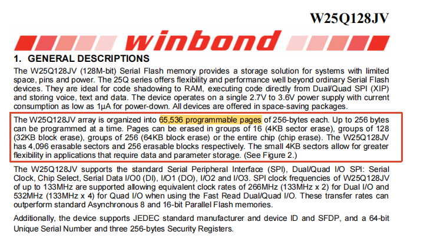
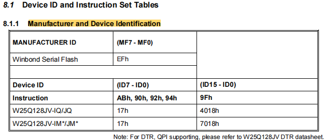
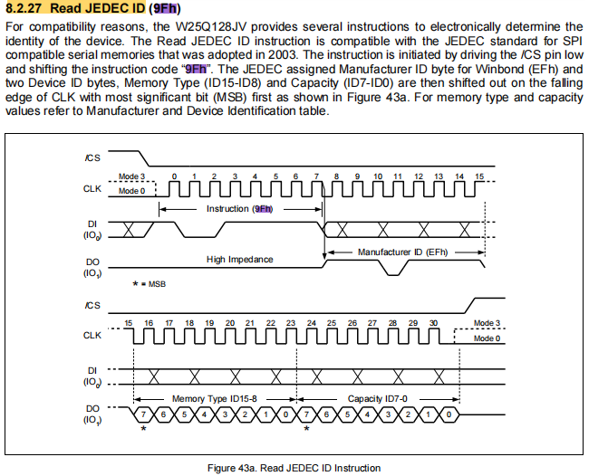
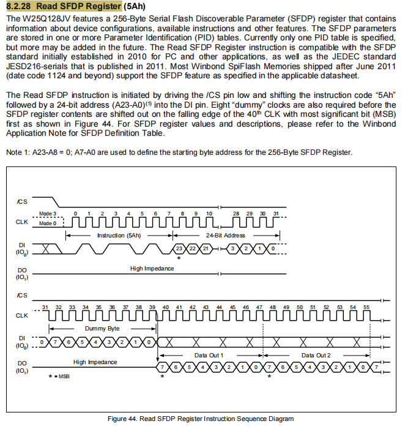
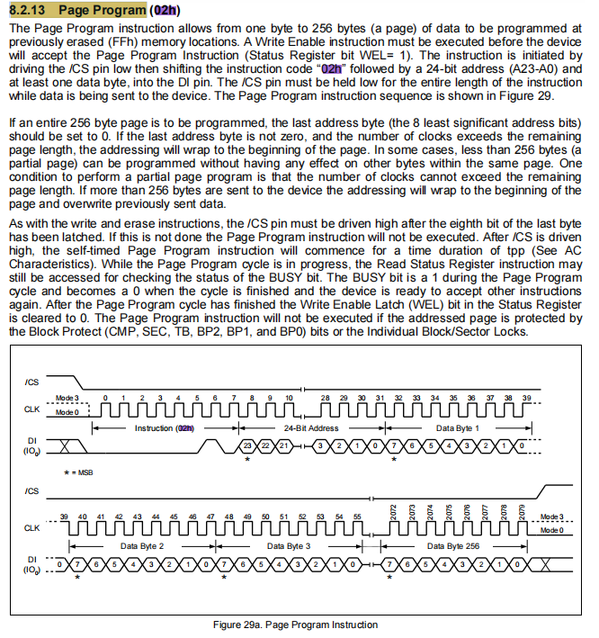
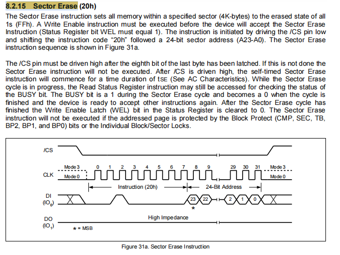
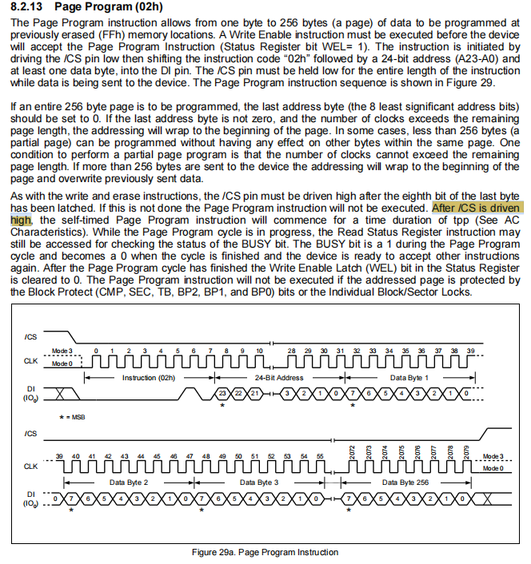
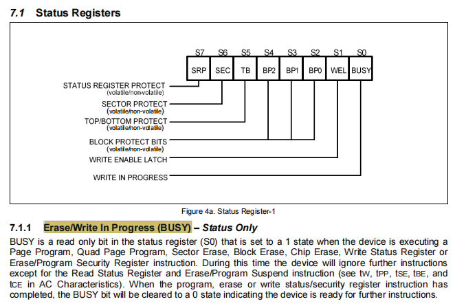
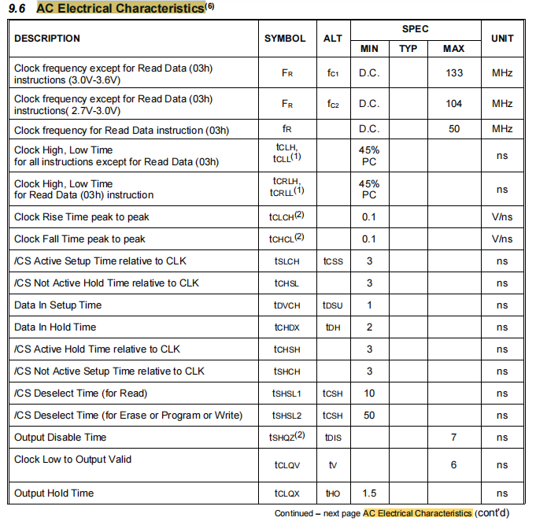

<div class="reader-b2" markdown="1">

# 准备与识别：怎样确认实验对象与可写边界

> 所属章节：第五部 B. 总线协议 > B-B.4 SPI 总线 > B-B.4.5 实战 W25Qxx SPI NOR Flash 端到端
>
> 本组阅读：第 2 页，共 5 页

本页只回答一个问题：**怎样把实验限制在预期的 `scratch`，并在任何写入前确认器件、接线和分区都正确？**

---

## <span class="blue"> 手册里的哪些参数会改变本次操作

这里按实际操作顺序读手册。每一项先回答“为什么需要它”，再给出 [W25Q128JV Rev F](images/W25Q128JV_RevF.pdf)中的取证位置。

### 先确认容量和擦除粒度：分区终点与测试文件大小都从这里来

**为什么需要：**DTS 要写明每个分区从哪里开始、占多大空间，就必须先知道整片容量。后面的 `flashcp` 会按擦除块向上取整，所以还要知道最小擦除粒度；否则无法解释为什么本例选择 4 KiB 测试文件，也无法判断一次操作会影响多大范围。

**PDF 位置：**§1 General Descriptions，印刷第 3 页。查找英文 `65,536 programmable pages`，同一段还给出 `4,096 erasable sectors` 和 `256 erasable blocks`。由此可确认：整片为 16 MiB，页为 256 字节，4 KiB 扇区有 4096 个，64 KiB 块有 256 个。


<!-- 【待补图】images/B-B.4.5-manual-p03-organization.png（优先级：★必要）
图名：W25Q128JV 的容量、页、扇区与块
截图要求：Rev F 印刷第 3 页，§1 General Descriptions。截取以“The W25Q128JV array is organized into...”开始的完整段落，保留“65,536 programmable pages of 256-bytes”“4,096 erasable sectors”“256 erasable blocks”三处文字，不截入无关页眉。
图注：整片 16 MiB 按 256 字节页、4 KiB 扇区和 64 KiB 块组织。 -->

### 再确认器件身份：DTS 的通用匹配不能代替具体 ID

**为什么需要：**DTS 中的 `jedec,spi-nor` 只告诉内核“这里是一颗 SPI NOR”，并没有说明具体型号。spi-nor 还要读取 JEDEC ID，才能在内核器件表中找到对应项。IQ/JQ 与 IM/JM 的 ID 不同，如果只记住一个 `EF 40 18`，换后缀后就会得到错误预期。

**PDF 位置：**§8.1.1 Manufacturer and Device Identification，印刷第 21 页。表中 `W25Q128JV-IQ/JQ` 在 `9Fh` 指令下为 `4018h`，IM/JM 为 `7018h`；厂商码为 `EFh`，所以本例完整 ID 是 `EF 40 18`。


<!-- 【待补图】images/B-B.4.5-manual-p21-identification.png（优先级：★必要）
图名：不同后缀的 Manufacturer and Device Identification
截图要求：Rev F 印刷第 21 页，§8.1.1。完整截取 Manufacturer ID、Device ID、Instruction 和两行 W25Q128JV 后缀，确保 IQ/JQ 的 4018h 与 IM/JM 的 7018h 都能看清，同时保留厂商码 EFh。
图注：IQ/JQ 与 IM/JM 在 9Fh 指令下的 Device ID 不同。 -->

若要继续核对 `9Fh` 命令怎样返回这三个字节，再看 §8.2.27 Read JEDEC ID，印刷第 50 页。这里回答“命令和响应怎样传输”，第 21 页回答“本例预期值是什么”，两张图不能互相替代。


<!-- 【待补图】images/B-B.4.5-manual-p50-read-jedec-id.png（优先级：△可选）
图名：Read JEDEC ID（9Fh）指令
截图要求：Rev F 印刷第 50 页，§8.2.27。截取指令说明和完整时序图，保留 9Fh、Manufacturer ID、Device ID 的先后关系。
图注：9Fh 命令之后，器件依次返回厂商和器件识别字节。 -->

### 识别型号后还要取得工作参数：SFDP 提供器件自描述信息

**为什么需要：**知道器件名称还不等于知道它怎样擦写。驱动还需要容量、擦除类型和编程能力等参数。v6.6 的 `w25q128` 项要求解析 SFDP（Serial Flash Discoverable Parameters，串行 Flash 可发现参数），因此还要确认这颗器件确实提供这张自描述表。

**PDF 位置：**§8.2.28 Read SFDP Register，印刷第 51 页。开头明确写出器件具有 256 字节 SFDP 寄存器，其中包含设备配置、可用指令和其他特性。这里证明 SFDP 的存在和读取方式；具体字段释义需继续查手册指向的 SFDP Definition Table，不能假装这一页已经列出全部字段。


<!-- 【待补图】images/B-B.4.5-manual-p51-sfdp.png（优先级：★必要）
图名：SFDP 寄存器及其读取指令
截图要求：Rev F 印刷第 51 页，§8.2.28。截取以“The W25Q128JV features a 256-Byte...”开始的说明段，保留 device configurations、available instructions 和 5Ah；需要展示传输格式时连同 Figure 44 一起截取。
图注：SFDP 是器件提供的自描述参数区，驱动用 5Ah 指令读取。 -->

### 写入前先确认页边界：一条 Page Program 不能任意跨页

**为什么需要：**本例会写入 4 KiB，而器件一条 Page Program 最多发送 256 字节。若起始地址不在页首，还要先算当前页剩余空间；否则超过页尾的数据会回卷到当前页首，覆盖本次已经发送的数据。理解这一点，才能说明 spi-nor 为什么替调用者拆成多段，而不是把 4 KiB 原样塞给器件。

**PDF 位置：**§8.2.13 Page Program，印刷第 36 页。第一段给出 1～256 字节和已擦除位置前提，随后说明超过当前页剩余长度会 `wrap to the beginning of the page`，并可能 `overwrite previously sent data`。


<!-- 【待补图】images/B-B.4.5-manual-p36-page-program.png（优先级：★必要）
图名：Page Program 的长度、已擦除前提与跨页回卷
截图要求：Rev F 印刷第 36 页，§8.2.13。截取开头至 overwrite previously sent data 的完整说明，保留 1 to 256 bytes、previously erased (FFh)、wrap to the beginning of the page 和 overwrite previously sent data。
图注：页编程长度受当前页边界约束，越界会回卷覆盖。 -->

<!-- 同一回卷规则也出现在 §8.1.2 表 1 注释 3，印刷第 22 页。若只选一张主图，第 36 页信息更完整；第 22 页适合作为指令表脚注的对照截图。 -->

<!-- 【待补图】images/B-B.4.5-manual-p22-instruction-note3.png（优先级：△可选）
图名：指令表注释 3 的页回卷规则
截图要求：Rev F 印刷第 22 页，§8.1.2 表 1 注释 3。完整截取注释编号和正文，保留 wrap to the beginning of the page 与 overwrite previously sent data。
图注：指令表脚注再次明确，超页发送会回卷并覆盖。 -->

### 任意覆盖前先擦除：擦除把目标扇区恢复为全 FFh

**为什么需要：**正常烧写要用新文件完整替换旧内容，不能保留旧数据中已经为 0 的位。擦除的作用就是把目标扇区恢复为全 1，后续编程才能在这个已知起点上写入任意新值。手册把“目标位置已擦除为 `FFh`”作为标准 Page Program 前提，因此正常路径不能省略擦除。

**PDF 位置：**§8.2.15 Sector Erase，印刷第 38 页。开头写明该指令把指定 4 KiB 扇区设置为 `all 1s (FFh)`。


<!-- 【待补图】images/B-B.4.5-manual-p38-sector-erase.png（优先级：★必要）
图名：Sector Erase 将扇区恢复为全 FFh
截图要求：Rev F 印刷第 38 页，§8.2.15。截取开头说明，完整保留 specified sector (4K-bytes)、erased state of all 1s (FFh) 和 Write Enable 前提。
图注：4 KiB 扇区擦除后，所有位恢复为 1。 -->

**擦除后全为 1 是手册直接陈述；“NOR 编程只能把位从 1 改为 0”是对编程位特性的概括，不是 Rev F 原句。**后文 `AA→55` 是已知原内容、每条 Page Program 不跨页的受控观察：已经为 0 的位不会因新输入为 1 而恢复，所以可按位推得 `AA & 55 = 00`。它用于解释位级结果，不能扩大成“任意产品数据都可以不擦除直接覆盖”。

### 发送命令后还要等待：CS 拉高不代表内部擦写完成

**为什么需要：**spi-nor 在写完一段后，不能立刻发下一段。`/CS` 拉高只结束串行命令并启动器件内部的自定时编程，内部操作期间 BUSY 为 1；只有 BUSY 清零，器件才恢复接受后续指令的状态。这就是框架必须调用等待函数的原因。

**PDF 位置一：**§8.2.13，印刷第 36 页。查找 `After /CS is driven high`，后文给出自定时 Page Program、BUSY 为 1 以及完成后清零的过程。


<!-- 【待补图】images/B-B.4.5-manual-p36-busy-timing.png（优先级：★必要）
图名：CS 拉高后的自定时编程与 BUSY 变化
截图要求：Rev F 印刷第 36 页，§8.2.13。截取以“As with the write and erase instructions...”开始的段落，保留 After /CS is driven high、self-timed Page Program、BUSY bit is a 1 和 becomes a 0。
图注：串行命令结束后，内部编程继续执行，BUSY 清零才表示完成。 -->

**PDF 位置二：**§7.1.1 Erase/Write In Progress (BUSY)，印刷第 13 页。这里从状态寄存器角度定义 BUSY，并说明忙期间器件会忽略哪些后续指令。第 36 页讲一笔页编程的时间顺序，第 13 页讲状态位的通用含义。


<!-- 【待补图】images/B-B.4.5-manual-p13-busy-bit.png（优先级：★必要）
图名：BUSY 状态位的通用定义
截图要求：Rev F 印刷第 13 页，§7.1.1。完整截取 BUSY 定义段，保留 read only bit、set to a 1、ignore further instructions 和 cleared to a 0 state。
图注：BUSY 是器件内部擦写状态的只读标志。 -->

### 最后看速率上限：它不能直接决定 DTS 中的请求速率

**为什么需要：**`spi-max-frequency` 需要同时受控制器、器件和板级条件约束。手册时钟表只给出器件在指定供电和指令条件下的上限，不能证明当前 RK3568、接线和 PCB 也能在该速率下可靠工作。本例固定 1 MHz 是受控教学配置，不是从器件上限反推出来的“最佳值”。

**PDF 位置：**§9.6 AC Electrical Characteristics，印刷第 64 页。Read Data `03h` 对应 50 MHz；其他指令在 3.0～3.6 V 和 2.7～3.0 V 档位分别列出 133 MHz、104 MHz。


<!-- 【待补图】images/B-B.4.5-manual-p63-clock-frequency.png（优先级：★必要）
图名：不同指令与供电条件下的时钟上限
截图要求：Rev F 印刷第 63 页，§9.6 时钟表。完整截取 Clock frequency except for Read Data (03h) 的两个供电行，以及 Clock frequency for Read Data instruction (03h) 的 50 MHz 行，保留条件和单位。
图注：50、104、133 MHz 分属不同条件，均不是当前板卡的实测工作频率。 -->

## <span class="blue"> 先定义可写区域，再完成接线与 DTS

### 为什么实验需要单独划出 scratch

后面的操作会先把测试数据写入 Flash，再故意不擦除进行第二次写入，最后恢复原内容。如果直接拿 kernel 或 rootfs 做这些操作，一旦写错地址或恢复失败，系统可能无法启动。因此，实验前需要先找一块**不存放启动数据、能够完整备份、允许反复擦写**的区域。

这套教学 DTS 把 uboot、kernel、rootfs 依次安排为 1 MiB、8 MiB、6 MiB，合计 15 MiB。整片 Flash 是 16 MiB，剩下最后 1 MiB 没有分配给启动系统：起点是 `0xF00000`（15 MiB），终点是 `0xFFFFFF`（16 MiB 的最后一个字节）。实验就使用这段地址，并在分区表中写 `label = "scratch"` 作为它的名字。

所以，`scratch` 不是芯片里现成的区域，也不是 DTS 或 Linux 的保留字，而是**作者为这套教学分区自行起的标签**。这套 DTS 也是为演示分区、备份和恢复而编写的教学片段，不来自某个 RK3568 板卡的默认配置。后文把该分区写作 `/dev/mtd3`，只是这套布局下的预期结果；换到真实板卡后，必须先查 `/proc/mtd`，不能照抄编号。

### 接线先看清四根信号的方向

先不涉及 DTS，只回答“主机和 Flash 怎样连上”。SOIC-8 表示芯片有 8 个物理引脚，图中括号里的数字就是引脚号。`/CS` 也可写作 `CS#`，斜杠或 `#` 都表示**低电平有效**。

四根 SPI 信号以 RK3568 主机为参照：CS 用来选中 Flash，MOSI 是主机输出、Flash 输入，MISO 是主机输入、Flash 输出，SCLK 是主机提供给 Flash 的时钟。除数据传输线外，`/WP`（Write Protect，写保护）和 `/HOLD`（暂停当前通信）也不能悬空；本例用电阻把它们默认保持在高电平，这种连接叫上拉。

读图时先看中间四个箭头的方向，再看右侧两个 10 kΩ 上拉电阻，最后看底部的共同 GND。它是依据手册绘制的教学接线示意，不是当前板卡的实测原理图；窄屏可在图内横向滚动。

<div style="overflow-x:auto">
<svg viewBox="0 0 900 450" xmlns="http://www.w3.org/2000/svg" style="max-width:800px;width:100%;min-width:700px;height:auto" font-family="sans-serif" font-size="13" stroke="currentColor" fill="none" stroke-width="1.5">
<title>RK3568 SPI1 与 W25Q128JV 的信号方向、上拉电阻和共同地</title>
<defs><marker id="wire-arrow" markerWidth="8" markerHeight="8" refX="7" refY="4" orient="auto" markerUnits="userSpaceOnUse"><path d="M0 0L8 4L0 8Z" fill="currentColor" stroke="none"/></marker></defs>
<text x="450" y="22" text-anchor="middle" fill="currentColor" stroke="none">教学接线示意：箭头表示数据或控制信号方向</text>
<rect x="55" y="55" width="215" height="245" stroke-width="2"/>
<text x="162" y="80" text-anchor="middle" fill="currentColor" stroke="none" font-size="15">RK3568 SPI1（主机）</text>
<rect x="600" y="55" width="200" height="245" stroke-width="2"/>
<text x="700" y="80" text-anchor="middle" fill="currentColor" stroke="none" font-size="15">W25Q128JV（SOIC-8）</text>
<path d="M270 105H595" stroke-width="2" marker-end="url(#wire-arrow)"/>
<text x="260" y="110" text-anchor="end" fill="currentColor" stroke="none">CS0</text>
<text x="610" y="110" fill="currentColor" stroke="none">CS#（引脚 1）</text>
<text x="435" y="94" text-anchor="middle" fill="currentColor" stroke="none" font-size="11">主机选中 Flash</text>
<path d="M270 150H595" stroke-width="2" marker-end="url(#wire-arrow)"/>
<text x="260" y="155" text-anchor="end" fill="currentColor" stroke="none">MOSI</text>
<text x="610" y="155" fill="currentColor" stroke="none">DI（引脚 5）</text>
<text x="435" y="139" text-anchor="middle" fill="currentColor" stroke="none" font-size="11">主机发送 → Flash 接收</text>
<path d="M600 195H275" stroke-width="2" marker-end="url(#wire-arrow)"/>
<text x="260" y="200" text-anchor="end" fill="currentColor" stroke="none">MISO</text>
<text x="610" y="200" fill="currentColor" stroke="none">DO（引脚 2）</text>
<text x="435" y="184" text-anchor="middle" fill="currentColor" stroke="none" font-size="11">Flash 返回 → 主机接收</text>
<path d="M270 240H595" stroke-width="2" marker-end="url(#wire-arrow)"/>
<text x="260" y="245" text-anchor="end" fill="currentColor" stroke="none">SCLK</text>
<text x="610" y="245" fill="currentColor" stroke="none">CLK（引脚 6）</text>
<text x="435" y="229" text-anchor="middle" fill="currentColor" stroke="none" font-size="11">主机提供时钟</text>
<line x1="800" y1="105" x2="825" y2="105"/>
<line x1="825" y1="105" x2="825" y2="40"/>
<text x="812" y="110" text-anchor="end" fill="currentColor" stroke="none">VCC（8）</text>
<line x1="800" y1="150" x2="845" y2="150"/>
<path d="M 845 150 L 845 132 L 838 124 L 852 114 L 838 104 L 852 94 L 838 84 L 852 74 L 845 66 L 845 40"/>
<text x="812" y="155" text-anchor="end" fill="currentColor" stroke="none">WP#（3）</text>
<text x="858" y="105" fill="currentColor" stroke="none">10 kΩ</text>
<line x1="800" y1="195" x2="885" y2="195"/>
<path d="M 885 195 L 885 172 L 878 164 L 892 154 L 878 144 L 892 134 L 878 124 L 892 114 L 885 106 L 885 40"/>
<text x="812" y="200" text-anchor="end" fill="currentColor" stroke="none">HOLD#（7）</text>
<text x="895" y="145" fill="currentColor" stroke="none" text-anchor="end">10 kΩ</text>
<line x1="825" y1="40" x2="885" y2="40" stroke-width="2"/>
<text x="855" y="32" text-anchor="middle" fill="currentColor" stroke="none">3.3 V</text>
<line x1="800" y1="240" x2="850" y2="240"/>
<text x="812" y="245" text-anchor="end" fill="currentColor" stroke="none">GND（4）</text>
<line x1="162" y1="300" x2="162" y2="390"/>
<line x1="162" y1="390" x2="850" y2="390"/>
<line x1="850" y1="390" x2="850" y2="240"/>
<line x1="470" y1="390" x2="470" y2="402"/>
<line x1="450" y1="402" x2="490" y2="402"/>
<line x1="456" y1="410" x2="484" y2="410"/>
<line x1="463" y1="418" x2="477" y2="418"/>
<text x="505" y="414" fill="currentColor" stroke="none">共同 GND</text>
</svg>
</div>

不看图也应能逐线核对：主机的 CS0 接 Flash 的 `/CS`（引脚 1），MOSI 接 DI（引脚 5），MISO 接 DO（引脚 2），SCLK 接 CLK（引脚 6）。3.3 V 接 VCC（引脚 8），双方 GND 相连且 Flash 的 GND 是引脚 4。`/WP`（引脚 3）和 `/HOLD`（引脚 7）各经 10 kΩ 上拉到 3.3 V；阻值是教学示例，不是所有板卡的固定答案。

`/WP` 的具体保护范围还受状态寄存器中的保护配置影响，不能笼统理解成拉低就保护全部数据。`/HOLD` 在 CS 有效时拉低会暂停当前通信。启用 Quad（四线）功能后，相关引脚改为 IO2/IO3，不能继续沿用标准 SPI 的引脚解释。排障时仍须核对实际原理图和状态位，不能只看上拉电阻就宣布写路径必然可用。

### DTS 把“哪颗 Flash、怎样分区”告诉内核

DTS（设备树源文件）描述板级硬件和分区布局，本身不是烧录工具。下面片段是本篇原创教学配置，不是可独立编译的完整 DTS，也不是当前板卡实测配置。`spi-max-frequency` 为 1 MHz，`m25p,fast-read` 允许选择 `0x0B` 快速读；最后的 `partition@f00000` 把前面定义的 `scratch` 写进分区表。

```dts
// 板级 DTS 片段；合入实际板级文件后按 B-B.4.3 的 DTB 流程构建。
// 教学配置：所有破坏性实验只允许落在 scratch，uboot/kernel/rootfs 保持只读。
&spi1 {
    status = "okay";                     // 使能 SPI1 控制器节点（覆盖固件里的 "disabled"）

    pinctrl-names = "default";           // 引脚状态名，与 pinctrl-0 一一对应
    pinctrl-0 = <&spi1m0_cs0 &spi1m0_pins>;
                                         // 申请 CS0 与 SPI1 四根信号线的引脚复用；
                                         // 引脚组名字随 SoC 头文件而定，RK3568 为 spi1m0_*

    flash@0 {                            // @0 对应 reg 的片选号，挂 CS0
        compatible = "jedec,spi-nor";    // 匹配 spi-nor 框架：按 JEDEC ID 自动识别器件，
                                         // 不靠名字猜型号；内核据此读 ID、解析参数、注册 MTD
        reg = <0>;                       // SPI 片选编号 0（CS0），不是器件协议地址

        spi-max-frequency = <1000000>;   // 请求 1 MHz：受控教学速率，远离信号完整性问题；
                                         // 不是器件上限（W25Q128JV Fast Read 可到 104/133 MHz）

        m25p,fast-read;                  // 允许 spi-nor 选用 0x0B Fast Read 代替 0x03 普通读，
                                         // 减少读时等待；器件支持与否由驱动按 ID/SFDP 确认

        partitions {                     // MTD 分区表，由 fixed-partitions 解析器注册
            compatible = "fixed-partitions";
            #address-cells = <1>;        // 分区地址用 1 个 32 位单元（16 MiB 用 <1> 足够；
                                         // 大于 4 GiB 的器件才需要 <2>）
            #size-cells = <1>;           // 分区长度同样用 1 个 32 位单元

            partition@0 {                // 节点名后缀是惯例写法（与起始地址一致），仅便于阅读，
                                         // 真正生效的是下面的 reg
                label = "uboot";
                reg = <0x0 0x100000>;    // 起始 0x000000，长 1 MiB
                read-only;               // MTD 层的只读标志：拒绝擦写请求；
                                         // 不是硬件块保护，也不代替备份
            };

            partition@100000 {
                label = "kernel";
                reg = <0x100000 0x800000>; // 起始 1 MiB，长 8 MiB
                read-only;
            };

            partition@900000 {
                label = "rootfs";
                reg = <0x900000 0x600000>; // 起始 9 MiB，长 6 MiB
                read-only;
            };

            partition@f00000 {
                label = "scratch";
                reg = <0xf00000 0x100000>; // 起始 15 MiB，长 1 MiB，整片末尾；
                                           // 唯一不加 read-only 的分区——所有实验只准写这里
            };
        };
    };
};
```

`reg = <0>` 选择 CS0，不是器件协议地址。`read-only` 给 MTD 分区增加只读约束，不等于硬件块保护，也不能代替备份。

上半图按容量比例画出四个分区，虚线明确指向 `scratch` 的左边界 `0xF00000`。下半图把两个连续的 256 字节页按同一比例展开，说明 `0x00F0` 起写 32 字节为什么必须断开；**上半图使用整片地址，下半图使用页内偏移，两套地址不要混看。**

<div style="overflow-x:auto">
<svg viewBox="0 0 900 400" xmlns="http://www.w3.org/2000/svg" style="max-width:800px;width:100%;min-width:700px;height:auto" font-family="sans-serif" font-size="13" stroke="currentColor" fill="none" stroke-width="1.5" role="img" aria-labelledby="partition-page-title">
<title id="partition-page-title">16 MiB 教学分区边界与两个等比例页</title>
<text x="60" y="35" fill="currentColor" stroke="none" font-size="15">整片 16 MiB：只有末尾 1 MiB 可写</text>
<rect x="60" y="60" width="42.5" height="65"/>
<rect x="102.5" y="60" width="340" height="65"/>
<rect x="442.5" y="60" width="255" height="65"/>
<rect x="697.5" y="60" width="42.5" height="65" stroke-width="3"/>
<text x="81" y="96" text-anchor="middle" fill="currentColor" stroke="none">uboot</text>
<text x="272" y="96" text-anchor="middle" fill="currentColor" stroke="none">kernel 8 MiB</text>
<text x="570" y="96" text-anchor="middle" fill="currentColor" stroke="none">rootfs 6 MiB</text>
<text x="718.75" y="90" text-anchor="middle" fill="currentColor" stroke="none" font-size="11">scratch</text>
<text x="718.75" y="107" text-anchor="middle" fill="currentColor" stroke="none" font-size="11">1 MiB</text>
<text x="60" y="150" fill="currentColor" stroke="none">0x000000</text>
<text x="740" y="150" text-anchor="end" fill="currentColor" stroke="none">0xFFFFFF</text>
<text x="687" y="180" text-anchor="end" fill="currentColor" stroke="none">0xF00000</text>
<line x1="697.5" y1="125" x2="697.5" y2="205" stroke-dasharray="5 4"/>
<path d="M 689.5 197 L 697.5 207 L 705.5 197"/>
<text x="60" y="225" fill="currentColor" stroke="none" font-size="15">放大：两个连续的 256 字节页（页内地址，等比例）</text>
<text x="405" y="246" text-anchor="end" fill="currentColor" stroke="none" font-size="11">第 1 段：0xF0～0xFF（16 B）</text>
<path d="M410 250L428 260"/>
<text x="480" y="246" fill="currentColor" stroke="none" font-size="11">第 2 段：0x00～0x0F（16 B）</text>
<path d="M475 250L460 260"/>
<rect x="60" y="260" width="360" height="65"/>
<rect x="420" y="260" width="24" height="65" stroke-width="3"/>
<rect x="444" y="260" width="24" height="65" stroke-width="3"/>
<rect x="468" y="260" width="360" height="65"/>
<text x="240" y="288" text-anchor="middle" fill="currentColor" stroke="none">当前页：0x00～0xEF</text>
<text x="240" y="309" text-anchor="middle" fill="currentColor" stroke="none">前 240 字节</text>
<text x="648" y="288" text-anchor="middle" fill="currentColor" stroke="none">下一页：0x10～0xFF</text>
<text x="648" y="309" text-anchor="middle" fill="currentColor" stroke="none">其余 240 字节</text>
<line x1="444" y1="250" x2="444" y2="335" stroke-dasharray="5 4"/>
<text x="450" y="345" fill="currentColor" stroke="none" font-size="11">页边界 0x100</text>
<text x="60" y="370" fill="currentColor" stroke="none">32 字节请求 = 当前页尾 16 字节 + 下一页首 16 字节</text>
<text x="60" y="392" fill="currentColor" stroke="none">spi-nor 分成两条 Page Program，并分别等待 BUSY</text>
</svg>
</div>

### 用三个算式核对这两段写入

1. **先确定当前页还剩多少空间。**页大小为 `0x100 = 256` 字节，写入起点的页内偏移为 `0xF0 = 240` 字节，因此页尾剩余量为 `0x100 - 0xF0 = 0x10 = 16` 字节。
2. **再判断请求是否跨页。**本次请求为 `0x20 = 32` 字节，大于当前页剩余的 16 字节，所以一条写请求必然涉及两页。
3. **最后分别计算两段地址。**第一段 16 字节占据 `0xF0～0xFF`，因为 `0xFF - 0xF0 + 1 = 0x10`；还剩 `32 - 16 = 16` 字节。`0x100` 是下一页的第一个字节，所以第二段占据下一页的 `0x00～0x0F`，同样为 16 字节。

这三步只说明“为什么必须分成两段”。真正避免回卷的是 spi-nor 的后续行为：它分别发出两条 Page Program，并在每条之后等待 BUSY，而不是把 32 字节装进一条跨页命令。只有绕过框架、自行构造一条跨页命令时，器件才会按手册规则回到当前页首并覆盖本次已发送的数据。

## <span class="blue"> DTS 生效后，内核怎样得到识别结果和分区表

前面的 DTS 只是配置文本。把它合入实际板级文件，构建 DTB（DTS 编译得到的设备树二进制文件），并启动到匹配系统后，**识别器件和注册 MTD 分区由内核在启动过程中完成**，不是执行 `dmesg` 或 `cat` 时才发生。

下图先沿上方看内核做了什么，再看下方两个用户态观察窗口分别能证明什么。这样可以把“驱动识别与注册”和“命令读取结果”分开。

<div style="overflow-x:auto">
<svg viewBox="0 0 900 330" xmlns="http://www.w3.org/2000/svg" style="max-width:800px;width:100%;min-width:700px;height:auto" font-family="sans-serif" font-size="13" stroke="currentColor" fill="none" stroke-width="1.5" role="img" aria-labelledby="register-chain-title">
<title id="register-chain-title">DTS 经 spi-nor 识别和 MTD 注册后形成日志与分区表</title>
<defs><marker id="register-arrow" markerWidth="8" markerHeight="8" refX="7" refY="4" orient="auto" markerUnits="userSpaceOnUse"><path d="M0 0L8 4L0 8Z" fill="currentColor" stroke="none"/></marker></defs>
<text x="450" y="25" text-anchor="middle" fill="currentColor" stroke="none" font-size="15">启动时由内核完成识别和注册</text>
<rect x="25" y="55" width="250" height="95" rx="7"/>
<text x="150" y="83" text-anchor="middle" fill="currentColor" stroke="none" font-size="15">DTS／DTB 提供描述</text>
<text x="150" y="109" text-anchor="middle" fill="currentColor" stroke="none">flash@0：jedec,spi-nor</text>
<text x="150" y="132" text-anchor="middle" fill="currentColor" stroke="none">partitions：四个固定分区</text>
<path d="M275 102H320" marker-end="url(#register-arrow)"/>
<rect x="325" y="55" width="250" height="95" rx="7"/>
<text x="450" y="83" text-anchor="middle" fill="currentColor" stroke="none" font-size="15">spi-nor 识别器件</text>
<text x="450" y="109" text-anchor="middle" fill="currentColor" stroke="none">读取 JEDEC ID：EF 40 18</text>
<text x="450" y="132" text-anchor="middle" fill="currentColor" stroke="none">匹配 w25q128，取得 SFDP 参数</text>
<path d="M575 102H620" marker-end="url(#register-arrow)"/>
<rect x="625" y="55" width="250" height="95" rx="7"/>
<text x="750" y="83" text-anchor="middle" fill="currentColor" stroke="none" font-size="15">MTD 注册设备与分区</text>
<text x="750" y="109" text-anchor="middle" fill="currentColor" stroke="none">mtd_device_register()</text>
<text x="750" y="132" text-anchor="middle" fill="currentColor" stroke="none">形成 mtd0～mtd3</text>
<path d="M410 150V185H285V205" marker-end="url(#register-arrow)"/>
<path d="M750 150V205" marker-end="url(#register-arrow)"/>
<rect x="160" y="210" width="250" height="85" rx="7"/>
<text x="285" y="240" text-anchor="middle" fill="currentColor" stroke="none" font-size="15">dmesg：查看已有启动日志</text>
<text x="285" y="267" text-anchor="middle" fill="currentColor" stroke="none">核对识别名称与 16 MiB 容量</text>
<rect x="625" y="210" width="250" height="85" rx="7"/>
<text x="750" y="240" text-anchor="middle" fill="currentColor" stroke="none" font-size="15">/proc/mtd：查看已有分区表</text>
<text x="750" y="267" text-anchor="middle" fill="currentColor" stroke="none">核对编号、大小、擦除单位和名称</text>
</svg>
</div>

### 沿 v6.6 源码追上一条完整调用链

上图是结果概览，真正的函数交接顺序如下。每个链接都指向本篇随站点发布的同一份 v6.6 源码，并高亮对应行；先沿编号读调用关系，需要看条件分支时再打开源码。

1. **probe 入口：确定自动识别，再启动扫描。**[`spi_nor_probe():3619-3691`](code/B-B.4.5/kernel-v6.6/drivers/mtd/spi-nor/core.c){: data-code-viewer="true" data-code-title="core.c" data-code-path="Linux v6.6 · drivers/mtd/spi-nor/core.c" data-code-lines="3619-3691"} 在 `spi1.0` 与 `jedec,spi-nor` 匹配后执行。第 3656～3657 行把 `flash_name` 设为 `NULL`，表示自动检测；第 3661 行调用 `spi_nor_scan()`；第 3690 行在扫描成功后进入 MTD 注册。
2. **扫描主流程：先取得器件信息，再设置 MTD。**[`spi_nor_scan():3465-3555`](code/B-B.4.5/kernel-v6.6/drivers/mtd/spi-nor/core.c){: data-code-viewer="true" data-code-title="core.c" data-code-path="Linux v6.6 · drivers/mtd/spi-nor/core.c" data-code-lines="3465-3555"} 的第 3501 行取得器件信息，第 3510 行初始化参数，第 3534 行设置 MTD 信息，第 3536～3537 行打印后面能在 `dmesg` 中看到的“器件名＋容量”。
3. **读取并匹配 JEDEC ID。**[`spi_nor_detect():2051-2082`](code/B-B.4.5/kernel-v6.6/drivers/mtd/spi-nor/core.c){: data-code-viewer="true" data-code-title="core.c" data-code-path="Linux v6.6 · drivers/mtd/spi-nor/core.c" data-code-lines="2051-2082"} 在第 2057 行调用 [`spi_nor_read_id():423-439`](code/B-B.4.5/kernel-v6.6/drivers/mtd/spi-nor/core.c){: data-code-viewer="true" data-code-title="core.c" data-code-path="Linux v6.6 · drivers/mtd/spi-nor/core.c" data-code-lines="423-439"} 发出 Read ID 操作，随后在第 2068 行调用 [`spi_nor_match_id():2031-2049`](code/B-B.4.5/kernel-v6.6/drivers/mtd/spi-nor/core.c){: data-code-viewer="true" data-code-title="core.c" data-code-path="Linux v6.6 · drivers/mtd/spi-nor/core.c" data-code-lines="2031-2049"} 遍历厂商器件表并比较 ID。
4. **命中本例的 Winbond 器件项。**[`winbond.c:123-125`](code/B-B.4.5/kernel-v6.6/drivers/mtd/spi-nor/winbond.c){: data-code-viewer="true" data-code-title="winbond.c" data-code-path="Linux v6.6 · drivers/mtd/spi-nor/winbond.c" data-code-lines="123-125"} 把 `0xef4018` 对应到 `w25q128`，并声明 `PARSE_SFDP`。手册第 21 页给出的预期 ID 与这里完成对接。
5. **解析 SFDP 参数。**[`spi_nor_init_params():3076-3099`](code/B-B.4.5/kernel-v6.6/drivers/mtd/spi-nor/core.c){: data-code-viewer="true" data-code-title="core.c" data-code-path="Linux v6.6 · drivers/mtd/spi-nor/core.c" data-code-lines="3076-3099"} 检查 `parse_sfdp` 后调用 [`spi_nor_parse_sfdp():1394-1569`](code/B-B.4.5/kernel-v6.6/drivers/mtd/spi-nor/sfdp.c){: data-code-viewer="true" data-code-title="sfdp.c" data-code-path="Linux v6.6 · drivers/mtd/spi-nor/sfdp.c" data-code-lines="1394-1569"}，读取 SFDP 头和参数表，再解析基本参数及可选参数表。到这里，驱动才有设置 MTD 容量和擦写能力所需的信息。
6. **进入 MTD 注册。**[`mtd_device_register():681-682`](code/B-B.4.5/kernel-v6.6/include/linux/mtd/mtd.h){: data-code-viewer="true" data-code-title="mtd.h" data-code-path="Linux v6.6 · include/linux/mtd/mtd.h" data-code-lines="681-682"} 实际展开为 [`mtd_device_parse_register():1043-1104`](code/B-B.4.5/kernel-v6.6/drivers/mtd/mtdcore.c){: data-code-viewer="true" data-code-title="mtdcore.c" data-code-path="Linux v6.6 · drivers/mtd/mtdcore.c" data-code-lines="1043-1104"}；后者在第 1063 行调用分区解析流程。
7. **从 DT 找到 fixed-partitions 解析器。**[`parse_mtd_partitions():664-712`](code/B-B.4.5/kernel-v6.6/drivers/mtd/mtdpart.c){: data-code-viewer="true" data-code-title="mtdpart.c" data-code-path="Linux v6.6 · drivers/mtd/mtdpart.c" data-code-lines="664-712"} 在默认解析器列表中选择 `ofpart`，进入 [`mtd_part_of_parse():576-644`](code/B-B.4.5/kernel-v6.6/drivers/mtd/mtdpart.c){: data-code-viewer="true" data-code-title="mtdpart.c" data-code-path="Linux v6.6 · drivers/mtd/mtdpart.c" data-code-lines="576-644"}，再按 `compatible = "fixed-partitions"` 找到匹配的解析器。
8. **读出每个分区并注册子 MTD。**[`parse_fixed_partitions():41-179`](code/B-B.4.5/kernel-v6.6/drivers/mtd/parsers/ofpart_core.c){: data-code-viewer="true" data-code-title="ofpart_core.c" data-code-path="Linux v6.6 · drivers/mtd/parsers/ofpart_core.c" data-code-lines="41-179"} 在第 110 行读取 `reg`，第 151～158 行得到偏移、长度和 `label`，第 160～161 行处理 `read-only`。随后 [`add_mtd_partitions():394-434`](code/B-B.4.5/kernel-v6.6/drivers/mtd/mtdpart.c){: data-code-viewer="true" data-code-title="mtdpart.c" data-code-path="Linux v6.6 · drivers/mtd/mtdpart.c" data-code-lines="394-434"} 逐项创建并注册子 MTD。在本篇预期的内核配置和设备顺序下，四个分区对应 `/dev/mtd0`～`/dev/mtd3`；其他内核配置或已有 MTD 设备可能改变编号，所以仍须以目标板的 `/proc/mtd` 为准。

这条链也明确了两条命令的位置：它们发生在上述启动过程之后，只读取已有结果，不修改 Flash，也不负责注册。下面把每条命令和各自输出一一对应。

以下输出均为与教学配置一致的**预期结果，不是当前板卡实测日志**。按顺序逐条执行；每条命令只对应紧随其后的输出。

### 查看 spi-nor 识别日志

```bash
dmesg | grep 'spi-nor spi1.0'
```

对应输出：

```text
spi-nor spi1.0: w25q128 (16384 Kbytes)
```

这一行来自前述 `spi_nor_scan()` 第 3536～3537 行，表示 spi-nor 把器件识别为 `w25q128`，容量为 `16384 Kbytes`，即 16 MiB。`w25q128` 来自 v6.6 `winbond.c` 中 `EF 40 18` 对应的器件项。

### 查看内核已经注册的 MTD 分区表

```bash
cat /proc/mtd
```

对应输出：

```text
dev:    size   erasesize  name
mtd0: 00100000 00001000 "uboot"
mtd1: 00800000 00001000 "kernel"
mtd2: 00600000 00001000 "rootfs"
mtd3: 00100000 00001000 "scratch"
```

每行依次给出设备号、分区大小、擦除大小和名称。本例据此确认 `mtd3` 是 1 MiB 的 `scratch`，而不是凭命令中的数字猜它是实验分区。

只有识别名称和容量符合预期、`/proc/mtd` 中实际设备编号与 `scratch` 对应，并且目标板也确认该区域允许实验，才进入下一页。若日志出现 unrecognized JEDEC、读取失败或设备未注册，应停止并沿 B-B.4.3、B-B.4.4 检查设备创建、绑定和总线事务；没有预期结果时，不能通过烧写来“试试看”。

---

[上一页：导读与实验地图](B-B.4.5_实战W25Qxx_SPI_NOR_Flash端到端.md) · [下一页：备份与正常烧写](B-B.4.5_实战W25Qxx_SPI_NOR_Flash端到端_write.md)

</div>
