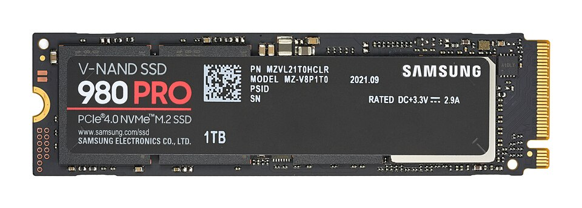
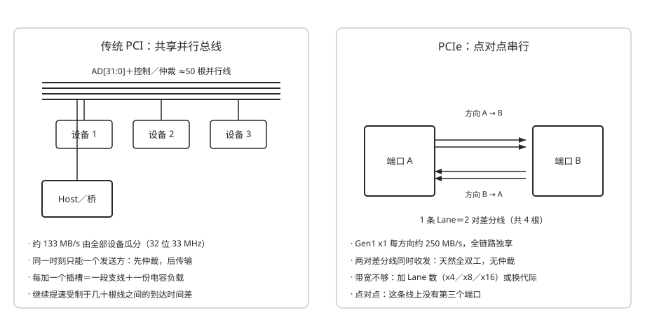
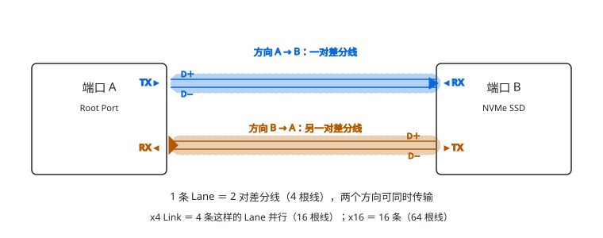
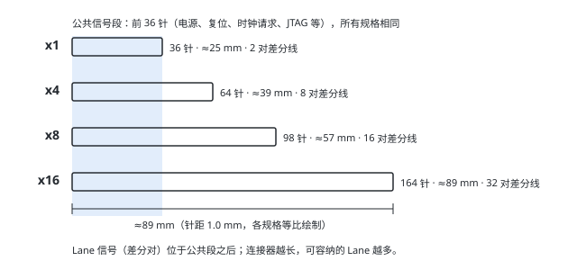
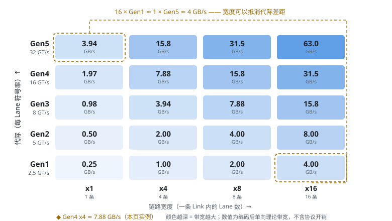
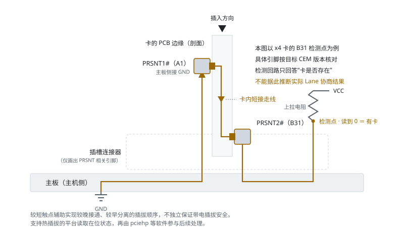

# B-D.10.1 PCIe 基础与物理层：拓扑与物理链路

> 所属章节：第五部 B. 总线协议 > B-D.10 PCIe
>
> 难度：[B→I] | 预计阅读时间：30 分钟

## <span class="blue"> 本节导读

PCIe（Peripheral Component Interconnect Express）是主机与高速外设之间传输寄存器访问、内存数据和中断消息的点对点串行互连。显卡、采用 NVMe（Non-Volatile Memory Express）协议的固态硬盘（SSD）、网卡和现场可编程门阵列（FPGA）加速卡都可以作为 PCIe 设备接入系统。

本页先把最小系统缩到两个角色：主机侧的**根复合体（Root Complex，RC）**和作为设备的 **NVMe SSD**。RC 代表主机发起访问，SSD 作为端点（Endpoint）响应访问，或主动发起 DMA（Direct Memory Access，设备直接读写主机内存而不需要 CPU 逐笔执行数据搬运）；两者之间的一条 Link 由一条或多条 Lane 组成，每条 Lane 用两对差分线同时收发。数据 Lane 之外，链路还依赖参考时钟和复位等辅助信号。

> 本页的贯穿实例是教学构造，不是某块实板的实测记录：主机 RC 与 NVMe SSD 都支持 PCIe Gen4 x4，主板实际连接 4 条 Lane，中间没有 Switch。涉及带宽的数值是按编码规则计算的理论值，不是性能测量结果。



*实物示例：Samsung 980 Pro 是支持 PCIe 4.0 的 M.2 NVMe SSD。它只用于对应本页主实例的设备形态，不是本页实测平台。摄影：D-Kuru／Wikimedia Commons，许可：CC BY-SA 4.0，[来源页](https://commons.wikimedia.org/wiki/File:Samsung_980_PRO_PCIe_4.0_NVMe_SSD_1TB-top_PNr%C2%B00915.jpg) · [许可](https://creativecommons.org/licenses/by-sa/4.0/)。*

本页回答的问题是：**这条 Gen4 RC—NVMe 链路怎样从上电走到可以传输数据包的 L0（正常传输工作状态）？**

阅读顺序就是链路建立的顺序：先确定谁与谁连接，再确认这条物理通道有多少 Lane；连线就绪后，还要满足参考时钟和复位条件，LTSSM 才能开始训练。进入 L0 后才能讨论理论带宽，并用 LnkCap／LnkSta 核对实际状态；设备重新插拔时，再沿存在检测、复位和训练重建链路。

本节覆盖：PCI 与 PCIe 的基本差异、RC／Root Port／Switch／Endpoint、Link 与 Lane、参考时钟与复位、链路训练状态机及重训、Gen1～Gen5 编码与理论带宽、链路状态的证据边界，以及热插拔的物理前提。

下一页沿同一条链路完成一次 Memory Read：[事务与软件模型](B-D.10.1_PCIe基础与物理层_transaction.md)。

---

## <span class="blue"> 先建立最小模型：PCIe 为什么采用点对点串行链路

要理解这个设计，先看它抛弃了什么。传统 PCI 是一组共享的并行线路：32 根地址／数据线（AD[31:0]）加上字节使能、仲裁、控制信号共约 50 根，所有插槽电气并联在同一组线上。

这个结构有三个互相纠缠的天花板：

1. **带宽被所有人分享。** PCI 32 位 33 MHz 整条总线只有约 133 MB/s，由总线上所有设备瓜分；想多传一些，先向仲裁器申请，等总线空出来。设备越多，每个设备分到的越少，延迟越不可控。
2. **频率被线数和插槽数量卡住。** 提速要求几十根信号线之间的到达时间差（skew）同时收窄， 到 66 MHz 时只剩几纳秒余量，所有走线必须按等长约束；更麻烦的是每个插槽都是一段支线加一份电容负载，插槽越多波形越差。PCI-X（PCI 的并行扩展版本）把并行总线频率推到 133 MHz 量级后，串扰、偏移和负载问题比带宽先到了极限。
3. **引脚是昂贵资源。** 约 50 根信号线意味着封装引脚、PCB 层数、连接器体积一起膨胀，而这组线绝大部分时间处于空闲状态，利用率极低。



PCIe 的回答分两步，顺序不能颠倒。

**第一步：串行化。** 把"32 根线各传 1 bit"换成"1 对差分线以高得多的速率依次传 bit"。线从几十根缩到一对，"多根线对齐"问题随之消失，只剩一对线内部的等长要求；8b/10b 编码保证数据流里有足够的电平跳变，接收端用 CDR（Clock Data Recovery，时钟数据恢复）直接从数据流中恢复时钟，连随路时钟线都省掉。单线速率因此可以做得远高于并行总线：Gen1 的 2.5 GT/s 换来扣除编码后每方向 250 MB/s，已经是整条 PCI 总线峰值的两倍，且这 250 MB/s 归这一个设备独享。代价是 20% 的编码开销， 这正是后面带宽表要算的那笔账。

**第二步：点对点化。** 串行差分链路本身只适合连接两个端点，设计顺势把"共享"整个废掉：一条 Link 的带宽只归两端使用，没有总线仲裁器，发送、接收各走各的差分对，天然全双工。一个 Root Port 的下游需要扩展多块设备时，可以使用 Switch；RC 也可以提供多个 Root Port，分别直接连接设备。跨端口传输要求数据包携带路由信息，于是循环冗余校验（CRC）、流控（信用机制）和排序规则都围绕包交换重新设计。

> 一句话记住本节：**"串行"解决线数、时钟偏移和引脚成本；"点对点"解决仲裁和带宽共享；点对点逼出了包交换，包交换又逼出了 RC／Switch／Endpoint 这套层级拓扑。** 三者不是三个独立设计，而是同一次换代的连锁结果，拓扑和协议因此必须放在一起理解。

本页先处理拓扑与物理链路，下一页再处理数据包。

---

## <span class="blue"> RC、Root Port、Switch 与 Endpoint：NVMe 数据能沿哪条路径走

点对点只说明一条 Link 有两个端口，还没有说明谁代表主机、谁执行设备功能，以及一块 RC 怎样连接多块设备。现在先把主实例的角色和路径固定下来。

下图给出本页实例和一个对照分支。读图时从 CPU 向下看：RC 提供主机入口，Root Port 引出实际 PCIe Link；左侧 NVMe 是主实例，右侧 Switch 用来扩展示例端口，不属于这笔 NVMe 访问的路径。

<svg viewBox="0 0 900 430" xmlns="http://www.w3.org/2000/svg" style="max-width:900px;width:100%">
<title>RC、Root Port、Switch 与 Endpoint 的 PCIe 拓扑</title>
<rect x="350" y="12" width="200" height="46" rx="5" fill="none" stroke="currentColor" stroke-width="1.5"/>
<text x="450" y="40" text-anchor="middle" font-size="14" fill="currentColor">CPU 与内存子系统</text>
<rect x="355" y="86" width="190" height="46" rx="5" fill="none" stroke="currentColor" stroke-width="1.5"/>
<text x="450" y="114" text-anchor="middle" font-size="14" fill="currentColor">Root Complex（RC）</text>
<line x1="450" y1="58" x2="450" y2="86" stroke="currentColor" stroke-width="1.5"/>
<rect x="165" y="166" width="210" height="50" rx="5" fill="none" stroke="currentColor" stroke-width="1.5"/>
<text x="270" y="195" text-anchor="middle" font-size="14" fill="currentColor">Root Port A</text>
<rect x="525" y="166" width="210" height="50" rx="5" fill="none" stroke="currentColor" stroke-width="1.5"/>
<text x="630" y="195" text-anchor="middle" font-size="14" fill="currentColor">Root Port B</text>
<line x1="415" y1="132" x2="295" y2="166" stroke="currentColor" stroke-width="1.5"/>
<line x1="485" y1="132" x2="605" y2="166" stroke="currentColor" stroke-width="1.5"/>
<rect x="170" y="290" width="200" height="62" rx="5" fill="none" stroke="currentColor" stroke-width="2"/>
<text x="270" y="316" text-anchor="middle" font-size="14" fill="currentColor">NVMe SSD（Endpoint）</text>
<text x="270" y="338" text-anchor="middle" font-size="12" fill="currentColor">主实例：Gen4 x4</text>
<rect x="535" y="270" width="190" height="50" rx="5" fill="none" stroke="currentColor" stroke-width="1.5"/>
<text x="630" y="300" text-anchor="middle" font-size="14" fill="currentColor">PCIe Switch</text>
<line x1="270" y1="216" x2="270" y2="290" stroke="currentColor" stroke-width="2"/>
<text x="280" y="253" font-size="12" fill="currentColor">PCIe Link，x4</text>
<line x1="630" y1="216" x2="630" y2="270" stroke="currentColor" stroke-width="1.5"/>
<rect x="455" y="365" width="150" height="46" rx="5" fill="none" stroke="currentColor" stroke-width="1.5"/>
<text x="530" y="393" text-anchor="middle" font-size="13" fill="currentColor">FPGA（Endpoint）</text>
<rect x="655" y="365" width="150" height="46" rx="5" fill="none" stroke="currentColor" stroke-width="1.5"/>
<text x="730" y="393" text-anchor="middle" font-size="13" fill="currentColor">网卡（Endpoint）</text>
<line x1="600" y1="320" x2="545" y2="365" stroke="currentColor" stroke-width="1.5"/>
<line x1="660" y1="320" x2="715" y2="365" stroke="currentColor" stroke-width="1.5"/>
</svg>

> Root Complex（RC，根复合体）：主机与 PCIe 层级之间的接口集合。它把 CPU 的内存访问转换成 PCIe 事务，也让设备 DMA 能够访问主机内存。RC 不等于 CPU，也不等于某一个 Root Port。

<!-- -->

> Root Port：RC 引出一条 PCIe 层级的下行端口。软件配置模型中，Root Port 表现为 Type 1 Bridge Function（类型 1 桥功能），保存下游总线范围和资源窗口等信息。它不是只用于连接老式 PCI 的协议转换器。

<!-- -->
> Switch：由一个上行端口和若干下行端口的桥功能组合而成。上行口连接 Root Port 或上一级 Switch，按包里的地址或设备 ID 把事务层数据包（TLP）转发到正确的下行口。每个端口都是一条独立 Link，不做电气广播，也不把带宽平均分给下级。

<!-- -->

> Endpoint（EP，端点）：完成具体功能的设备，例如本例的 NVMe SSD。Endpoint 可以响应主机请求，也可以主动发起 DMA 或中断消息，但不为其他设备转发数据包。

包怎样凭地址或 ID 找到下一跳，即路由规则，归下一页"事务与软件模型"；本节只需要建立直觉：**Root Port 和 Switch 端口在软件看来都是桥，桥上挂着哪些下级，就是 `lspci -tv` 显示的那棵树。**

至于一笔完整 NVMe 读怎样继续涉及命令队列、DMA 和中断，留到下一页先拆清单笔 Memory Read 后再展开；队列和驱动实现细节归 B-D.10.3。

**Switch 分支的边界**

本例的 NVMe 访问只走 **RC → Root Port A → NVMe SSD**，不经过 Switch。但"不经过"不意味着 Switch 分支与带宽无关：若 FPGA 和网卡同时经 Switch 搬数据，它们各自独享自己到 Switch 下行口的 Link，却**共享 Switch 上行口到 Root Port B 那一段**， 跨段传输的带宽由上行口宽度封顶，还要经过 Switch 内部端口间的包调度。这是"点对点"的另一面：每段 Link 带宽专属，但过了交换就要排队。对照分支只用于说明多设备组网，不会在后面突然变成同一笔 NVMe 访问的中间节点。

Linux 的 `lspci -tv` 可以从软件侧显示这类父子关系。缩进和总线号属于枚举结果，B-D.10.2 会解释它们如何产生；物理图上有一个端口，并不表示操作系统已经完成枚举。

下面按实机输出格式构造一个教学示例，把上图的抽象角色映射到 Linux 对象。设备名直接写为 NVMe SSD，不携带具体厂商信息，也不把这段文字冒充实机证据：

```text
+-[0000:60]
   +-01.2-[62]----00.0  NVMe SSD
```

读法与上图一一对应：`0000:60` 是这个层级所在的 Domain 和根总线，`01.2` 是根总线上的上游端口，`[62]` 是该端口下游分配到的总线号，最右侧 `00.0` 则是挂在下游总线上的 Endpoint。实际系统中还可能出现多个 Domain 和更长的桥接路径，因此不能只靠 `60:01.2` 的局部数字猜设备位置；完整寻址和多域选择归 B-D.10.2。

---

## <span class="blue"> Lane 与 Link：这条物理路径有多宽

现在主实例已经固定为 RC→Root Port A→NVMe SSD，下一个实际问题是这条路径包含多少条并行传输通道，以及两个方向是否共享线路。这会直接决定插槽、布线和理论带宽。

> Lane：一条 PCIe 双向传输通道，由两对差分信号线组成。一对把 A 的发送端连接到 B 的接收端，另一对把 B 的发送端连接到 A 的接收端。

<!-- -->

> Link：两个端口之间的一条逻辑链路，由一条或多条 Lane 聚合而成。x1、x4、x8、x16 表示 Link 当前使用的 Lane 数。

两者的关系可以压缩成一句话：**Lane 是组成单位，Link 是聚合结果。** 本页主实例中，Root Port A 与 NVMe SSD 两个端口之间是一条 Link，由 4 条 Lane 聚合，所以叫 x4；把 4 换成 1／8／16，就是 x1／x8／x16。

> 注意 Link 连接的是"相邻两个端口"：主实例没有 Switch，整条路径恰好只有这一条 Link；若中间经过 Switch，一次访问要穿过多段 Link，每段各有自己的宽度、独立训练。

下图把一条 Lane 的两对差分线展开。每个箭头旁的一对线表示一对差分信号，不是两根独立的数据通道。



差分信号用两根导体传输一对相反变化，接收端取两者之差，从而抑制两根线上共同出现的噪声。它的工作原理和信号完整性细节见 B-F.16.1；本页只需要记住：**一对差分线负责一个方向，一条 Lane 需要两对，因此 x4 是 8 对差分线。**

发送和接收通道彼此独立，所以 PCIe 标称带宽按每个方向分别计算。x4 并不是把 4 条 Lane 分成 2 条发送、2 条接收，而是 4 条 Lane 都能同时收发。

链路宽度也不是对两个整数求“最大公约数”。初始训练时，两端在规范允许的宽度、各自能力和主板实际连线约束下建立可用 Link；已经工作的 Link 还可能在 Recovery 中调整宽度。x16 插槽外观、Root Port 能力、Endpoint 能力和实际焊接 Lane 数是四个不同事实。

**连接器规格长度随可容纳的 Lane 数增加。** 卡边缘连接器所有规格共用 1.0 mm 针距和同一段前端公共信号（电源、复位、时钟请求、JTAG 等，共 36 针），x1／x4／x8／x16 的差别就是连接器向后延长了多长：



*x1／x4／x8／x16 按真实毫米长度等比绘制；所有规格共用前 36 针公共信号段（图中高亮）。机械长度决定“能插什么槽”，电气 Lane 数决定“跑多宽”，两者可以不一致。本图为本页自绘示意图。*

这张等比图给出两个直觉：

- **短卡能插长槽**：x1 卡只用前 36 针，插入 x16 槽时信号一一对齐前段，机械与电气都合法；
- **长槽不等于宽链路**：x16 长度的插槽只布了 x4 走线的主板很常见，“壳长”只是可能性上限，“瓤宽”要查原理图和链路状态。


*实物照片帮助识别插槽的机械长度，但不能据此判断实际接线宽度。摄影：Csendesmark，作者已释放为公有领域，[来源与作者信息](https://commons.wikimedia.org/wiki/File:PCI_Express.jpg)。*

> ⚠️ 机械兼容与电气宽度是两个独立判断，不能互相替代：
>
> - **短卡插长槽**：机械合法，电气上按卡的 Lane 数工作；
> - **长卡插短槽**：封闭式槽尾通常插不进去；开放式槽尾插进去也只按插槽实际布线宽度工作；
> - 任何方向都不能只凭插槽长度推断实际带宽，以 LnkSta 读数为准。

---

## <span class="blue"> REFCLK 与 PERST#：插好设备后为什么仍不能训练

现在主实例已经有 RC、Root Port、NVMe SSD 和 4 条 Lane，但“线路接好”仍不代表两端可以立即交换训练序列。硬件还要回答两个不同问题：按什么时间基准发送，以及设备是否仍被保持在复位状态。

> REFCLK：PCIe 常用的 100 MHz 参考时钟，提供计算发送时刻和接收时序的基准，**不是数据线上的实际速率**。物理层收发器（PHY）中的 PLL（Phase-Locked Loop，锁相环）等电路以参考时钟为基础生成内部高速时钟，再支持 Gen4 的目标符号率。参考时钟不满足要求时，后续高速训练就缺少可靠前提。

不同系统可以采用共同参考时钟，也可以采用满足规范条件的独立参考时钟，不能把所有板卡都画成共用同一颗晶振。需要核对的是实际时钟来源、频率、稳定性和设备手册要求，而不只是“有没有 100 MHz 这个数字”。

<!-- -->

> PERST#：PCIe 的基本复位信号，`#` 表示低有效。`PERST#=0` 时设备保持复位，不应开始正常链路训练；`PERST#=1` 时表示复位已经释放。所谓“释放复位”是让信号在满足手册条件的时刻从 0 变为 1，不是向设备发送一条软件命令。

把两个条件分开看，上电时的预期行为就清楚了：

| 电源 | REFCLK | PERST# | 当前能得出的结论 |
|---|---|---|---|
| 正常 | 正常 | 0 | 设备仍保持复位，不能据此判断 PCIe 链路好坏 |
| 正常 | 异常 | 1 | 复位虽已释放，但时钟前提不满足，训练仍可能失败 |
| 正常 | 正常 | 0→1 | 满足设备手册规定的时序后，两端才进入 Detect |

**这三个条件的价值不在台式机主板上，而在板级上电调试（bring-up）现场。** 台式机的上电时序由电源时序控制器一气呵成，确实"自然而然"；嵌入式板上，时钟使能和 PERST# 往往就是主控的寄存器位或通用输入输出引脚（GPIO），"先电源、后时钟、最后释放复位"这个顺序要由固件或驱动按序排出，设备树中的 `clocks`／`reset-gpios` 描述就是这个交界面在配置层的落点。`lspci` 看不到 SSD 时，NVMe 驱动尚未开始接管设备，第一嫌疑是时钟没使能、复位没释放或释放过早，而不是让 NVMe 驱动反复重试。

本页教学实例的正常上电时序如下。波形把参考时钟画成主板同时供给两端，只是其中一种形态，不排除其他合规的独立时钟设计；T_PVPERL 取 PCIe 卡机电规范（CEM）下限 100 ms，具体数值以设备手册为准。

<div class="interactive-demo">
  <iframe
    src="../html/10.1-pcie-powerup-sequence.html"
    title="PCIe 上电时序：电源、REFCLK 与 PERST#"
    loading="lazy"
    style="width:100%;height:430px;border:0;"
  ></iframe>
</div>


*上电时序示意：电源达到规范值后 REFCLK 先稳定，经 T_PVPERL（≥100 ms，CEM 规范下限）后 PERST# 由 0 变 1 释放复位，两端随后进入 Detect。波形为示意，时间与频率不按真实比例绘制。*

因此，本节的产出只是**允许开始训练**，还不是链路已就绪（Link Up）。PERST# 的准确时序不能用一段通用延迟代替手册要求；下一步由 LTSSM 回答两端怎样真正进入 L0。

---

## <span class="blue"> LTSSM：时钟和复位就绪后，两端怎样进入 L0

参考时钟和 PERST# 只提供开始训练的条件，并没有替两端建立同步。接下来的任务是发现对端、确定 Link／Lane 关系、先建立 2.5 GT/s 链路，再通过 Recovery 进入 Gen4 目标速率。

> LTSSM（Link Training and Status State Machine）：PCIe 端口用来发现对端、建立同步、配置 Link、进入工作状态以及处理重训的硬件状态机。

LTSSM 的状态转换和训练序列由两端硬件执行。软件可以通过链路控制寄存器设置目标速率、请求重训或禁用链路，具体支持情况取决于端口和平台；这些操作只是配置和触发，不是软件逐拍执行 Detect、Polling、Configuration 或 Recovery。

软件通常通过 LnkSta 的速率、宽度和错误日志观察训练结果。PCIe 没有跨厂商统一的完整 LTSSM 状态读取接口，但具体控制器可能提供厂商专用调试寄存器。初始训练发生在初次枚举之前，运行期间也可能重训；所需时间随平台、复位和训练过程变化，不能用统一的毫秒数概括。

下面把正常路径做成可交互的：点击状态查看机制说明与排查线索，或点"播放训练流程"看一遍完整的训练过程（省略 L0s／L1、Disabled、Hot Reset、Loopback 等状态）。

<div class="interactive-demo">
  <iframe
    src="../html/10.1-pcie-ltssm-explorer.html"
    title="LTSSM：两端怎样进入 L0（交互图解）"
    loading="lazy"
    style="width:100%;height:450px;border:0;"
  ></iframe>
</div>


交互页之外，四个状态各记一句话就够：

1. **Detect** 探测对端接收器是否存在，卡在这里先查插卡、供电、连接器、复位和端口使能；
2. **Polling** 交换 TS1／TS2 完成位锁定与符号锁定，固定以 2.5 GT/s 起步，不在这里一步到位；
3. **Configuration** 确定 Link／Lane 编号和初始宽度，物理连接从此成为一条可识别的 Link，但主机还不知道设备功能，也未分配地址窗口；
4. **Recovery** 承担变速、均衡、重训与错误恢复， 进入它不等于降速，成功回到 L0 也不等于故障消失，Gen4 训练失败的定位方法归 B-D.10.4。

本例的正常结果可以概括为两段：

```text
Detect → Polling → Configuration → L0（先以 2.5 GT/s 建立 Link）
L0 → Recovery（变速到 Gen4，并完成所需均衡）→ L0
```

随后数据链路层完成初始化，才可以正常交换事务数据包和链路控制包。<BR>
到这一步仍不能说“SSD 已经可以供文件系统使用”，因为枚举、资源分配、驱动加载和块设备初始化还在后面。

---

## <span class="blue"> Gen1～Gen5 编码与理论带宽：进入 L0 后能传多快

L0 只说明链路已经可以传包，接下来自然要估算它的传输能力。<BR>
带宽由两个互相独立的维度相乘得到：**每条 Lane 有多快（Gen，代际）× 有几条 Lane（x几，链路宽度）**。

### 先把两个维度分清

- **Gen（代际）**：PCIe 标准的版本号，规定每条 Lane 的符号率和编码方式。
  它不是"Lane 的型号"，同一条 Link 上所有 Lane 使用相同速率。两端共同支持的最高代际只是上限，实际结果还受目标配置、平台布线和训练过程限制。
- **x几（链路宽度）**：一条 Link 由几条 Lane 并行组成，见上节（x1/x4/x8/x16）。

两个维度可以按平台和设备实现组合：Gen3 x1 与 Gen3 x16 是同代不同宽；甚至 Gen1 x16（约 4.0 GB/s）还略快于 Gen5 x1（约 3.94 GB/s），增加 Lane 数可以抵消代际差距。所以问"这条链路多快"必须同时给出两个数：什么 Gen、x几。



### 符号率与编码：GT/s 为什么不等于 Gbit/s

GT/s 是每秒发送到线上的符号数。NRZ（Non-Return-to-Zero，二电平传输）方式下每个符号是电压的一个电平状态，携带 1 个线比特，但线比特不等于数据比特：接收端靠电平跳变恢复时钟（CDR），且线路要求 0/1 数量大致平衡，所以数据 bit 必须裹上一层"包装"才能上线，这层包装就是编码开销。

- 8b/10b（Gen1/2）：每 8 bit 数据配 2 bit 包装，有效载荷 80%，开销 20%
- 128b/130b（Gen3～5）：每 128 bit 数据只配 2 bit 包装，有效载荷约 98.5%

下表按**每 Lane、单向**列出，只扣除编码开销，按十进制字节换算，不扣除事务层包头、数据链路控制包、流控、空闲有序集和设备实现等额外开销。**链路总带宽＝查表值 × Lane 数**：

| 世代 | 每 Lane 符号率 | 编码 | 编码后每 Lane 单向 | 若 x4，整链路单向 |
|---|---:|---|---:|---:|
| Gen1 | 2.5 GT/s | 8b/10b | 约 250 MB/s | 约 1.0 GB/s |
| Gen2 | 5.0 GT/s | 8b/10b | 约 500 MB/s | 约 2.0 GB/s |
| Gen3 | 8.0 GT/s | 128b/130b | 约 985 MB/s | 约 3.94 GB/s |
| Gen4 | 16.0 GT/s | 128b/130b | 约 1.969 GB/s | 约 7.88 GB/s |
| Gen5 | 32.0 GT/s | 128b/130b | 约 3.938 GB/s | 约 15.75 GB/s |

Gen3 值得单独计算一次，体会编码带来的差别：

```text

8.0 GT/s × 128/130 = 7.8769 Gbit/s      ← 符号率先扣一次编码
7.8769 ÷ 8 = 0.9846 GB/s（每 Lane、单向）
0.9846 × 4 = 3.9385 GB/s（x4、单向）     ← 再乘 Lane 数

```

Gen3 的符号率只比 Gen2 高 60%，编码后理论带宽却接近翻倍， 差别几乎全来自 8b/10b 换成 128b/130b 省下的包装。<BR>
Gen4/5 沿用 128b/130b 与 NRZ，继续提高符号率；它们的链路均衡和信道要求不能从这张表推导出来。

本页实例若最终稳定在 Gen4 x4，按上表即约 7.88 GB/s，每个方向分别计算。<BR>
它不是 NVMe 顺序读写保证值，实际吞吐还受协议开销、队列、设备介质和主机实现影响。

---

## <span class="blue"> LnkCap 与 LnkSta：软件怎样核对实际速率和宽度

前面的带宽计算只是理论推演。要确认本页实例实际是否工作在 Gen4 x4，还需要读取训练留下的软件可见结果，而不是由插槽外观或 SSD 标称速度反推。

训练完成后，软件可以读取 PCIe Capability（能力寄存器区）中的链路字段：

- **LnkCap（Link Capabilities）**：被读取的那个 Function 所在端口声明的最大链路速率与宽度等能力， 它描述的是'这一端'，不是整条 Link；
- **LnkSta（Link Status）**：当前读取时，这条 Link 的协商速率和宽度等状态。

因此，本例 SSD 显示 Gen4 x4 能力，只能说明 SSD 这一端的能力。要判断实际 Link，还要同时考虑 Root Port 的能力、主板连线、目标速率配置和当前电源管理状态。

具体读法（本例 SSD 位于 0000:01:00.0，其上游 Root Port 为 0000:00:01.0；写出完整 Domain 可以避免多域误选）：

```bash
lspci -vv -s 0000:01:00.0 | grep -E "LnkCap:|LnkSta:"   # SSD 端
lspci -vv -s 0000:00:01.0 | grep -E "LnkCap:|LnkSta:"   # Root Port 端
```

下面只是假设两端都工作在 Gen4 x4 的教学示意，不是实测输出：

```text
LnkCap: Port #0, Speed 16GT/s, Width x4, ...
LnkSta: Speed 16GT/s, Width x4, TrErr- Train- ...
```

核对顺序：

1. 在明确的负载和电源状态下读取链路两端。若 `Train=1`，说明当前仍在训练，先等它清零再比较。
2. 分别比较每一端的 LnkSta 与 LnkCap。相等只表示当前读取值与本端能力一致，不能排除历史重训或链路错误。
3. 出现差异时读取对端能力。协商结果不会超过两端共同支持的上限；哪一端上限更低，就把它列入瓶颈候选。
4. 共同上限之内仍偏低，再查 LnkCtl2 的 Target Link Speed、AER 错误记录和 dmesg 日志。

`LnkSta` 低于本端 `LnkCap` 是一个需要继续调查的现象，不是“训练失败”的单一判据。可能原因包括：

- 上游 Root Port 只支持较低速率或较少 Lane；
- 插槽或 SoC 实际只连接了部分 Lane；
- 固件或链路控制寄存器设置了较低目标；
- 平台为了功耗管理临时调整了链路状态；
- 高速训练或链路稳定性确实存在问题。

基础检查应先读取链路两端，并在明确的工作负载和电源状态下比较能力与现状。只有再结合目标速率、训练状态、日志和 AER（Advanced Error Reporting，高级错误报告）等证据，才能继续归因；完整方法归 B-D.10.4。

> ⚠️ `lspci` 输出的 `downgraded` 也是工具根据单端能力与当前状态所作的标记，不等于它知道平台为什么形成当前状态。

---

## <span class="blue"> PRSNT# 与热插拔：设备重新插入后怎样重建链路

前面只完成了本页实例的一次上电训练。如果设备被拔出再插入，系统先要知道物理对象发生了变化，随后才可能重新执行复位、训练和枚举。存在检测因此是链路生命周期的入口，而不是一个孤立的信号名词。

### PRSNT# 怎样感知“卡在位”

在支持这种检测方式的 CEM 插槽上，PRSNT1# 与 PRSNT2# 构成检测回路。卡内走线把两端联系起来，主板一侧提供接地和上拉检测点；卡插入后，回路状态改变，主机据此判断卡是否存在。具体引脚位置和检测条件应按目标 CEM 版本与设备形态核对，不能用这张示意图推断当前 Lane 数。



图中的重点只有“回路是否成立”。部分形态的触点较短，用于让检测触点较晚接通、较早分离，辅助控制插拔顺序；它不是消除电弧或保证带电插拔安全的独立措施。

### 插入之后谁干什么

| 阶段 | 谁 | 干什么 |
|------|-----|--------|
| 在位感知 | 插槽与检测硬件 | 检测回路或平台支持的其他检测方式发现设备变化 |
| 槽电源 | pciehp 与平台电源控制 | 在插槽支持时，按 Slot Control 和硬件能力控制上电／断电 |
| 链路重建 | 两端硬件 | 在电源、时钟和复位条件满足后，由 LTSSM 重新训练 |
| 重新枚举 | pciehp 与内核 | 在链路可用且满足规定等待条件后扫描设备并恢复驱动绑定 |

链路重建仍由硬件执行，软件负责提供电源、时钟、复位和枚举条件。等待时间不能只写一个通用的“100 ms”，必须区分电源稳定、时钟稳定、训练完成和允许首次配置访问各自的规范要求。

### 边界

PRSNT# 只是在位检测输入，不等于热插拔能力。受控热插拔还需要平台提供相应检测、电源控制、固件和操作系统配合。没有这些能力的平台发生意外移除时，不能承诺仅靠重新训练就能自动恢复。

重新枚举归 B-D.10.2，驱动移除与异常恢复归 B-D.10.3，实际操作和日志归 B-D.10.4。

---

## <span class="blue"> 本节总结

本页沿一条 Gen4 RC—NVMe 链路建立了最小物理模型：RC 通过 Root Port 引出 Link，Endpoint 完成设备功能，Switch 负责扩展端口并转发数据包；每条 Lane 用两对差分线实现全双工。链路先满足时钟和复位前提，再以 2.5 GT/s 完成初始训练，经 Recovery 进入目标速率，不能把这些阶段混成“上电即 Gen4”。

LnkCap 和 LnkSta 是观察训练结果的入口，不是单独的故障判决书。后续阅读先沿这条已经可用的链路完成一次 Memory Read，再进入枚举，理解软件怎样发现和分配设备资源。

### 速查表

| 对象 | 本页应记住的含义 |
|---|---|
| RC 与 Root Port | RC 是主机接口集合，Root Port 是引出 PCIe 层级的下行端口 |
| Type 1 Bridge | Root Port 和 Switch Port 都可采用这种配置模型，不等于只连接传统 PCI |
| Endpoint | 完成具体功能，不为其他设备转发数据包 |
| Lane 与 Link | 一条 Lane 是两对差分线；x4 Link 聚合 4 条 Lane |
| REFCLK／PERST# | 100 MHz 参考时钟不是数据速率；PERST#=0 保持复位，=1 释放复位 |
| LTSSM | 先以 2.5 GT/s 建立 Link，再经 Recovery 变速或重训 |
| Gen3／Gen4 | 同用 128b/130b；Gen4 提高符号率，编码规则没有换代 |
| LnkCap／LnkSta | 单端声明能力／当前链路状态，差异本身不等于训练失败 |
| 热插拔 | 存在检测只是输入，完整支持还需要平台、操作系统和驱动 |

### 本节自查

??? details "Q1. Root Port、Switch 和 Endpoint 在一棵 PCIe 树中分别负责什么？"
    Root Port 从 RC 引出一条下行层级，Switch 扩展上行和下行端口，Endpoint 完成 NVMe、网卡等具体功能。Root Port 和 Switch Port 都可以在软件配置模型中表现为 Type 1 Bridge Function；Endpoint 不负责为其他设备转发数据包。

??? details "Q2. 一条 Gen4 x4 Link 有多少对差分线，为什么两个方向可以同时传输？"
    x4 有 4 条 Lane，每条 Lane 两对差分线，所以共有 8 对。每条 Lane 的一对用于 A→B，另一对用于 B→A，方向互不占用对方的物理通道，因此可以全双工。

??? details "Q3. 为什么“Gen4 链路在 Polling 中直接谈妥 16 GT/s”不是本页采用的正常训练模型？"
    初始 Link 先在 Polling／Configuration 中以 2.5 GT/s 建立基本同步和逻辑关系。Gen3 及以上的目标速率通过 Recovery 中的变速过程进入，Gen4 还涉及相应均衡训练。

??? details "Q4. SSD 的 LnkCap 是 Gen4 x4，而 LnkSta 是 Gen3 x2，能否直接判定 SSD 训练失败？"
    不能。它只说明当前状态低于 SSD 单端声明的能力。还要读取 Root Port 能力和状态，核对实际 Lane 连线、目标速率、负载与电源状态，再结合训练日志和 AER 等证据判断原因。

??? details "Q5. Gen3 x4 的编码后理论带宽怎样计算，为什么不能把它当成 NVMe 实测吞吐？"
    每 Lane 为 `8.0 × 128/130 ÷ 8 ≈ 0.9846 GB/s`，x4 约为 `3.938 GB/s`，每个方向分别计算。这个值只扣除编码开销，没有扣除包协议、流控和设备实现成本，也没有测量 SSD 介质和队列行为。

??? details "Q6. 为什么 REFCLK 不是数据线上的速率，PERST#=1 又意味着什么？"
    REFCLK 是计算发送时刻和接收时序的参考基准，内部电路以它生成高速工作时钟，100 MHz 不是 Gen4 的线上符号率。`PERST#=1` 表示低有效复位已经释放；在满足设备手册时序后，两端才可以进入 Detect，而不是已经训练到 L0。

沿同一条已经训练的链路继续阅读：[事务与软件模型：一次 Memory Read 怎样完成](B-D.10.1_PCIe基础与物理层_transaction.md)。
