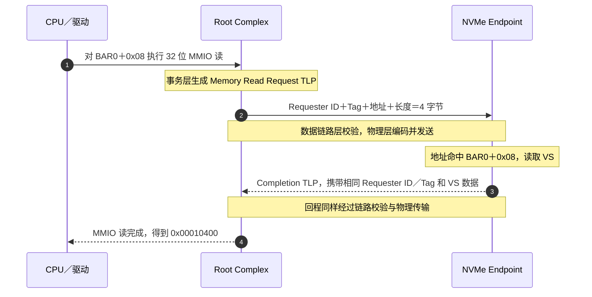
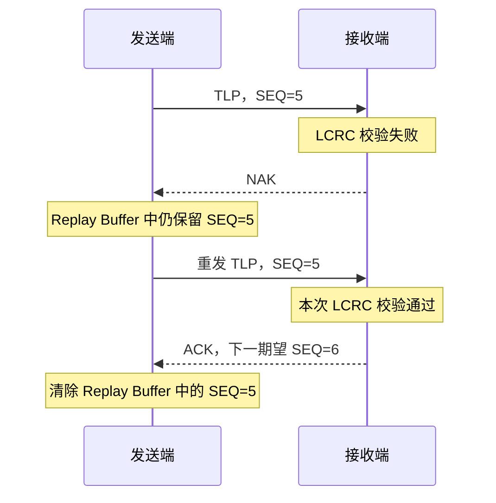

# B-D.10.1 PCIe 基础与物理层：事务与软件模型

> 所属章节：第五部 B. 总线协议 > B-D.10 PCIe
>
> 难度：[B→I] | 预计阅读时间：30 分钟

## <span class="blue"> 本节导读

[上一页](B-D.10.1_PCIe基础与物理层.md)已经让同一条 Gen4 RC—NVMe 链路完成训练并进入 L0。物理链路可用之后，软件最关心的不再是有没有波形，而是：一次寄存器读怎样变成 PCIe 事务，数据又怎样通过完成包（Completion）返回。

本页继续这条链路，增加一笔最小操作：CPU 对 NVMe 的 BAR0 寄存器窗口执行一次 **32 位内存读（Memory Read）**，读取偏移 `0x08` 的 VS（Version）寄存器。VS 是 NVMe 规范定义的只读寄存器，用 Major、Minor、Tertiary 三个字段表示控制器支持的规范版本。

> BAR（Base Address Register，基址寄存器）：配置空间中描述设备地址窗口的寄存器。枚举阶段，系统为设备分配地址窗口；驱动再把窗口映射到 CPU 可访问的地址范围。本页把 BAR0＋`0x08` 作为设备内部偏移，不展开窗口地址如何分配，具体过程归 B-D.10.2。

<!-- -->

> MMIO（Memory-Mapped I/O，内存映射输入输出）：CPU 用访问内存地址的方式访问设备寄存器。对软件而言是一次 load 指令，对 PCIe 而言则需要由 RC 生成 Memory Read 事务。

本页再作两项教学假设：枚举和 BAR 映射已经完成；这块教学用 NVMe 控制器报告 NVMe 1.4，因此 VS 返回 `0x00010400`。返回值只用于演示版本字段，不是某块 SSD 的实测结果。

本节覆盖：Memory Read 的完整往返、事务层与数据链路层、投递与非投递事务、请求匹配、链路校验与重传、流控信用、完成超时的证据边界，以及 PCI 软件兼容与设备驱动兼容的区别。

---

## <span class="blue"> 先给全路：一次 VS 读取怎样返回 0x00010400

下图按时间顺序展示正常路径。读图时先跟踪实线请求，再跟踪虚线 Completion；RC 与 Endpoint 之间的每一段都同时经过事务层、数据链路层和物理层，不是只有一根“Direct”连线。

> TLP（Transaction Layer Packet，事务层数据包）：PCIe 表达内存读写、配置读写、消息和 Completion 等事务的基本数据包。头部描述事务类型、地址、长度和路由所需信息，某些 TLP 还携带数据载荷。

<!-- -->

> Requester ID／Tag：Completion 的匹配依据。Requester ID 标识请求者，Tag 区分同一请求者的多个未完成事务，两者共同找回原来的请求。



正常闭环包含两次方向相反的传输：Memory Read Request 从 RC 到 Endpoint，Completion 从 Endpoint 回到 RC。缺少第二段，CPU 的这次读取就不能正常完成。

### 1. CPU 发起 MMIO 读

驱动对已经映射的 BAR0 窗口执行 32 位读取，设备内部偏移为 `0x08`。CPU 不需要知道 TLP 的格式，它看到的是一次地址访问；RC 负责把这个访问转换为 PCIe Memory Read Request。

本例只读 4 字节，因此正常时只需一个携带 4 字节数据的 Completion。更大的 Memory Read 可能由多个 Completion 分段返回，不能用本例推成所有读取都只有一个回程包。

### 2. RC 在事务层生成 Request TLP

Memory Read Request 不携带 VS 数据，因为数据尚且在设备中。它至少要携带让 Endpoint 找到目标寄存器的信息，以及让回程 Completion 找到原请求的信息：

- 地址与长度：目标是 BAR0＋`0x08`，长度为 4 字节；
- Requester ID：标识请求者；
- Tag：在同一个请求者的多个未完成事务中标识这一笔请求。

请求者可能同时发出多笔需要回程的事务，只靠“Completion 从哪块设备来”并不足以确定它属于哪一次读取，因此必须保留 Requester ID／Tag 的对应关系。

先看字段位置，再进入数据链路层。上图只展开事务层组装的 TLP，下图展开同一份内容在一段 Link 上被数据链路层封装后的样子。

<svg viewBox="0 0 900 330" xmlns="http://www.w3.org/2000/svg" style="max-width:900px;width:100%">
<title>TLP 字段与数据链路层 Sequence 和 LCRC 的关系</title>
<text x="450" y="28" text-anchor="middle" font-size="14" fill="currentColor">事务层组装的 TLP</text>
<rect x="40" y="55" width="400" height="70" rx="4" fill="none" stroke="currentColor" stroke-width="1.5"/>
<text x="240" y="83" text-anchor="middle" font-size="14" fill="currentColor">Header：类型、地址、长度</text>
<text x="240" y="105" text-anchor="middle" font-size="12" fill="currentColor">Requester ID／Tag 等</text>
<rect x="440" y="55" width="260" height="70" rx="4" fill="none" stroke="currentColor" stroke-width="1.5"/>
<text x="570" y="83" text-anchor="middle" font-size="14" fill="currentColor">Data（可选）</text>
<text x="570" y="105" text-anchor="middle" font-size="12" fill="currentColor">本例 Completion 为 4 字节 VS</text>
<rect x="700" y="55" width="160" height="70" rx="4" fill="none" stroke="currentColor" stroke-width="1.5" stroke-dasharray="5 3"/>
<text x="780" y="83" text-anchor="middle" font-size="14" fill="currentColor">ECRC（可选）</text>
<text x="780" y="105" text-anchor="middle" font-size="12" fill="currentColor">端到端校验</text>
<line x1="450" y1="135" x2="450" y2="172" stroke="currentColor" stroke-width="1.5"/>
<polygon points="450,172 445,161 455,161" fill="currentColor"/>
<text x="450" y="157" text-anchor="middle" font-size="12" fill="currentColor">数据链路层在每一段 Link 上添加 Sequence 与 LCRC</text>
<rect x="20" y="185" width="100" height="70" rx="4" fill="none" stroke="currentColor" stroke-width="1.5"/>
<text x="70" y="222" text-anchor="middle" font-size="13" fill="currentColor">Sequence</text>
<rect x="120" y="185" width="350" height="70" rx="4" fill="none" stroke="currentColor" stroke-width="1.5"/>
<text x="295" y="222" text-anchor="middle" font-size="14" fill="currentColor">TLP Header</text>
<rect x="470" y="185" width="220" height="70" rx="4" fill="none" stroke="currentColor" stroke-width="1.5"/>
<text x="580" y="222" text-anchor="middle" font-size="14" fill="currentColor">Data（可选）</text>
<rect x="690" y="185" width="120" height="70" rx="4" fill="none" stroke="currentColor" stroke-width="1.5" stroke-dasharray="5 3"/>
<text x="750" y="222" text-anchor="middle" font-size="13" fill="currentColor">ECRC（可选）</text>
<rect x="810" y="185" width="70" height="70" rx="4" fill="none" stroke="currentColor" stroke-width="1.5"/>
<text x="845" y="222" text-anchor="middle" font-size="13" fill="currentColor">LCRC</text>
<text x="450" y="292" text-anchor="middle" font-size="13" fill="currentColor">Sequence 与 LCRC 是逐段 Link 的链路层封装，不是事务层 TLP 字段</text>
</svg>

Memory Read Request 只有头部，没有 VS 数据；Completion 才在本例的 Data 位置携带 4 字节 VS。Sequence 和 LCRC 服务于每一段 Link，不能把它们画成所有路径共享不变的端到端字段。

### 3. 数据链路层为这一段 Link 提供可靠传输

> DLLP（Data Link Layer Packet，数据链路层数据包）：数据链路层自身使用的控制包，用于 TLP 的 ACK／NAK、流控和电源管理等，不承载本例的 VS 用户数据。

发送侧在 TLP 外增加序列号和 LCRC（Link CRC，链路循环冗余校验），接收侧据此检查这段 Link 上是否出现损坏。TLP 还可以选择携带端到端循环冗余校验（ECRC），它与 LCRC 不是一回事：

| 校验 | 作用范围 | 本页需要区分的重点 |
|---|---|---|
| LCRC | 每一段 PCIe Link | 数据链路层用它检查链路传输是否损坏，Switch 的每一跳分别处理 |
| 可选 ECRC | 请求者与最终完成者之间 | 用于端到端完整性检查，不替代逐跳 LCRC |

> ACK／NAK：接收方对链路包确认或否认的 DLLP。ACK 表示相应 TLP 已在这段 Link 上被正确接收，NAK 表示需要重传；ACK 不表示设备业务操作已经成功。

<!-- -->

> Replay buffer（重传缓冲区）：发送侧保存尚未得到确认的 TLP 的缓冲区。收到 NAK 或出现需要重放的条件时，发送侧可以重新发送保存的包；收到相应 ACK 后，这些包才能从缓冲区清除。

下面用 `SEQ=5` 演示一次校验失败后的重传。这里仍是 Request 或 Completion 在一段 Link 上的传输过程，不是 NVMe 重新执行一次 VS 读取。



图中的 `SEQ=5` 重发时序号不变，因为它还是同一份链路层数据。ACK 中的序号表示接收方下一期望收到的序号，所以收到 `SEQ=5` 后确认的是下一期望 `SEQ=6`，不是把原包改成 `SEQ=6`。

<!-- -->

> 流控信用（Flow Control Credit）：接收方把可用接收缓冲空间通告为信用，发送方只有拥有足够信用时才能发送相应类别的 TLP。接收方释放缓冲后继续用 DLLP 更新信用，避免发送方仅凭自身速度把对端缓冲压满。

本例的 Request 和 Completion 都受这些机制约束。它们提供的是**逐段链路的传输可靠性**，不能保证设备永不出错，也不能代替事务层的成功／失败状态。

### 4. 物理层把包变成线上符号

物理层完成编码、串化和发送。Gen4 使用 128b/130b，4 条 Lane 协同传输这条 Link 的数据；接收端再完成相反过程。

上一页计算的 Gen4 x4 理论带宽描述这里的传输能力，但它不能说明 VS 读取需要多长时间。一次 4 字节寄存器读还包含包头、链路控制和往返延迟，不能用 `4 ÷ 7.877 GB/s` 推算完整耗时。

### 5. Endpoint 命中 BAR0＋0x08

Endpoint 接收并校验包后，事务层根据事务类型和地址识别：这是一次 Memory Read，目标落在自己的 BAR0 窗口内，偏移为 `0x08`。

NVMe 控制器随后读取 VS。教学假设控制器支持 NVMe 1.4，各字段为：

```text
VS[31:16] = 0x0001  Major Version
VS[15:08] = 0x04    Minor Version
VS[07:00] = 0x00    Tertiary Version
合并结果  = 0x00010400
```

如果地址不落在有效窗口，或设备不能完成该请求，结果就不再是这条正常路径，后文的错误分支会处理这种差异。

### 6. Endpoint 返回 Completion TLP

Endpoint 生成 Completion TLP，写入原请求的 Requester ID 和 Tag，并携带 `0x00010400`。Completion Status 表示事务是否成功完成；只有 Successful Completion 才对应本例的正常 VS 返回。

回程同样经过数据链路层和物理层。RC 收到 Completion 后，用 Requester ID／Tag 找到此前挂起的 MMIO 读，再把数据交回 CPU。

### 7. CPU 得到结果

CPU 的 32 位读取最终得到 `0x00010400`。软件可以据此判断设备报告的 NVMe 版本，但不能仅凭这个值推断 SSD 的实际读写速度、健康状态或链路速率。

至此，正常路径形成完整闭环：

```text
MMIO 读
→ Memory Read Request TLP
→ Endpoint 命中 BAR0＋0x08
→ Completion TLP 携带 VS
→ CPU 得到 0x00010400
```

---

## <span class="blue"> Posted 与 Non-Posted：区别在事务是否需要 Completion

Memory Read 属于 Non-Posted（非投递型）事务，因为请求者必须等待 Completion。PCIe 不能靠“包已经发到线上”推断读取已经成功。与之相对，Posted（投递型）事务不要求 Completion。返回 Completion 的一方称为 Completer（完成者），本例就是 NVMe Endpoint。

| 事务 | 类型 | 正常结果 |
|---|---|---|
| Memory Read | Non-Posted | Completer 返回携带数据的 Completion |
| Configuration Read／Write | Non-Posted | Completer 返回 Completion；配置写不需要数据载荷，但仍需完成状态 |
| Memory Write | Posted | 包发出后不要求 Completion，写入错误需要通过其他错误机制发现 |
| MSI／MSI-X（消息信号中断） | 通常表现为 Posted Memory Write | 设备向预定地址写入预定数据，由中断相关硬件接收并转化为中断信号 |

Posted 不等于“一定可以忽略错误”，Non-Posted 也不等于“一定卡死”。两者描述的是事务完成模型，不是可靠性等级。

本页主实例只有 Memory Read。DMA（Direct Memory Access，设备主动读写主机内存）和 MSI／MSI-X 只是用于对照的第二类操作，不会与 VS 读取混成同一笔事务；其配置面和驱动代码分别归 B-D.10.2、B-D.10.3。

---

## <span class="blue"> 从一次 VS 读取扩展到一笔 4 KB NVMe 读取

前面的 VS 读取只有一笔 Memory Read 和一次 Completion。真实 SSD 读取则是一组事务协作，下面引入的是**第二笔、复合操作**：CPU 要求 SSD 把 4 KB 数据送入主机内存。它仍使用同一条 RC—NVMe 链路，但不是前面那次 VS 读取。

1. **驱动准备命令。** 驱动把读命令写入主机内存中的提交队列（Submission Queue）。这一步发生在主机内存，不需要经过 PCIe；队列只是双方约定的一块共享数据结构。
2. **驱动通知设备。** 驱动写 SSD 的门铃寄存器（Doorbell，用来通知设备“队列里有新命令”的 MMIO 寄存器）。RC 把这次 MMIO 写转换为下行 Memory Write TLP。
3. **设备取得并执行命令。** SSD 通过 DMA 从主机内存读取提交队列中的命令，再从闪存介质（NAND）取出目标数据。这里的 DMA 读同样需要设备发起 Memory Read，并接收主机返回的 Completion。
4. **设备写回数据。** SSD 通过 DMA 把 4 KB 数据写入主机内存。线上表现为一个或多个上行 Posted Memory Write TLP，具体分包取决于设备允许的最大包载荷和实际实现，不能把 4 KB 想成必须装进一个 TLP。
5. **设备报告完成。** SSD 把完成项写入主机内存中的完成队列（Completion Queue），再发送 MSI 中断消息。主机软件随后处理完成项，并从已经写入的主机内存中取得 4 KB 数据。

这个过程说明 Endpoint 不只是被动响应者：它也能作为 **Bus Master（总线主，能够主动发起内存读写事务的一方）**读取命令、搬移数据并报告完成。命令下行与数据、完成通知上行使用同一条 Link 的不同方向通道，因此带宽按方向分别计算。

队列格式、门铃地址、DMA 映射、完成中断和驱动错误清理归 B-D.10.3。本页只要求读者能把复合操作拆回一个个 Memory Read、Memory Write、Completion 和中断消息。

---

## <span class="blue"> Completion 没有正常返回时，能推断到哪里

Non-Posted 请求可能正常完成，也可能返回错误状态，或者在超时前没有任何 Completion 回来。

| 观察结果 | 能确认的事实 | 不能直接确认的原因 |
|---|---|---|
| Successful Completion | 这笔事务由 Completer 成功完成 | 不能据此证明整个链路长期稳定 |
| Unsupported Request | Completer 表示不支持或不能接受该请求 | 不能仅凭状态判断是地址、窗口使能还是设备实现问题 |
| Completer Abort | Completer 表示自己无法完成该请求 | 不能直接判断是设备逻辑、链路还是主机配置 |
| Completion Timeout | 请求者在规定时间内没有等到对应 Completion | 不能直接排除 CPU 侧地址、映射、设备命令寄存器配置或电源管理问题 |

Completion Timeout 只说明“没有正常等到回程结果”。Endpoint 没有响应、链路中断、设备处于低功耗、BAR 或内存空间访问使能配置错误、地址映射错误和 Root Port 处理异常都可能参与其中。具体 CPU／SoC 对超时访问的返回方式也不同，不能把所有平台都写成永久卡死。

面对这类错误，首先停止把反复读取当成修复手段，保留当时的 BDF（Bus:Device.Function，总线:设备:功能号）、目标地址、链路两端状态和错误日志，再分别检查：

1. 这笔访问是否使用了当前有效的 BAR 窗口和地址映射；
2. 设备的内存空间访问是否仍被允许，驱动是否仍绑定且设备未进入不可访问状态；
3. 链路当前是否在线，是否发生重训、意外移除或电源状态变化；
4. AER（Advanced Error Reporting，高级错误报告）和主控日志记录了哪一类错误。

恢复动作取决于证据：重新建立有效配置、等待设备恢复可访问状态，或在驱动和系统参与下执行复位与重新枚举。AER 的详细判读归 B-D.10.4，驱动错误恢复归 B-D.10.3，本页不安排直接改写配置寄存器的实验。

---

## <span class="blue"> PCI 软件兼容不等于旧驱动可以驱动任意新设备

PCIe 保留了 PCI 的发现与配置模型：设备仍通过总线、设备、功能号寻址，配置空间中仍有 BAR 等标准结构，操作系统仍能用相似的机制发现设备并分配资源。

配置空间的兼容布局也有明确边界：PCI 时代的标准配置空间为 256 字节，PCIe 保留前 256 字节的兼容布局，同时把可寻址配置空间扩展为 4 KB，以容纳 PCIe 扩展能力。

这种兼容回答的是“系统软件能否沿用发现与配置模型”，不是“任意旧设备驱动能否操作任意新硬件”。设备驱动仍然依赖：

- 厂商 ID／设备 ID（Vendor ID／Device ID）等身份匹配；
- 设备自己的寄存器、队列和命令接口；
- 驱动对该接口版本和硬件行为的支持。

一块 2003 年的 PCI 网卡与一块当代 PCIe 网卡可以拥有相似的总线配置模型，却不需要拥有相同的设备接口。因此，旧驱动只有在目标硬件本来就是它所支持的设备或兼容设备时才可能继续工作，不能把总线兼容扩大成设备兼容。

本页对 BAR0 的讨论都建立在“系统已经完成枚举和地址分配”的前提上。B-D.10.2 将回到这个前提，解释配置空间、BDF 和 BAR 怎样形成；B-D.10.3 再解释驱动怎样取得并使用这些资源。

---

## <span class="blue"> 本节总结

一次 Memory Read 不是 CPU 与设备寄存器之间的一条无形直线，而是 Request 和 Completion 两次方向相反的 PCIe 事务。Requester ID／Tag 负责匹配回程，LCRC、ACK／NAK、Replay 和流控负责逐段 Link 的可靠传输，Completion Status 才表示事务本身是否成功。

Completion Timeout 只能说明回程没有正常完成，不能单独排除主机软件或锁定 Endpoint。PCI 软件兼容也仅覆盖发现与配置模型，设备驱动仍必须理解目标硬件自己的接口。

### 速查表

| 对象 | 本页应记住的含义 |
|---|---|
| TLP | 表达 Memory、Configuration、Message 和 Completion 等事务的数据包 |
| DLLP | 数据链路层自己的控制包，用于 ACK／NAK、流控等 |
| Requester ID／Tag | 让 Completion 找回原请求，区分并发的未完成事务 |
| Non-Posted | 必须等待 Completion，例如 Memory Read |
| Posted | 不要求 Completion，例如 Memory Write，但不等于没有错误 |
| LCRC／ECRC | 逐段 Link 校验／可选端到端校验，职责不同 |
| ACK | 只确认这段 Link 接收正确，不表示设备业务成功 |
| Completion Timeout | 没有按时等到 Completion，原因仍需跨层取证 |
| 配置兼容 | 前 256 字节保留 PCI 布局，PCIe 配置空间扩展到 4 KB |
| 驱动兼容 | 仍取决于设备 ID、寄存器和命令接口，不能由总线兼容推出 |

### 本节自查

??? details "Q1. 为什么读取 BAR0＋0x08 需要 Request 和 Completion 两笔方向相反的传输？"
    Memory Read 是 Non-Posted 事务。Request 只描述要读哪个地址、读多长，VS 数据仍在 Endpoint 中；Endpoint 必须通过 Completion 把数据和完成状态送回，CPU 的读取才能正常完成。

??? details "Q2. 请求者同时发出多笔 Memory Read 时，RC 怎样知道某个 Completion 属于哪一笔？"
    Completion 携带原请求的 Requester ID 和 Tag。Requester ID 标识请求者，Tag 区分该请求者的未完成事务，两者共同找回对应的挂起读取。

??? details "Q3. 收到 Endpoint 对 Request TLP 的 ACK，是否已经证明 VS 读取成功？"
    没有。ACK 只说明这段 Link 正确接收了相应 TLP。VS 读取是否成功还要看 Completion 是否返回，以及 Completion Status 是否为 Successful Completion。

??? details "Q4. Completion Timeout 为什么不能直接证明是 Endpoint 硬件故障？"
    它只证明请求者没有按时收到对应 Completion。BAR／Memory Space 配置、地址映射、设备电源状态、链路中断、Root Port 和 Endpoint 都可能参与其中，需要结合配置、链路两端状态和日志继续定位。

??? details "Q5. PCIe 保留 PCI 软件模型，是否意味着旧 PCI 网卡驱动可以直接驱动当代 PCIe 网卡？"
    不意味着。兼容的是设备发现、配置空间和 BAR 等总线模型。具体驱动仍须匹配设备 ID，并支持目标网卡自己的寄存器、队列和命令接口；只有硬件本身相同或明确兼容时才可能沿用。

继续阅读 B-D.10.2：配置空间、BDF 和 BAR 怎样让系统发现设备并分配这笔 MMIO 访问所需的地址窗口。
