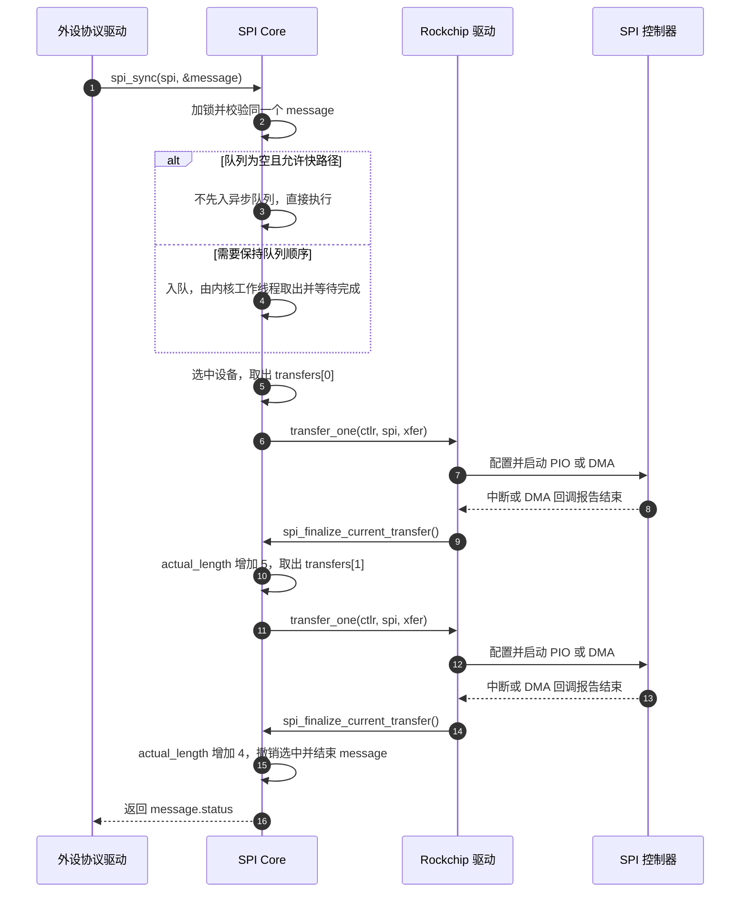

<div class="reader-b2" markdown="1">

# spi_sync 之后：Core 和 Rockchip 各做什么

> 所属章节：第五部 B. 总线协议 > B-B.4 SPI 总线 > B-B.4.3 SPI Linux 驱动框架
>
> 本组阅读：第 4 页，共 6 页

上一页已经组织好一笔 Fast Read：`message` 中依次挂着 5 字节前导段和 4 字节接收段，两个堆缓冲区也已经分配。现在仍需回答：**`spi_sync()` 拿到同一个 `message` 后，谁校验、调度、操作硬件、处理 CS，又怎样把最终状态带回调用者？**

本页覆盖：同步入口的校验与两条调度路径，Core 的默认分段执行，Rockchip 的寄存器、中断与 DMA 配合，以及正常和错误路径上的 CS、完成通知与返回值。

---

## <span class="blue"> 先沿同一笔 message 看清完整交接

本页始终跟随上一页的对象，不在跨层时换一笔事务：

- `spi` 表示目标 SPI 设备，`spi->controller` 指向它所属的控制器；Rockchip 驱动再用 `spi_controller_get_devdata()` 取得自己的运行时状态 `rs`。
- `message` 仍是同一个 `spi_message`。`message.transfers` 链表中有两个 `spi_transfer`：第一段只有 `tx_buf`，`len = 5`；第二段只有 `rx_buf`，`len = 4`。
- SPI Core 负责校验、排队或直接执行、遍历 transfer、维护 CS 和汇总状态；Rockchip 控制器驱动负责把当前 transfer 变成寄存器、FIFO、中断或 DMA 操作。FIFO 是控制器内部暂存收发字的小容量硬件队列。

下面的时序图只画正常路径，用来固定参与者和两类完成通知的位置。`transfer_one()` 被调用两次，但两次都属于同一个 `message`；第二段完成后，Core 才结束整个事务并返回。



图中的“直接执行”和“入队”只影响怎样到达消息执行器，不改变双段顺序和同步返回语义。硬件完成当前 transfer 后，Rockchip 调用的是 `spi_finalize_current_transfer()`；整个 message 收尾则使用另一个函数 `spi_finalize_current_message()`。这两个完成层次不能混为一次通知。

首读之后的所有片段都可回到同一份 Linux v6.6 原文：

- [`include/linux/spi/spi.h:1029-1166`](code/B-B.4.3/kernel-v6.6/include/linux/spi/spi.h){: data-code-viewer="true" data-code-title="spi.h" data-code-path="Linux v6.6 · include/linux/spi/spi.h" data-code-lines="1029-1166"}：`spi_transfer`、`spi_message` 及链表初始化。
- [`drivers/spi/spi.c`](code/B-B.4.3/kernel-v6.6/drivers/spi/spi.c){: data-code-viewer="true" data-code-title="spi.c" data-code-path="Linux v6.6 · drivers/spi/spi.c"}：校验、调度、默认消息执行、CS 和完成通知。
- [`drivers/spi/spi-rockchip.c`](code/B-B.4.3/kernel-v6.6/drivers/spi/spi-rockchip.c){: data-code-viewer="true" data-code-title="spi-rockchip.c" data-code-path="Linux v6.6 · drivers/spi/spi-rockchip.c"}：Rockchip 的配置、PIO、DMA 和错误清理。

下文代码均为这些文件的节选，`...` 表示省略；以 `// 教学：` 开头的注释是本页增加的解释，不属于上游源码。

## <span class="blue"> 先校验描述，再允许硬件启动

`spi_sync()` 的入口很短。互斥锁 `bus_lock_mutex` 用来与其他显式总线锁定操作协调；无论内部成功还是失败，入口都在返回前解锁。

`drivers/spi/spi.c` 的 `spi_sync()`，Linux v6.6，完整函数：

```c
int spi_sync(struct spi_device *spi, struct spi_message *message)
{
	int ret;

	mutex_lock(&spi->controller->bus_lock_mutex);
	ret = __spi_sync(spi, message);       // 教学：仍传入上一页的同一个 message
	mutex_unlock(&spi->controller->bus_lock_mutex);

	return ret;                          // 教学：返回状态，不返回传输字节数
}
```

真正检查描述符的是 `__spi_validate()`。它先拒绝空 transfer 链表，再逐段继承设备默认值、核对控制器能力和长度约束。这里的“校验”不是读取 Flash，也不会让 `rx_buf` 变得有效。

`drivers/spi/spi.c` 的 `__spi_validate()`，Linux v6.6，节选：

```c
if (list_empty(&message->transfers))
	return -EINVAL;                     // 教学：没有 transfer，不能形成事务

...

message->frame_length = 0;
list_for_each_entry(xfer, &message->transfers, transfer_list) {
	xfer->effective_speed_hz = 0;
	message->frame_length += xfer->len; // 教学：本例累计为 5 + 4 = 9
	if (!xfer->bits_per_word)
		xfer->bits_per_word = spi->bits_per_word;

	if (!xfer->speed_hz)
		xfer->speed_hz = spi->max_speed_hz;

	if (ctlr->max_speed_hz && xfer->speed_hz > ctlr->max_speed_hz)
		xfer->speed_hz = ctlr->max_speed_hz;

	if (__spi_validate_bits_per_word(ctlr, xfer->bits_per_word))
		return -EINVAL;

	// 教学：每字不超过 8、16 或更多位时，分别按 1、2 或 4 字节检查对齐。
	if (xfer->bits_per_word <= 8)
		w_size = 1;
	else if (xfer->bits_per_word <= 16)
		w_size = 2;
	else
		w_size = 4;

	if (xfer->len % w_size)
		return -EINVAL;               // 教学：不接受只传一部分字的描述
	...
}

message->status = -EINPROGRESS;          // 教学：内部“正在执行”标记，不是最终返回值
```

上一页把两个 transfer 零初始化，因此未单独设置的 `bits_per_word` 和 `speed_hz` 在这里继承 `spi` 的配置。Core 还检查收发方向与设备模式是否冲突、单线／多线位宽是否合法，以及速度是否低于控制器下限；完整条件见 [`drivers/spi/spi.c:3862-4007`](code/B-B.4.3/kernel-v6.6/drivers/spi/spi.c){: data-code-viewer="true" data-code-title="spi.c" data-code-path="Linux v6.6 · drivers/spi/spi.c" data-code-lines="3862-4007"}。

`spi_setup()` 不是 `spi_sync()` 内部刚执行的一步。它属于更早的设备设置路径，负责模式、默认字长、速度范围和控制器 `setup()` 回调；本页消费的是已经建立的设备配置。二者的时间边界见 [`drivers/spi/spi.c:3694-3839`](code/B-B.4.3/kernel-v6.6/drivers/spi/spi.c){: data-code-viewer="true" data-code-title="spi.c" data-code-path="Linux v6.6 · drivers/spi/spi.c" data-code-lines="3694-3839"}。

如果校验直接返回负错误，流程不会进入 CS 选中或 Rockchip 寄存器配置。上一页的调用者收到负值后走释放出口，不能把 `rx_buf` 当作一次读取的结果。

## <span class="blue"> 同步只规定等待结果，不固定必须排队

校验通过后，`__spi_sync()` 先观察控制器队列。队列为空且 `must_async` 未禁止快路径时，它直接调用消息执行器；否则给同一个 message 安装完成回调，进入异步队列并等待。这样做是为了让同步调用也能与先前提交的异步请求保持顺序。

`drivers/spi/spi.c` 的 `__spi_sync()`，Linux v6.6，节选：

```c
if (READ_ONCE(ctlr->queue_empty) && !ctlr->must_async) {
	message->actual_length = 0;
	message->status = -EINPROGRESS;
	...
	__spi_transfer_message_noqueue(ctlr, message); // 教学：直接执行，不先挂入 queue
	return message->status;                     // 教学：执行器收尾后即可取得最终状态
}

message->complete = spi_complete;               // 教学：队列路径用回调唤醒等待者
message->context = &done;
status = spi_async_locked(spi, message);
if (status == 0) {
	wait_for_completion(&done);                 // 教学：只有成功接收请求后才等待
	status = message->status;
}
message->context = NULL;
```

`done` 是当前栈上的完成对象，`spi_complete()` 只是对它调用 `complete()`。由于同步函数会等到完成通知后才返回，`done` 在等待期间不会失效。这里的等待是不可中断等待，且这一层没有给整个 message 设置超时。

排队分支最终到达 `__spi_queued_transfer()`。它把实际完成长度清零，将链表节点追加到控制器队列，并在需要时唤醒内核工作线程。

`drivers/spi/spi.c` 的 `__spi_queued_transfer()`，Linux v6.6，节选：

```c
msg->actual_length = 0;
msg->status = -EINPROGRESS;

list_add_tail(&msg->queue, &ctlr->queue);       // 教学：排入的仍是同一个 message
ctlr->queue_empty = false;
if (!ctlr->busy && need_pump)
	kthread_queue_work(ctlr->kworker, &ctlr->pump_messages);
```

工作线程中的 `__spi_pump_messages()` 取出队首，把 `ctlr->cur_msg` 指向它；快路径也设置同一个 `cur_msg`。两条路径由此汇合到 `__spi_pump_transfer_message()`。所以“同步”描述调用者会等到最终状态，不能用来推断当前一次调用一定经过队列。

本页没有运行时的 `queue_empty`、`must_async` 和队列竞争观测值，因此只给出选择条件，不声称本例在某块板卡上实际走了哪条分支。两条路径的原文见 [`drivers/spi/spi.c:4144-4240`](code/B-B.4.3/kernel-v6.6/drivers/spi/spi.c){: data-code-viewer="true" data-code-title="spi.c" data-code-path="Linux v6.6 · drivers/spi/spi.c" data-code-lines="4144-4240"} 和 [`drivers/spi/spi.c:2125-2168`](code/B-B.4.3/kernel-v6.6/drivers/spi/spi.c){: data-code-viewer="true" data-code-title="spi.c" data-code-path="Linux v6.6 · drivers/spi/spi.c" data-code-lines="2125-2168"}。

## <span class="blue"> Core 保留整条消息，Rockchip 接收当前一段

进入消息执行器后，Core 先按控制器限制拆分过长的 transfer，调用可选的准备回调并映射缓冲区，然后调用 `ctlr->transfer_one_message()`。任一步骤出错，都会把错误写入 `message->status` 并进入消息收尾，而不是继续启动后续硬件操作。

`drivers/spi/spi.c` 的 `__spi_pump_transfer_message()`，Linux v6.6，节选：

```c
ret = spi_split_transfers_maxsize(ctlr, msg,
				  spi_max_transfer_size(msg->spi),
				  GFP_KERNEL | GFP_DMA);
if (ret) {
	msg->status = ret;
	spi_finalize_current_message(ctlr);
	return ret;
}

...

ret = spi_map_msg(ctlr, msg);                   // 教学：按控制器需要建立 DMA 映射
if (ret) {
	msg->status = ret;
	spi_finalize_current_message(ctlr);
	return ret;
}

...

ret = ctlr->transfer_one_message(ctlr, msg);    // 教学：默认实现逐段遍历
```

Rockchip 在 probe 中设置的是 `transfer_one`，不是 `transfer_one_message`：

`drivers/spi/spi-rockchip.c` 的 `rockchip_spi_probe()`，Linux v6.6，节选：

```c
ctlr->setup = rockchip_spi_setup;
ctlr->set_cs = rockchip_spi_set_cs;
ctlr->transfer_one = rockchip_spi_transfer_one; // 教学：只负责当前 transfer
ctlr->max_transfer_size = rockchip_spi_max_transfer_size;
ctlr->handle_err = rockchip_spi_handle_err;
```

Core 初始化通用队列时，如果控制器没有提供自己的整消息实现，就补上 `spi_transfer_one_message()`：

```c
ctlr->transfer = spi_queued_transfer;
if (!ctlr->transfer_one_message)
	ctlr->transfer_one_message = spi_transfer_one_message;
```

因此，本例的分工是：Core 选中设备并遍历两段；每次遍历到一段，Rockchip 的 `transfer_one` 收到同一个 `spi` 和当前 `xfer`。Rockchip 报告的单段上限为 `0xffff`，本例的 5 和 4 都不会因这个上限被拆开。相关入口见 [`drivers/spi/spi.c:1615-1718`](code/B-B.4.3/kernel-v6.6/drivers/spi/spi.c){: data-code-viewer="true" data-code-title="spi.c" data-code-path="Linux v6.6 · drivers/spi/spi.c" data-code-lines="1615-1718"} 和 [`drivers/spi/spi-rockchip.c:668-722`](code/B-B.4.3/kernel-v6.6/drivers/spi/spi-rockchip.c){: data-code-viewer="true" data-code-title="spi-rockchip.c" data-code-path="Linux v6.6 · drivers/spi/spi-rockchip.c" data-code-lines="668-722"}。

## <span class="blue"> Rockchip 把当前 transfer 写成一次硬件操作

Core 在默认消息循环的开头先按第一段描述选中设备，再调用 `ctlr->transfer_one()`。此时传入 Rockchip 的 `xfer` 就是 `transfers[0]`，不是重新构造的另一份描述。

`drivers/spi/spi.c` 的 `spi_transfer_one_message()`，Linux v6.6，节选：

```c
xfer = list_first_entry(&msg->transfers, struct spi_transfer, transfer_list);
spi_set_cs(msg->spi, !xfer->cs_off, false);     // 教学：本例 cs_off = 0，先逻辑选中

list_for_each_entry(xfer, &msg->transfers, transfer_list) {
	...
	if ((xfer->tx_buf || xfer->rx_buf) && xfer->len) {
		reinit_completion(&ctlr->xfer_completion);
		...
		ret = ctlr->transfer_one(ctlr, msg->spi, xfer);
```

Rockchip 首先排除不能启动的情况，保存当前指针和每字字节数，再询问是否使用 DMA。

`drivers/spi/spi-rockchip.c` 的 `rockchip_spi_transfer_one()`，Linux v6.6，节选：

```c
if (!xfer->tx_buf && !xfer->rx_buf) {
	dev_err(rs->dev, "No buffer for transfer\n");
	return -EINVAL;                         // 教学：没有数据缓冲区，直接报错
}

if (xfer->len > ROCKCHIP_SPI_MAX_TRANLEN) {
	dev_err(rs->dev, "Transfer is too long (%d)\n", xfer->len);
	return -EINVAL;
}

rs->n_bytes = xfer->bits_per_word <= 8 ? 1 : 2;
rs->xfer = xfer;                            // 教学：错误处理等路径仍指向当前 transfer
use_dma = ctlr->can_dma ? ctlr->can_dma(ctlr, spi, xfer) : false;

ret = rockchip_spi_config(rs, spi, xfer, use_dma, ctlr->target);
if (ret)
	return ret;                            // 教学：配置失败不进入启动步骤

if (use_dma)
	return rockchip_spi_prepare_dma(rs, ctlr, xfer);

return rockchip_spi_prepare_irq(rs, ctlr, xfer);
```

`rockchip_spi_config()` 根据当前段设置收发方向、字长、传输计数、FIFO 阈值和时钟分频。方向选择与本例直接对应：

```c
if (xfer->rx_buf && xfer->tx_buf)
	cr0 |= CR0_XFM_TR << CR0_XFM_OFFSET;   // 教学：同时收发
else if (xfer->rx_buf)
	cr0 |= CR0_XFM_RO << CR0_XFM_OFFSET;   // 教学：第二段选择只接收模式
else if (use_dma)
	cr0 |= CR0_XFM_TO << CR0_XFM_OFFSET;   // 教学：DMA 的单向发送可选择只发送
```

第一段只有 `tx_buf`。在非 DMA 路径下，上述分支不显式改写传输方向位，保留函数初始化的全双工设置；驱动写发送 FIFO，同时读取并丢弃没有 `rx_buf` 的接收字。第二段只有 `rx_buf`，选择只接收模式，把 4 个接收字保存到 `rx_buf`。这两种处理都产生当前段所需的时钟，不会因为没有某一种缓冲区就自动省去另一方向的硬件动作。

若字长为 8 位，`rockchip_spi_config()` 把 `CTRLR1` 写成 `xfer->len - 1`，所以两段分别描述 5 和 4 个传输单位。时钟分频向偶数取整，使实际速度不超过请求速度。完整配置见 [`drivers/spi/spi-rockchip.c:526-610`](code/B-B.4.3/kernel-v6.6/drivers/spi/spi-rockchip.c){: data-code-viewer="true" data-code-title="spi-rockchip.c" data-code-path="Linux v6.6 · drivers/spi/spi-rockchip.c" data-code-lines="526-610"}。

### DMA 的门槛是字数与通道，不是通用字节数

probe 只有在 TX、RX 两个 DMA 通道都请求成功时才安装 `can_dma`；否则 `transfer_one()` 中的条件直接选择非 DMA 路径。安装后，判断仍取决于当前 transfer 的字数：

```c
unsigned int bytes_per_word = xfer->bits_per_word <= 8 ? 1 : 2;

return xfer->len / bytes_per_word >= rs->fifo_len;
```

`fifo_len` 由控制器版本读取，当前源码中的两种结果为 32 或 64。若本例按 8 位字长运行，5 字和 4 字都小于这两个 FIFO 深度，`can_dma()` 会返回假；若最终字长、通道状态或运行时条件不同，就应按实际值重新判断。这里没有把某次静态推演写成板上实测结论。通道安装与判断见 [`drivers/spi/spi-rockchip.c:710-722`](code/B-B.4.3/kernel-v6.6/drivers/spi/spi-rockchip.c){: data-code-viewer="true" data-code-title="spi-rockchip.c" data-code-path="Linux v6.6 · drivers/spi/spi-rockchip.c" data-code-lines="710-722"} 和 [`drivers/spi/spi-rockchip.c:883-908`](code/B-B.4.3/kernel-v6.6/drivers/spi/spi-rockchip.c){: data-code-viewer="true" data-code-title="spi-rockchip.c" data-code-path="Linux v6.6 · drivers/spi/spi-rockchip.c" data-code-lines="883-908"}。

## <span class="blue"> 当前段结束后，Rockchip 通知 Core 继续

非 DMA 路径也叫 PIO，即由驱动配合中断把数据写入或读出 FIFO。`rockchip_spi_prepare_irq()` 把当前段的缓冲区指针和剩余字数存入 `rs`，使后续中断处理仍然操作同一个 `xfer`。

`drivers/spi/spi-rockchip.c` 的 `rockchip_spi_prepare_irq()`，Linux v6.6，节选：

```c
rs->tx = xfer->tx_buf;
rs->rx = xfer->rx_buf;
rs->tx_left = rs->tx ? xfer->len / rs->n_bytes : 0;
rs->rx_left = xfer->len / rs->n_bytes;     // 教学：接收计数也用于判断全双工段何时结束

...

spi_enable_chip(rs, true);                 // 教学：使能控制器，不等于此处重新切换 CS
if (rs->tx_left)
	rockchip_spi_pio_writer(rs);

...

return 1;                                  // 教学：已启动且尚未完成，请 Core 等待
```

中断处理函数先补充发送 FIFO，再读取接收 FIFO。只有 `rx_left` 归零才关闭控制器、屏蔽并清除中断，随后通知 Core 当前 transfer 已完成：

```c
if (rs->tx_left)
	rockchip_spi_pio_writer(rs);

rockchip_spi_pio_reader(rs);
if (!rs->rx_left) {
	spi_enable_chip(rs, false);
	writel_relaxed(0, rs->regs + ROCKCHIP_SPI_IMR);
	writel_relaxed(0xffffffff, rs->regs + ROCKCHIP_SPI_ICR);
	spi_finalize_current_transfer(ctlr);   // 教学：完成 ctlr->xfer_completion
}
```

第一段虽然没有接收缓冲区，`rx_left` 仍按 5 个接收字计数；读取函数在没有 `rs->rx` 时丢弃接收值。第二段的 4 个接收字则写入 `rx_buf`。这使两段都能用“本段应收的字已全部到来”作为结束条件。实现见 [`drivers/spi/spi-rockchip.c:296-400`](code/B-B.4.3/kernel-v6.6/drivers/spi/spi-rockchip.c){: data-code-viewer="true" data-code-title="spi-rockchip.c" data-code-path="Linux v6.6 · drivers/spi/spi-rockchip.c" data-code-lines="296-400"}。

DMA 路径使用同样的完成通知，只是触发者换成 DMA 回调。接收回调会检查发送方向是否仍未完成；发送回调也会检查接收方向，并在必要时等待发送 FIFO 空闲。两个相关方向都结束后才调用 `spi_finalize_current_transfer()`。见 [`drivers/spi/spi-rockchip.c:402-432`](code/B-B.4.3/kernel-v6.6/drivers/spi/spi-rockchip.c){: data-code-viewer="true" data-code-title="spi-rockchip.c" data-code-path="Linux v6.6 · drivers/spi/spi-rockchip.c" data-code-lines="402-432"}。

### Core 怎样理解 transfer_one 的返回值

Rockchip 启动 PIO 或 DMA 后返回 1。Core 把这个正值解释为“传输进行中”，等待 `xfer_completion`；返回 0 表示驱动已经在调用内完成，不必再等；负值通常进入错误出口，但“DMA 尚未启动”可以先回退到 PIO。

`drivers/spi/spi.c` 的 `spi_transfer_one_message()`，Linux v6.6，节选：

```c
ret = ctlr->transfer_one(ctlr, msg->spi, xfer);
if (ret < 0) {
	...
	goto out;                            // 教学：当前段最终失败，不再进入下一段
}

if (ret > 0) {
	ret = spi_transfer_wait(ctlr, msg, xfer);
	if (ret < 0)
		msg->status = ret;              // 教学：等待失败也成为整笔事务的错误
}

...

if (msg->status != -EINPROGRESS)
	goto out;

...

msg->actual_length += xfer->len;           // 教学：只累计已成功完成的当前段
```

省略部分包含一个受控回退：若消息已建立 DMA 映射，且控制器在 `xfer->error` 中设置了 `SPI_TRANS_FAIL_NO_START`，Core 会解除映射并转到 `fallback_pio`。该标记表示这次硬件传输没有启动，因此可以用 PIO 重试；不满足这些条件的负值才直接结束当前消息。见 [`drivers/spi/spi.c:1507-1537`](code/B-B.4.3/kernel-v6.6/drivers/spi/spi.c){: data-code-viewer="true" data-code-title="spi.c" data-code-path="Linux v6.6 · drivers/spi/spi.c" data-code-lines="1507-1537"}。

默认主机路径的 `spi_transfer_wait()` 会根据段长和速度估算等待时间，再加余量；超时返回 `-ETIMEDOUT`。这与前述 `spi_sync()` 等待整个 message 时没有超时不矛盾：一个是默认逐段等待，另一个是同步调用者等待最终完成通知。原文见 [`drivers/spi/spi.c:1319-1367`](code/B-B.4.3/kernel-v6.6/drivers/spi/spi.c){: data-code-viewer="true" data-code-title="spi.c" data-code-path="Linux v6.6 · drivers/spi/spi.c" data-code-lines="1319-1367"}。

本例正常完成第一段后，`actual_length` 从 0 变为 5；第二段正常完成后再变为 9。若第一段失败，累加尚未发生，第二段也不会执行；若第二段失败，已经完成的 5 仍保留在 `actual_length` 中，但 4 字节接收缓冲区不能因此被当成有效结果。

## <span class="blue"> CS 由 Core 决定何时变化，由 Rockchip 落实到引脚

片选（Chip Select，CS）的“选中”和“撤销选中”是逻辑状态，不应一律写成物理拉高或拉低；实际极性还受 `SPI_CS_HIGH` 和 GPIO 描述影响。Core 在消息循环中根据当前段的位置和字段决定何时调用 `spi_set_cs()`。

本例两个 transfer 的 `cs_change` 都是 0，`cs_off` 也都是 0。第一段前选中设备，第一段后不满足撤销条件，Core 继续第二段；第二段完成后才进入统一出口。这样，5 字节前导和 4 字节接收仍处于同一次连续选中期间。

`drivers/spi/spi.c` 的 `spi_transfer_one_message()`，Linux v6.6，节选：

```c
if (xfer->cs_change) {
	if (list_is_last(&xfer->transfer_list, &msg->transfers)) {
		keep_cs = true;                 // 教学：末段请求让选中状态跨 message 保留
	} else {
		if (!xfer->cs_off)
			spi_set_cs(msg->spi, false, false);
		_spi_transfer_cs_change_delay(msg, xfer);
		if (!list_next_entry(xfer, transfer_list)->cs_off)
			spi_set_cs(msg->spi, true, false); // 教学：非末段在段间撤销后恢复
	}
} else if (!list_is_last(&xfer->transfer_list, &msg->transfers) &&
	   xfer->cs_off != list_next_entry(xfer, transfer_list)->cs_off) {
	spi_set_cs(msg->spi, xfer->cs_off, false);
}

msg->actual_length += xfer->len;
```

统一出口同时覆盖正常结束和错误跳转：

```c
out:
	if (ret != 0 || !keep_cs)
		spi_set_cs(msg->spi, false, false); // 教学：出错时即使 keep_cs 为真也撤销

	if (msg->status == -EINPROGRESS)
		msg->status = ret;                  // 教学：把内部进行中标记换成最终结果

	if (msg->status && ctlr->handle_err)
		ctlr->handle_err(ctlr, msg);        // 教学：让控制器清理本次硬件状态

	spi_finalize_current_message(ctlr);
```

因此，`cs_change` 必须结合位置理解：非末段为 1，表示段间短暂撤销并恢复；末段为 1，表示成功路径可保持选中到后续操作。它不是“每段结束都翻转 CS”的开关。本例保持默认 0，只有在器件协议明确要求段间撤销或跨 message 保持选中时才应改变它。

Core 负责时机，Rockchip 的 `rockchip_spi_set_cs()` 负责把逻辑状态写到原生 CS 或配合 GPIO 控制，并在选中期间持有运行时电源引用。`SPI_CS_HIGH` 的极性处理见 [`drivers/spi/spi.c:946-1002`](code/B-B.4.3/kernel-v6.6/drivers/spi/spi.c){: data-code-viewer="true" data-code-title="spi.c" data-code-path="Linux v6.6 · drivers/spi/spi.c" data-code-lines="946-1002"}，Rockchip 的 SER 寄存器操作见 [`drivers/spi/spi-rockchip.c:242-273`](code/B-B.4.3/kernel-v6.6/drivers/spi/spi-rockchip.c){: data-code-viewer="true" data-code-title="spi-rockchip.c" data-code-path="Linux v6.6 · drivers/spi/spi-rockchip.c" data-code-lines="242-273"}。

若第一段返回负错误，Core 在出口撤销选中，不会把第二段继续发给 Flash。Rockchip 的 `handle_err` 还会关闭控制器、屏蔽并清除中断，终止仍在进行的 DMA；它清理的是控制器执行状态，不会把失败的 message 改写成成功。见 [`drivers/spi/spi-rockchip.c:275-294`](code/B-B.4.3/kernel-v6.6/drivers/spi/spi-rockchip.c){: data-code-viewer="true" data-code-title="spi-rockchip.c" data-code-path="Linux v6.6 · drivers/spi/spi-rockchip.c" data-code-lines="275-294"}。

## <span class="blue"> 最后结束整个 message，再把状态交回调用者

当前 transfer 的完成只让 Core 可以继续下一段。两段结束或中途出错后，`spi_finalize_current_message()` 才完成整条消息的资源收尾和通知。

`drivers/spi/spi.c` 的 `spi_finalize_current_message()`，Linux v6.6，节选：

```c
spi_unmap_msg(ctlr, mesg);                 // 教学：撤销本次消息建立的 DMA 映射
spi_res_release(ctlr, mesg);               // 教学：释放拆分等过程附加的消息资源

if (mesg->prepared && ctlr->unprepare_message) {
	ret = ctlr->unprepare_message(ctlr, mesg);
	...
}
mesg->prepared = false;

WRITE_ONCE(ctlr->cur_msg_incomplete, false);
...
if (READ_ONCE(ctlr->cur_msg_need_completion))
	complete(&ctlr->cur_msg_completion);   // 教学：先让消息泵确认收尾已结束

...

mesg->state = NULL;
if (mesg->complete)
	mesg->complete(mesg->context);         // 教学：再执行提交者提供的完成回调
```

这里有两个不同用途的通知。`cur_msg_completion` 服务于 Core 内部的消息执行上下文；`mesg->complete` 才是提交者设置的回调。在本例的排队同步分支中，后者是 `spi_complete`，参数是栈上的 `done`，所以它唤醒 `__spi_sync()` 中的等待者。快路径不依赖这个栈上等待对象，直接从同一个 `message->status` 取得结果。

`drivers/spi/spi.c` 的 `__spi_sync()` 返回前，Linux v6.6，节选：

```c
if (status == 0) {
	wait_for_completion(&done);
	status = message->status;              // 教学：提交成功后，最终状态来自 message
}
message->context = NULL;

return status;
```

回到上一页的 `spi_frame_observer_read()`，不同结局现在有明确边界：

- 两段全部成功：`spi_sync()` 返回 0，`message.status` 为 0，`actual_length = 5 + 4 = 9`。调用者通过长度检查后，才把 `rx_buf` 的 4 字节复制给调用方。
- 第一段启动或等待失败：返回负错误，`actual_length` 保持 0，第二段不执行，4 字节接收结果无效。
- 第一段成功、第二段失败：返回负错误，`actual_length` 只累计已成功的 5；即使接收缓冲区中可能出现部分写入，也不能把它当作完整读取。
- 校验或排队提交失败：不进入正常硬件完成链，调用者按负错误返回，不伪造读取数据。

无论哪种结局，上一页共用的 `out_free` 都释放两个堆缓冲区；栈上的 `message` 和 `transfers` 也只活到同步函数已经返回之后。若改用 `spi_async()`，规则不同：提交返回 0 只说明请求已接受，最终状态要到完成回调中的 `message->status` 才能读取；message、transfer 和缓冲区必须保持到回调结束。v6.6 只承诺该回调在不能睡眠的上下文运行，不能把它简单等同为硬中断上下文，也不能在回调里调用可能睡眠的函数。约定见 [`drivers/spi/spi.c:4039-4091`](code/B-B.4.3/kernel-v6.6/drivers/spi/spi.c){: data-code-viewer="true" data-code-title="spi.c" data-code-path="Linux v6.6 · drivers/spi/spi.c" data-code-lines="4039-4091"}。

> ⚠️ 本页结论是 Linux v6.6 源码静态推演，不是 RK3568 上板实测。未观测实际队列分支、DMA 选择、传输耗时或 CS 波形，也未把这些预期行为写成硬件测量结果。

---

[在新窗口打开 SPI Framework Lab](./html/spi-framework-lab.html#mechanism){: target="_blank" rel="noopener noreferrer" }。在实验室中对照正常、首段失败和次段失败路径，检查第二段是否执行、CS 何时撤销、`actual_length` 累计到哪里，以及负错误怎样返回。实验室用于跟随代码状态，不替代目标硬件验证。

## <span class="blue"> 本页总结

`spi_sync()` 的同步语义是等待同一个 message 得到最终状态，不是固定经过某种队列。Core 管理整笔事务的顺序、CS 和状态汇总，Rockchip 管理当前 transfer 的寄存器与数据搬运；两种完成通知分别把“当前段结束”和“整笔消息结束”交回上层。对调用者最可靠的判据仍是返回值与 `actual_length`，不能仅凭函数已经返回或缓冲区已有内容就认定读取成功。

## <span class="blue"> 本页自查

??? details "Q5. 为什么不能把“message 结束 CS 必定拉高”当作不变量？"

    这句话同时混淆了逻辑状态和物理电平。CS 的实际极性受模式与 GPIO 描述影响；在逻辑层面，默认成功路径通常于消息结束后撤销选中，但末段 `cs_change = 1` 会设置 `keep_cs`，允许设备保持选中到后续操作。非末段 `cs_change = 1` 则表示段间短暂撤销并恢复，错误出口仍会撤销选中。

??? details "Q7. Rockchip 是否直接实现了默认 `transfer_one_message()`，DMA 又由什么条件决定？"

    没有。v6.6 的 Rockchip 驱动设置的是 `ctlr->transfer_one = rockchip_spi_transfer_one`，默认整消息遍历仍由 Core 完成。只有 TX、RX DMA 通道都可用时才安装 `can_dma`；安装后，当前 transfer 的字数达到 `xfer->len / bytes_per_word >= rs->fifo_len` 才返回真。这个条件依赖字长、FIFO 深度和通道状态，不能套用通用字节阈值。

---

[上一页：手工双段 message](B-B.4.3_SPI Linux驱动框架_message.md) · [下一页：便捷封装的边界](B-B.4.3_SPI Linux驱动框架_api.md)

</div>
