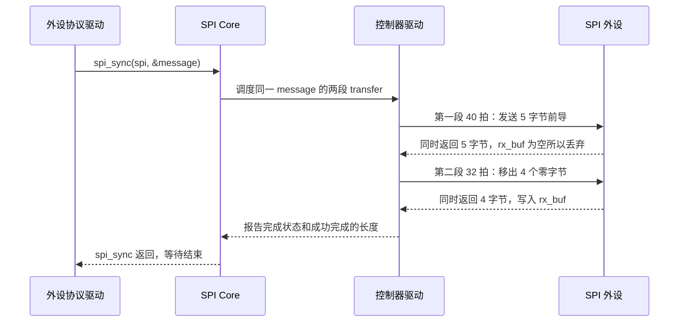

<div class="reader-b2" markdown="1">

# 手工双段 message：5＋4 字节怎样完成并释放

> 所属章节：第五部 B. 总线协议 > B-B.4 SPI 总线 > B-B.4.3 SPI Linux 驱动框架
>
> 本组阅读：第 3 页，共 6 页

本页只回答一个问题：**两个 spi_transfer、缓冲区和 message 怎样组织一笔读取，并在成功或失败后正确返回？**

---

## <span class="blue"> 本节导读

上一页已经说明 `spi_device` 由 SPI Core 根据设备树创建，并在匹配成功后作为参数进入协议驱动的 `probe()`。本页从这个已有对象继续向下：驱动从地址 `0x001234` 发起一次只读 Fast Read，先发送 5 字节前导，再接收 4 字节数据。

本节覆盖：一笔 5＋4 字节读取怎样拆成两段 transfer，为什么线上总共仍有 72 个时钟，发送与接收缓冲区分别怎样生效，`spi_sync()` 如何提交和返回，以及所有出口怎样释放资源。

> `spi_transfer`：一段具有独立发送缓冲区、接收缓冲区和长度的传输描述。每段移入和移出的位数相同；`tx_buf == NULL` 时移出零，`rx_buf == NULL` 时丢弃同时移入的数据。

<!-- -->

> `spi_message`：由一组按顺序执行的 transfer 组成的总线事务。它记录事务的总长度、成功完成的字节数和最终状态；在一个 message 完成前，其他 message 不能插入占用这条 SPI 总线。

手工构造这两个对象，是为了看清便捷封装背后的段边界、缓冲区方向和返回值。完整教学模块不是 Rockchip 控制器驱动或 spi-nor 源码的节选，也不替代产品级 Flash 管理；它只在可睡眠的进程上下文中同步执行一次受控读取。

### 5＋4 字节为什么对应 72 拍

本例采用 8 位字长。`0x0b` 是 Fast Read 操作码，随后是 24 位地址和 8 个 dummy 时钟。dummy 表示外设需要的一段准备时间，控制器仍须继续提供时钟，但这一个空字节不承载地址或读回数据。

前导因此占 5 字节：1 字节操作码、3 字节地址和 1 字节 dummy。读取阶段再交换 4 字节，总共是 `(5 + 4) × 8 = 72` 个 SCLK 周期。

SPI 是全双工总线：每个时钟都在 MOSI 上移出一位，同时在 MISO 上移入一位。第一段只关心 MOSI 上的前导，所以不提供接收缓冲区，5 个同时移入的字节被丢弃。第二段只关心 MISO 上的数据，所以不提供发送缓冲区，控制器继续移出 4 个零字节并保存同时移入的 4 字节。第二段不是“只开接收、关闭时钟”，而是用零填充发送方向来取得接收时钟。

| 所属 transfer | 长度 | MOSI 上移出的内容 | MISO 上同时移入的内容 | 时钟数 |
|---|---:|---|---|---:|
| `transfers[0]` | 5 字节 | `0b 00 12 34 00` | 5 字节，驱动不保存 | 40 |
| `transfers[1]` | 4 字节 | `00 00 00 00` | 4 字节，保存到 `rx_buf` | 32 |
| 整个 message | 9 字节 | 两段连续发送 | 只有后 4 字节作为结果 | 72 |

这里的 9 是请求的总字节数，72 是 8 位字长下的时钟数，两者都不是 `spi_sync()` 的返回值。表中发送内容已经由地址 `0x001234` 唯一确定；四个接收字节取决于实际器件和运行环境，本页不预设它们的数值。

---

## <span class="blue"> 先建立描述符，再挂上两段缓冲区

驱动需要自己管理 message、transfer 和数据缓冲区的生命期。`message` 与 `transfers` 描述“要做什么”，`tx_buf` 与 `rx_buf` 保存“线上交换什么”；它们可以位于不同内存中，但都必须在 SPI Core 使用期间保持有效。

本例把 message 和两个 transfer 放在栈上，把数据缓冲区交给 `kzalloc()` 分配。后者分配并清零内核内存，`GFP_KERNEL` 表示分配时允许睡眠，符合 probe 同步读取的上下文。缓冲区采用 kmalloc 族分配，使 SPI Core 能在控制器需要时对其进行 DMA 映射。

> DMA：直接内存访问。控制器可在不逐字节占用 CPU 的情况下搬运数据；协议驱动不必自己建立 DMA 映射，但必须提供符合 SPI Core 映射要求的缓冲区，并保持其生命期。

入口先拒绝超过 24 位的地址，再分配两个缓冲区。任何一次分配失败都返回 `-ENOMEM`：`-ENOMEM` 表示内存不足，`-EINVAL` 表示传入参数不合法。两者都是负错误码，不会被误当成传输长度。

```c
// spi_frame_observer.c · spi_frame_observer_read() 开头（节选）
if (address > 0xffffff)
    return -EINVAL;

tx_buf = kzalloc(OBSERVER_CMD_LEN, GFP_KERNEL);
rx_buf = kzalloc(OBSERVER_DATA_LEN, GFP_KERNEL);
if (!tx_buf || !rx_buf) {
    ret = -ENOMEM;
    goto out_free;
}
```

两次分配都会执行，因此无论哪一个失败，两个指针都已有确定的返回值。`kfree()` 接受空指针，统一的 `out_free` 可以释放已经成功的分配，同时安全跳过失败的分配。地址检查发生在分配之前，所以该出口不需要清理。

地址合法且两个缓冲区都就绪后，驱动写入前导并设置段描述符：

```c
// spi_frame_observer.c · 前导与两段 transfer（节选）
tx_buf[0] = 0x0b;
tx_buf[1] = (address >> 16) & 0xff;
tx_buf[2] = (address >> 8) & 0xff;
tx_buf[3] = address & 0xff;
tx_buf[4] = 0x00;              /* 8 个 dummy 时钟 */

transfers[0].tx_buf = tx_buf;
transfers[0].len = OBSERVER_CMD_LEN;
transfers[1].rx_buf = rx_buf;
transfers[1].len = OBSERVER_DATA_LEN;
```

三次移位和掩码把 32 位整数中的低 24 位拆成高字节在前的三个线上字节。以 `0x001234` 为输入，结果就是 `00 12 34`；这与设备树或控制器的寄存器地址无关，它是本次 Fast Read 命令中的外设内部地址。

`transfers` 在声明时零初始化。未显式设置的 `speed_hz` 和 `bits_per_word` 保持 0，表示继承 `spi_device` 的默认速度与字长；`cs_change` 也为 0，本例不在第一段结束后主动改变片选。通常，片选从 message 开始保持到最后一段结束，避免把一笔器件命令拆成互不连续的操作。

---

## <span class="blue"> spi_sync 提交整个事务，而不是逐段返回字节数

两段描述符还不能自行执行。`spi_message_init()` 先清零 message 并初始化其中的链表，`spi_message_add_tail()` 再把 transfer 的链表节点按调用顺序追加到 message。第一段必须先于第二段，因为外设只有收齐操作码、地址和 dummy 后，才会进入本例所需的数据返回阶段。

```c
// spi_frame_observer.c · 初始化、排序与同步提交（节选）
spi_message_init(&message);
spi_message_add_tail(&transfers[0], &message);
spi_message_add_tail(&transfers[1], &message);

/* 同步返回前，栈上的 message 和 transfers 始终有效。 */
ret = spi_sync(spi, &message);
```

`spi_sync()` 的参数分别是上一页已经建立的 `spi_device` 和当前事务的 message。它建立在 SPI Core 的异步原语之上，但会让调用者睡眠等待完成，因此只能用于可睡眠上下文。等待期间，当前函数不会返回，栈上的 message 和 transfer 不会失效，两个堆缓冲区也仍由当前函数持有。



读图时沿一次提交向下，不要把两段理解成两次独立调用。控制器按 message 中的顺序执行它们，Core 在完成后汇总状态。删除这张图后，上文关于 40＋32 拍、缓冲区方向和同步等待的文字仍给出同一条完整路径。

若改用 `spi_async()`，调用者可以先返回，完成结果通过回调通知。那时必须重新安排生命期：message、transfer 和缓冲区都不能在完成回调之前出栈或被释放。本例使用同步接口，所以不需要额外的完成回调和引用计数。

### 返回值、完成长度和有效数据是三个判断

`spi_sync()` 返回 **0 表示事务成功，负值表示错误**，不返回本次传输的 9 字节。message 中的 `actual_length` 才是各成功段累计完成的字节数；完整执行本例后应为 `5 + 4 = 9`。

```c
// spi_frame_observer.c · 判断结果并交付接收数据（节选）
ret = spi_sync(spi, &message);
if (ret < 0)
    goto out_free;

if (message.actual_length != OBSERVER_CMD_LEN + OBSERVER_DATA_LEN) {
    ret = -EIO;
    goto out_free;
}

memcpy(data, rx_buf, OBSERVER_DATA_LEN);

out_free:
kfree(rx_buf);
kfree(tx_buf);
return ret;
```

判断顺序不能颠倒。返回负值时，不能推断 4 字节结果已经完整有效，直接清理并把这个错误交给调用者。返回 0 后还要核对 `actual_length`；若长度不是 9，代码把结果转换为 `-EIO`，表示本次 I/O 没有得到预期的完整事务，同样不交付接收数据。

只有“返回 0 且完成长度为 9”才进入 `memcpy()`，把内核接收缓冲区中的 4 字节复制到 probe 提供的 `data` 数组。复制只改变结果存放位置，不产生额外 SPI 时钟。

`out_free` 是成功与失败共用的出口。堆缓冲区在这里释放；栈上的 message 和 transfer 随函数返回自然失效，不需要调用 `kfree()`。spi-nor、MTD 等上层栈不参与这笔教学读取，也不承担本函数的清理责任。

---

## <span class="blue"> 完整教学驱动：从 probe 发起读取到统一清理

配套源码：[`spi_frame_observer.c`](code/B-B.4.3/spi_frame_observer.c){: data-code-viewer="true" data-code-title="spi_frame_observer.c" data-code-path="本篇教学配套 · code/B-B.4.3/spi_frame_observer.c"}。以下是同一文件的完整内容，面向 Linux v6.6 SPI 外设协议驱动模型；它不是可直接在用户态编译的程序。

```c
// SPDX-License-Identifier: GPL-2.0
/*
 * Linux v6.6 SPI framework teaching example.
 *
 * This is a read-only protocol observer for a controlled W25Q128JV setup.
 * It is not a replacement for the in-kernel spi-nor/MTD driver stack.
 */
#include <linux/errno.h>
#include <linux/module.h>
#include <linux/of.h>
#include <linux/slab.h>
#include <linux/spi/spi.h>
#include <linux/string.h>

#define OBSERVER_CMD_LEN  5
#define OBSERVER_DATA_LEN 4

static int spi_frame_observer_read(struct spi_device *spi, u32 address,
				   u8 *data)
{
	struct spi_transfer transfers[2] = { };
	struct spi_message message;
	u8 *tx_buf;
	u8 *rx_buf;
	int ret;

	if (address > 0xffffff)
		return -EINVAL;

	/* kmalloc-family buffers can be mapped by the SPI core if DMA is used. */
	tx_buf = kzalloc(OBSERVER_CMD_LEN, GFP_KERNEL);
	rx_buf = kzalloc(OBSERVER_DATA_LEN, GFP_KERNEL);
	if (!tx_buf || !rx_buf) {
		ret = -ENOMEM;
		goto out_free;
	}

	/* Fast Read: opcode, 24-bit address, then eight dummy clocks. */
	tx_buf[0] = 0x0b;
	tx_buf[1] = (address >> 16) & 0xff;
	tx_buf[2] = (address >> 8) & 0xff;
	tx_buf[3] = address & 0xff;
	tx_buf[4] = 0x00;

	/* Segment 0 sends the command and ignores simultaneous MISO data. */
	transfers[0].tx_buf = tx_buf;
	transfers[0].len = OBSERVER_CMD_LEN;

	/* Segment 1 shifts out zeroes and captures four simultaneous MISO bytes. */
	transfers[1].rx_buf = rx_buf;
	transfers[1].len = OBSERVER_DATA_LEN;

	spi_message_init(&message);
	spi_message_add_tail(&transfers[0], &message);
	spi_message_add_tail(&transfers[1], &message);

	/* Stack-held message/transfer descriptors live until spi_sync returns. */
	ret = spi_sync(spi, &message);
	if (ret < 0)
		goto out_free;

	if (message.actual_length != OBSERVER_CMD_LEN + OBSERVER_DATA_LEN) {
		ret = -EIO;
		goto out_free;
	}

	memcpy(data, rx_buf, OBSERVER_DATA_LEN);

out_free:
	kfree(rx_buf);
	kfree(tx_buf);
	return ret;
}

static int spi_frame_observer_probe(struct spi_device *spi)
{
	u8 data[OBSERVER_DATA_LEN] = { };
	int ret;

	dev_info(&spi->dev,
		 "matched: cs=%u, mode=0x%x, max_speed_hz=%u, bits_per_word=%u\n",
		 spi->chip_select, spi->mode, spi->max_speed_hz,
		 spi->bits_per_word);

	ret = spi_frame_observer_read(spi, 0x001234, data);
	if (ret < 0) {
		dev_err(&spi->dev, "fast_read failed: ret=%d\n", ret);
		return ret;
	}

	dev_info(&spi->dev,
		 "fast_read: ret=0, addr=0x001234, data=%02x %02x %02x %02x\n",
		 data[0], data[1], data[2], data[3]);

	return 0;
}

static void spi_frame_observer_remove(struct spi_device *spi)
{
	dev_info(&spi->dev, "unbound\n");
}

static const struct of_device_id spi_frame_observer_of_match[] = {
	{ .compatible = "kimi,spi-frame-observer" },
	{ }
};
MODULE_DEVICE_TABLE(of, spi_frame_observer_of_match);

static struct spi_driver spi_frame_observer_driver = {
	.driver = {
		.name = "spi_frame_observer",
		.of_match_table = spi_frame_observer_of_match,
	},
	.probe = spi_frame_observer_probe,
	.remove = spi_frame_observer_remove,
};
module_spi_driver(spi_frame_observer_driver);

MODULE_AUTHOR("Embedded Knowledge System V2026");
MODULE_DESCRIPTION("Read-only SPI framework teaching observer");
MODULE_LICENSE("GPL");
```

`u8` 和 `u32` 分别是 8 位、32 位无符号整数，用来明确地址和字节缓冲区的大小。`linux/errno.h` 提供本例的负错误码，`linux/slab.h` 提供分配与释放接口，`linux/string.h` 提供 `memcpy()`，`linux/spi/spi.h` 提供本页的 SPI 对象和提交接口。`linux/of.h` 与 `linux/module.h` 支持设备树匹配和模块注册。

probe 先用 `dev_info()` 记录匹配结果和当前设备配置，再以固定地址调用读取函数。读取失败时，`dev_err()` 记录负错误码，probe 原样返回它，设备模型据此判定绑定失败；成功时才打印四个有效数据字节并返回 0。

`of_device_id` 表中的 `compatible` 与上一页教学 DTS 节点对应。`MODULE_DEVICE_TABLE(of, ...)` 导出这张匹配表，使用户空间模块自动加载机制能够识别它；`module_spi_driver()` 生成模块加载时注册、卸载时注销 `spi_driver` 所需的样板。它们负责模块与驱动生命周期，不改变本例的 5＋4 字节帧格式。

设备解绑时调用 `remove()`。本例的传输缓冲区早在每次读取函数返回前已经释放，probe 没有留下需要跨解绑保存的资源，所以 `remove()` 只记录 `unbound`，不再次释放缓冲区。

---

## <span class="blue"> 正常路径、失败路径与验证边界

把固定输入 `0x001234` 沿代码走一遍，可以得到以下可检查结论：

1. 地址没有超过 `0xffffff`，不会触发 `-EINVAL`。
2. 分配成功后，发送缓冲区为 `0b 00 12 34 00`，第一段长度是 5。
3. 第二段长度是 4，只提供 `rx_buf`，用 32 拍接收 4 字节。
4. 两段合计 72 拍；完整成功时 `spi_sync()` 返回 0，`actual_length` 为 9。
5. 成功路径复制 4 字节，probe 打印 `ret=0` 和实际接收值；失败路径不复制，也不打印伪造的成功数据。
6. 所有经过分配阶段的出口都执行两次 `kfree()`；无论错误来自分配、提交还是长度检查，都不会遗留这两个缓冲区。

正常日志中的地址和 `ret=0` 是确定的，但 `data=` 后的四个十六进制字节是实际设备响应，不能写成固定常量。失败日志中的 `ret=` 也应保留真实负错误码，例如分配失败时为 `-ENOMEM`，完整长度不符时为 `-EIO`；具体控制器或总线错误则由底层执行结果决定。

本页源码入口用于核对对象语义和代码路径：[`include/linux/spi/spi.h:901-1222,1341-1374`](code/B-B.4.3/kernel-v6.6/include/linux/spi/spi.h){: data-code-viewer="true" data-code-title="spi.h" data-code-path="Linux v6.6 · include/linux/spi/spi.h" data-code-lines="901-1222,1341-1374"}。其中 transfer 注释给出全双工和空缓冲区规则，message 定义给出完成长度与状态字段，内联函数给出初始化和追加顺序，同步接口注释说明可睡眠及返回语义。

本页只证明教学代码如何使用这些接口，不把源码审阅当成编译、上板或器件数据正确性的证明。实际观察还依赖板级 DTS、控制器与外设连接、内核构建和真实设备响应；没有这些证据时，不能从“代码路径完整”推出“某块板卡已经读到指定数据”。

[在新窗口打开 SPI Framework Lab](./html/spi-framework-lab.html#mechanism){: target="_blank" rel="noopener noreferrer" }。在实验室中对照双段提交、实际完成长度、返回值和缓冲区释放；实验室用于跟随对象和状态，不替代硬件测量。

## <span class="blue"> 本页总结

手工双段 message 的价值，是把一笔读取拆成可逐一核对的描述符、缓冲区和结果判断。5＋4 字节在 8 位字长下始终对应 72 拍，但只有返回值为 0 且 `actual_length` 为 9 时，后 4 字节才作为有效结果交付。同步提交让栈上描述符的使用边界清楚，统一出口则保证正常与错误路径都不会遗留堆缓冲区。

## <span class="blue"> 本页自查

??? details "Q3. 为什么本例的第二段只设置 `rx_buf`，却仍会占用 SCLK？"

    SPI 每拍同时移入和移出一位，不存在只接收而不提供时钟的模式。`tx_buf == NULL` 时，Core 的语义是移出零并填充 `rx_buf`。第二段长度 4、字长 8 位，因此产生 32 个时钟并取得 4 个 MISO 字节；两段合计 72 拍。

??? details "Q4. 一笔成功读取的返回值和 `actual_length` 分别应是多少，失败后数据与资源怎样处理？"

    `spi_sync()` 成功返回 0，不返回 9。两段长度分别为 5 和 4，全部成功后 `message.actual_length` 为 9。负返回值或完成长度不为 9 时，代码不复制接收数据；无论成功还是失败，两个堆缓冲区都在统一出口释放，负错误码继续交给 probe 和设备模型。

---

[上一页：DTS 建链](B-B.4.3_SPI Linux驱动框架_startup.md) · [下一页：Core 与 Rockchip 执行](B-B.4.3_SPI Linux驱动框架_execution.md)

</div>
