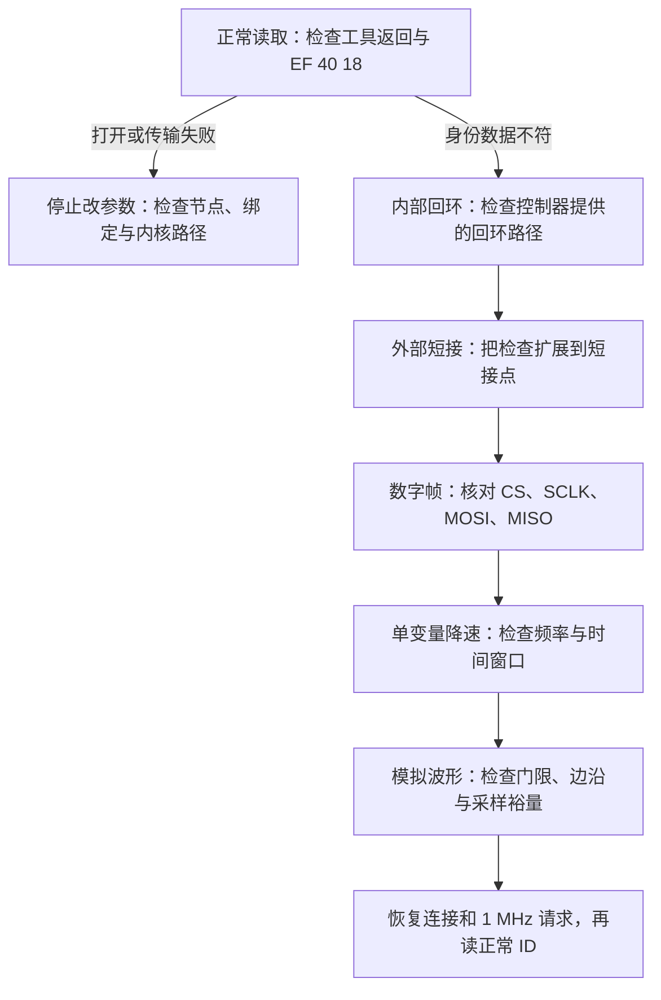

<div class="reader-b2" markdown="1">

# B-B.4.4 SPI 调试与选型

> 所属章节：第五部 B. 总线协议 > B-B.4 SPI 总线
>
> 本组阅读：第 1 页，共 2 页
>
> 难度：[B→I] Beginner → Intermediate | 预计阅读时间：40 分钟

## <span class="blue"> 本节导读

B-B.4.1～B-B.4.3 已经分别建立 SPI 的位流、事务帧和 Linux 传输路径。现在沿用同一个 RK3568 SPI1 与 W25Q128JV-IQ/JQ，回答一个调试问题：**怎样先完成一笔答案已知的 JEDEC ID 读取，再在结果异常时，逐层判断证据已经覆盖到哪里、下一步该观察什么？**

JEDEC ID 是器件按 JEDEC 标准返回的身份标识。本例固定为 Mode 0、8 位、MSB-first、低有效 CS 和 1 MHz 请求速率：

```text
MOSI：9F 00 00 00
MISO：?? EF 40 18
拍数：8 拍命令 + 24 拍响应 = 32 拍
```

`0x9F` 是 Read JEDEC ID 命令，后三个 `00` 只用于继续提供时钟。`??` 表示命令阶段的接收值不参与身份判断，不要求它等于 `00` 或 `FF`。根据 [W25Q128JV Rev F 手册](images/W25Q128JV_RevF.pdf)，`EF` 是 Winbond 制造商 ID，`40 18` 是本例 IQ/JQ 后缀的 Device ID；IM/JM 后缀对应 `70 18`，不能混用预期答案。

本节覆盖：先走通一次 `spidev_test` 正常读取，再用内部回环和外部短接缩小范围，用数字帧区分协议与软件问题，用单变量降速检查时间窗口，最后用示波器核对模拟条件并恢复基线。帧格式和时序细节归 B-B.4.2，设备创建与驱动匹配归 B-B.4.3，正式产品接入与烧录归 B-B.4.5；速率与接口选择由下一页承接。

## <span class="blue"> 先看清调试路径与证据边界

> spidev：把 SPI 设备暴露为 `/dev/spidevB.C` 字符设备的内核驱动。B 是总线号，C 是片选号；用户态程序通过 `open()` 打开节点，通过 `ioctl()` 配置并发起传输。

本例的一次用户态读取仍沿 B-B.4.3 的分层前进：`spidev_test` 准备四字节发送（TX）与接收（RX）缓冲区，spidev 把请求交给 SPI Core，RK3568 控制器驱动产生 CS、SCLK 和双向位流，Flash 返回身份字节，接收数据再沿原路回到用户缓冲区。调试不是另换一个对象，而是在这条路径上选择不同的观察点。

下图先给出整条的排障顺序。内部回环、外部短接、逻辑分析仪和示波器覆盖的范围不同；每一步都只缩小候选范围，不能代替最后恢复正常事务。



实际执行时可以停在已经足以定位问题的一步。例如，打开字符设备失败时还没有发起总线传输，不必短接引脚；线上已经解出正确 ID 而用户缓冲区错位时，应先查软件交付位置，不必先怀疑走线。

## <span class="blue"> 先建立可判定的正常基线

### 确认这是可以安全访问的测试节点

本节的正常路径是**受控工具验证**，不是正式 Flash（闪存）产品访问方式。开始前必须同时满足：

1. 使用专用测试节点 `spi1.0`，其驱动已经绑定为 `spidev`，字符设备为 `/dev/spidev1.0`。
2. 当前节点没有同时绑定 spi-nor（内核的 SPI NOR Flash 驱动）或其他协议驱动。不要在现场启动盘、已挂载根文件系统或其他业务正在访问的 Flash 上换绑驱动。
3. 原理图确认 SPI1 CS0 确实连接本例 W25Q128JV-IQ/JQ，供电、共地、CS、MOSI、MISO 和必要的状态引脚符合器件手册。
4. 当前账户有权读取 sysfs（内核导出设备对象与属性的文件系统）、打开字符设备并执行 `spidev_test`。工具取自 Linux v6.6 的 [`tools/spi/spidev_test.c`](https://github.com/torvalds/linux/blob/v6.6/tools/spi/spidev_test.c)，目标系统应使用与其内核 UAPI（用户态与内核之间的接口约定）兼容的构建版本。

先检查绑定和字符设备。`readlink` 读取驱动符号链接，`basename` 去掉目录部分，`test -c` 检查路径是否为字符设备；紧随其后的 `printf` 保存并打印这次检查的退出状态：

```bash
basename "$(readlink /sys/bus/spi/devices/spi1.0/driver)"
test -c /dev/spidev1.0
printf 'char_device_check=%d\n' "$?"
```

满足前提时，完整预期输出为：

```text
spidev
char_device_check=0
```

`spidev` 证明当前绑定驱动名称，`0` 证明 `test -c` 成功。若 `readlink` 报错、名称不是 `spidev` 或字符设备不存在，应停止后续传输，按 B-B.4.3 检查控制器注册、设备创建和驱动匹配。设备存在与驱动绑定是两个阶段，不能用“没有 `/dev`”反推器件没有上电。

### 用同一笔 0x9F 读取确认正常结果

下面的 `-D` 选择设备，`-s 1000000` 设置 1 MHz 请求上限，`-p` 给出四个发送字节，`-v` 打印收发缓冲区。工具还会显式写入并读回 Mode 0、8 位字长和请求速率；单个 `SPI_IOC_MESSAGE(1)` 让四字节处于同一笔全双工传输。参数解析、传输和打印逻辑可在前文所链的 v6.6 `spidev_test.c` 中回查。

```bash
spidev_test -D /dev/spidev1.0 -s 1000000 -p '\x9f\x00\x00\x00' -v
printf 'exit=%d\n' "$?"
```

TX 是发送缓冲区，RX 是接收缓冲区，`RX[n]` 表示从 0 开始编号的接收字节。以下输出依据 v6.6 工具的打印逻辑和本器件手册推演，**不是当前板卡实测**。为展示完整格式，假设命令阶段的 `RX[0]` 恰好为 `00`；它不是身份判据，实际也可以是其他值。

```text
spi mode: 0x0
bits per word: 8
max speed: 1000000 Hz (1000 kHz)
TX | 9F 00 00 00 __ __ __ __ __ __ __ __ __ __ __ __ __ __ __ __ __ __ __ __ __ __ __ __ __ __ __ __ |....|
RX | 00 EF 40 18 __ __ __ __ __ __ __ __ __ __ __ __ __ __ __ __ __ __ __ __ __ __ __ __ __ __ __ __ |..@.|
exit=0
```

前三行是工具配置后读回的软件状态。`spi mode: 0x0` 表示 Mode 0，未设置 CPOL、CPHA、LSB-first 等附加位；若控制器改写了请求模式，工具会先打印警告。`bits per word: 8` 使本例四字节对应 32 拍。`max speed` 只是请求上限，不是引脚实测频率；[spidev UAPI 文档](https://github.com/torvalds/linux/blob/v6.6/Documentation/spi/spidev.rst)明确说明，用户态不能通过该接口取得实际移位速率。

TX/RX 两行才对应这笔事务。真正用于身份判断的是 `RX[1]=EF`、`RX[2]=40`、`RX[3]=18`，`RX[0]` 不参与判断。每行末尾的 `__` 是工具把不足 32 字节的显示行补齐，竖线后是 ASCII 显示；不可打印字节显示为点，`0x40` 因而显示为 `@`。这些填充不是总线上额外的数据。

最后的 `exit=0` 由 shell 打印，表示工具正常返回。它不能单独作为器件正常的判据，原因有两层：

- SPI 没有低层 ACK（Acknowledgement，接收确认），控制器完成位移不等于 Flash 已理解命令，更不能把工具失败解释成从设备返回了 NACK（Negative Acknowledgement，否定应答）。
- v6.6 工具只把传输 ioctl 返回值小于 1 视为失败，不向用户打印实际完成长度；普通 `-p` 路径也不会自动比较 TX/RX。短传输或错误的身份数据不能靠退出状态排除。

因此，**正常基线必须同时满足工具成功返回和有效位置的 ID 与器件后缀一致**。即便如此，它也只证明本次条件与本次读取，不证明其他速率、其他板卡或长期运行可靠。

若打开设备失败，程序自身的典型错误行是：

```text
can't open device: No such file or directory
```

这行只说明本次 `open()` 失败。v6.6 工具在打开、配置或传输失败时通过 `perror()` 打印原因并调用 `abort()`，失败退出状态不应写成固定值；shell 对 `abort()` 的附加诊断也随环境变化。此时先检查节点、权限和绑定，不要继续改模式或短接引脚。

## <span class="blue"> 用回环缩小范围，但不夸大证据

正常基线未得到预期 ID 时，回环把外设协议答案暂时换成“发出什么，应收什么”。这样可以将控制器与传输路径同 Flash 的命令响应分开，但两种回环的证据终点不同。

### 内部回环：检查控制器提供的回环路径

`-l` 设置 `SPI_LOOP`，`-S 4` 让工具生成四字节测试数据，`-I 1` 只执行一次。这里特意不用普通 `-p`：v6.6 [`spidev_test.c` 的 `transfer_buf()`](https://github.com/torvalds/linux/blob/v6.6/tools/spi/spidev_test.c) 在 `-S` 所走的随机缓冲区路径中，只有设置 `SPI_LOOP` 后才逐字节比较 TX/RX；不一致时打印 `transfer error !` 并以 1 退出。RK3568 控制器驱动在 [`spi-rockchip.c:856`](code/B-B.4.3/kernel-v6.6/drivers/spi/spi-rockchip.c){: data-code-viewer="true" data-code-title="spi-rockchip.c" data-code-path="Linux v6.6 · drivers/spi/spi-rockchip.c" data-code-lines="856"} 的 `mode_bits` 中声明支持 `SPI_LOOP`。

```bash
spidev_test -D /dev/spidev1.0 -s 1000000 -l -S 4 -I 1
printf 'exit=%d\n' "$?"
```

若控制器接受回环模式、比较一致且本次执行未跨越工具的 5 秒统计间隔，完整预期输出为：

```text
spi mode: 0x20
bits per word: 8
max speed: 1000000 Hz (1000 kHz)
total: tx 0.0KB, rx 0.0KB
exit=0
```

`0x20` 是 `SPI_LOOP` 模式位，CPOL/CPHA 仍为 0。`0.0KB` 是四字节除以 1024 后保留一位小数的结果，不表示没有传输。测试数据由 C 库的 `random()` 生成，本条命令没有 `-v`，所以不打印其内容；自动比较失败时打印的 TX/RX 也随数据而变，不能伪造一组固定失败输出。

**内部回环成功只支持当前控制器回环配置和传输路径可工作，不证明外部引脚、焊接、连接线、CS 或 Flash 正常。**若出现模式不支持警告、传输失败或数据比较失败，先保留工具原始错误并检查控制器配置，不要把责任推给外设。后续正常命令不带 `-l`，工具会重新写入 Mode 0，避免让 `SPI_LOOP` 混入下一项对照。

### 外部短接：证据停在短接点

若内部回环正常而真实读取仍失败，可用外部短接继续检查板级收发路径。先在断电条件下，将指定测试点的 MOSI 与 MISO 短接，并隔离可能同时驱动 MISO 的 Flash。若保持 Flash 的数据输出引脚 DO 与主机 MOSI 对接，两个推挽输出可能争用，不能把这种接法当作无风险测试。

短接点位于控制器测试焊盘、连接器还是器件引脚附近，决定了哪些线段被覆盖。恢复供电后，沿用正常命令但不加 `-l`：

```bash
spidev_test -D /dev/spidev1.0 -s 1000000 -p '\x9f\x00\x00\x00' -v
printf 'exit=%d\n' "$?"
```

此时预期 RX 与 TX 都是 `9F 00 00 00`。普通 `-p` 路径不会自动比较，必须人工或脚本逐字节核对。相等只说明短接点以内、当前配置下的收发路径一致，不能证明 Flash 会回答，也不能证明另一速率或其他 CS 正常。

结束后必须断电、移除短接、恢复器件连接，再重新执行一次正常 JEDEC ID 读取。若重新得到 `EF 40 18`，本次隔离与恢复已经形成闭环；若仍不正常，保持恢复后的正常接线，进入数字帧观察。**回环是隔离步骤，恢复正常事务才是收尾判据。**

## <span class="blue"> 让异常回到协议和电气机制

### 全 00、全 FF：先确认线路是否静止，再列候选机制

在本例有效响应位置，全 `00` 或全 `FF` 都不符合 IQ/JQ 后缀的 `EF 40 18`，但它们不指向唯一根因。MISO 可能因上拉、下拉或输入默认状态保持固定电平，也可能因 CS 未选中、器件未就绪、DO 高阻、接线错误、采样配置错误或器件实际返回固定数据而呈现相同结果。普通数据读取中的全 `FF` 甚至可能是擦除后的合法内容，不能脱离命令语义判断。

此时最有区分度的下一项证据是完整数字帧。逻辑分析仪从 CS 有效开始捕获，解码器按手册和可观察信号设置为 Mode 0、MSB-first，而不是反复切换参数直到结果“看起来合理”。采样率、触发和存储深度应能覆盖完整 32 拍，具体设置取决于仪器带宽和捕获条件，不使用统一倍数代替测量条件。

沿同一笔读取，观察结果可以这样分流：

- MOSI 上没有 `9F 00 00 00`：先查用户缓冲区、控制器、pinctrl（引脚复用配置）和片选路径。
- MOSI 正确而 CS 未覆盖 32 拍：先查 CS 配置、映射和事务边界。
- CS、SCLK、MOSI 都符合预期而 MISO 始终不动：再查器件供电、复位、DO 驱动权和输入门限。
- 线上已经出现 `EF 40 18` 而用户缓冲区不同：回查软件接收长度、偏移和交付路径。

上电就绪也必须按具体器件判断。W25Q128JV Rev F 的 `tVSL` 是器件达到最低工作电压 VCC(min) 后到允许拉低 CS 的时间，最小 20 μs；写指令另有不同的上电约束。不能把一次全 `00`／全 `FF` 直接归成固定毫秒延时问题，更不能在未读手册前随意加 `msleep()`（内核毫秒级睡眠函数）。

### 数据错位：分别检查采样位置、帧边界和软件偏移

本例没有地址和 dummy（器件规定的额外等待时钟），正常结构只有 8 拍命令与 24 拍响应。若逻辑分析仪在正确采样边沿得到 `EF 40 18`，而用户态结果整体移动，应检查软件是否错误解释了 `RX[0]` 或遗漏前导。若线上位流本身错位，则检查 CPHA 是否改变采样边沿、CS 是否提前结束事务、SCLK 是否出现额外跳变。

对于 [B-B.4.2 的 Fast Read 与缓冲区约定](B-B.4.2_SPI协议层与时序_buffer.md)，还要多检查命令、地址和 dummy 的前导拍数；不能把那条命令的 `RX[0]`／`RX[5]` 结论机械搬到本例 JEDEC ID。两篇事务不同，判别依据始终是“哪一拍进入有效数据、接口保留哪些接收字节”。

### 位序反转：用受控数据验证假设

MSB-first 与 LSB-first 描述每个字内部哪一端先上线。若把预期的 `EF 40 18` 逐字节反转位序，会得到 `F7 02 18`；`0x18` 恰好正反相同，因此前两个字节更有区分度。这组值只能形成位序假设，不能单独证明根因。

应回到已知发送数据的回环：内部回环检查当前控制器的位序路径，隔离后的外部短接再检查到短接点的线路。若受控 TX/RX 也呈逐位反转，才检查主从位序配置；若回环正确而器件响应异常，则继续检查器件手册要求的位序和实际帧。不要在普通通信中仅凭一个 `0x80` 就宣布 LSB/MSB 配错。

## <span class="blue"> 降速对照只回答频率是否相关

如果 1 MHz 下结果异常，数字帧又没有把问题定位到明确的软件偏移或帧边界，下一步可以只改变请求速率，观察故障是否随时间窗口变化。保持其他前提不变，将 1 MHz 改为 100 kHz：

```bash
spidev_test -D /dev/spidev1.0 -s 100000 -p '\x9f\x00\x00\x00' -v
printf 'exit=%d\n' "$?"
```

若本次成功，完整预期输出如下。仍假设不参与判断的 `RX[0]` 为 `00`，它不是实测值：

```text
spi mode: 0x0
bits per word: 8
max speed: 100000 Hz (100 kHz)
TX | 9F 00 00 00 __ __ __ __ __ __ __ __ __ __ __ __ __ __ __ __ __ __ __ __ __ __ __ __ __ __ __ __ |....|
RX | 00 EF 40 18 __ __ __ __ __ __ __ __ __ __ __ __ __ __ __ __ __ __ __ __ __ __ __ __ __ __ __ __ |..@.|
exit=0
```

除 `max speed` 变为 100 kHz 外，字段含义与正常基线相同。若高速时异常而这次恢复 `EF 40 18`，只能说明故障表现与频率或可用时间窗口相关。候选机制包括超过器件或控制器限制、Flash 输出有效延迟、走线传播、主机输入建立时间不足、边沿过慢、过冲和振铃，不能仅凭“低速能读”宣布走线或端接就是根因。

还要区分请求值与真实时钟。当前 RK3568 v6.6 驱动在 [`spi-rockchip.c:602-607`](code/B-B.4.3/kernel-v6.6/drivers/spi/spi-rockchip.c){: data-code-viewer="true" data-code-title="spi-rockchip.c" data-code-path="Linux v6.6 · drivers/spi/spi-rockchip.c" data-code-lines="602-607"} 中选择不小于理想值的偶数分频，使结果不超过请求速率。这个控制器事实不能推广为所有 SoC（System on Chip，片上系统），也不能代替引脚实测。

因此，降速后的下一项观察仍是两类证据：先用逻辑分析仪确认数字帧是否仍符合 32 拍，再用示波器在接收端附近检查真实电平和采样窗口。对照结束后，把 `-s` 恢复为 `1000000` 并重新执行正常基线命令，确认结果变化确实跟参数修改同时出现，而不是一次偶然成功。

升速或降速对照都遵守三条纪律：**一次只改一个参数；每项结果写明能支持什么、不能支持什么；结束后恢复原参数并复测正常 ID。**B-B.4.5 的提速验证沿用这三条纪律，不把一次低速成功当成永久修复。

偶发故障需要有限次数、明确判据的记录：每次都检查 ioctl 结果、有效 ID 和实际测试条件，再统计失败数。普通 `spidev_test -p` 不会自动比较数据，单纯用 `while true` 循环它并不能得到错误率。

## <span class="blue"> 数字帧与模拟波形各自回答什么

前面的逻辑分析仪证据回答的是数字关系：本例应从 CS 有效开始，确认 Mode 0 的空闲低、上升沿采样、32 个时钟、MOSI 的 `9F 00 00 00`，以及有效响应位置的 `EF 40 18`。数字解码正确，说明分析仪在自己的门限和采样条件下识别出了预期位流，不证明接收端具有充分模拟裕量。

示波器接手的是另一个问题：信号到达接收端时，是否仍满足器件和控制器要求的模拟条件。应在接收端附近观察 CS、SCLK 和相关数据线，按主从手册检查输入高低门限、过冲与下冲限制、边沿形态、输出有效到采样之间的窗口。`0.9 VCC` 或 `0.5 VCC` 在某些手册图中可能只是测量参考电平，不能直接当作所有器件的输入合格门限。

B-B.4.2 已给出 MISO 的时间预算，它把“降速为什么可能恢复”落到可检查的延迟项：

```text
启动边沿到采样边沿的间隔
≥ tCLQV(max) + 走线传播 + 主机建立时间 + 设计余量
```

`tCLQV(max)` 是 Flash 从启动边沿到输出有效的最坏延迟，走线传播取决于板级路径，主机建立时间要求数据在采样前保持稳定。降速增加左侧可用时间，却不会自动修复 CS 错误、位序错误或软件偏移；反过来，波形边沿漂亮也不能证明命令和器件应答正确。两类仪器各自提供一部分证据。

多从机场景还要加入驱动权检查：只选中目标 CS，其他从机应按各自手册释放 MISO。若某从机未释放，或设备树子节点的 `reg`（片选编号属性）把访问引到另一 CS，主机同样可能读到固定值或争用后的无效电平。电气机制见 B-B.4.1，DTS 的 CS 与设备对象关系见 B-B.4.3。

本文没有取得当前板卡的逻辑分析仪或示波器记录，以上均为验证方法和由手册、源码推出的预期，不是实测波形或实测频率。

**速查表**

| 当前证据 | 可以支持的结论 | 仍不能推出的结论 |
|---|---|---|
| `exit=0` 且 RX[1]～RX[3] 为 `EF 40 18` | 本次工具调用完成，本次身份数据匹配 IQ/JQ | 长期稳定、其他速率可靠、模拟裕量充分 |
| 内部回环比较一致 | 当前控制器回环路径可工作 | 外部引脚、接线、CS 和 Flash 正常 |
| 外部短接 TX=RX | 短接点以内的当前收发路径一致 | 从设备应答正确、整板设计可靠 |
| 降速后 ID 正确 | 故障与频率或时间窗口相关 | 根因必是走线、端接或某个固定参数 |
| 数字帧完整且正确 | 数字位流符合当前解码条件 | 接收端模拟门限和时序余量充分 |
| 正常事务在恢复后再次出现 | 本次恢复操作回到已知基线 | 后续所有访问都已验证 |

到这里，正常基线、分层隔离、异常判别、降速对照和仪器证据已经组成完整调试链。下一页再把这套证据用于速率与接口选择；若正在执行回环、短接或降速对照，应先按本页要求恢复原连接或参数并复测正常 ID。

---

[下一页：速率与接口选择](B-B.4.4_SPI调试与选型_selection.md)

</div>
